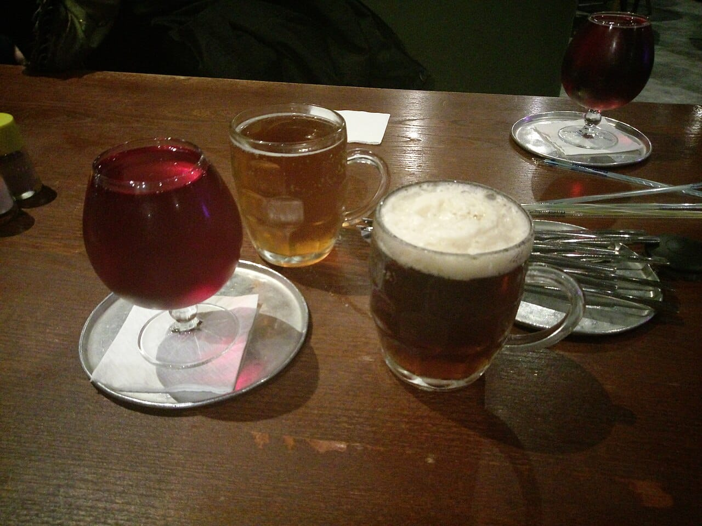

# Low-alcohol / Non-alcoholic Beer

Low-alcohol and non-alcoholic beer covers beers in which alcohol is held to a very low level or removed after brewing. Legal thresholds differ by country, and production splits into two routes: controlled fermentation and post-brew dealcoholisation. Flavours range from light grain and sweet malt to something close to a regular lager; the body is often thin, and the balance of residual sweetness against hop bitterness matters most.

Figure: Low-alcohol / Non-alcoholic Beer: Low-alcohol beer, Iran (Wikimedia Commons). Image: Freshman404, CC BY-SA 4.0, via Wikimedia Commons ([source page](https://commons.wikimedia.org/wiki/File:Low-alcohol_beer,_Iran.jpg)).

## Definition and boundaries

US TTB labelling rules draw precise lines. A malt beverage labelled "non-alcoholic" must carry the adjacent, clearly printed statement "contains less than 0.5% alcohol by volume"; "low alcohol" or "reduced alcohol" may be used only below 2.5% ABV; "alcohol free" requires that no alcohol be present. These are labelling rules, not the same threshold each country uses for taxing alcoholic drinks.

English official guidance splits alcohol-free alternatives into three bands: alcohol-free at no more than 0.05% ABV, dealcoholized between 0.05% and 0.5%, and low alcohol at no more than 1.2% ABV. Many EU countries set the alcohol-free line at 0.5% ABV; proposed NoLo categories also include 0.0% vol, no-alcohol, low alcohol at 0.5–1.2% vol, and reduced alcohol with at least a 30% drop versus a comparable product.

Tax thresholds follow differently: beer is taxed above 0.5% ABV in the US, Germany, Finland and the Netherlands, and above 1.2% ABV in the UK. Note that English light beer usually means a lower-carb, lower-calorie beer, a separate line from the non-alcoholic and low-alcohol category discussed here. The base ingredients of [beer](ref:beer) match regular beer; the difference is alcohol level and processing.

## History and naming

Attempts at dealcoholised beer date to the expansion of industrial brewing in the twentieth century, but early products were often worty and thin, closer to a sweet fizzy malt drink. The category grew rapidly only after the 2010s, driven by health, fitness and moderation trends, and alcohol-free beer became one of the fastest-growing drink directions.

The contemporary craft NA benchmark is America's Athletic Brewing, founded in 2017 by Bill Shufelt and brewer John Walker; its first dedicated NA brewery opened in Stratford, Connecticut, in 2018. Rather than dealcoholising a regular beer, the brewery ferments the wort fully but stops below 0.5% ABV. Its flagship Run Wild IPA uses five Northwestern hop varieties for citrus and pine notes.

By name, NA beer, alcohol-free beer, low-alcohol beer and dealcoholized beer each map to different thresholds; check the stated ABV on the label rather than the word "non-alcoholic" alone. A category rarely rises around one company alone; raw materials, equipment, tax rules and drinking habits shape it together.

## Materials and process

The base ingredients remain malted [barley](ref:barley), water, [hops](ref:hop) and yeast, and the chosen [fermentation](ref:fermentation) route sets the finished skeleton. The first route is controlled fermentation: cool fermentation, early interruption or special yeast keeps sugar conversion incomplete. It uses ordinary equipment, but the finished beer often keeps a worty sweetness, a thin body and an obvious malt flavour.

The second route is post-brew dealcoholisation. Vacuum distillation lowers the boiling point to about 30–35 °C under reduced pressure; alcohol evaporates first while most malt and hop aroma survives, and strength can be taken precisely below 0.05% ABV, suiting malty lagers and dark beers. Reverse osmosis pushes beer through a semipermeable membrane under pressure: water and alcohol pass through while large flavour compounds stay in the concentrate, preserving hop aroma, but it is not economical below about 0.45% ABV, and the beer needs re-carbonation afterwards.

The spinning cone column is the premium dealcoholisation standard. In two passes it first recovers an aroma fraction of roughly 3% of volume at about 60% alcohol, then dealcoholises the bulk liquid before blending the aroma back. A separate no-fermentation route blends malt extract, hop oil and water to reach 0.0% ABV. Dealcoholisation carries away some volatile aroma, so brewers compensate with dry hopping, malt recipe changes and aroma recovery.

## Style and palate

The flavour spectrum runs from light grain and sweet malt to something close to a regular lager or ale. The body is generally thinner than full-strength beer, and the balance of residual sugar against hop bitterness decides whether the beer drinks smoothly. Common faults are raw worty taste, watery thinness, metallic notes and cardboard-like oxidation, usually from incomplete fermentation, overheated dealcoholisation or storage oxidation.

By strength, market products fall into 0.0%, below 0.05%, below 0.5% and up to 1.2% bands, with carbonation levels that vary by process. Process differences show in the glass: dealcoholised lagers lean to malt sweetness, RO and spinning-cone versions keep more hop aroma, and arrested-fermentation examples are sweeter and thinner.

Tasting can separate sweetness, bitterness, aroma, body and fizz; one dimension standing out does not make a better beer, and balance plus a clean finish usually matter more than sheer intensity. Between different process lines of the same brand, the difference is often more worth comparing than the brand name.

## Representative regions and brands

Germany is an established NA beer country, with Bitburger 0.0 and the long-time NA specialist Clausthaler among familiar names; Heineken 0.0 comes from the Netherlands, Asahi Dry Zero from Japan, and Athletic Brewing is the contemporary American benchmark. Athletic's Run Wild IPA sits below 0.5% ABV and holds over half the US NA craft beer market, with a lineup spanning IPA, golden ale, dark beers and sours.

Big-brand 0.0 lines sell through mass retail at steady prices; craft small producers build NA versions around IPA, wheat and stout styles, and equipment and ingredient costs show up in pricing. A brand is only an entry point: raw-material grade, dealcoholisation method and freshness vary widely within the category, so read the label parameters before comparing products.

## How to drink and pair

NA and low-alcohol beer is best chilled to about 4–7 °C in an ordinary beer glass. It refreshes on its own and works with meals, fitting naturally into lunch, driving, before or after exercise and duty occasions where alcohol does not suit. Pairing does not need to accommodate the warmth of alcohol.

Match salty, grilled and fried snacks: fried chicken, grilled sausage, salted nuts, crisps and burgers all answer the malt sweetness and fizz. A light NA lager also suits seafood and simple dishes. Low alcohol means little alcoholic warmth on the palate; too cold and fruit and malt notes shut down together, so watch chilling time before pouring.

## Buying, storage and misreadings

On the label look for actual ABV: 0.0%, below 0.05% or below 0.5%, plus the ingredient list and date code. NA beer has a shorter shelf life than full-strength beer, and freshness directly affects flavour; store away from light and heat, and finish an opened bottle promptly rather than keeping it.

Common misreadings: non-alcoholic does not mean zero alcohol, since below-0.5% products still contain traces; colour depth and sweetness are not quality measures; "handmade", "traditional" and "small batch" are marketing words, not legal terms. Also keep in mind that light beer emphasises lower calories, a different route from the dealcoholisation discussed here.

## Further reading and see also

- Related: [beer](ref:beer), [fermentation](ref:fermentation), [distillation](ref:distillation), [barley](ref:barley), [hop](ref:hop).
- To map the category, start with one dealcoholised lager and one craft NA IPA, compare malt sweetness, hop bitterness and body, then try an arrested-fermentation or no-fermentation blended version.

For Low-alcohol / Non-alcoholic Beer, begin with the production rule. Then look at the strength, and finally ask the usual serving. The answers point to different choices, not to a single score.