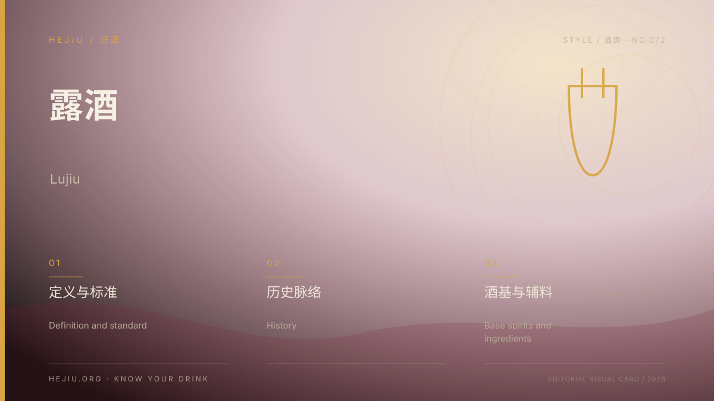

# Lujiu

Lujiu is a major branch of Chinese compounded liquor. Under GB/T 27588-2011, Lujiu, it is made from a base of distilled spirit, fermented wine or food-grade alcohol with edible or medicinal-and-food materials, blended, mixed or reprocessed, and the style of the base has been changed. It is a beverage, not a medicine.

Figure: thematic illustration for Lujiu. Image: AI-assisted illustration generated with Doubao Seedream 5.0 (project-owned); not a photograph of the subject.

## Definition and standard

The standard places lujiu within compounded liquor and sets requirements for base, materials, sensory and physicochemical indices. The Chinese character for dew in the name relates to traditional practice: aromatic or herbal materials were steeped in spirit, the infusion was drawn off and then blended to a recipe.

Lujiu is a class name, not a quality grade and not a promise of efficacy. Base, ingredients, alcohol content and type on the label are the direct information for judging a product; a drink that contains herbs but is not labelled lujiu does not necessarily belong to this class.

## History

The tradition of lujiu is tied to the idea that food and medicine share sources, to the use of spices and to seasonal drinking. Early texts already record steeping herbs or spices in wine; from the Ming and Qing periods onward, recipes and commercial production grew, and a number of regional lujiu emerged.

In the twentieth century, lujiu production was folded into the food industry and recipes and standards were gradually regulated. After reform and opening, lower alcohol and more varied flavours drove new products, while consumer interest in herbs and wellbeing made the market position of lujiu more complicated.

The character for dew also relates to Ming and Qing flower-distillation. A floral dew is an aromatic liquid distilled from scented plants with steam; a small amount added to a base lifts its aroma, a different extraction idea from steeping herbs directly in spirit. Rose dew and osmanthus dew existed in court and folk practice, and only later did they evolve into recipe-based commercial lujiu.

## Base spirits and ingredients

The base can be a distilled spirit such as [baijiu](ref:baijiu), a fermented wine such as yellow wine or wine, or food-grade alcohol. Different bases bring different bodies and aromas: a distilled base is clean and strong, a fermented base is more complex.

Materials include herbs, fruit, flowers, spices and sugar, many of them substances used both as food and as medicine. Their role is to supply aroma, flavour or colour, not therapeutic effect. Recipes and dosages belong to the producer, and public sources usually describe directions only.

## Process

Common lujiu processes are steeping, blending and redistillation. Steeping types soak materials in the base for a period to extract aroma and flavour, then filter and clarify; blending types mix base with sugar syrup, juice and spice extracts in proportion; redistillation types distil the steeped liquid to collect a cleaner aromatic fraction.

[Blending](ref:blending) decides the final style: the ratio of bases, extracts and syrup affects sweetness, aroma intensity and finish. Temperature, time and filtration affect extraction efficiency and stability, and they are key points of quality control.

When food-grade alcohol is the base, the alcohol itself must meet the national food-safety standard for edible alcohol (GB 31640); when baijiu or yellow wine is the base, the relevant product standard also applies. The base, ingredients, alcohol content and standard on the label are the keys to classification, not the mere presence of herbs.

## Flavour and types

Lujiu covers a wide flavour range: herbal types show plant, root and light bitter notes; fruit types stress the sweetness and acidity of fruit; spice types often show cinnamon, clove and citrus peel. The base style is partly masked but still affects body and aftertaste.

By recipe and flavour, common market types include herbal lujiu, fruit lujiu and floral lujiu. Zhuyeqing is one of the representative herbal lujiu products. Type describes the flavour source, not a grade; differences within one type remain clear.

## Tasting and serving

Start with the aroma to identify the main flavour source, then check whether base and materials are integrated, whether sweet and sour are balanced, and whether the finish is clean. Herbal types can be served at room temperature or with ice; fruit types suit chilling, and ice lowers aroma intensity but raises freshness.

Lujiu is often used before meals, with food or in cocktails. High-sugar products suit small servings, high-alcohol products need portion control. Judge strength by the [alcohol by volume](ref:abv) on the label, not by sweetness or colour. Excessive drinking is harmful to health, and minors should not drink.

## Common misconceptions

First, treating lujiu as medicinal liquor. Medicinal liquor falls under drug regulation, while lujiu is a beverage.
Second, believing lujiu has health benefits. Efficacy claims on labels and in marketing should not be taken at face value.
Third, calling every herb-containing drink lujiu. The category follows the label and the standard, not a guess from ingredients.
Fourth, assuming high sweetness means low alcohol. Sweetness and alcohol content do not determine each other.
Fifth, treating lujiu as a low-end product. Category has no direct link to price or quality.

For Lujiu, begin with the production rule. Then look at the strength, and finally ask the usual serving. The answers point to different choices, not to a single score.

**In brief:** A Chinese beverage made from a base of distilled spirit, fermented wine or food-grade alcohol with edible or medicinal-and-food materials, blended or reprocessed; GB/T 27588-2011 applies, and lujiu is not a medicinal liquor.

The usual confusion is to treat Lujiu as a particular brand. Check what it is first, then what the label claims; the two need not agree.

**Key facts.**

| Item | Detail |
| --- | --- |
| In one line | A Chinese beverage made from a base of distilled spirit, fermented wine or food-grade alcohol with edible or medicinal-and-food materials, blended or reprocessed; GB/T 27588-2011 applies, and lujiu is not a medicinal liq… |
| Parent style | Compounded liquor |

**Sources and limits.** The key claims about Lujiu are checked against the following sources: General Administration of Quality Supervision, Inspection and Quarantine, Standardization Administration of China (Searchable by standard number in the National Standards Full-Text Public System), State Administration for Market Regulation, Standardization Administration of China (Searchable by standard number in the National Standards Full-Text Public System; Used to check the scope, terminology and classification of GB/T 27588-2011; no text copied), Oxford University Press (Consulted for entries on flavoured wine traditions; no original text is reproduced; Migrated from the former reference list at the end of the article; access date not re-verified). Prices, batches and status change; the body is project-written and does not reproduce source text.

## Further reading

- [Compounded liquor](ref:compounded): the parent category of lujiu.
- [Baijiu](ref:baijiu): the most common distilled base.
- [Blending](ref:blending): recipe building and flavour balance.
- [Alcohol by volume](ref:abv): the basic concept behind label declarations.

## Related images

Image: Thematic illustration for Compounded liquor. Project-made bilingual editorial figure, not an on-site photograph. Related image for Lujiu.
