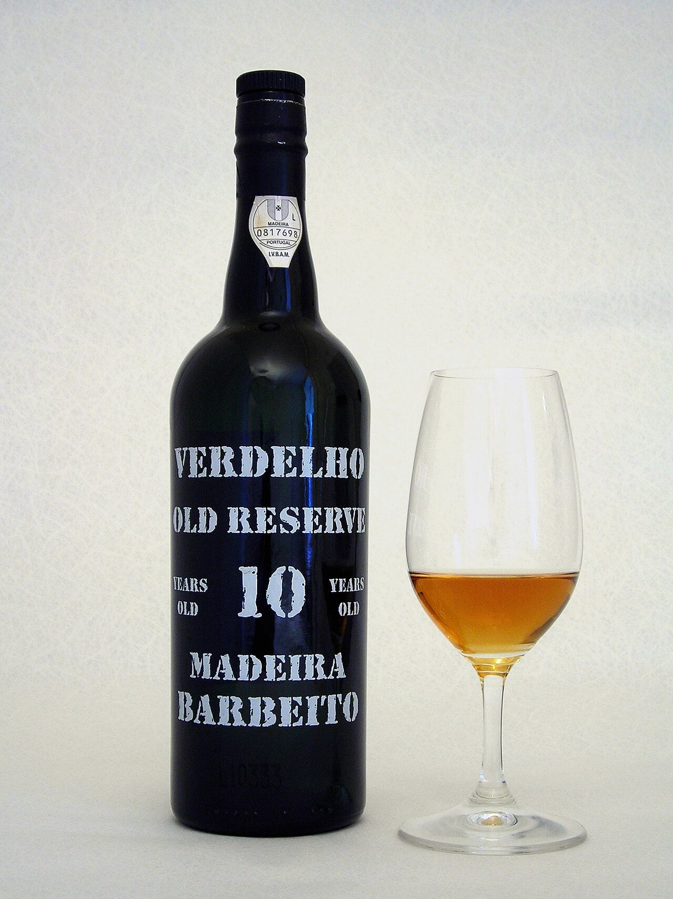

# Madeira

Madeira is the [fortified wine](ref:fortified-wine) of the Portuguese island of [Madeira](ref:madeira), and one of the few wines that turned being heated into a style. It is fortified with grape spirit during fermentation, then aged in one of two ways: in heated tanks, or in casks under the warm roof of a cellar where the Atlantic climate does the work slowly. The result is high in acidity, dark in colour, nutty and caramel-scented, and stable for weeks or months after opening. Understanding Madeira means understanding how heat and oxygen were turned into rules.

Figure: A bottle of Barbeito Verdelho 10-year-old Madeira and a glass of amber wine. Image: Origenes.Adamantius, CC BY-SA 4.0, via [source page](https://commons.wikimedia.org/wiki/File:Madeira_Barbeito_Verdelho_Old_Reserva_-_Bottle_Glass.jpg).

## An island shaped by heat

Madeira lies in the Atlantic, roughly a thousand kilometres from mainland Portugal. The terrain is steep, and vineyards are planted on narrow terraces cut into the slopes, where machinery can barely enter. Volcanic soils and a maritime climate ripen grapes slowly, so acidity is preserved. That acidity is the foundation that lets Madeira survive long heating and oxidation; without it, the same process would produce a flat sweet wine.

## Estufagem: heat applied directly

After [fortification](ref:fortification), ordinary commercial Madeira goes through estufagem. The wine is heated to about 45–50°C in stainless-steel tanks fitted with hot-water coils, held there for at least 90 days, then rested for at least another 90 days. The process imitates the heat of a long sea voyage and gives the wine cooked aromas and an amber colour quickly. Rules also govern release: the wine cannot be sold before the second year after harvest. Entry-level Madeira made from Tinta Negra usually takes this route.

## Canteiro: slow time in the attic

Better wines go through canteiro. Casks are placed on beams under the roof and are not actively heated; they rely on the warm air of the cellar, moderated by sun and sea, and age slowly for at least two years. The time is longer and the temperature gentler, so oxidation is finer, acidity is better preserved, and the aromas move from caramel and coffee towards dried fruit, spice and cedar. Canteiro costs more and takes longer, so it tends to appear in vintage wines and premium blends.

## Four variety names and one underrated grape

The traditional Madeira variety names double as sweetness coordinates. Sercial is the driest, with sharp acidity, citrus and almond. Verdelho is medium dry, with smoke and honey. Boal (Bual) is medium sweet, with raisin and caramel. Malvasia (Malmsey) is the sweetest, with toffee, coffee and dark chocolate. On a label these four names usually replace the variety itself, so they give a reliable first idea of sweetness.

The other name is Tinta Negra. Long dismissed as a workhorse, it is now the most widely planted red grape on the island and can be made dry or sweet; it forms the backbone of many commercial Madeiras. Variety and sweetness do not map one to one: the same grape can produce different sweetness levels depending on when fermentation is stopped.

## Oxidation as a style

[Oxidation](ref:oxidation) is a fault in most wine, but it is the core of Madeira. Heat and long cask ageing keep the wine in contact with oxygen, and the colour moves from gold to amber and mahogany while aromas turn from fresh fruit to walnut, caramel, coffee and spice. Unlike [Sherry](ref:sherry), Madeira has no flor to protect it. Unlike [Port](ref:port), its oxidation is not a short phase but an accumulation over years or decades.

## From sea route to cellar

Vines were planted on Madeira after Portuguese navigators reached the island in 1418. In the sixteenth and seventeenth centuries, Madeira was a provisioning stop on Atlantic routes, and wine repeatedly heated in tropical holds accidentally created the ancestor of today's style. In the eighteenth century, British and North American markets drove exports, and producers began to imitate the process deliberately in heated rooms. In the nineteenth century, powdery mildew and phylloxera almost destroyed the vineyards; the replanting that followed changed the variety mix and increased the share of Tinta Negra. From the twentieth century, tourism and cellar visits became part of the island economy, and the traditional methods were taken seriously again.

## Sweetness, age and labels

Madeira is commonly labelled 5, 10, 15, 20, 30, 40 or 50 years, meaning the average age of the wine in cask rather than a single vintage. Colheita indicates a single harvest, usually aged at least five years. Frasqueira means a single variety from a single vintage, aged in cask for at least twenty years, the strictest category on the island. Since 2013, EU labelling rules have tightened the wording around vintage and variety, so buyers should check whether the number is an average age or a single year.

## After opening

Serve Madeira at 14–16°C, a little warmer for very old bottles. A tulip glass or a small white-wine glass is enough, and decanting is unnecessary. It is one of the few wines that keeps for months after opening, but that does not mean it can be stored in sun or heat; recork it and keep it in a cool place, without over-chilling. With food, Sercial suits almonds, olives and clear soups; Verdelho suits smoked fish and ham; Boal suits nut desserts and caramel custard; Malmsey suits dark chocolate, blue cheese and coffee desserts. Excessive drinking is harmful, and minors should not drink.

**At a glance:** A fortified wine from the Portuguese island of Madeira, shaped by heat through estufagem or by slow cask ageing in warm attics known as canteiro; styles run from dry Sercial to rich Malmsey, with acidity as the constant. 

For Madeira, begin with the production rule, then the strength, and finish with the usual serving; that order keeps the account grounded.

Start with [Fortified wine](ref:fortified-wine) for legal definition, then read [Oxidation](ref:oxidation) for materials and process. Seeing both keeps Madeira from being confused with a neighbouring idea.

Madeira is fortified and heated, either in estufagem tanks or in warm cask attics, and the heat gives it a long shelf life and a nutty, caramel edge. Sercial is dry, Verdelho medium, Bual rich and Malmsey sweet; the style names refer to sweetness, not quality.

**Key facts.**

| Item | Detail |
| --- | --- |
| In one line | A fortified wine from the Portuguese island of Madeira, shaped by heat through estufagem or by slow cask ageing in warm attics known as canteiro; styles run from dry Sercial to rich Malmsey, with acidity as the constant. |
| Parent style | Fortified wine |
| Aroma family | Oxidative / nutty / caramel |

**Sources and limits.** The key claims about Madeira are checked against the following sources: Instituto da Vinha e do Vinho (the Madeira DOP area, varieties, fortification and estufagem/canteiro ageing; no original text is reproduced), European Union (the framework for fortified wines, geographical indications and labelling; no original text is reproduced), International Organisation of Vine and Wine (OIV) (definitions of liqueur wine and fortification; no original text is reproduced) and 4 sources in total. Prices, batches and status change; the body is project-written and does not reproduce source text.
