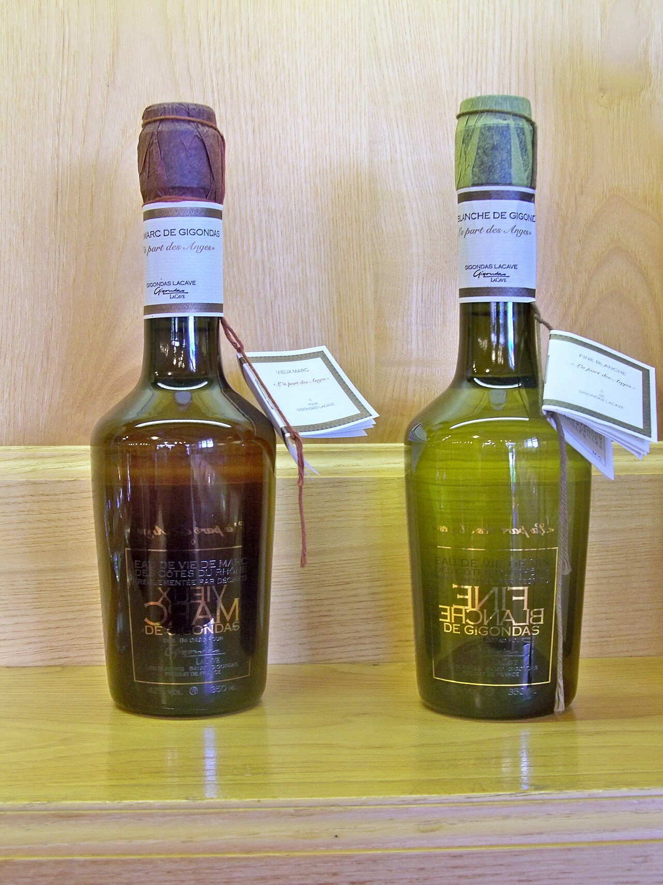
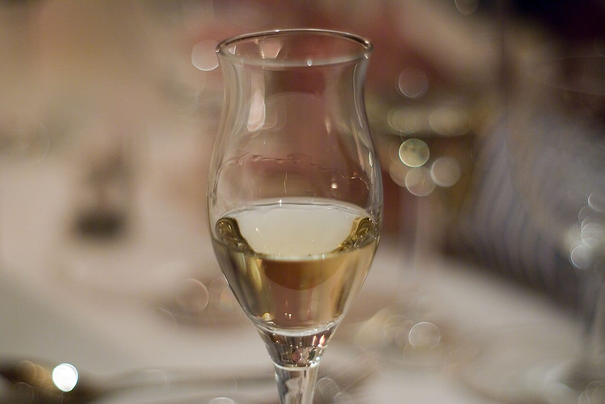

# Marc

The French name for grape-pomace spirit, most associated with Burgundy and Champagne; it is the same broad family as Italian grappa, but French rules, raw materials and ageing habits differ and the style is usually more rustic.

Figure: Marc: Marc et fine blanche de Gigondas (Wikimedia Commons). Image: Véronique PAGNIER, Public domain, via Wikimedia Commons ([source page](https://commons.wikimedia.org/wiki/File:Marc_et_fine_blanche_de_Gigondas.jpg)).

## Definition and boundaries

Marc is the French term for spirit distilled from grape pomace: the skins, seeds, stems and residual juice left after pressing. The pomace is fermented and distilled, usually in a pot still, to roughly 40–45% ABV. Marc de Bourgogne and Marc de Champagne are the best-known regional names.

It belongs to the same broad family as Italian grappa, but the legal and cultural boundaries differ. French marc often carries a regional name and sometimes an AOC or AOP; grappa has its own Italian rules for raw material and distillation. Marc is neither wine nor brandy: it is a pomace spirit, made from the solid residue rather than from fermented grape juice.

The word “marc” simply means pomace in French. Marc de Bourgogne refers to Burgundy pomace spirit; Marc de Champagne to the Champagne region. Not every French pomace spirit may use those names, and a generic “marc de raisin” is a wider category.

## History and naming

Pomace was a by-product of pressing, but it still contained sugar and yeast. Farmers fermented it in sealed vessels and distilled it rather than discarding it. In Burgundy and Champagne, monasteries and winegrowers commercialised the practice in the nineteenth century, and marc became an everyday after-dinner drink.

The name follows the raw material, not the still or the brand. Burgundy families often distilled their own pomace; in Champagne, merchants and cooperatives frequently handled distillation, and some bottlings are labelled Marc de Champagne without a vintage. EU spirit-drink rules later recognised grape marc as a category and prohibited added sugar or flavouring.

Marc also has a local social history. In Burgundy it was a winter warmer for vineyard workers; in Champagne it was a way to extract value from press residue. The two regions developed different reputations even though the underlying raw material is similar.

## Materials and process

Fresh pomace still contains sugar and yeast. It is packed into sealed tanks or pits and fermented anaerobically for several weeks, so acetobacter does not turn the alcohol into vinegar. It should be distilled promptly; pomace left too long can develop vinegar, mould or a muddy smell.

Traditional distillation is batch pot still, with heads and tails cut away and only the middle run retained. The new spirit is clear and high in alcohol, then diluted to 40–45% ABV. Some marcs are aged in oak for two to ten years, gaining amber colour, vanilla, dried fruit and spice; unaged versions stay clear and more directly grapey.

Grape variety and pomace freshness shape the spirit. Pinot Noir pomace brings red-fruit skin and floral notes; Chardonnay pomace is more citrus and nutty. Pomace that has been stored too long gives acetic and mouldy notes, so many producers require same-day or next-day distillation.

Moisture affects fermentation: very dry pomace may need water, while very wet pomace can acetify. Distillers usually fill tanks with fresh pomace and exclude air. The shape of the still and the heating method also change how much grape-skin aroma survives; pot stills retain more, column stills give a more neutral spirit.

## Style and palate

Unaged marc is colourless, with grape skin, flowers, green herb and a light bitterness. The entry is strong and the texture tight. Aged marc turns amber and adds vanilla, dried fruit, leather and spice, with a rounder body.

Compared with grappa, French marc is often more rustic and skin-driven, with a higher proportion of aged bottlings. Compared with brandy, it lacks the softness of a wine distillate and has a coarser, more pomace-forward structure. Typicality is judged from pomace origin, pot distillation and regional labelling.

Most aged marc uses old oak rather than new char, so vanilla and toast do not bury the grape skin. Five years or more can bring dried fruit, leather and mushroom notes, and alcohol may fall slightly through evaporation. The colour is not a reliable age marker because old casks and light-coloured spirits vary.

## Representative regions and brands

Domaine de la Romanée-Conti and Château de Chamirey produce Marc de Bourgogne; in Champagne, Marc de Champagne is often made by merchants and cooperatives, and houses such as Ruinart have released bottlings. These are reference points, not a ranking.

Marc production is small and regionally fragmented. Reputation comes from the estate and the vintage rather than from a national brand. Look for “Marc de Bourgogne” or “Marc de Champagne” and the vintage; a generic pomace spirit may be sound but is not the same appellation product.

A useful comparison is an unaged Burgundy marc, an aged Burgundy marc and a Champagne marc. The first shows the raw grape skin, the second the oak and roundness, the third the regional difference in base material and distillation style.

## How to drink and pair

Serve at 18–20°C in a small tulip or spirit glass, with a 30–40 ml pour. Smell the grape skin and flowers first, then take a small sip and let the alcohol spread across the tongue. Dark chocolate, nuts, dried fruit and after-dinner coffee work well; aged marc can accompany a cigar and hard cheese.

A drop of water can open the aroma, but ice is not recommended because cold suppresses grape skin and flowers. After opening, seal the bottle, keep it dark and finish within one or two years. High alcohol preserves it, but aroma fades gradually.

Marc is often confused with fine, the Burgundy term for a spirit made from wine or pomace under a different tax and labelling tradition. The two can appear side by side in the same cellar, but they are not interchangeable categories.

## Buying, storage and misreadings

Check the regional name, vintage and alcohol first, then whether the spirit is aged. Clear does not prove unaged; an aged marc can remain pale. A high price may reflect an old bottle or a famous estate, not superior typicality; pomace spirit value lies in fresh raw material and careful distillation.

Common misreadings include treating marc as grappa, treating pomace spirit as inferior brandy, and assuming all marc must be aged. It can be colourless, strong and intensely grapey, or amber, round and spicy.

The vintage on a marc usually refers to the grape harvest, not the distillation year. Ask about raw material and distillation date; that information is more useful than the vintage alone.

## Further reading and see also

Compare an unaged and an aged marc from the same region, then a Champagne marc beside a Burgundy one. Record pomace variety, still type, age and strength; those variables explain the spirit more than the label.

- [Grappa](ref:grappa): the Italian pomace-spirit comparison.
- [Brandy](ref:brandy): the broad wine-distillate category.
- [Pomace](ref:pomace): the raw material for marc.
- [Distillation](ref:distillation): pot stills and cuts.
- [France](ref:france): regional and regulatory background.

## Related images

Image: Grappa. Credit: Carsten Tolkmit from Kiel, Germany, CC BY-SA 2.0, via Wikimedia Commons ([source page](https://commons.wikimedia.org/wiki/File:A_glass_of_tasty_grappa.jpg)). Related image for Marc.
