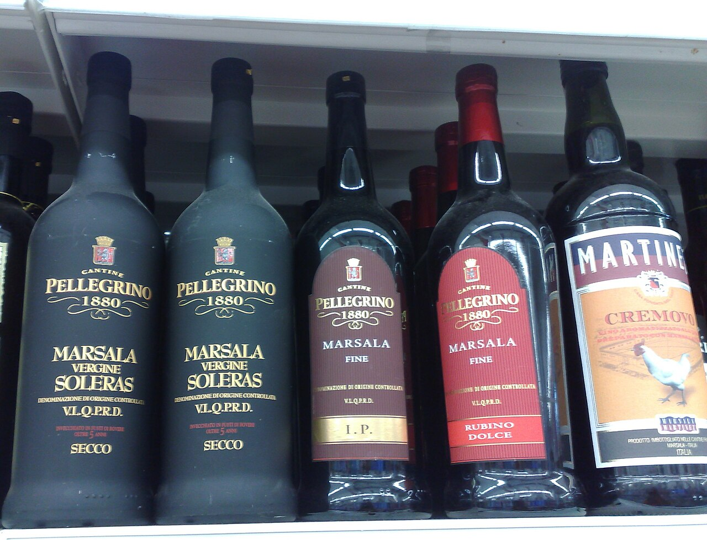

# Marsala

A fortified wine from the Marsala district of western Sicily, made from white grapes with added alcohol or cooked wine and oxidative ageing; it ranges from dry to sweet and from amber to ruby.

Figure: Marsala: Marsala (Wikimedia Commons). Image: Dedda71, CC BY-SA 3.0, via Wikimedia Commons ([source page](https://commons.wikimedia.org/wiki/File:Marsala.jpg)).

## Definition and boundaries

Marsala is a fortified wine from the western tip of Sicily. White grapes form the base; fermentation is stopped with added alcohol or vino cotto, a concentrated cooked grape must, and the wine is aged oxidatively. Colour runs from pale amber to deep brown, with ruby versions made by brief maceration of red grapes. Alcohol is usually 17–20% ABV and sweetness ranges from secco to dolce.

The name is protected as a DOC. Only wine made in the defined Marsala area, from permitted varieties and processes, and aged according to the rules may be called Marsala. The main types are Fine, Superiore, Superiore Riserva, Vergine and Soleras. Vergine has no vino cotto and is drier and more complex; Soleras uses a continuous blending system.

Marsala is not a single “cooking wine”. Fine is young, paler and sweeter and is often used in the kitchen; Superiore and Superiore Riserva are aged longer and more suitable for drinking; Vergine is the most wine-like and least sweet. The label’s type and sweetness are more useful than the brand alone.

## History and naming

In the late eighteenth century, British merchant John Woodhouse saw that Marsala could survive long sea voyages if fortified. By the 1770s the wine was being shipped to Britain and the United States in a stabilised, higher-alcohol form. The port of Marsala gave the wine its name and its export identity.

In the nineteenth century, families such as Florio and Pellegrino built brands and cellars. After Garibaldi landed in Sicily in 1860, Marsala also became entangled with Italian unification and national symbolism. The DOC later fixed the types, ageing periods and sweetness levels, turning a trading wine into a regulated appellation.

The modern image is split between an after-dinner wine and a kitchen ingredient. That split is not new: export merchants wanted a stable sweet wine, while Sicilian families used the same category for cooking, dessert and celebration. The better bottles retain the oxidative complexity that made the wine travel.

## Materials and process

The base is usually Catarratto, Grillo or Inzolia, with Nero d’Avola and other red grapes for ruby styles. Grapes are fermented normally; before all sugar is consumed, alcohol or vino cotto is added to stop fermentation and retain residual sugar. Vino cotto adds colour, caramel, dried fruit and body.

Ageing is oxidative and usually in wood. The wine slowly contacts air, darkening from pale gold to amber and moving from citrus and flowers toward dried fruit, caramel, vanilla, tobacco and nuts. Fine requires at least one year, Superiore at least two, Superiore Riserva at least four; Vergine and Soleras are aged longer.

The Soleras system blends wines of different ages in a stack of barrels. Wine is drawn from the oldest level and replaced from the next oldest, so the commercial style remains continuous rather than reflecting a single vintage. The related perpetuo system makes the same claim of continuity.

Sweetness is set by the point at which fermentation is stopped. Secco is fermented nearly dry, semisecco keeps moderate sugar, and dolce is stopped while sugar is high. The amount of vino cotto affects colour and caramel; Vergine uses none and depends on grape and oxidative ageing.

## Style and palate

Colour ranges from pale amber to deep brown; ruby versions come from brief red-grape maceration. Aroma brings dried fruit, caramel, vanilla, tobacco, orange peel and nuts. The entry may be dry or sweet, alcohol is high but the texture is rounded, and the finish often has a bitter, saline edge.

Vergine is drier and more oxidative, with nuts and spice, and is best served on its own. Fine is sweeter and cheaper and is often used in cooking. Superiore Riserva sits between the two, with more dried fruit and vanilla from longer ageing. Typicality should be judged from type, sweetness and ageing before brand.

Fine’s minimum age is one year, its colour is lighter and its sweetness higher. Superiore needs two years and has more complex aroma; Superiore Riserva needs four and often shows dried fruit and tobacco. Soleras gains depth and nuttiness from continuous blending. Vergine, with no vino cotto, is the clearest expression of the base wine and the oxidative method.

The difference between Fine and Superiore is not only age but sweetness and aromatic complexity. A bottle intended for cooking and a bottle intended for drinking may share a brand but not a function.

## Representative regions and brands

Florio, Pellegrino and Curatolo Arini are the most common commercial names. Marco De Bartoli’s Vergine and Superiore are associated with traditional oxidative winemaking and are often treated as benchmarks by sommeliers. These are reference points, not a ranking.

Production is concentrated around Marsala, Petrosino and neighbouring communes in western Sicily. Estates range from large cooperatives to small family wineries. When buying, look at the type and ageing before the brand; a cooking Fine and a drinking Superiore are different products with different value.

A useful comparison is a Fine, a Superiore Riserva and a Vergine from the same producer if possible. The first shows the young, sweet, culinary end; the second the aged middle; the third the driest, most wine-like interpretation.

## How to drink and pair

Serve at 12–14°C in a small dessert glass or tulip, with a 60 ml pour. Vergine can take a little more warmth to open its nut and spice notes. Dried fruit, almond biscuits, blue cheese, caramel desserts and cigars are natural partners; sweet versions also work with fruit tarts and chocolate.

In cooking, Marsala is used for zabaglione, veal and mushroom sauces. Do not substitute salted “cooking wine”; poor-quality salted wine can ruin a sauce. After opening, refrigerate and finish within one to two months. High alcohol slows spoilage, but oxidation eventually overwhelms the fruit.

Marsala can also be used in cocktails, including a Marsala Martini, and sweet versions can stand in for dessert wine. Vergine benefits from about fifteen minutes in the glass before drinking. A vinegar smell indicates over-oxidation, and the bottle is then better used in cooking than drunk.

## Buying, storage and misreadings

Read the type and ageing first: Fine for cooking, Superiore and Superiore Riserva for drinking, Vergine for the driest and most complex expression. Then check sweetness and alcohol. A high price may reflect age or a famous name, not necessarily a better match for cooking; an inexpensive Fine can still be sound.

Common misreadings include treating Marsala as a single sweet cooking liquid, treating ruby Marsala as red wine, and assuming every Marsala is sweet. The category spans dry to sweet and young to very old; Vergine can be dry and Soleras can be deeply complex.

Store bottles upright, cool and dark. An opened bottle should be refrigerated even if it is high in alcohol. Sediment in older bottles is normal; stand the bottle up before pouring and decant if necessary.

## Further reading and see also

Compare a Fine, a Superiore Riserva and a Vergine, keeping the producer and sweetness as close as possible. Record ageing, type and residual sugar; those three variables explain most of the difference.

- [Fortified wine](ref:fortified-wine): wine stabilised with added alcohol.
- [Wine](ref:wine): the basic categories of wine.
- [Sicily](ref:sicily): the regional background of Marsala.
- [Solera](ref:solera): continuous blending and ageing.
- [Oak ageing](ref:oak): oxidative maturation and barrel type.
