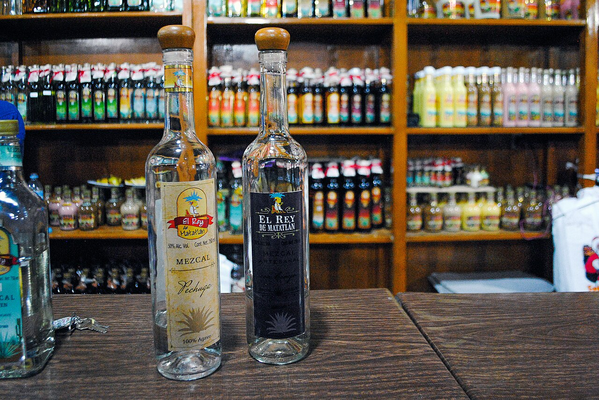

# Mezcal

Mezcal is a Mexican spirit distilled from [agave](ref:agave). Its most visible sensory marker is the smoke of pit roasting, but smoke intensity, plant character and sweetness vary widely with region, agave variety, fermentation vessel and still type. It shares an agave base and a distilling tradition with [tequila](ref:tequila), yet it is a separate category with its own raw-material range, protected regions and process requirements.

Figure: Mezcal. Image: ProtoplasmaKid, CC BY-SA 4.0, via Wikimedia Commons ([source page](https://commons.wikimedia.org/wiki/File:Mezcal_bottles_.jpg)).

## The boundary: what counts

Under the Mexican standard NOM-070-SCFI-2016, mezcal must be made from agave, cooked (traditionally in a pit), fermented and distilled, with the key stages carried out inside the protected region. The name is protected by a designation of origin and certified and supervised by the Consejo Regulador del Mezcal (CRM).

What is not mezcal: tequila, which uses blue Weber agave alone and is made in specified regions such as Jalisco; spirits made from other plants or regional traditions such as sotol or raicilla; and blended products that use neutral alcohol with an agave flavour. All may market themselves through agave, but the legal categories differ.

## Protected regions and agave varieties

The protected region covers several states. Oaxaca is the most representative, while Guerrero, Durango, San Luis Potosí, Zacatecas, Guanajuato, Tamaulipas and Michoacán also have their own traditions. Climate, altitude, soil and the distiller's habits form the first layer of stylistic difference.

Espadín is the most common cultivated variety and the largest in volume, with a relatively clean profile and clear sweetness. Wild or semi-wild varieties such as tobalá, tepeztate and sierra bring stronger plant, mineral, green-pepper and spice notes. Wild agave matures slowly and yields little, which is a major reason for the high price of artisanal mezcal and a source of concern about over-harvesting.

## Harvest and pit roasting

Agave often takes years to mature. The jimador removes the leaves, cuts out the heart (piña) and takes it to the roasting site. In the traditional method a pit is dug, lined with stones and fired with wood; the agave hearts are piled in, covered with fibre and earth, and left to roast for several days. The complex fructans hydrolyse into fermentable sugar, and smoke, caramel and roasted-plant flavours develop.

Pit roasting is one of the main process forks between mezcal and tequila. Tequila usually uses autoclaves or brick ovens, giving a cleaner, less smoky profile; mezcal keeps the earth pit and wood fire, so smoke becomes part of the style. Smoke is not the only criterion, however, and heavy smoke can bury variety and regional detail.

## Crushing, fermentation and distillation

Roasted agave must be crushed. Traditionally a stone wheel (tahona) or wooden mallet is used, and mechanical mills are also common. The crushed fibre and juice go with water into fermentation vessels, usually wooden tinas but sometimes clay or stone. Fermentation often relies on wild yeast and takes from several days to two weeks; temperature and the vessel's microbial community bring acidity, esters and funk.

The fermented liquid then goes to [distillation](ref:distillation). Many producers use copper [pot stills](ref:pot-still) for a double distillation, while others use clay or wood. Clay stills bring a more pronounced mineral and earthy quality; copper is cleaner and pushes plant aroma forward. Equipment is a style variable, not a detail.

## Categories and ageing classes

Under the standard, mezcal is classified by ageing in three groups. Joven is unaged or falls short of the Reposado period, with the most direct flavour; Reposado spends 2 to 12 months in wood; Añejo spends more than 12 months. Ageing pushes smoke back and adds vanilla, caramel, dried fruit and wood.

The classes are legal ranges, not exact ages. Actual time within a class can differ greatly, and cask type and age change the style. Not every mezcal benefits from ageing: a strongly smoky, plant-driven spirit can lose its identity after a long spell in wood.

## A stylistic map: regions and special methods

Oaxacan mezcal is usually balanced with clear plant character, and espadín's sweetness integrates gently with smoke; Guerrero versions can be more direct and mineral; Durango and San Luis Potosí show different directions depending on variety and climate. Differences between regions are often larger than differences between brands in one region.

Among special methods, pechuga adds chicken breast, fruit and spice at the final distillation, traditionally for celebrations, giving a richer, rounder flavour; de olla means distillation in clay, with a stronger mineral note. These are traditional variants, not features of every mezcal.

## Key parameters

NOM-070-SCFI-2016 sets an alcohol range of 35% to 55% ABV, and commercial bottles usually fall between 40% and 48%. Higher strength concentrates aroma but also the alcohol sting; water opens plant and mineral notes but changes the texture.

The ageing parameters are as above: 2 to 12 months for Reposado and more than 12 months for Añejo. Pit roasting usually takes several days, fermentation from several days to two weeks, and distillation is usually double. Producers vary, and the variety, region and batch on the label say more than a vague claim of “handmade”.

## Difference from tequila

Tequila is limited to blue Weber agave and specified regions, chiefly Jalisco; mezcal allows more agave varieties and a wider protected region. Tequila mostly uses ovens or autoclaves, while mezcal stresses pit roasting. The ageing classes are similar, but the regulations and certifying bodies are not.

Both are agave spirits, but the names cannot be swapped merely because both come from agave. Calling mezcal “smoky tequila” is a useful first analogy, yet it hides the real differences in variety, region and process. For the legal framework of tequila, see the [tequila](ref:tequila) entry.

## Common misconceptions and disputes

First, that mezcal must be heavily smoky. Second, that the worm (con gusano) is a mark of quality; the worm is a local tradition and commercial hook in some products, not a category requirement of NOM-070-certified mezcal. Third, that all mezcal is “100% agave”, when the label and class need checking against the standard. Fourth, that “artisanal” guarantees quality. Fifth, ignoring the ecological pressure on wild agave.

Three arguments dominate: sustainable harvesting of wild varieties, the boundary between industrial and traditional production, and the generic use of the name “mezcal” outside designation-of-origin protection. These affect the industry and how buyers read price.

## How to drink it

Mezcal rewards slow sipping. Drunk neat, hold it in the mouth to follow smoke, plant, mineral and sweetness; a drop or two of water helps release aroma. It also mixes well: replacing tequila with mezcal in a [Margarita](ref:margarita) adds a clear smoky layer, and citrus, bitter liqueurs and smoked salt are natural partners.

With food, smoke suits grilled meat, mole and spicy dishes; acidity and minerality balance fat. Excessive drinking is harmful to health, and minors should not drink.

Start with the production rule. From there, consider the strength, then the usual serving. That is how a practical judgment about Mezcal is built.

[Tequila](ref:tequila) and [Margarita](ref:margarita) are the two useful reference points for Mezcal. [Tequila](ref:tequila) sets out legal definition; [Margarita](ref:margarita) brings in materials and process. Read them together.
