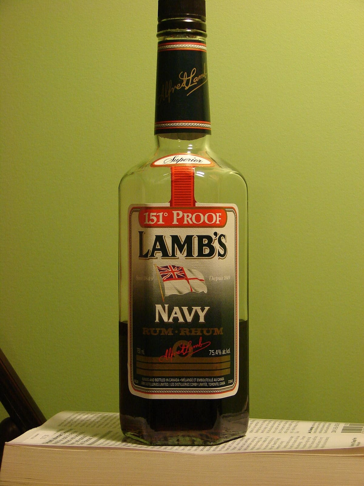

# Navy Rum

Navy rum is the traditional name for the British Royal Navy's daily rum ration; on the modern market it also means a category of high-strength, dark, full-bodied Caribbean blended rum with caramel, spice and dried-fruit notes. Most current brands blend aged rums from several Caribbean origins.

Figure: A bottle of Lamb’s Navy Rum 151 Proof, labelled Navy Rum and 75.4% vol. Image: Spikenard, Public domain, via [source page](https://commons.wikimedia.org/wiki/File:Lamb's_Navy_151.jpg).

## Definition and boundaries

Originally, navy rum was not a brewing style but the daily ration issued to Royal Navy sailors. The rum was bought, blended and issued by the Navy's victualling yards, and over time the colour, aroma and strength of that ration were adopted by the market as a dark, robust, multi-origin blended rum (ref:rum). It remains part of the rum family: the base is sugar-cane molasses, fermented and distilled (ref:distillation), then oak-aged (ref:oak) and blended.

As a market label, "navy rum" is not a protected legal appellation. It does not specify a single origin, distillation method or fixed recipe; brands may draw base rums from Jamaica, Guyana, Barbados, Trinidad and elsewhere, with strength ranging from 40% up toward the original ration proof. On a label, separate the historical ration tradition from a modern brand's self-styled navy positioning: the first is naval institutional history, the second is commercial product positioning.

## History and naming

Before rum, the Royal Navy issued a daily gallon of beer as the sailors' ration; on long voyages beer soured quickly and took up cargo space. After Britain captured Jamaica in 1655, the Navy switched the provision to rum, a ration that lasted more than three centuries. The ship's supply officer was the Purser, colloquially the "Pusser", which is why the issue rum was also called Pusser's rum; the daily allotment was known as the tot.

The ration settled into a fixed pattern between 1850 and 1970. It was issued at the "Up Spirits" hour around midday: senior ratings received it neat, while junior ratings diluted two parts water into grog. Sailors who did not drink were marked "T" (temperance) in the ship's books and received threepence a day instead; those under 20 were marked "UA" and did not receive the ration. On 31 July 1970, First Sea Lord Admiral Sir Michael Le Fanu ordered the daily rum ration discontinued; the day became known as Black Tot Day, after which the Navy no longer issued rum.

## Materials and process

Modern navy rum uses Caribbean sugar-cane molasses, with base spirits from several origins: Jamaican pot-still rums carry prominent esters, Guyanese Demerara rums give weight and body, and Barbadian and Trinidad rums supply a cleaner, woody skeleton. The blender combines base rums of different origins and ages to recipe, then adds a small amount of caramel for colour, producing a deep brown, full-textured drink. Oak ageing brings vanilla, cocoa and dried-fruit layers; molasses fermentation fruitiness and the spirit's strength together form the backbone.

There is an earlier chapter to strength measurement. Before the Sikes hydrometer spread in 1816, the ship's purser mixed rum with a little water and a few grains of gunpowder, then focused sunlight through a burning glass: if the powder ignited, the strength was high enough for issue. This gunpowder test later measured at 109° proof, about 54.5% ABV. Modern high-strength navy rums often target this "gunpowder" strength, while ordinary commercial versions sit around 40%.

## Style and palate

The typical navy rum is deep brown or mahogany, with molasses, caramel, burnt sugar, vanilla, cocoa, cinnamon and a hint of ginger on the nose. The palate is rich and sweet on entry, followed by spice, dried fruit and wood in the finish, with a noticeable but usually mellowed alcohol warmth. Jamaican base contributes tropical fruit and esters, Guyanese base adds body and syrup richness, and barrel ageing supplies smoothness; blend proportions vary, so some brands lean toward spice and wood while others favor molasses sweetness.

Strength is a key coordinate. Gunpowder-proof bottlings run around 54.5%, while historical ration records list 95.5° proof, about 54.6% ABV; modern ordinary navy rums are mostly 40%. High-strength versions carry more alcohol warmth and suit sipping or short drinks; lower-strength ones mix more easily. ABV (ref:proof), molasses sweetness and oak ageing together decide whether a rum reads robust and firm or soft and round; colour alone cannot indicate strength.

## Representative regions and brands

The modern brand most directly tied to the ration is Pusser's. In 1979, Charles Tobias, with Admiralty blessing, recreated the last Admiralty ration recipe and founded Pusser's British West Indies. Its Gunpowder Proof bottling is bottled at the original naval strength, 54.5% ABV, built mainly around aged Guyanese rum, and has long sold itself as a recreation of the issue rum.

Another familiar brand is Lamb's Navy Rum. In 1849, London merchant Alfred Lamb blended 18 rums from Barbados, Jamaica, Trinidad and Guyana to create the brand; the current bottling is 40% ABV. It is worth noting that Lamb's was never an official Navy supplier; it draws on navy styling in its brand narrative, and after the 1970 ration end the company used the advertising campaign "Join the Lamb's Navy". Other market navy rums are mostly commercial multi-origin blends, with wide variation in origin composition and strength between brands.

## How to drink and pair

The traditional serves were neat or diluted: seniors drank a small tot neat, while the junior grog was diluted with water, historically with lemon juice to improve the flavour. Today high-strength versions can be sipped at room temperature or loosened with a little water; cola or ginger-ale highballs are common bar serves, and the rum can stand in for ordinary dark rum in cocktails.

Pairing leans toward bold flavours. Smoked or grilled meats, cured sausages and charcuterie, and nuts carry the molasses and spice; dark chocolate and coffee desserts echo the caramel and cocoa notes. High-alcohol rum does not suit delicate seafood or fresh salads, where alcohol and sweetness would overwhelm the food; spicy dishes amplify the alcohol bite, so a more balanced sweet-and-body bottling is safer.

## Buying, storage and misreadings

When buying, read the origin composition, ABV and ageing notes on the label: products declaring multi-origin blends from Jamaica, Guyana and others sit closer to the traditional navy skeleton, while a dark rum with no origin or strength detail offers less to compare. Treating the word "navy" as an official endorsement is a common misreading; modern brands use the name as commercial positioning, not proof of having supplied the Navy.

For storage, high-strength rum is stable: keep it away from light, heat and vibration, and there is no need to lay the bottle down. After opening, alcohol evaporates slowly and the flavour holds for a few months; finish an opened bottle sooner rather than later. Navy rum usually has low residual sugar and does not rely on sweetness for preservation, though caramel-coloured, blended bottlings still turn muted if kept long in heat.

## Further reading and see also

To approach navy rum, start with a 40% multi-origin blend to learn the molasses backbone, then compare a gunpowder-proof recreation of the ration. Side by side, the ration history, origin blending and strength differences become clear.

- Related: [rum](ref:rum), [distillation](ref:distillation), [oak-ageing](ref:oak), [liqueur](ref:liqueur), [proof-and-abv](ref:proof).

For Navy Rum, begin with the production rule. Then look at the strength, and finally ask the usual serving. The answers point to different choices, not to a single score.