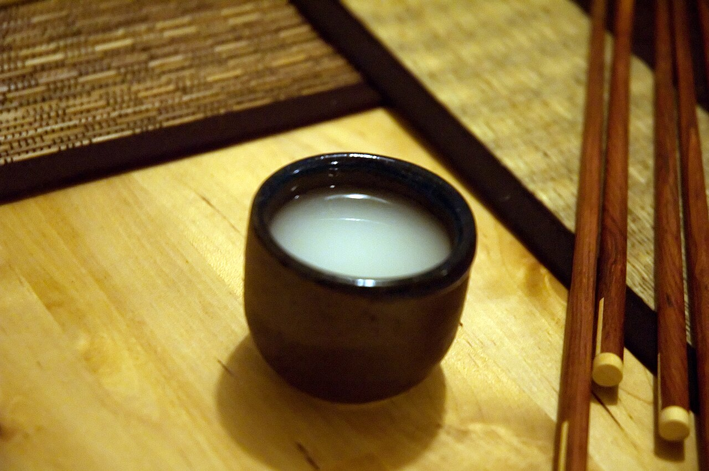

# Nigori Sake

A cloudy sake style from Japan that retains rice solids and lees after rough filtration; it is sweet, creamy and needs refrigeration, shaking before pouring and quick consumption after opening.

Figure: Nigori Sake: Nigori sake (Wikimedia Commons). Image: Luigi Anzivino, CC BY-SA 2.0, via Wikimedia Commons ([source page](https://commons.wikimedia.org/wiki/File:Nigori_sake.jpg)).

## Definition and boundaries

Nigori, or nigorizake, is a filtration category in Japanese sake. After fermentation the mash is pressed through a coarse mesh, leaving rice solids, yeast and lees in the liquid. The result is milky or cloudy and separates on standing. It is not an unfinished or defective sake; the solids are deliberately retained.

The difference from clear sake is the degree of filtration, not the raw material or fermentation. The difference from nama is pasteurisation: nigori can be nama, unpasteurised, or heat-treated. Labels may use nigori, nigorizake or “cloudy sake”, and the texture ranges from a faint haze to a thick rice-porridge consistency.

Nigori is not a protected grade or a single class in the Japanese sake tax system. A brewery can make nigori from junmai, honjozo or ginjo base sake, so a bottle may also carry “junmai”, “ginjo” or “nama”. The filtration word and the base class should be read separately.

## History and naming

Rough-filtered and unfiltered sake has a long history. Early farmhouse sake and winter-pressed shiborizake often retained rice solids, giving a sweet, thick texture. Modern nigori was commercialised in the later twentieth century and became one of the most recognisable sake categories.

“Nigori” literally means cloudy or muddy; it describes the liquid, not a defect. Japanese labelling rules do not create a separate nigori grade, which is why the word appears alongside other classifications. The same brewery may release a nigori version of its standard sake and a nigori version of a ginjo.

The name also signals expectation: a cloudy appearance leads drinkers to expect sweetness and body. That is often true, but not universal. A lightly cloudy ginjo nigori can be floral and relatively dry, while a thick junmai nigori can taste like rice cream.

## Materials and process

The raw materials remain rice, water, koji and yeast. After fermentation, the moromi is pressed and filtered through a coarse mesh so that some rice solids and yeast pass through. Too fine a filter removes the cloud and the creamy sweetness; too coarse a mesh leaves gritty sediment and a rough texture.

Some nigori undergo a second fermentation in the bottle, producing light carbonation and a fizzy mouthfeel. Others are winter-pressed shiborizake, bottled soon after pressing to keep fresh rice aroma. Unpasteurised nama must stay cold, or lactic bacteria and yeast will continue to ferment and can make the sake sour or the bottle dangerous.

Alcohol ranges from about 8% to more than 17% ABV. Sweetness and solids determine texture. A high koji ratio and low polishing ratio give a thicker, sweeter sake; a ginjo base gives more floral and fruit notes even when cloudy.

Solids usually sit around 1–3%. More can taste like rice paste; less loses the milky look and creamy sweetness. Breweries often let the pressed sake settle and bottle from the middle layer, while bottle-conditioned versions deliberately retain yeast. Do not freeze a bottle with active yeast.

## Style and palate

The liquid is milky white with a faint grainy texture and separates into a clearer top and denser bottom. Aroma brings cooked rice, sweet rice porridge, coconut, banana and lactic notes. The entry is sweet and creamy, acidity is low to medium, and the finish has rice bran and yeast.

Compared with clear sake, nigori is sweeter, thicker and less alcoholic on the palate. Compared with rice wine or amazake, it has sake koji aroma and a fermented structure rather than simple rice sweetness. Typicality depends on filtration, nama status and polishing ratio, then on sweetness and carbonation.

Sugar comes from residual sweetness and polysaccharides in the lees; acidity is low and alcohol is cushioned by texture. Chilling makes the sweetness more obvious, while warming brings out rice and yeast. Amazake is a sweet rice drink without alcoholic fermentation; nigori is a fermented sake with koji and alcohol.

## Representative regions and brands

Kikusui Funakuchi is a classic nigori, sweet and thick. Dassai’s nigori releases are known for a ginjo profile and a cleaner sweetness, and Umenishiki and many regional breweries make winter-limited versions. These are reference points, not a ranking.

Nigori is made across the sake regions. Niigata shiborizake tends to emphasise winter freshness and light carbonation; Kyoto versions are often sweeter and more rice-forward; Hiroshima producers may use lower polishing ratios. Look for “nigori”, “shibori” and “nama” on the label, then check polishing and alcohol.

A useful comparison is a lightly cloudy ginjo nigori beside a thick junmai nigori and a clear junmai from the same region. The first shows aroma through cloud; the second shows solids and sweetness; the third provides the clear baseline.

## How to drink and pair

Serve at 8–12°C and gently invert the bottle before pouring so the sediment redistributes. Do not shake hard; carbonated and bottle-conditioned versions can foam over. Use a wide glass or small sake cup, pour a small amount and drink it in two or three sips.

Pair with spicy, fried, creamy or sweet food: karaage, tempura, mapo tofu, cream cheese and fruit tarts. After opening, refrigerate and finish within three to five days. Nama is more fragile and is best finished in one sitting.

Sediment shifts with temperature and becomes more visible after chilling. Let a shaken bottle stand for a moment before opening so any foam settles. A bottle that becomes pressurised, smells wrong or turns sharply sour should be discarded rather than tasted further.

## Buying, storage and misreadings

Check whether the sake is nama, bottle-conditioned or pasteurised, then the polishing ratio and alcohol. Nama must be refrigerated; shelf-stable nigori is usually pasteurised. Sediment is normal, but a bulging bottle, off odour or rapid souring is not.

Common misreadings include treating nigori as badly filtered sake, assuming cloudier means sweeter, and shaking every bottle without checking carbonation. Sweetness and texture come from solids and fermentation, not from a filtration mistake.

Low polishing ratios give a thicker, sweeter sake; ginjo-based nigori is more floral and delicate. Store bottles upright, cool and dark. Once opened, the clock runs faster than for clear sake because the solids and yeast are still biologically active.

## Further reading and see also

Compare a clear junmai, a light ginjo nigori and a thick junmai nigori at similar polishing ratios. Record solids, sweetness, carbonation and nama status; those variables explain the texture better than the word “cloudy”.

- [Sake](ref:sake): the basic categories of Japanese rice wine.
- [Rice](ref:rice): the main raw material.
- [Fermentation](ref:fermentation): koji and yeast activity.
- [Filtration](ref:filtration): the boundary between clear and cloudy sake.
- [Japan](ref:japan): sake regions and culture.
