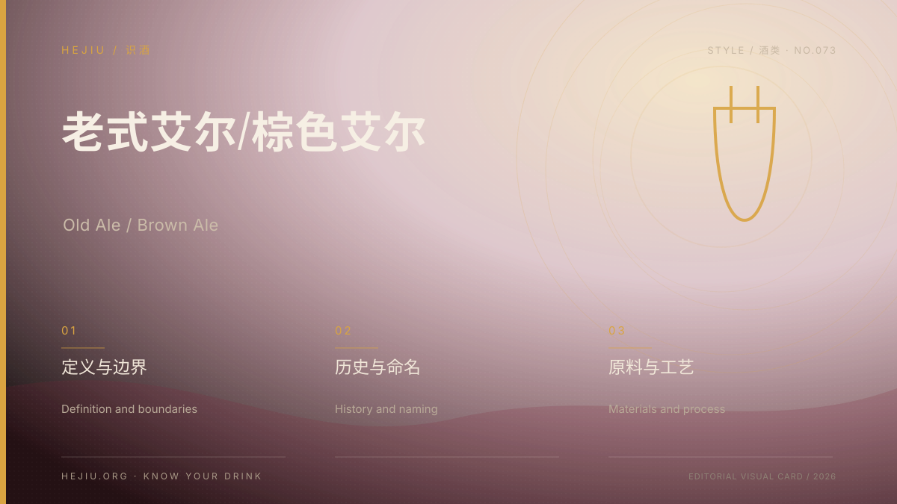

# Old Ale / Brown Ale

Old Ale and Brown Ale are two adjacent directions within traditional British ale: Old Ale is a stronger, malt-sweet, cellared or bottle-aged strong ale, while Brown Ale is a medium-strength everyday British ale built on malt toast and caramel. Both share British malt, traditional ale yeast and low hop bitterness as their base.

Figure: Thematic illustration for Old Ale / Brown Ale. Image: AI-assisted illustration (Doubao Seedream 5.0), project-owned; not a photograph of the subject, used as a thematic illustration only.

## Definition and boundaries

Old Ale and Brown Ale both belong to the British malt-ale family; the difference lies mainly in strength, ageing positioning and flavour depth. Old Ale (BJCP 19A) usually runs 6–9% ABV, OG 1.060–1.090, FG 1.015–1.022, IBU 30–60 and SRM 10–22, positioned as a strong ale meant to keep and blend. Brown Ale (BJCP 13B) runs 4.2–5.9% ABV, OG 1.040–1.052, FG 1.008–1.013 and SRM 12–22, an everyday medium-strength malt ale.

The boundary with Porter and Stout rests on roast degree: Brown Ale and Old Ale lead with caramel, biscuit, nut and dried-fruit character, not the coffee, burnt bitterness and smoke of dark-roasted malt. A modern recipe heavy on dark roasted malt moves toward the Porter route. Old Ale should not be confused with Barleywine: the latter is higher in alcohol and more assertive in hop and malt strength, while Old Ale keeps more dry and oxidative character.

## History and naming

Old Ale's history is tied to the British stock-ale tradition. Stock ale was held in the cellar for a long period: part was blended with younger beer, part drunk at full strength. Mashing ran at a high temperature to keep attenuation low, leaving more residual sugar and body. After primary fermentation it continued to age, and some products received further wood or bottle maturation, allowing light lactic or Brettanomyces complexity.

Brown Ale split into northern and southern English routes from the late nineteenth and twentieth centuries: the north (Yorkshire, North East England) was malt-sweet and medium-dark, while the south historically had a darker, drier London brown ale. Mann's London Brown Ale was bottled from 1902 and once called the sweetest beer in London, at around 5% ABV before the First World War; it was nearly extinct by the late twentieth century. Newcastle Brown Ale was created in 1927 at the Newcastle Breweries by Lt. Col. James Herbert Porter, refined over three years with brewer Archie Jones; the original was OG 1060 at 6.25% ABV, the current version about 4.7% ABV, and the 1928 blue-star logo's five points stand for the five founding breweries.

## Materials and process

Old Ale uses well-modified British pale malt with caramel and specialty malts, dark malt kept sparing; adjuncts may include molasses, treacle, invert or dark sugar, maize, flaked barley, wheat or malt extract. The yeast is a low-attenuation British ale strain that carries the higher alcohol and residual sugar. A high mash temperature and incomplete attenuation are the key process choices that preserve sweetness and body.

Brown Ale follows a simpler malt route: pale malt gives the base skeleton, caramel and toast malts contribute biscuit, toast, caramel and a little nut character, and hops act mainly as balance without dominant bitterness. Neither beer uses large amounts of dark roasted malt, so obvious coffee, chocolate bitterness or peat smoke is absent. Modern commercial products sometimes add molasses or dark sugar for colour and sweetness; recipe transparency needs checking on the ingredient list.

## Style and palate

The typical Old Ale leads with malt sweetness, supported by fruity esters, dried fruit, a wine-like hint of oxidation, and caramel, molasses, nut, toffee and treacle flavours. Light oxidation akin to Sherry or Port is allowed and expected here, a feature of ageing rather than a fault. The body is full and the finish long, with alcohol wrapped by malt and sweetness; aged versions develop dried fruit, leather and yeast-derived complexity.

Brown Ale is medium in body, with clear malt aroma and mainly caramel, toast and biscuit notes plus a little butterscotch sweetness. Hop bitterness and aroma are both low, and the finish is drier than Old Ale. Colour runs reddish brown to dark brown, but the entry is not burnt or bitter. North-south differences sit mainly in sweetness and dryness: northern versions are sweeter and rounder, southern historically drier with a more toasty malt character.

## Representative regions and brands

Old Ale commercial examples include Gale's Prize Old Ale, Burton Bridge Olde Expensive, Marston Owd Roger, Greene King Olde Suffolk, Fuller's Vintage Ale, Harvey's Elizabethan Ale, Theakston Old Peculier, Fuller's 1845 and Samuel Smith's Winter Welcome. Theakston Old Peculier sits between Old Ale and a traditional British strong ale, at about 5.6% ABV.

Brown Ale representatives include Maxim Double Maxim, Newcastle Brown Ale, Riggwelter Yorkshire Ale, Samuel Smith's Nut Brown Ale and Wychwood Hobgoblin. Recipes and sweetness differ considerably between brands: some follow a drier malt route, others a sweeter caramel route. Reading the label's ABV, malt ingredients and origin tells you more than a vague idea of a brown ale.

## How to drink and pair

Old Ale suits a cellar-cool serving around 12–14°C in a half-pint glass; too much warmth pushes alcohol forward, too much cold closes off oxidation and dried-fruit layers. Brown Ale is best around 10–13°C, slightly cooler than Old Ale, in a British pint or straight-sided glass. Bottle-conditioned versions keep changing slowly after opening, so they can be finished over several sittings within their drinking window.

On the table, Old Ale pairs with mature Cheddar, game, stews, roast beef and winter desserts; its malt sweetness complements fat and roast aroma. Brown Ale suits a ploughman's lunch, sausages, pork pies, fish and chips and roasted nuts, with malt sweetness carrying salt and fried flavour. Light seafood and acidic salads do not match these malt-forward beers, which would make the sweetness stand out.

## Buying, storage and misreadings

Common misreadings: treating Brown Ale as a dark-roasted beer — its darkness comes from caramel and toast malt, not roasted coffee malt; assuming Old Ale is always a high-strength barleywine — its strength range sits above ordinary brown ale but below barleywine; treating oxidative nut notes as spoilage — light oxidation is an allowed feature of Old Ale style; and taking brand history for current recipe evidence.

When buying, read the back label: ABV, malt and adjunct ingredients, whether it is bottle-conditioned, origin and producer. Large front lettering is usually brand marketing. For storage, Old Ale keeps away from light and heat at a steady cool temperature, and bottle-aged versions can continue to evolve for years under suitable conditions. Brown Ale is best drunk fresh, within a few months for its best flavour. Once opened, both lose carbonation and malt aroma, so finish them the same day. A high price usually reflects ageing length or brand rather than a more typical style.

## Further reading and see also

Styles close to these share the British malt and ale-fermentation framework: [english-ale](ref:english-ale) is the broad family, [beer](ref:beer) gives the basic category reference, [barley](ref:barley) malt decides caramel, biscuit and nut layers, [fermentation](ref:fermentation) sets residual sugar, esters and bottle maturation, and [vintage](ref:vintage) corresponds to the Old Ale storage and bottle-ageing tradition.

To learn a British ale, start with the standard benchmark, then a variant that changes strength or malt, then a long-aged extreme; after those three steps the boundary is clearer than from definitions alone.

- Related: [english-ale](ref:english-ale), [beer](ref:beer), [barley](ref:barley), [fermentation](ref:fermentation), [vintage](ref:vintage).

## Related images

Image: Vintage. Credit: Chiusi Painter, Public domain, via Wikimedia Commons ([source page](https://commons.wikimedia.org/wiki/File:Cup_vintage_Cdm_Paris_320_n1.jpg)). Related image for Old Ale / Brown Ale.
