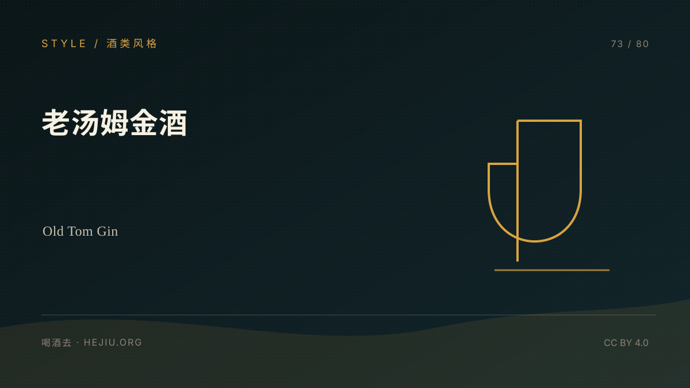

# Old Tom Gin

Old Tom gin is a sweetened [gin](ref:gin) style popular in England in the eighteenth and nineteenth centuries. Its definition lives in history rather than law: sugar, syrup or sweet botanicals such as liquorice are added to a distilled gin, making the body rounder, softer and easier to drink than the later London Dry. Today's Old Tom is not "London Dry in vintage packaging" but a reinterpretation of a sweet gin tradition.

Figure: thematic illustration for Old Tom Gin. Image: AI-assisted illustration generated with Doubao Seedream 5.0 (project-owned); not a photograph of the subject.

## A historical style, not a legal category

EU spirit-drink law has no legal category called "Old Tom". It is neither a geographical indication nor a process name with a fixed definition like London Dry; a producer may make it within the gin category, but "Old Tom" works more like a style label. That means sweetness, base spirit and botanical recipe can vary widely between brands, and the name alone tells the buyer little.

The ambiguity is both a risk and an opening. The risk is that any sweetened gin may call itself Old Tom; the opening is that producers can reconstruct different historical recipes. To judge a bottle, look at where the sweetness comes from, the strength, whether juniper is still clear, and whether it keeps the rounded rather than syrupy texture of nineteenth-century gin.

## Sweet gin in eighteenth-century London

In eighteenth-century London, gin consumption surged, prices were low and quality was uneven. Gin was often made from rough grain alcohol with juniper and sweeteners, and it drank sweeter and heavier than today's London Dry. The origin of the name Old Tom is uncertain: one story points to a cat-shaped sign outside a tavern, another to a distiller; neither can be fully proved, but both point to the same period.

By the nineteenth century, gin moved towards a drier, cleaner style, while Old Tom survived in bars and recipe books. In the twentieth century it almost vanished, leaving only a name in a few historical formulas. The craft-gin wave of the early twenty-first century sent producers looking for "lost styles", and Old Tom was revived as a historical bridge between genever and London Dry.

## Sugar, liquorice and a malty base

Modern Old Tom usually gets its sweetness from three directions: a little sugar or syrup added after distillation; sweet botanicals such as liquorice, almond or malt in the recipe; or a grain base with a malty character. The sweetness is generally below liqueur level and far above London Dry; it should be a rounded mouthfeel, not obvious sugar water.

[Juniper](ref:juniper) still matters, but it need not be as sharp as in London Dry. Old Tom recipes often bring in citrus, liquorice, angelica and spice, with a medium body and a soft finish. Some producers age Old Tom briefly in oak for colour and vanilla; that is not essential to the style but a way for revivalists to add complexity. Strength usually sits between 40% and 45% ABV, enough to carry sweetness and botanicals.

## From disappearance to revival

Reviving Old Tom is not a matter of copying a historical recipe but of rebuilding from limited written records and modern taste. Nineteenth-century recipe books often mention "sweet gin" or "old-fashioned gin", but sugar levels, base strength and botanical ratios were never standardised; producers must infer the context and then adjust with modern equipment.

That explains the wide range of Old Tom today: some bottles sit close to genever, with clear malt and sweetness; some sit close to London Dry, with only a touch of roundness at the finish; some use barrel ageing for vanilla and caramel. There is no need to search for a single "correct" version, but the drinker should know it is not a legally bounded category.

Revivalists face another problem: the standard of sweetness. Nineteenth-century sugar was not today's refined white sugar, and liquorice and malt gave a more complex sweetness; using syrup alone easily produces "sweet gin" rather than Old Tom. Sweeter is not better; balance is the point, and too much sugar cloys.

## Old Tom in cocktails

Old Tom is useful in classic cocktails. Tom Collins-style long drinks need a little sweetness to balance lemon and soda, and Old Tom fits better than London Dry; a [gin fizz](ref:gin-fizz) also works with Old Tom for a rounder result. In [Old Fashioned](ref:old-fashioned) variations, its sweetness can replace part of the syrup and soften the body.

Old Tom is not an all-purpose sweetener, however. Its sweetness is still below liqueur level and cannot adjust a recipe like syrup; if it replaces London Dry, the acid and bitters need rebalancing. When mixing, test a small batch first, then decide whether to add lemon or bitters.

Old Tom also suits gentle mixers such as ginger ale and apple juice, but not heavily smoked or peated spirits. Serve it at about 10 to 15 degrees Celsius; too cold suppresses malt and liquorice.

## Where Old Tom differs from genever and London Dry

[Genever](ref:genever) treats malt wine as an essential component, with sweetness and malt coming from the raw material and recipe, usually with clearer grain and bread notes; Old Tom is built on gin, and its sweetness comes mainly from post-distillation addition or sweet botanicals, so malt may be present but is not the defining core. [London Dry](ref:london-dry-gin) requires flavour from redistillation, keeps sugar extremely low, and tastes drier and sharper.

The three can be arranged as a historical line: genever is the earlier malt-wine tradition, Old Tom the sweet gin of the eighteenth and nineteenth centuries, and London Dry the modern dry standard that emerged later in the nineteenth century. But the line is not an evolution chart; all three coexist today with their own recipes and drinking occasions. Understanding their differences is more useful than arguing over which is more authentic.

**In brief:** A sweetened gin style popular in eighteenth- and nineteenth-century England, made by adding sugar or sweet botanicals such as liquorice after distillation; it is not a legal category, and modern revivals usually sit at 40% to 45% ABV as the historical base for Tom Collins and Old Fashioned variations.

**Read alongside.** Put Old Tom Gin next to Gin, Genever, London dry gin: the first fixes identity and boundary, the others provide a region, process or peer comparison. Read this style first, then return to those entries; the links become coordinates, not decoration.

**Sources and limits.** The key claims about Old Tom Gin are checked against the following sources: The Gin Guild (the historical period, sources of sweetness and style features of Old Tom gin), European Union (gin categories and the fact that Old Tom is not an EU legal category), Beefeater Gin (modern Old Tom sweetening and revival methods) and 4 sources in total. Prices, batches and status change; the body is project-written and does not reproduce source text.

For Old Tom Gin, this style was last checked in 2026; prices, batches and availability change, so confirm them against the sources below.
