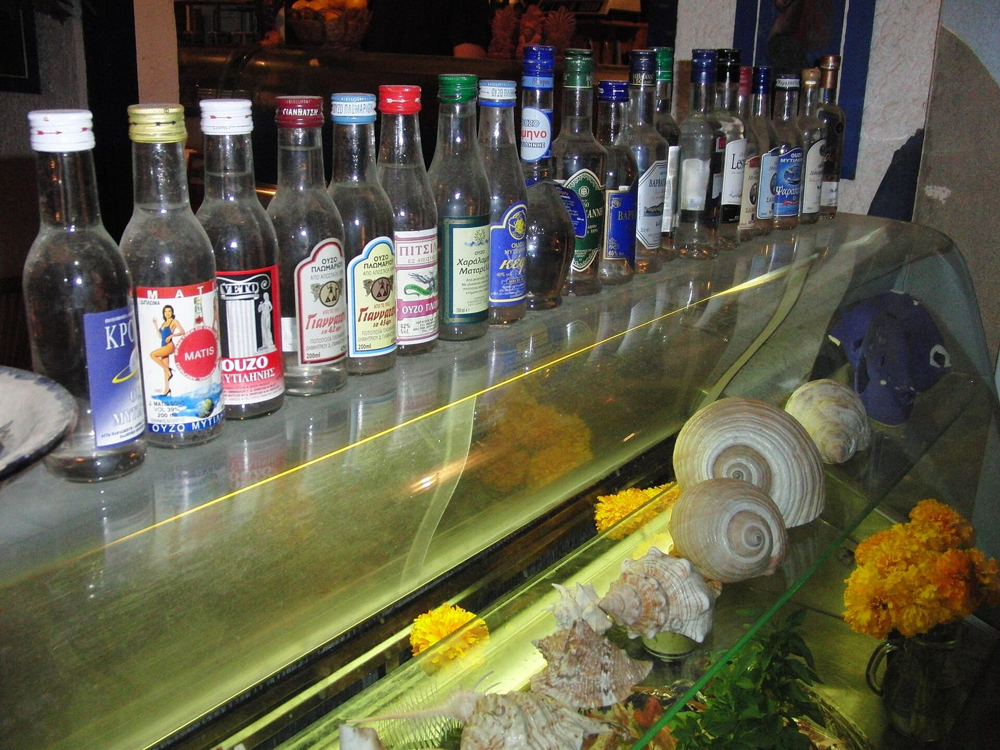
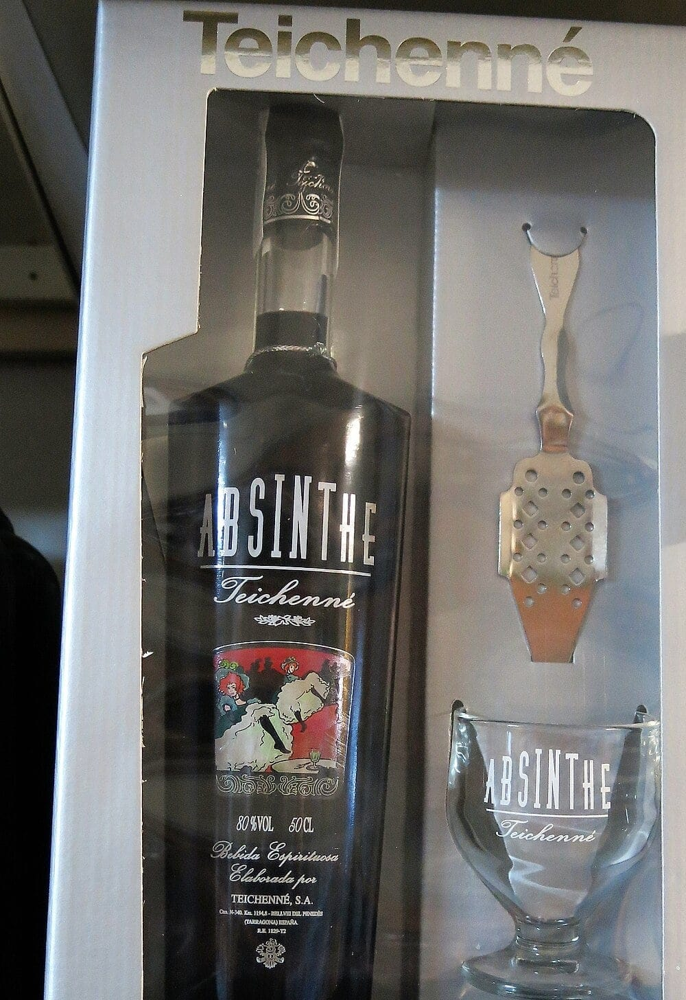

# Ouzo

Ouzo is Greece's most recognisable anise spirit: clear and colourless, it turns milky when water or ice is added, and it tastes of aniseed, liquorice and a faint sweetness, with a herbal bitter edge at the end. It is usually distilled in copper, built around aniseed, and bottled at no less than 37.5% ABV. For Greeks it is not a souvenir drink but a daily ritual tied to meze, seafood and long afternoons.

Figure: Related photograph of Ouzo. Image: Ioannis Protonotarios, CC BY-SA 4.0, via Wikimedia Commons ([source page](https://commons.wikimedia.org/wiki/File:Very_rare_ouzo_brands.jpg)).

## The Anise Spirit That Turns White

The core aroma comes from trans-anethole in aniseed. This compound dissolves readily in strong alcohol, keeping the spirit clear; when water lowers the strength, its solubility falls and tiny oil droplets separate, producing a milky cloud. The effect is called louche, the same physical change that turns absinthe cloudy, and it is neither spoilage nor added milk.

The serving method is therefore part of the flavour design. Drunk neat, ouzo is concentrated and hot; with water, the aroma opens, the texture softens and the liquorice sweetness becomes more obvious. Ice lowers both temperature and strength, thickening the cloud and pushing the alcohol into the background.

## Geographical Indication and the 37.5% Floor

In EU spirit-drink law, ouzo is protected as a geographical indication rather than as an ordinary traditional speciality. The name may be used only for spirit made in Greece under prescribed raw materials and methods; other countries may make anise spirits, but they cannot call them ouzo. The rules also set a minimum of 37.5% ABV, require the finished spirit to be colourless, and limit sugar or dry extract to no more than 50 grams per litre.

"100% distillation" is a special ouzo category in which all the alcohol comes from distillation rather than from neutral spirit added afterwards. Traditional copper stills usually hold no more than 1000 litres, and the distillate falls between 55% and 80% ABV before being diluted to bottling strength. Since the EU spirit-drink regime took shape in 1989, protection of the name has become increasingly formal, and the product specification can be found in the EU geographical-indications register.

## Lesbos and Plomari

Lesbos, in the north-eastern Aegean, is often called the heart of ouzo, and the town of Plomari is its commercial birthplace. In the nineteenth century Plomari had a port, anise growing and a distilling tradition; the Barbayannis family brought still-making knowledge from Odessa and produced anise spirit in copper. In 1894, Isidoros Arvanitis established a large distillery in Plomari, later known as Ouzo of Plomari.

Lisvori, on Lesbos, is known for anise, while the island of Chios supplies mastic. Mastic is a resin from a pistachio relative, bringing pine, citrus and spice; added to ouzo, it creates a more complex resinous layer. Plomari styles tend to be full in anise and soft in texture, whereas Chios versions emphasise the bright, slightly bitter lift of mastic.

## Copper Stills, Anise and Mastic

Traditional ouzo is made in copper pot stills. Producers mix aniseed, fennel, mastic, coriander seed, clove, cinnamon and other spices with alcohol and water, steep them, then heat the still. Copper binds some sulphur compounds and keeps the spirit clean, while pot distillation preserves more spice detail. The run is separated into [heads, hearts and tails](ref:cuts); only the most balanced heart is kept, while the solvent-like heads and cloudy tails are set aside.

After [distillation](ref:distillation), the spirit is reduced with soft water to the target strength. A very small amount of sugar may be added for roundness, but the finished ouzo must stay colourless and within the dry-extract limit of 50 grams per litre. Most ouzo is not aged in oak and does not seek bottle age; its character comes from the spice formula and the cut of the [pot still](ref:pot-still), not from time.

## Where the Cloud Comes From

The thickness of the cloud depends on anethole content, strength, temperature and water quality. Lower strength and lower temperature produce a heavier cloud; hard water makes it coarser, soft water finer. Greeks often pour ouzo into a small glass and add a little water, watching the white mist rise from the bottom; the gesture is part of the ritual.

Cloudiness is not a quality score, but it does signal anise intensity. A faint cloud may mean less aniseed or more filtration; a dense cloud usually means a fuller aroma that softens readily with water. If the spirit is cloudy before water is added, it may be a temporary chill haze or a storage fault, and the smell should decide.

## Regional Differences Across Greece

Lesbos and Plomari ouzo tends to be anise-led and round, suited to seafood and olives; Chios versions gain a resinous, citrusy layer from mastic and finish drier; Tirnavos in Thessaly is known for a stronger, drier style sometimes treated as the "hard" ouzo; the large plants of Athens and Thessaloniki make more uniform, easy-drinking commercial brands.

Strength commonly falls between 40% and 50%, with some "100% distillation" products higher. Barbayannis, Plomari, Ouzo 12 and Metaxa Ouzo are among the easiest names to find. They differ not only in spices but in sweetness, dilution water and distillation cut, and bottlings from the same brand can vary.

## Ouzo at the Table

The standard setting is meze: octopus, sardines, fried small fish, feta, olives, tomato and cucumber. The liquorice note of anise cuts through seafood and the richness of fried food. Pour a small measure, add water, and drink slowly; it is not a shot, and a straw is beside the point.

It can also be served over ice, with soda, or as a cocktail base, though the anise is so strong that recipes usually need only a small amount. After dinner, room temperature or a light chill is enough; ice dilutes the aroma and suits hot weather better. With dessert, choose lemon, nuts or honey rather than chocolate, which fights the anise.

## The Border with Other Anise Spirits

Ouzo is often compared with [absinthe](ref:absinthe), but they differ: absinthe is built on wormwood, usually stronger and more herbal and bitter, while ouzo is anise-led, sweeter and lower in minimum strength. French pastis also clouds with water but is usually sweeter and softer; Italian sambuca is sweeter, often served with sugar and coffee beans, and sits closer to the [liqueur](ref:liqueur) category; Levantine arak and Turkish rakı are also anise-centred but differ in raw material, strength and drinking habit.

Greece's tsipouro is a grape-marc distillate, normally without anise, so it is not ouzo. Treating the two as the same underrates ouzo's spice complexity and misreads the way it is served.

## Buying and Storage

Look first at name and origin: real ouzo says "Ouzo" and names a Greek origin, with at least 37.5% ABV. "100% distillation" usually signals a more concentrated aroma. The shorter the ingredient list, the easier it is to read the style, and the order of mastic, coriander and clove hints at the flavour direction.

Ouzo does not need ageing. Keep the cap tight, store away from light at room temperature, and use it within a reasonable time; prolonged air contact oxidises anethole and dulls the aroma. Do not store it in the freezer, where anethole may separate early and spoil the appearance.

## Related images

Image: An absinthe gift set: a black Teichenné bottle, a slotted metal sugar spoon and a glass lettered ABSINTHE.. Credit: Tangopaso, Public domain, via Wikimedia Commons ([source page](https://commons.wikimedia.org/wiki/File:Absinthe_bottle_with_glass_and_spoon.jpg)). Related image for Ouzo.
