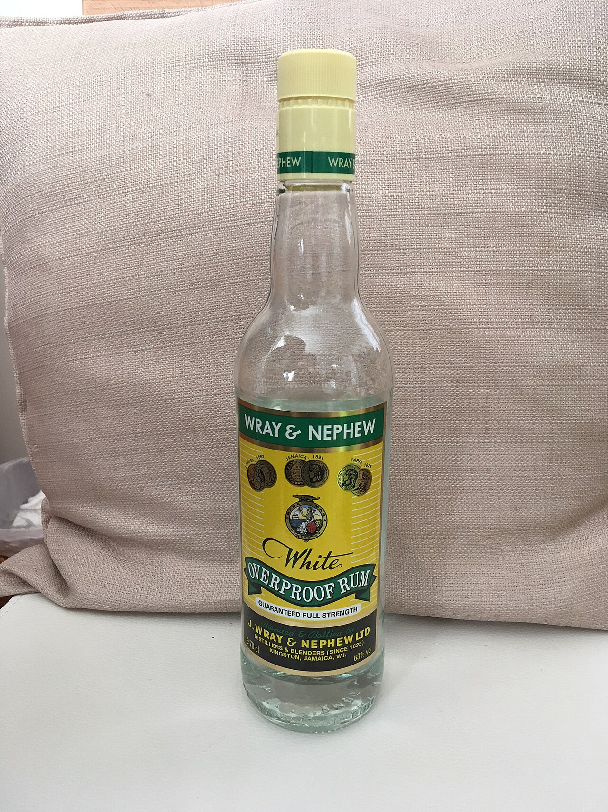

# Overproof Rum

Rum with alcohol well above the standard category, often 57.15% ABV (151 US proof) or higher; intense, flammable and mostly used in mixing and cooking.

In the “Hejiu” style index, Overproof Rum is not a fixed recipe but a set of checkable parameters: material, fermentation or distillation, sweetness, alcohol, ageing and occasion. First place it in a broad family, then check whether the producing country legally protects the name; the same name can mean different material ratios and alcohol limits in different countries. Finally, split the “typical style” into comparable samples: a benchmark, a variant and an extreme. Three bottles build a clearer boundary than ten definitions. Style names are also rewritten by marketing: sweetness becomes a style, packaging becomes tradition. Read the label for material, alcohol, sugar and origin before deciding whether it belongs. The biggest trap in style comparison is judging from one bottle. Within one style, material grade, fermentation temperature, distillation cuts, ageing vessel and sweetness all change the result; fix two or three variables before deciding whether a difference comes from style, producer or vintage. A useful note should record those variables, not only “liked” or “disliked”, and the same glass and temperature should be kept. Also record the batch or lot code and the date.

Figure: Overproof Rum: Wray & Nephew White Overproof Rum (Wikimedia Commons). Image: ZeugeDerNacht., CC BY-SA 4.0, via Wikimedia Commons ([source page](https://commons.wikimedia.org/wiki/File:Wray_%26_Nephew_White_Overproof_Rum.jpg)).

## Definition and boundaries

Overproof rum generally means rum above 50% ABV, most commonly 57.15% ABV (151 US proof), with 63%, 69% and higher versions.

Overproof Rum is a style defined by raw material, fermentation or distillation, sweetness, alcohol and ageing. It is not a single brand or place; the same style can be made in different countries with different materials and equipment.

For Overproof Rum, beyond the style name, read the material list, alcohol, sugar and process notes. Many “styles” are market categories, not legal ones; the same name can mean different parameters in different countries.

## History and naming

The Caribbean is the main source, with high-ester Jamaican rum and Demerara rum from Guyana available overproof; flavours range from clean to intense fruit.

The history of Overproof Rum is usually tied to a regional surplus, tax, religious festival or industrial change. The name may come from a container, process, place or brand; etymology is a clue, not a definition.

For Overproof Rum, history often credits one person or one shop, but a style usually forms from material, tax, transport and consumption together. Treating an “inventor” as the only answer hides the more important social and economic conditions.

## Materials and process

High alcohol amplifies aroma and heat and raises flammability; sip with care and use mostly for mixing, flambé and maceration.

The core of Overproof Rum is raw material preparation, fermentation or distillation, and ageing or adjustment before bottling. Temperature, yeast or culture, still shape, vessel and time all change aroma, texture and colour.

For Overproof Rum, process details define the boundary: fermentation temperature, yeast or culture, distillation cuts, ageing vessel and time, water, sugar or acid adjustment all change the result. Read parameters, not only stories.

## Style and palate

Historically, high-proof rum was easier to ship and reduced volume and tax; navy rations and colonial trade encouraged it.

The taste of Overproof Rum is a balance of sweetness, acidity, bitterness, alcohol, aroma and texture. It can be crisp, dry, sweet, rich or light; a single style contains a wide range and cannot be reduced to one word.

For Overproof Rum, taste judgment separates sweetness, acidity, bitterness, alcohol, aroma and texture. One dimension standing out does not make a drink better; balance and length are usually harder to achieve than sheer intensity.

## Representative regions and brands

Representative brands include Wray & Nephew Overproof and Bacardi 151 (discontinued); Wray & Nephew is the Jamaican benchmark.

To find representative Overproof Rum, start with the place of origin or traditional region, then compare a region using the same process with different materials. Keep sweetness, alcohol and vintage close to isolate process and material.

For Overproof Rum, a representative product is an entry point, not the whole style. Under one name, material, origin, vintage, ageing and brand position vary enormously; fix the parameters before comparing brands.

## How to drink and pair

To drink Overproof Rum, confirm sweetness, alcohol and bubbles or temperature, then choose glass and food. Dry high-acid styles suit salt and fat, sweet styles suit spice and desserts, high alcohol rewards slow sipping, bubbles suit starters and fried food.

Occasion shapes choice: aperitif, meal, dessert, solo drinking or mixing have different needs

## Buying, storage and misreadings

Read Overproof Rum through the production rule, then the strength, and finally the usual serving. The sequence matters.

### Key dates and figures

- Common strengths: 57% ABV and 75.5% ABV (151 US proof), with other high-proof rums at 63% and 69% ABV.
- A common misreading is to treat “151” as 151% ABV; 151 is US proof, not a percentage.

## Further reading and see also

To study Overproof Rum, build a raw material–process–taste table, then compare origins. Do not collect too many brands at once; understand the structure of the style first, then add detail.

For Overproof Rum, to learn a style, build a “benchmark–variant–extreme” sequence: taste the standard version, then a variant with changed material or process, then an extreme version. After three steps, the boundary becomes clear.

- Related: [rum](ref:rum), [distillation](ref:distillation), [jamaica](ref:jamaica), [liqueur](ref:liqueur), [proof-and-abv](ref:proof).
- This style offers no brand ranking, prices or shopping channels; style is a classification tool, not a quality grade.

[Rum](ref:rum) explains legal definition; [Jamaica](ref:jamaica) adds materials and process. Put Overproof Rum between them before deciding what it is.

**In brief:** Rum with alcohol well above the standard category, often 57.15% ABV (151 US proof) or higher; intense, flammable and mostly used in mixing and cooking.

Overproof rum is defined by strength, not by a single style; 57.15% ABV (151 US proof) is the common high-proof benchmark, and some rums go higher. It is flammable and should never be poured near a flame; it is used in small quantities for floats, cooking and tiki drinks. High strength intensifies aroma but also alcohol heat, so dilution and balance matter. A label should give the ABV, because proof systems differ between US and UK conventions.

Do not sip overproof rum neat; its heat overwhelms the aroma, and dilution is the ordinary way to taste it.

A common use is a float on a tiki drink, where a small measure adds aroma without diluting the body.

**Key facts.**

| Item | Detail |
| --- | --- |
| In one line | Rum with alcohol well above the standard category, often 57.15% ABV (151 US proof) or higher; intense, flammable and mostly used in mixing and cooking. |
| Parent style | Rum |

**Sources and limits.** The key claims about Overproof Rum are checked against the following sources: European Union (spirit categories, definitions and labelling rules), US TTB (US whiskey, rum and spirits classifications), West Indies Rum and Spirits Producers' Association (Caribbean rum production, geographical indications and industry standards) and 4 sources in total. Prices, batches and status change; the body is project-written and does not reproduce source text.

## Related images

Image: Category image for Jamaica. Credit: Acampbell3000, CC BY 3.0, via Wikimedia Commons ([source page](https://commons.wikimedia.org/wiki/File:Appleton_Estate_Jamaica_November_2012.jpg)). Related image for Overproof Rum.
