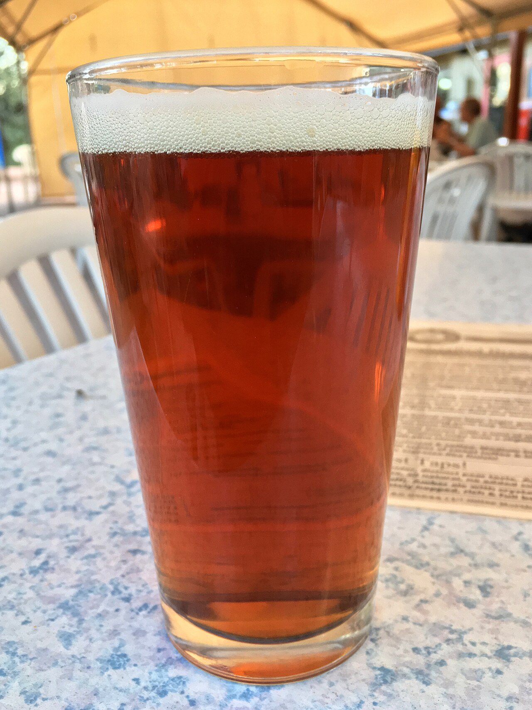

# Pale Ale

Pale ale is a family within [beer](ref:beer) built on pale malt, top fermentation and clearly readable hop aroma. At one end sits the bitter and cask ale tradition of [English ale](ref:english-ale); at the other, the American Pale Ale that craft brewers rebuilt in the 1980s with Cascade and similar hops. What places a beer in this family is not a colour swatch but whether the malt backbone can support the hops and whether the finish stays clean.

Figure: Pale Ale. Image: https://www.flickr.com/photos/cogdog/, CC BY 2.0, via Wikimedia Commons ([source page](https://commons.wikimedia.org/wiki/File:THAT_Brewery_Bearfoot_Pale_Ale.jpg)).

## How pale malt changed English brewing

In 18th-century England brewers switched from wood to coke for drying malt, cutting smoke and producing paler, cleaner-tasting grain. That malting change helped pale ale separate from brown ale. Burton-upon-Trent's hard, sulphate-rich water pushed hop bitterness into a drier, sharper shape, and the town's brewing trade became shorthand for English pale ale.

In the 19th century Britain shipped heavily hopped pale ale to India, and the stronger, bitterer export branch became IPA. The domestic version moved toward lower strength and higher volume, becoming the pub bitter. In 1980 Sierra Nevada in California released a Pale Ale built around Cascade, whose citrus, resin and grapefruit aromas gave pale ale a new reference point. American pale ale then became one of the most common entry styles in the craft movement. Naming on the two sides of the Atlantic is not consistent: British bitter is often labelled pale ale, while American pale ale may be bitterer and hoppier than its English counterpart. The boundary is a band, not a line.

## Mashing, fermentation and hopping

[Barley](ref:barley) is turned into pale base malt by [malting](ref:malting), supplying enzymes and fermentable sugar; a small share of crystal malt adds biscuit, caramel and amber colour. A warmer mash leaves more residual sugar and a rounder body, while a cooler mash gives a drier finish. English recipes often use Fuggles and Goldings for bitterness and aroma, whereas American recipes lean toward Cascade, Centennial and Citra, with their citrus and resin character.

[Fermentation](ref:fermentation) is top-fermenting, commonly at 18–20°C. Dry hopping adds hops late in fermentation or during conditioning, extracting aroma rather than bitterness. English pale ale usually sits around 4.0%–5.5% alcohol and 25–40 IBU; American pale ale commonly runs 4.5%–6.2% and 30–50 IBU. These figures vary with source and brewery and are not a legal standard; hop variety, hopping rate and attenuation change the result just as much. Water chemistry matters too: sulphate-heavy water magnifies a dry bitterness, while chloride-heavy water makes malt feel rounder.

## Aroma and texture in the glass

English pale ale rests on biscuit, toast and light caramel from the malt, with hops appearing as a soft mix of floral, earthy and citrus-peel notes; bitterness is clear without taking over. American pale ale puts hops at the front, with grapefruit, orange peel, pine and tropical fruit more direct, a drier bitterness and a resinous edge on the finish.

Both share a boundary of drinkability: alcohol should not rise so high that it buries the aroma, and the body should not become so thick that bitterness loses its outline. If hop aroma is generous but malt is absent, the beer feels hollow; if malt sweetness dominates, the hops turn vague. Oxidation brings cardboard and stale honey notes, which is a storage fault rather than a style trait. Carbonation also shapes judgment: English cask ale has softer bubbles and slower aroma release, while bottled or canned American pale ale is more lively and throws hop aroma faster.

## Regions and representative breweries

English pale ale is associated with Burton, Yorkshire and London. Burton's sulphate-rich water suits a dry hop bitterness, while London and southern breweries tend to emphasise softer malt. The Pacific Northwest is a key source of citrus-forward hops, with growers in Washington and Oregon supplying Cascade and Citra; California, Colorado and Vermont have produced American pale ales of different strengths.

On a label, "pale ale" may be a synonym for British bitter or shorthand for American pale ale. If a label says only "pale ale" without an origin, treat it as a family name still to be confirmed: alcohol content separates everyday versions from stronger ones, and the hop description points to an English or American leaning.

## Where pale ale ends and IPA, bitter and lager begin

Compared with IPA, pale ale usually has less alcohol and bitterness and more restrained hop expression; IPA can push hops to the limit, while pale ale still asks malt and hops to support each other. Compared with British bitter, it shares the same top fermentation and malt base, with the difference lying more in naming habit and strength: bitter is the everyday ale of the pub, pale ale the broader family name.

The line against [lager](ref:lager) comes from yeast and temperature: lager uses cool bottom fermentation for a cleaner flavour and a more linear hop expression, while pale ale uses top fermentation for more ester and malt layering. Reading pale ale simply as "a pale-coloured beer" misses fermentation, the core variable.

## Serving and pairing

Pale ale is best served at about 8–12°C. Too cold suppresses hop aroma; too warm lets alcohol and sweetness stand out. English versions suit a pint or a narrowing glass, American versions a tulip that gathers aroma; leave a reasonable head to help aroma lift.

With food, English pale ale suits fish and chips, meat pies and cheddar, while American pale ale suits burgers, pizza, tacos and salads with citrus. Avoid very hot or very sweet dishes that overpower the hops, or the bitterness will seem abrupt.

For Pale Ale, begin with the production rule, then the strength, and finish with the usual serving; that order keeps the account grounded.

[English ale](ref:english-ale)'s legal definition and [Lager](ref:lager)'s materials and process form a useful pair: the contrast shows where one ends and the other begins.

**Short definition:** A family of pale-malt, top-fermented beers with clearly readable hop aroma; English versions lean on malt and floral hops, American versions on citrus and resinous hops, forming a continuum with bitter and IPA rather than three isolated boxes.

**Key facts.**

| Item | Detail |
| --- | --- |
| In one line | A family of pale-malt, top-fermented beers with clearly readable hop aroma; English versions lean on malt and floral hops, American versions on citrus and resinous hops, forming a continuum with bitter and IPA rather tha… |
| Parent style | English ale |
| Aroma family | Hops and malt |

**Sources and limits.** The key claims about Pale Ale are checked against the following sources: Beer Judge Certification Program, Brewers Association, Campaign for Real Ale and 4 sources in total. Prices, batches and status change; the body is project-written and does not reproduce source text.
