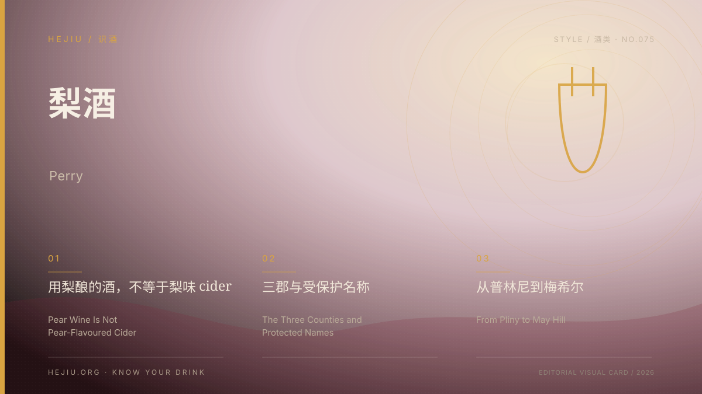

# Perry

Perry is a low-alcohol drink made by fermenting pear juice, most characteristically in Herefordshire, Gloucestershire and Worcestershire in the English West Midlands. It uses purpose-grown, high-tannin pears and ranges from dry to medium-sweet, usually between 4% and 8% ABV. The crucial difference from "pear cider" lies in the raw material: true perry is built on pear juice, while apple cider is built on apple juice, and the two follow different aromatic and tannic paths.

Figure: thematic illustration for Perry. Image: AI-assisted illustration generated with Doubao Seedream 5.0 (project-owned); not a photograph of the subject.

## Pear Wine Is Not Pear-Flavoured Cider

On a supermarket shelf, "pear cider" often means an apple-cider base with pear juice or pear flavouring added; it may be sweet, clear and strongly candy-like. Perry is the traditional fermented pear drink, defined by pear varieties and skin tannin. British and EU labelling debates have long circled the two words: one side wants perry to keep its traditional methods and pear varieties, the other treats pear cider as a market name consumers understand.

For the drinker, the practical test is the label and the ingredient list. A bottle marked "perry" usually emphasises pear varieties, vintage and a dry style; one marked "pear cider" may be sweeter and more industrial. Both can be enjoyable, but they are not the same flavour category.

## The Three Counties and Protected Names

The Three Counties of Herefordshire, Gloucestershire and Worcestershire are the traditional heartland. Soils and climate suit high-tannin pears, and the area around May Hill holds an especially dense concentration of early varieties. Perry production there has at least four hundred years of farming and documentary record, flourished in the seventeenth and eighteenth centuries, then declined as orchards disappeared.

"Herefordshire Perry" has been put forward as a geographical indication within the EU system, stressing origin, pear varieties and traditional method. Whatever the final label, Three Counties perry already forms a recognisable flavour community: dry, bitter, tannic and structured rather than simply sweet pear juice. A county name on the label usually tells you more than the word "pear" alone.

## From Pliny to May Hill

Perry's history reaches back to Rome. Pliny the Elder mentioned a fermented pear drink in the first century; medieval monasteries and farms left similar records. English perry grew in scale after the seventeenth century, when farms in Herefordshire and Gloucestershire treated it as a sibling of cider, drinking it at home and selling it in nearby towns.

Nineteenth-century agricultural change felled many old orchards, and twentieth-century industrialisation squeezed traditional perry further. By 2000, the Three Counties still had many named perry pear varieties, but fewer than thirty were grown commercially. In the last two decades, small producers, orchard-conservation groups and pubs have pushed a revival, bringing old varieties back to market.

## Pear Varieties Decide Everything

Perry pears are not dessert pears: the fruit is small, hard, astringent and high in tannin, unpleasant to eat but well suited to fermentation. Common varieties include Blakeney Red, Butt, Gin, Moorcroft and Thorn, each bringing a different aroma and structure. Some are floral, some citrusy, some distinctly bitter; blending can build a more complete body.

The Three Counties once held more than one hundred named perry pear varieties, many now kept only in national collections and old orchards. Single-variety perry shows the character of one tree, while a blend is more stable and closer to a producer's house style. This is also where perry differs most from mass-market cider: it remains a study of varieties and orchards.

## Fermentation, Racking and Bottle Conditioning

Ripe pears are harvested, crushed and pressed, and the juice goes into a fermentation vessel. Traditional methods rely on wild yeast, starting slowly at cool temperatures and producing more complex flavours; modern producers may inoculate with cultured yeast for consistency. After [fermentation](ref:fermentation), the liquid may be racked, clarified or left to settle, and some versions keep a little [residual sugar](ref:residual-sugar) for roundness.

Many fine perries then undergo a second fermentation in bottle: a little sugar and yeast are added at bottling so that the drink gains bubbles and a finer foam. The process resembles the traditional method for sparkling wine without the elaborate riddling equipment. Final strength usually falls between 4% and 8%, with acidity and tannin deciding whether it tastes crisp or weighty.

## Aroma: Blossom, Pear and Bitter Tannin

In the glass, perry is pale gold to light amber, clear or slightly hazy. The nose is pear, white blossom, citrus peel and hay, sometimes with honey and yeast. The entry starts with fruit, the middle shows tannic grip and a gentle bitterness, and the finish returns to pear and minerals. Compared with [apple](ref:apple) cider, perry is lighter and more floral, with finer tannin and usually softer acidity.

Sweetness varies widely: dry perry suits food, medium-sweet suits solo drinking. Judge it on three points: whether the pear aroma is real, whether tannin gives a backbone, and whether the finish is clean. A version that is only sweet feels thin; one that is too bitter needs food to restore balance.

## Herefordshire, Gloucestershire and Worcestershire

Producers in the Three Counties have different emphases. Westons is known for large-scale cider and perry across the sweetness range; Sheppy's continues a family orchard tradition in Somerset, often with a more forward fruit character; Dunkertons, Oliver's and Hogan's are smaller producers stressing organic fruit, old varieties and bottle conditioning. Together they have pushed perry from a rural drink back into city pubs and restaurants.

Normandy and Anjou in France also make a fermented pear drink, usually called poiré, drier and more mineral; Swedish päroncider is often sweeter and fruitier. Set side by side, they show that perry's core is not the word "pear" but the combination of high-tannin varieties and dry fermentation.

## Serving and Temperature

Perry is best lightly chilled, around 8 to 10 degrees Celsius; too cold mutes blossom and tannin, too warm pushes alcohol forward. Dry perry suits pork, roast chicken, fish, hard cheese and fried food; medium-sweet versions work with curry, spicy dishes and fruit desserts. Its tannin is finer than cider's, so white meat and seafood are not out of place.

In pubs, perry is often served from a cask or tap alongside cider, slightly warmer than fridge temperature and with softer carbonation. Bottle-conditioned versions may keep changing, so chill before opening and finish soon after. [Cider](ref:cider) and perry are often poured side by side, but the pear version rewards a separate look.

## Buying and Storage

Check the name and ingredients first: "perry" is more likely to be a traditional pear ferment, while "pear cider" may contain apple juice or flavouring. Then look at sweetness and strength; 4% to 8% is the usual range, and bottle-conditioned products often say so. A label naming vintage and pear variety shows that the producer wants you to trace its origin.

Perry is not for long cellaring, especially low-alcohol, low-tannin versions. Store it cool and dark, refrigerate after opening and finish within two or three days. A clear vinegar smell or an unusual haze means it is past its best.

Further reading: [Abbey beer](ref:c-extra-1).

Start with the production rule. From there, consider the strength, then the usual serving. That is how a practical judgment about Perry is built.