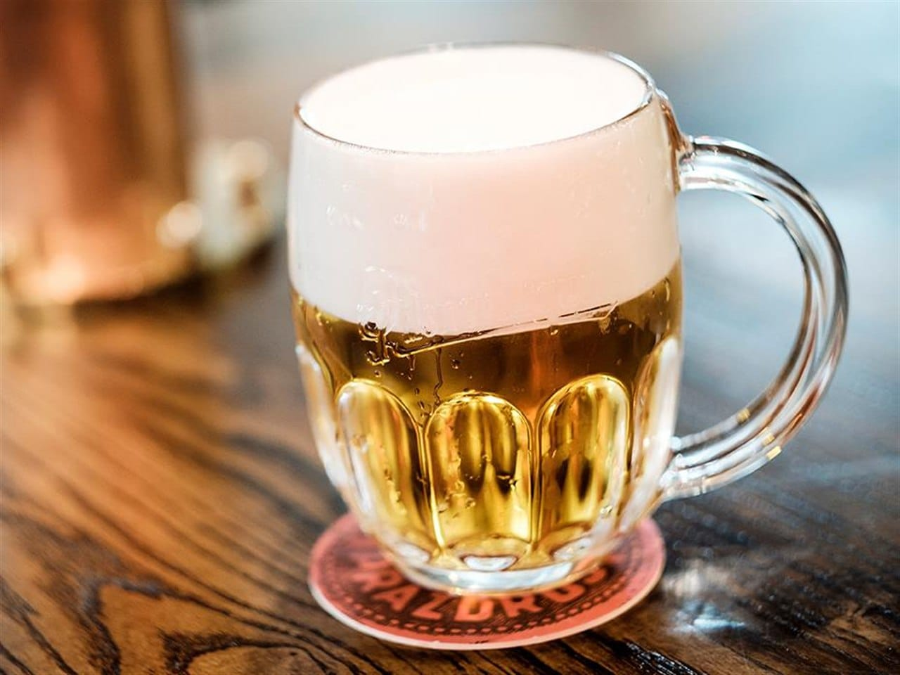

# Pilsner

Pilsner is a pale lager originating in the Bohemian city of Plzeň (Pilsen) in Czechia, characterised by very soft water, Saaz hops, pale malt and cool bottom fermentation. It is both a specific historical style and, in many countries, a loose term for pale lager; the two uses should be kept apart. Within the family of [beer](ref:beer), it belongs to the lager branch.

Figure: Pilsner. Image: Steven Walling, CC BY-SA 4.0, via Wikimedia Commons ([source page](https://commons.wikimedia.org/wiki/File:Pilsner_urquell_mug.jpg)).

## Definition and standards

In the framework of style guidelines, Pilsner broadly corresponds to Czech Premium Pale Lager: pale yellow to gold in colour, bright and clear, with [bitterness](ref:ibu) commonly around 30–40 IBU, an [original gravity](ref:original-gravity) mostly in the 11–12 °P range, and an alcohol content commonly 4.2–5.0%. These figures describe typical ranges, not a scorecard. Breweries adjust strength and bitterness for their markets, so the numbers alone cannot establish quality.

Names and styles must be separated. In the strict sense, Pilsner points to the brewing tradition of Plzeň; in Germany, the Netherlands, Brazil and elsewhere, Pils or Pilsen has become a generic label for pale lager, with hops, water and fermentation details adapted locally. Treating the two as identical hides real differences in recipe.

## Origin and history

Plzeň lies in western Bohemia in [Czechia](ref:czechia). In the early 19th century local beer was criticised for its quality, so citizens pooled funds in 1839 to found a civic brewery and engaged the Bavarian brewer Josef Groll. In 1842 the first pale bottom-fermented beer was produced, and it soon succeeded. That beer is today's [Pilsner Urquell](ref:pilsner-urquell) and a direct reference point for the style.

In the second half of the 19th century, railways and refrigeration carried Pilsner-style beer across Europe. Places kept the name but redesigned the recipe around local water, malt and hops, eventually producing Czech Pilsner and German Pilsner branches. The spread of a style is also a process of reinterpretation.

## Ingredients and process

[Water](ref:water) is the condition most easily overlooked in Pilsner. Plzeň's groundwater has very low mineralisation, with low sulphate and carbonate levels; it neither amplifies hop bitterness nor suppresses the delicate aroma of pale malt, so the finished beer tastes clean and brisk.

For [barley](ref:barley), the tradition uses pale malt made from Moravian two-row barley, kilned very lightly so that colour and flavour stay gentle. Saaz hops (Žatec in Czech, Saaz in German) are the reference variety: low in alpha acids, herbal, spicy and lightly floral, with a fine rather than sharp bitterness. Replacing them with high-alpha hops gives a more direct, harder bitterness and changes the style.

For mashing, the traditional method is triple decoction: part of the mash is boiled and returned, raising the temperature in steps so that enzyme action and malt flavour develop fully. Modern breweries often use stepped or single-infusion mashing to save energy. Decoction is not the only correct answer, but it works well with pale, lightly modified malt.

[Fermentation](ref:fermentation) is cool and bottom-fermenting, with primary fermentation usually held at 7–12°C and followed by long storage near 0°C. Cold and time let yeast settle, reduce off-flavours and stabilise foam and body. A warmer fermentation brings esters, which is no longer the neutral expression Pilsner aims for.

## Flavour profile

A typical beer is pale straw to gold, highly clear, with fine, persistent foam. The aroma rests on bready, biscuit-like malt, layered with the herbal, spicy and lightly floral notes of Saaz hops; esters and diacetyl should stay very low.

The first impression on the palate is a brief, soft malt sweetness, followed by clear but not coarse bitterness and a clean, fairly dry finish. The body is light to medium, carbonation medium to high, and the overall goal is briskness rather than intensity. Balance is central to this style: the bitterness needs support, and the malt must not be missing.

## Tasting and serving

Pilsner is best served well chilled, typically around 4–8°C; too cold mutes the aroma, too warm makes it feel loose. A tall glass or tulip helps gather foam and aroma. Czech pubs also practise layered pouring, adjusting the ratio of foam to beer to change texture and carbonation.

Freshness matters especially for Pilsner. Hop aroma and delicate malt notes fade quickly with oxidation and light, and clear glass is particularly vulnerable in daylight. Check the production date and storage conditions when buying; they say more than the packaging design. With food, the crisp bitterness suits fried food, sausages and dishes with some acidity.

## Common misconceptions

First, equating Pilsner with all pale lager. True Pilsner depends on a specific water, hop and fermentation tradition.
Second, assuming a pale colour means a bland beer. Flavour intensity comes from ingredients and process, not from colour.
Third, treating Pilsner as an ale. It is a bottom-fermented lager.
Fourth, assuming more bitterness means more authenticity. Pilsner seeks a fine, supported bitterness.
Fifth, expecting Pils to be the same beer everywhere. The name is shared, but recipes and regulations are not.

The comparison with [Beer](ref:beer) and [Water](ref:water) runs through legal definition and materials and process. Each answers a different question.

**Short definition:** A pale lager born in Plzeň, Czechia, defined by very soft water, Saaz hops, pale malt and cool bottom fermentation, and central to understanding modern pale lagers.

Start with the production rule. From there, consider the strength, then the usual serving. That is how a practical judgment about Pilsner is built.

The usual confusion is to treat Pilsner as a particular brand. Check what it is first, then what the label claims; the two need not agree.

Pilsner is a pale lager from Plzeň, Czechia, with soft water, noble hops and a clean, bitter finish; German Pils is drier and more bitter.

**Key facts.**

| Item | Detail |
| --- | --- |
| In one line | A pale lager born in Plzeň, Czechia, defined by very soft water, Saaz hops, pale malt and cool bottom fermentation, and central to understanding modern pale lagers. |
| Parent style | Beer |
| Aroma family | Malt and hops |

**Sources and limits.** The key claims about Pilsner are checked against the following sources: Beer Judge Certification Program (the strength, bitterness and colour ranges of Czech Premium Pale Lager; no original text is reproduced), Brewers Association (public industry statements on pale lager and style naming; no original wording is reproduced), Plzeňský Prazdroj (public information on the 1842 origin, Plzeň water and hops; no original text is reproduced) and 4 sources in total. Prices, batches and status change; the body is project-written and does not reproduce source text.

For Pilsner, this style was last checked in 2026; prices, batches and availability change, so confirm them against the sources below.

## Further reading

- [Beer](ref:beer): the overall classification of lager and ale.
- [Czechia](ref:czechia): the home region and brewing tradition of Plzeň.
- [Water](ref:water): how soft water shapes a pale lager.
- [Barley](ref:barley): the basis of pale malt and body.
- [Fermentation](ref:fermentation): bottom fermentation and cold storage.
- [Bitterness](ref:ibu): what an IBU figure means and where it stops.
- [Original gravity](ref:original-gravity): another measure of strength and body.
- [Pilsner Urquell](ref:pilsner-urquell): the representative product of the style.
