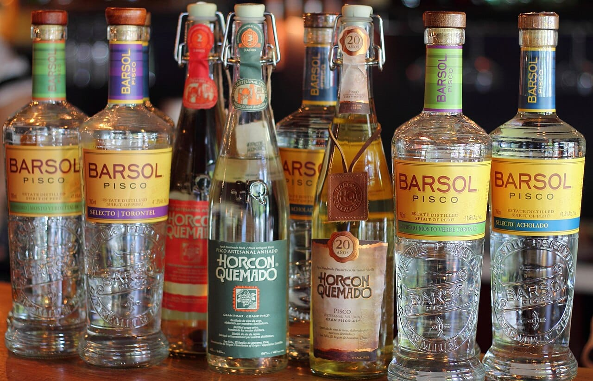

# Pisco

Pisco is a grape spirit distilled from freshly fermented grape juice, produced in Peru and Chile. It belongs to the wider [brandy](ref:brandy) family, yet it follows a different logic from Cognac or Armagnac: most Pisco is never aged in oak, and it is not diluted with water before bottling. The aim is to capture the aroma of a particular grape harvest, not to build complexity through years in barrel. Both countries maintain protected appellations and detailed production rules, and both claim the name, a dispute that has lasted for decades.

Figure: Pisco. Image: Cocktailmarler, CC BY-SA 4.0, via Wikimedia Commons ([source page](https://commons.wikimedia.org/wiki/File:Range_of_Pisco.jpg)).

> **Quick verdict**
> **In one line:** This style places Pisco on the flavour map, and helps you choose and serve it.
>
> - **Best for:** Anyone comparing Pisco with other styles before buying or ordering.
> - **Not for:** If you want want a single “best” ranking and reject stylistic difference.
> - **Check first:**
>   - Pisco grew out of colonial viticulture in South America.
>   - To read Pisco, start with the production rule, then the strength, then the usual serving; no single check settles it.

## Definition and regulation

Three elements define Pisco. First, the raw material is grape juice or must, not pomace, so it is not a grape-marc spirit. Second, the process is fermentation followed by [distillation](ref:distillation), not maceration or compounding. Third, the name is protected through a [denomination of origin](ref:appellation), so only spirit made in the specified regions under the specified rules may be called Pisco.

Peru's appellation requires copper pot stills, a single distillation and a heart cut bottled at 38%–48% ABV. Nothing may be added: no water, sugar, colouring or flavouring. Oak is forbidden; the spirit rests in glass, stainless steel or other inert containers. Chile's appellation covers the Atacama and Coquimbo regions and sets alcohol tiers by strength, while permitting oak maturation for certain labelled products. Both rulebooks use the word Pisco, but their thresholds are not the same.

EU spirit-drink law provides a comparative framework for grape spirits and brandy, but Pisco itself is governed by Peruvian and Chilean law and by bilateral agreements. When reading a label, establish the country of origin first, then look at strength and any maturation claim.

## History

Pisco grew out of colonial viticulture in South America. The Spanish brought vines to Peru and Chile in the sixteenth century, and irrigated coastal valleys gradually became important wine regions. Wine was bulky and perishable, so local producers began distilling wine or grape must into a stronger, more stable spirit that was easier to store and tax. The port of Pisco on Peru's southern coast gave the drink its name and became a key export point.

Phylloxera and war disrupted South American wine in the nineteenth century, and Pisco production rose and fell with the region's fortunes. Peru formalised its denomination of origin in 1991; Chile strengthened its own appellation rules around the same period. Both countries regard their product as authentic, and the argument has moved into international trade negotiations. For drinkers, the practical approach is to understand the two rulebooks rather than to treat one as the only true version.

## Grapes and production

The raw material is grape. Peru permits eight varieties, usually divided into aromatic and non-aromatic groups. The aromatic set includes [Muscat](ref:muscat), Italia, Albilla and Torontel, which bring flowers, citrus and melon. The non-aromatic set includes Quebranta, Negra Criolla, Mollar and Uvina, with greener, more savoury notes of grass, banana, bread and mineral. Chile relies mainly on Moscatel de Alejandría, Moscatel Rosada, Pedro Jiménez and Torontel, which tend to give more overt fruit.

Grapes are pressed and fermented to dryness, with or without skins, and distilled soon after fermentation to avoid oxidation. Peru insists on a single distillation in a pot still: heads and tails are cut away and only the heart is kept, so the spirit is strong and concentrated. Chile allows more than one distillation route, including double distillation and column stills, which can produce a lighter spirit.

Peruvian Pisco is not reduced with water; the bottling strength is the strength of the heart cut. Chile permits adjustment to the declared tier. The difference is immediately visible in the glass: Peruvian Pisco is drier and more austere, with a tighter aroma, while Chilean Pisco is often softer and more openly fruity.

## Two legal styles

Peru's production zones are Lima, Ica, Arequipa, Moquegua and Tacna, with Ica at the centre. The rules require single distillation, no added water or sugar, no oak, and a minimum resting period of three months. Bottles may be labelled by variety, either single-variety or blended, and by aromatic or non-aromatic style.

Chile's zones lie in Atacama and Coquimbo, covering several river valleys. Strength tiers are Corriente or Tradicional at a minimum of 30% ABV, Especial at 35%, Reservado at 40% and Gran Pisco at 43%. Oak claims are also regulated: at least 180 days in oak allows the term "guarda", and at least 360 days allows "envejecido". Chilean Pisco is therefore not uniformly unoaked.

## Grades and categories

Peru classifies Pisco mainly by grape and aroma: single-variety or blended, aromatic or non-aromatic. It also recognises mosto verde, made from must that has not finished fermenting. The distillate is still dry, because sugar does not pass through the still, but it carries more aroma and a fuller texture.

Chile classifies by strength and maturation: four strength tiers plus the guarda and envejecido claims. These tiers are compliance bands, not a quality ranking. A 43% Gran Pisco is not automatically better than a 35% Especial; clean aroma and clear varietal character matter more.

## Sensory profile

Young Pisco smells of grape, citrus, white flowers, melon and grass. It is dry, medium-light in body and warm, but it should not smell of solvent. Aromatic varieties show rose, orange blossom, lychee and musk; non-aromatic varieties lean towards banana, bread, mineral and a faint saline note. Mosto verde is rounder and more aromatic.

Chilean Pisco often shows riper tropical fruit, raisin and flowers, depending on variety and still. Oak-aged versions add vanilla, cream and light spice. In either country, heavy oak tannin or caramel sweetness is a warning sign: it points to a Chilean aged style or to a flavoured product, not to the classic unaged profile.

## Regions

Peru's core region is Ica, hot and dry with intense sunlight, which gives ripe, concentrated fruit. The port of Pisco and the valleys around Lima also have historical claims. Arequipa, Moquegua and Tacna in the south produce smaller volumes with a fresher profile. Region and variety on the label are useful clues.

[Chile](ref:chile)'s Pisco zones are in the north, in Atacama and Coquimbo, including the Elqui, Limarí and Choapa valleys. Large day-night temperature swings and dry air help retain acidity, which suits a fresher style. A region name is not a guarantee of quality, but it does signal climate and variety.

## Representative products

Peru's signature is single-variety Quebranta: banana, bread and grass, dry and firm, equally good neat or in a Pisco Sour. Aromatic Italia and Torontel are often bottled alone for their floral lift, and mosto verde represents Peru's richer, more textured style.

Chile's representative types include single-variety Moscatel, Reservado and Gran Pisco, plus oak-aged guarda and envejecido bottlings. White Pisco suits mixing; aged versions can be sipped. The Pisco Sour is a national cocktail in both countries, though the proportions and sweetness vary.

## Tasting and serving

To read Pisco, start with the production rule, then the strength, then the usual serving; no single check settles it.

Neat serving is best for judging style. Pisco Sour, Chilcano and Piscola are common mixed serves. Stronger bottlings deserve small glasses and food; excessive drinking is harmful, and minors should not drink.

## Common misconceptions

First, that Pisco is a grape-marc brandy. It is made from fresh juice, not skins. Second, that all Pisco is unoaked. Peru forbids oak, but Chile permits it and regulates the claims. Third, that Chile's strength tiers are a quality scale. They are legal bands. Fourth, that sweeter Pisco is better. Most Pisco is dry; any sweetness comes from grape and fermentation, not added sugar. Fifth, that the Pisco Sour is the only way to drink it. Neat tasting reveals variety differences. Sixth, that Peru and Chile make the same product. Their rules, varieties and styles differ.

## Further reading

- [Brandy](ref:brandy): the wider family of grape spirits.
- [Distillation](ref:distillation): how a single distillation and the heart cut shape style.
- [Muscat](ref:muscat): a key aromatic variety behind many Piscos.
- [Chile](ref:chile): the northern valleys and climate behind Chilean Pisco.
- [Appellation](ref:appellation): the basic idea behind Pisco's protected name.

## Related images

Image: Muscat. Credit: Tristan, CC BY 2.0, via Wikimedia Commons ([source page](https://commons.wikimedia.org/wiki/File:Al_Alam_Palace.jpg)). Related image for Pisco.
