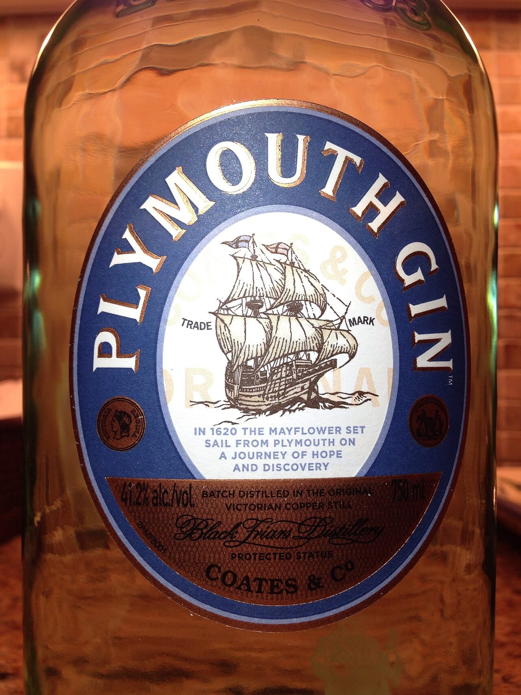

# Plymouth Gin

Plymouth Gin is a [gin](ref:gin) identified with the English city of Plymouth. What makes it unusual is not the botanical recipe but the origin rule: the name is tied to the Black Friars distillery in Plymouth, and production moved out of the city cannot be called Plymouth Gin. It is softer and earthier than London Dry, and its history is closely tied to the Royal Navy and classic cocktails.

Figure: Plymouth Gin. Image: WestportWiki, CC BY-SA 3.0, via Wikimedia Commons ([source page](https://commons.wikimedia.org/wiki/File:Plymouth_Gin_1793_Black_Friars_Distillery_2.jpg)).

## One place, one style

Plymouth Gin is both a brand and a style. As a brand, it is made at Black Friars; as a style, it stands for a rounder, less citrus-sharp, more root-and-spice juniper spirit than London Dry. The two are easily confused, because today almost only one distillery makes the name.

That matters: Plymouth Gin is not "any gin made in Plymouth", nor a regional version of London Dry. It is an identity held together by place, distillery, recipe and law; remove any one condition and the name loses its meaning.

That also explains why Plymouth Gin is often recommended to a first-time gin drinker: juniper is less sharp than in London Dry, citrus does not steal the scene, and the entry is closer to the roundness of grain. For experienced drinkers, softness is not simplicity; the balance between botanicals and the length of the finish still deserves attention. That is also why it works as an everyday gin rather than an occasional pour.

## Black Friars and 1793

The Black Friars building goes back to the fifteenth century and once belonged to a Dominican friary; the distillery has made gin on the same site since 1793 and is one of England's longest continuously operating gin distilleries. The still room, refectory and visitor spaces preserve a great deal of historic structure, so "origin" is more than a word on a label.

The 1793 date is often used to emphasise continuity: same site, same buildings, same basic recipe. Continuity does not guarantee quality, but it explains why Plymouth Gin can write place into its flavour story: water, buildings, equipment and people have accumulated in one spot.

## Seven botanicals and Dartmoor water

The Plymouth recipe is usually published as seven botanicals: juniper, coriander, cardamom, angelica, orris root, orange peel and lemon peel. Lists from different sources may vary slightly, but the structure is clear: juniper gives the frame, coriander adds citrus spice, cardamom brings warmth, angelica and orris give earth and flower, and citrus peel lifts the whole.

[Juniper](ref:juniper) is not meant to be as sharp as possible. Plymouth Gin is softer and more rooty, with clear but not aggressive juniper, restrained citrus and a faint sweetness at the finish. Production uses Dartmoor water, which affects dilution and texture, but water is not the whole flavour; botanical ratio and distillation cuts are decisive.

## The edge of the geographical name

Plymouth Gin was long protected as a geographical indication in the EU; after Brexit, geographical names moved into the UK system, and the current register status should be checked against the official listing. Whatever the register says, the production boundary has been clear: the gin must be made within Plymouth, at the Black Friars site.

A GI protects a set of conditions, not a secret formula. It fixes origin, production site and basic style, preventing outside distilleries from free-riding on the name Plymouth; it does not guarantee that every bottle is good, nor stop the producer from adjusting the recipe. If the distillery moves or bottles outside the city, the name loses its basis; that is what makes a GI stricter than an ordinary trademark. On a label, origin, distillery and strength are more reliable than words such as "navy" or "traditional".

## The navy, Pink Gin and cocktails

The link with the Royal Navy is one of Plymouth Gin's best-known stories. Navy Strength is usually 57% ABV, and the tale connects it to the gunpowder test at sea: gin at that strength spilled on gunpowder could still ignite, proving it had not been over-diluted. The details are hard to prove completely, but Navy Strength became a general term for high-strength gin.

Pink Gin is the classic Plymouth serve: gin with a few dashes of bitters, sometimes a little water, giving a pale pink colour. It is simple and direct and tests the gin itself. Plymouth Gin also suits the dry Martini, the [gin fizz](ref:gin-fizz) and the [Negroni](ref:negroni); the standard 41.2% ABV gives it volume in stirred drinks without excessive heat.

Neat, Plymouth Gin is best slightly chilled in a small glass so roots and citrus unfold; in a gin and tonic it needs little garnish, a strip of lemon peel or rosemary is enough. Softness is not weakness: the alcohol still carries soda and ice, and the key is not to drown juniper under too much tonic.

## Where Plymouth and London Dry differ

[London Dry](ref:london-dry-gin) is a process name with no origin limit; Plymouth Gin is a place name limited to production in Plymouth. In style, London Dry is usually drier, more citrus-led and sharper; Plymouth is softer, more rooty and rounder, with a less aggressive line between juniper and citrus.

It also differs from [genever](ref:genever): genever uses malt wine as an essential component, while Plymouth Gin is still built on neutral grain alcohol and redistilled botanicals, without malt-wine weight. Seen together, Plymouth Gin has a clear position: softer than London Dry, drier than genever, a middle style organised around place.

Begin with the production rule, move on to the strength, and finish with the usual serving. That order keeps the reading of Plymouth Gin practical.

**At a glance:** A gin style identified with the English city of Plymouth and produced at the Black Friars distillery; softer and earthier than London Dry, the standard bottle is 41.2% ABV and Navy Strength is 57% ABV, and it is a historical base for Pink Gin and the dry Martini.

**Sources and limits.** The key claims about Plymouth Gin are checked against the following sources: Plymouth Gin (the history, buildings and production site of the Black Friars distillery), UK Government (the current UK framework for spirit-drink geographical indications), European Union (gin categories and the boundary with GI spirit drinks) and 4 sources in total. Prices, batches and status change; the body is project-written and does not reproduce source text.

**Read alongside.** Put Plymouth Gin next to Gin, London dry gin, Genever: the first fixes identity and boundary, the others provide a region, process or peer comparison. Read this style first, then return to those entries; the links become coordinates, not decoration.

For Plymouth Gin, this style was last checked in 2026; prices, batches and availability change, so confirm them against the sources below.
