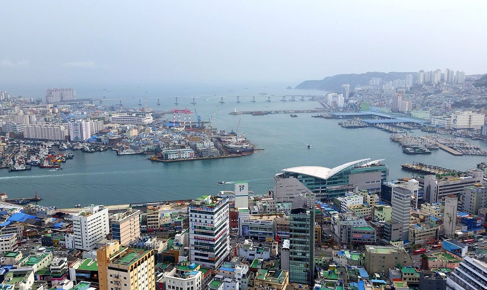
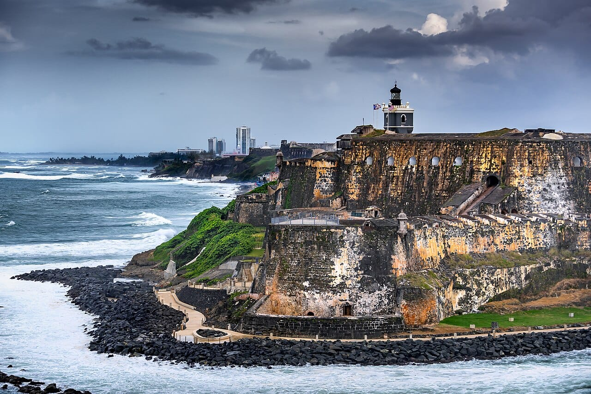

# Port

Port is a sweet fortified wine from Portugal's Douro Valley. Grape spirit is added before fermentation finishes, killing the yeast, stopping fermentation and leaving sugar in the wine while raising strength to about 19%–20% ABV. Sweet, full-bodied and long-lived is the immediate impression, but the real style split comes after [fortification](ref:fortification): whether the wine matures in a reductive or an oxidative environment.

Figure: Port. Image: cezzie901, CC BY 2.0, via Wikimedia Commons ([source page](https://commons.wikimedia.org/wiki/File:View_of_Nam_Harbor_from_Busan_Tower.jpg)).

> **Quick verdict**
> **In one line:** This style places Port on the flavour map, and helps you choose and serve it.
>
> - **Best for:** Anyone comparing Port with other styles before buying or ordering.
> - **Not for:** If you want want a single “best” ranking and reject stylistic difference.
> - **Check first:**
>   - The name comes from the port city of Porto.
>   - Serve Ruby and LBV at 16–18°C, Tawny at 12–16°C, White Port at 8–10°C and Vintage at 16–18°C after decanting; a young Vintage may need an hour or more.

## Definition and regulation

Port is a protected [denomination of origin](ref:appellation). The appellation lies in the [Douro Valley](ref:douro) in northern Portugal, and the name Porto or Vinho do Porto is regulated by the Instituto dos Vinhos do Douro e Porto (IVDP). Growing, making and fortifying must happen in the Douro; maturation may take place in the Douro or in the traditional lodges of Vila Nova de Gaia.

Port must be made from permitted Douro varieties, fortified mid-fermentation with grape spirit, and bottled at about 19%–20% ABV, with residual sugar depending on the category. EU wine law provides the framework for geographical indications and [fortified wines](ref:fortified-wine), while the IVDP specification sets varieties, yields, maturation and labelling.

"Port" is not a generic term for sweet fortified wine. Only wine made in the Douro under the rules, and matured in the permitted locations, may use the name. Similar wines from elsewhere are simply fortified wines.

## History

The name comes from the port city of Porto. In the seventeenth century, British merchants bought wine in northern Portugal and found that ordinary wine travelled badly. Adding grape spirit raised strength and helped the wine survive the sea voyage. The Methuen Treaty of 1703 lowered English tariffs on Portuguese wine, and the Port trade expanded quickly.

Vineyards spread through the Douro in the eighteenth century, and in 1756 the Marquis of Pombal demarcated the region, an early example of a legally defined wine appellation. Phylloxera and disease hit the Douro in the nineteenth century, and replanting on grafted rootstock restored production. The IVDP gradually standardised categories, ageing and labelling in the twentieth century; after Portugal joined the European Community in 1986, the geographical indication system became more formal.

## The Douro and its terraces

The Douro runs from west to east through Baixo Corgo, Cima Corgo and Douro Superior. Baixo Corgo is wetter and earlier ripening, producing lighter wines. Cima Corgo is the heart of Port, with schist slopes and large day-night temperature swings that give ripe fruit and retained acidity. Douro Superior is hotter and drier, with lower yields.

The terraces are the region's signature. Traditional stone-walled socalcos create narrow platforms that hold water and limit erosion but are hard to mechanise. Modern patamares use earth platforms instead of walls and allow machinery. A third system, vinha ao alto, plants rows up the slope. Terrace form changes light, water and ripening, and therefore wine structure.

## Varieties

Port is mainly red. Touriga Nacional gives flowers, black fruit and tannin; Touriga Franca gives aroma and suppleness; Tinta Roriz (Tempranillo) gives red fruit and acidity; Tinta Barroca gives sugar and volume; Tinto Cão gives acidity and ageing potential; Sousão gives colour and acidity. White Port uses Malvasia Fina, Viosinho, Gouveio, Rabigato and other white grapes.

These varieties are often field-blended and co-fermented. Old vineyards may contain many varieties, and single-variety Port is relatively rare. The aim is a balance of colour, tannin, acidity and aroma rather than the pure expression of one grape.

## Fortification

The dividing line between Port and ordinary wine is mid-fermentation. Grapes are pressed and fermented, and while sugar is still being converted to alcohol, grape spirit at about 77% ABV is added, usually at roughly one fifth of the volume of must. Strength rises to 19%–20% ABV, the yeast stops, and residual sugar remains.

Timing sets sweetness: an earlier addition leaves more sugar and a sweeter, fruitier wine; a later addition gives a drier style closer to table wine. The fortified wine then matures in large casks, small casks, stainless steel or bottle, depending on category. The added spirit should be neutral enough not to mask the grape.

## Categories

Port categories can be read along two axes, container and vintage:

- **Ruby**: mainly reductive ageing; deep red, vivid fruit, full body, for relatively early drinking.
- **Tawny**: mainly oxidative ageing; amber to tawny, with dried fruit, nuts, caramel and coffee. The 10, 20, 30 and 40 year labels indicate the average age of the blend, not a vintage.
- **Vintage**: a single harvest from a declared year, matured about two years in cask and then for a long time in bottle; bottling normally falls between the second and third year after harvest.
- **LBV (Late Bottled Vintage)**: a single harvest, usually four to six years in cask before bottling; filtered and unfiltered versions exist, the latter better suited to further bottle age.
- **Colheita**: a single-harvest tawny, aged at least seven years in wood.
- **Crusted**: a blend of several harvests, bottle-aged until it throws a crust, closer to Vintage in style but ready earlier.
- **White Port**: made from white grapes, ranging from dry to sweet, often served as an aperitif.
- **Rosé Port**: short skin contact, pale pink, light fruit, served chilled.

These are process and maturation choices, not a quality ladder. Vintage stresses year and bottle potential, Tawny stresses oxidation and blending, LBV offers a single year earlier, and Colheita stresses long wood ageing from one harvest.

## Sensory profile

Ruby smells of blackberry, cherry, plum and chocolate, with a full body, noticeable tannin and a sweet finish. Tawny turns to raisin, fig, walnut, caramel, coffee and orange peel, with a softer texture and brighter acidity. Young Vintage is concentrated and tannic, developing leather, tobacco, spice and truffle with age. LBV is usually riper and softer, ready sooner. White Port shows citrus, apricot, honey and almond, with sweetness from dry to luscious.

Port's sweetness comes from residual grape sugar, not from sweetening after fermentation, although cheaper products may be sweetened or flavoured. The category and label are the guide. High alcohol and high sugar make Port a small-glass drink, not a thirst quencher.

## Representative products

Representative types include young, fruity Ruby; Tawny labelled 10 or 20 years; single-year Vintage and LBV; long-aged Colheita; and White and Rosé Port. Classic houses include Taylor's, Graham's, the Symington family brands and Quinta do Noval; these are reference points, not a ranking.

A Vintage year is "declared" by the shipper when the quality justifies it, so it is not produced every year. When buying Vintage Port, consider the house, the year and the condition of the bottle, not just the word Vintage.

## Tasting and serving

Serve Ruby and LBV at 16–18°C, Tawny at 12–16°C, White Port at 8–10°C and Vintage at 16–18°C after decanting; a young Vintage may need an hour or more. Use a tulip glass or a Port glass, sip slowly, and look for fruit, nut and spice before judging sweetness, acidity, tannin and length.

With food, Ruby and Vintage suit chocolate, blue cheese, red meat and game; Tawny suits nuts, dried fruit, caramel desserts and aged cheese; White Port works as an aperitif with olives, almonds and seafood. Excessive drinking is harmful, and minors should not drink.

## Common misconceptions

First, that Port is always deep red. Tawny is amber, White Port is white and Rosé Port is pink. Second, that the 10 on a Tawny is a vintage. It is an average age. Third, that LBV is the same as Vintage. LBV is bottled earlier, drinks earlier and usually has less ageing potential. Fourth, that sweeter Port is better. Sweetness is a style, not a grade. Fifth, that opened Port keeps indefinitely. Refrigerate it and finish it within weeks. Sixth, that Port is a grape or a generic name for fortified wine. It is a protected geographical indication.

## Further reading

- [Fortified wine](ref:fortified-wine): the wider category and its processes.
- [Fortification](ref:fortification): how mid-fermentation addition preserves sugar.
- [Porto](ref:porto): the appellation as a whole.
- [Douro](ref:douro): the valley, its terraces and its climate.
- [Appellation](ref:appellation): the basic idea behind Port's protected name.

## Related images

Image: Fortification. Credit: John Scofield, CC BY-SA 4.0, via Wikimedia Commons ([source page](https://commons.wikimedia.org/wiki/File:Castillo_San_Felipe_del_Morro_(10_of_1).jpg)). Related image for Port.
