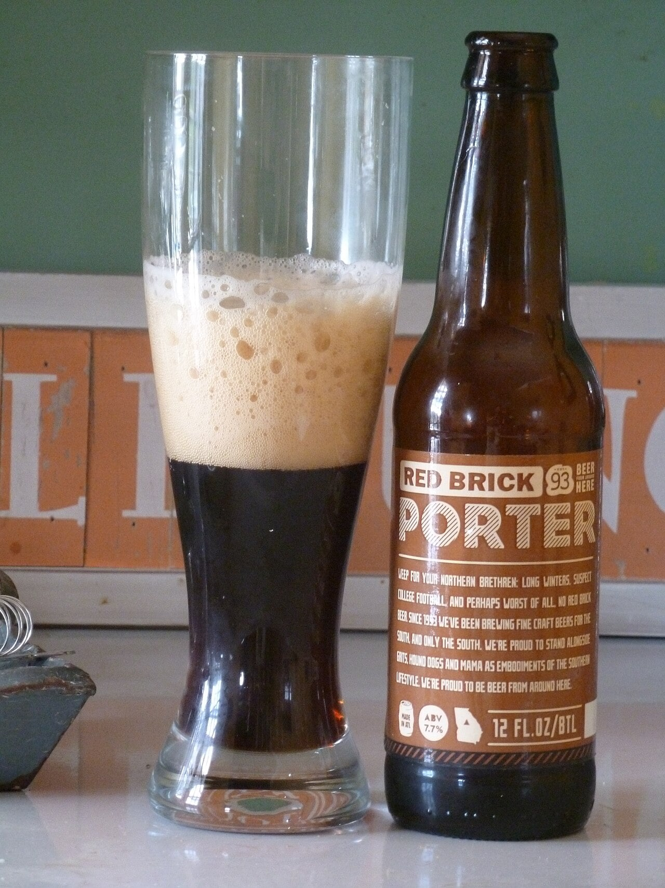

# Porter

Porter is a dark top-fermented beer that arose in 18th-century London, with roast, coffee and cocoa flavours coming from brown malt and later roasted malt. The name is said to come from London street and market porters, who were among its main drinkers. Porter and stout share a historical root, but they are not equivalent in strength, sweetness or recipe.

Figure: A bottle of Red Brick Porter and a glass of dark beer with a beige head. Image: Erik Cleves Kristensen, CC BY 2.0, via [source page](https://www.flickr.com/photo.gne?id=6175146624).

## Definition and standards

In modern style systems porter is usually divided into brown porter, robust porter and Baltic porter. Brown porter commonly has 4.0–5.4% alcohol and about 18–35 IBU; robust porter commonly has 4.8–6.5% and a little more bitterness; Baltic porter commonly has 6.5–9.5% and a fuller body. These ranges describe typical examples, not a scoring scale. Porter belongs to the top-fermenting family within [beer](ref:beer), sharing technique and market context with [English ale](ref:english-ale).

What needs separating is name and strength. The historical “stout porter” meant a stronger porter, and “stout” later became the separate [stout](ref:stout) style; a porter today is not necessarily lighter than a stout, and a stout is not necessarily sweeter than a porter. Treating the two as one style, or ranking them simply by colour, misreads the recipes.

## Origin and history

Porter became popular in London in the 1720s. The local water was hard and rich in carbonate, suited to mashing dark malt; large breweries combined different batches of beer and supplied the market after a period of ageing. In the late 18th century porter was one of London's important beer types and was exported to Ireland and continental Europe.

In the 19th century, as glassware, railways and drinking habits changed, porter lost ground in Britain while stout and pale ale gained attention. The Baltic region imported English porter in the 18th and 19th centuries and later evolved Baltic porter from local ingredients and technique. In the late 20th century the [craft beer](ref:craft-beer) movement brought porter back in Britain and the United States; today [the United Kingdom](ref:uk) and the United States are the most representative homes.

## Ingredients and process

[Barley](ref:barley) is the backbone of porter. In the 18th century porter used a large share of brown malt, kilned over direct fire, which gave deeper colour and roast flavour; from the 19th century recipes shifted towards pale base malt with a small amount of black malt or roasted malt for cleaner colour and roast character. Modern recipes may add crystal malt, chocolate malt or a little roasted rye.

[Fermentation](ref:fermentation) is top-fermenting, usually at 18–22°C. Historically porter was aged for months in wooden barrels, rounding the body and adding a light oxidative note; modern breweries mostly use stainless steel and aim for a cleaner result. London water, malt kilning and longer ageing together form the process background of traditional porter.

## Flavour profile

The beer is deep brown to black, often with ruby edges in backlight. The aroma is dominated by chocolate, coffee, caramel and toast, possibly with nuts and dried fruit; hops give a medium bitterness, herbal in British versions and sometimes stronger in American ones. Brown porter is medium-bodied with a fairly dry finish; robust porter is richer and sweeter; Baltic porter is full-bodied with obvious alcohol warmth and a flavour closer to dark lager.

The roast in a good porter should be clean, without burnt, acrid smoke or cardboard notes. As the beer warms, caramel and alcohol become more obvious, so tasting across a range of temperatures is useful.

## Tasting and serving

Porter is best at around 8–12°C, while Baltic porter can be served a little warmer at 12–14°C. Tulip, narrowing or pint glasses all work, and the shape mainly affects aroma concentration and foam. With food it suits grilled meat, stews, hard cheese and dark chocolate desserts; Baltic porter also pairs well with eastern European dishes.

Store away from light in a cool place. Low-alcohol brown porter is best drunk fresh; strong robust and Baltic porter can be cellared moderately under suitable conditions, but not indefinitely. Cask porter is usually served a little warmer than bottled versions.

## Common misconceptions

First, assuming porter is simply stout, or that the two differ only in colour. They share a history but diverged in strength, sweetness and recipe.
Second, assuming a blacker colour means a stronger beer. Colour comes from roasting, while alcohol comes from recipe and fermentation.
Third, assuming porter belongs only to Britain. The Baltic region and the United States both developed stable traditions.
Fourth, treating Baltic porter as a simple copy of British porter. It went through local ingredient and process adaptation.
Fifth, assuming every porter benefits from long ageing. Only well-structured, strong versions have cellaring value.

**Short definition:** A dark top-fermented beer that arose in 18th-century London, given roast, coffee and cocoa flavours by brown malt and later roasted malt; named after market porters and related to stout, though not the same, with modern robust and Baltic porter branches.

Porter is best approached through the production rule, then the strength, and then the usual serving. One check alone will not settle it.

[Beer](ref:beer) and [English ale](ref:english-ale) answer different questions about Porter: legal definition and materials and process. Read them as a pair, not as alternatives.

Treating Porter as a particular brand mixes two different questions: identity and use. Separate them before comparing.

The entry on Porter draws on Beer Judge Certification Program, Campaign for Real Ale, Brewers Association, Oxford University Press.

Porter is a dark top-fermented beer from 18th-century London, built on brown malt and later roasted malt; stout is the stronger descendant.

**Key facts.**

| Item | Detail |
| --- | --- |
| In one line | A dark top-fermented beer that arose in 18th-century London, given roast, coffee and cocoa flavours by brown malt and later roasted malt; named after market porters and related to stout, though not the same, with modern … |
| Parent style | Beer |
| Aroma family | Roasted malt |

**Sources and limits.** The key claims about Porter are checked against the following sources: Beer Judge Certification Program, Campaign for Real Ale (public statements on British dark beer and pub serving traditions; no original text is reproduced), Brewers Association (US craft industry discussion of porter and its variants; no original wording is reproduced) and 4 sources in total. Prices, batches and status change; the body is project-written and does not reproduce source text.

For Porter, this page was last checked in 2026; prices, batches and availability change, so confirm them against the sources below.

## Further reading

- [Beer](ref:beer): where porter sits in the beer style system.
- [Stout](ref:stout): the other dark beer branch that shares porter's roots.
- [English ale](ref:english-ale): the top-fermenting tradition porter belongs to.
- [The United Kingdom](ref:uk): London porter's historic home and pub culture.
- [Barley](ref:barley): the source of brown and roasted malt.
- [Fermentation](ref:fermentation): how top fermentation and ageing shape body.
- [Craft beer](ref:craft-beer): the background for porter's modern revival and variants.
