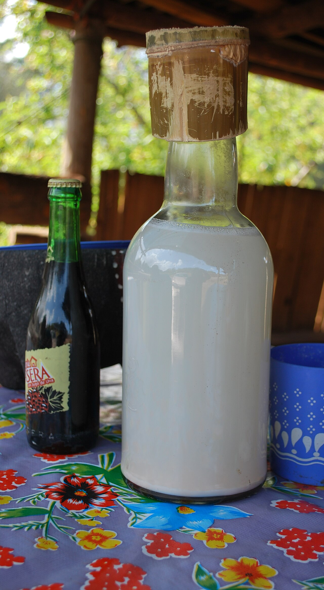

# Pulque

Pulque is a low-alcohol drink from central Mexico made by fermenting agave sap naturally. Its key fact can be stated in one sentence: it is not distilled. The agave is cut and scraped to release sap, the sap [ferments](ref:fermentation) in a vessel with wild yeasts and bacteria, and within days it becomes a sour, viscous, yeasty white drink. It shares a plant starting point with [tequila](ref:tequila) and [mezcal](ref:mezcal), but belongs to a completely different technical tradition.

Figure: Pulque. Image: AlejandroLinaresGarcia, CC BY-SA 3.0, via Wikimedia Commons ([source page](https://commons.wikimedia.org/wiki/File:Pulquebottle.JPG)).

## A fermented juice, not a distillate

The raw material is aguamiel, literally "honey water", the sweet sap that seeps from the heart of the agave. The harvester, called a tlachiquero, scrapes the heart so that sap collects, then draws it out with a gourd or a tube. The sap cannot wait: it must reach the tinacal, the fermentation room, quickly, or it will over-ferment or spoil.

Finished pulque usually has only 4% to 6% ABV, lower than wine and closer to a fermented drink such as [cider](ref:cider). It is neither distilled nor aged for long, which means it must be drunk fresh and cannot sit in a bottle for years like a spirit.

## From sacred drink to pulquería

In pre-Hispanic central Mexico, pulque carried religious and ritual meaning. The agave was a sacred plant, and pulque was linked to fertility, offerings and particular festivals; during the colonial period, Spanish authorities tried at times to restrict its consumption because it was associated with drunkenness and "pagan" custom. Prohibition did not erase it, and it survived in everyday urban and rural drinking.

From the nineteenth century into the early twentieth, the pulquería became part of Mexican city life. These places worked like today's cafés or beer halls, serving large glasses of white pulque, flavoured pulque and snacks. In the late twentieth century, the beer industry, urbanisation, hygiene scares and a negative stereotype pushed pulque into decline and closed many old bars; in the past decade or so, young producers and small bars have begun bringing it back.

## How agave sap becomes alcohol

Pulque ferments by natural inoculation, without commercial yeast. The wooden vats or stone tanks in the tinacal keep a microbial community from the previous batch; when fresh sap arrives, yeasts, lactic acid bacteria and acetic acid bacteria work together to make alcohol, lactic acid, acetic acid and a little ester. Fermentation usually takes only a few days and is faster in warm weather; too long turns it sharply sour, too short leaves it sweet and thin.

The [agave](ref:agave) species and ripeness affect the sugar and flavour of the sap. Pulque mainly uses maguey manso and similar varieties, and a plant must grow for years before it can be tapped; tapping damages the plant, so producers must manage the harvest rhythm. Unlike mezcal, which roasts and converts agave hearts before fermenting, pulque uses raw sap, so its aroma is greener and more vegetal.

The "seed" in the fermentation room matters: producers keep part of the previous batch as the starter for the next, much like sourdough or kombucha. The end of fermentation is judged not by a fixed number of days but by acidity, bubbles and smell; experienced producers decide by nose and taste. That judgement relies on experience, not instruments.

## Sour, viscous, mildly tipsy

White pulque (pulque blanco) is usually cloudy and milky, with fine bubbles and a slight viscosity. The nose is yeast, dough, green grass, agave and a little acidity; the palate is clearly sour, light to medium in body, with lactic and mineral notes at the finish. It does not fit the language of spirit tasting; it is closer to a fermented milk or sourdough drink.

The viscosity comes from polysaccharides in the agave sap and microbial metabolites, not from a thickener; that is also what makes it so different from beer or wine on the palate. It is best finished within a day or two of fermentation, because it keeps souring and can turn to vinegar.

Curado is pulque flavoured with fruit, nuts, grains or vegetables, commonly prickly pear, oats, strawberry, mango and coffee. Flavouring can soften the acidity and help a first-time drinker, but it can also bury the agave itself. The traditional serve is a large glass, cold, drunk quickly, with no ambition of complex ageing.

## Regulation and the industry's difficulty

Pulque has official standards and hygiene rules in Mexico, but it lacks the strict geographical indication and global grading system of [tequila](ref:tequila). Production is scattered, shelf life is short and transport is costly, and many small producers cannot afford bottling and cold-chain distribution; as a result, pulque has long remained a local-market drink.

Image is another difficulty. The "unhygienic" and "low-class" narrative that began in the colonial period has given some consumers a prejudice against pulque; in fact, serious producers have clear requirements for fermentation vessels, water and hygiene. The recent craft-fermentation wave has brought pulque attention again, but its future still depends on raw-material supply, price and whether drinkers will treat it as an everyday fermented drink rather than a novelty.

## Where pulque differs from tequila and mezcal

[tequila](ref:tequila) uses blue agave, is cooked, converted, fermented and distilled, and usually exceeds 35% ABV; [mezcal](ref:mezcal) is also distilled, but uses an underground pit roast and pot distillation, with more smoke and variety difference. Pulque is not distilled or roasted, has single-digit alcohol, and does not depend on oak or distillation cuts for flavour.

Pulque is therefore not "the original version of tequila" or "mezcal before distillation". It is a separate fermentation tradition: agave sap as raw material, wild microbes as the engine, and freshness, acidity and low alcohol as its markers. Only with that clear can it take its proper place in Mexican drinking history.

**Short definition:** A low-alcohol drink from central Mexico made by fermenting agave sap (aguamiel), usually 4% to 6% ABV; it is neither distilled nor aged, tastes sour, viscous and yeasty, and is served in pulquerías as white pulque or fruit-flavoured curado. 

Start with the production rule. From there, consider the strength, then the usual serving. That is how a practical judgment about Pulque is built.

[Tequila](ref:tequila) and [Agave](ref:agave) are the two useful reference points for Pulque. [Tequila](ref:tequila) sets out legal definition; [Agave](ref:agave) brings in materials and process. Read them together.

**Read alongside.** Put Pulque next to Tequila, Mezcal, Agave: the first fixes identity and boundary, the others provide a region, process or peer comparison. Read this page first, then return to those entries; the links become coordinates, not decoration.

**Sources and limits.** The key claims about Pulque are checked against the following sources: Secretaría de Cultura — CDI (the pre-Hispanic tradition, maguey raw material and drinking culture of pulque), Frontiers in Microbiology (aguamiel fermentation, the microbial process, alcohol content and pulque types), Universidad Nacional Autónoma de México (the etymology, maguey manso and historical background of pulque) and 4 sources in total. Prices, batches and status change; the body is project-written and does not reproduce source text.

For Pulque, this page was last checked in 2026; prices, batches and availability change, so confirm them against the sources below.
