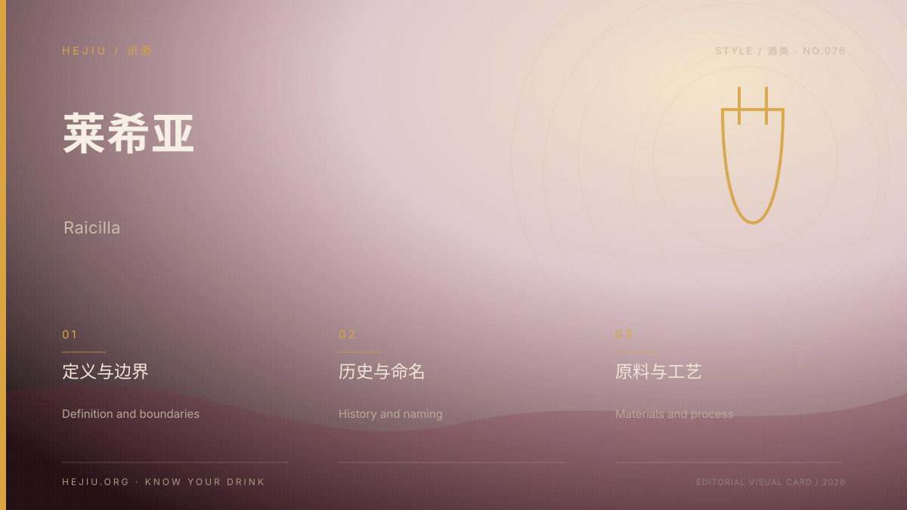
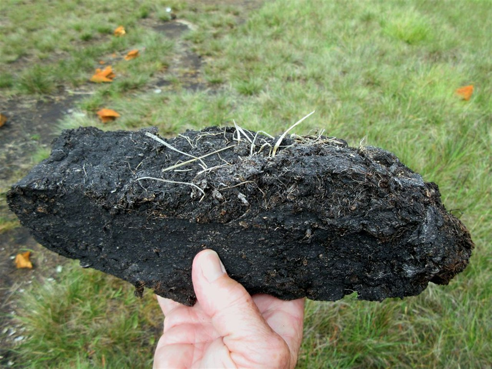

# Raicilla

Raicilla is an agave spirit distilled in mountain villages and coastal settlements of western Jalisco, Mexico. It belongs to the same agave-spirit family as mezcal, but its wild agave varieties, village-level methods and flavour range are more dispersed. It received Mexican appellation-of-origin protection in 2019 and was added to the EU–Mexico spirit-drinks mutual-recognition list in 2020.

Figure: Thematic illustration for Raicilla. Image: AI-assisted illustration (Doubao Seedream 5.0), project-owned; not a photograph of the subject, used as a thematic illustration only.

## Definition and boundaries

Raicilla is a spirit made from cooked and roasted mature agave heads, fermented and then distilled. Its production area lies in the western Sierra Madre Occidental, the Sierra de Amula, and the southern and northern coasts of Jalisco, extending to the municipality of Bahía de Banderas in Nayarit. Under the general declaration protecting the Raicilla appellation of origin published in the Mexican Official Journal on 28 June 2019, the protected territory covers 16 municipalities of Jalisco and 1 municipality of Nayarit, including mountain and coastal villages such as Mascota, Mixtlán, Talpa de Allende, San Sebastián del Oeste, Puerto Vallarta, Cabo Corrientes and Tomatlán.

In classification terms, raicilla sits closer to mezcal (ref:mezcal) than to tequila. It does not use the blue agave that defines tequila, but rather a range of mountain and semi-wild agaves, and the name gathers small-scale distillations that differ village to village. Through bilateral protection, Raicilla appears in Annex II of the EU–Mexico agreement on spirit-drink designations and has been protected at EU level with effect from 31 January 2020; the UK registered it as a protected spirit-drink name on 1 September 2021.

## History and naming

Raicilla has roughly 300 years of history in the Jalisco mountains, originating in mining settlements near the Sierra Madre Occidental. Mines lacked reliable water and grain, and transport was difficult, so villagers roasted local wild agaves in stone ovens, pressed the juice, fermented it, and distilled the result in small pot devices. For a long period it remained a rural, often unregistered spirit, outside the official spirit trade and rarely seen in export markets.

The name is commonly traced to the Spanish word raíz (root): the appearance of the liquid and its packaging suggest a spirit obtained from the agave root, and the village usage kept the colloquial term alive. This is an etymological hypothesis rather than a documented attribution to one person; like many rural spirits, raicilla was shaped by available raw material, mining life and transport conditions. In 2019 the Mexican government issued the appellation-of-origin declaration, subsequently registered with WIPO under the Lisbon system; the Consejo Mexicano Promotor de la Raicilla has long worked to bring village products into the formal market.

## Materials and process

Permitted agaves include Agave maximiliana Baker, A. inaequidens Koch, A. valenciana, A. angustifolia Haw. and A. rhodacantha, among mountain varieties; Agave tequilana F.A.C. Weber is expressly excluded. These agaves grow wild or semi-wild on slopes and in scrubland, take many years to mature and yield scattered crops, which raises raw-material cost. The agave (ref:agave) species, altitude, soil and harvest year steer the aroma direction of the final spirit.

The traditional workflow roasts the agave heads slowly in stone pit ovens to convert starch and build roast aroma, then crushes and presses them; the juice ferments in barrels or vessels with either local wild yeast flora or cultured Mexican yeast. The wash goes on to small clay or copper pot stills (ref:distillation), and most village products receive one or two small-batch distillations rather than a heavily rectified run, keeping more raw-material and fermentation character. Glass-aged or unaged examples are nearly colourless, while wood-aged versions take on pale yellow; the market is dominated by clear or pale-gold unaged bottlings.

## Style and palate

Compared with mezcal, raicilla's flavour shifts more freely between villages and species. Common descriptors are herbal, green pepper, citrus peel, mineral, roasted agave and light smoke; some batches show cocoa, papaya, sweet potato and caramelised agave sweetness. Smoke is not prominent on every line: it comes mainly from pit roasting and particular varieties, rather than being a uniform rule. When judging a bottle, separate the mountain-herbal route from the heavier-roast route before asking how typical it is.

Bottling strength varies by batch and brand, generally between 40–48%; within one brand, different product lines can run from 41.8% to 48%, and the ABV on the label usually adjusts with the batch. The palate tends dry, with clear acidity and a finish driven by herbs and minerals. Unaged bottles lead with fresh herbs and citrus, while wood-aged examples are rounder, with honey, dried fruit and wood spice. Cross-brand comparisons work best when species and distillation method are fixed before comparing municipality, ageing and batch.

## Representative regions and brands

Production units are mostly village workshops (tabernas), run by a distiller with a family or small team. Output is limited and batches differ visibly. The best-known brand in international markets is La Venenosa, whose lines are divided by mountain area and village, including Sierra Occidental, Sierra del Tigre, Tabernas and Etílica series. These use different agaves such as maximiliana, and each lists its own distiller and ABV.

Beyond La Venenosa, many village producers in Jalisco and Nayarit have not built large-scale export businesses; their products circulate through local festivals, the producers' association and small-batch importers. Market brands are not an official classification or a quality ranking. Within one brand, unaged, wood-aged and single-species batches can differ substantially in price and flavour. When buying, check the municipality, Latin agave name, batch number and distillation method on the label.

## How to drink and pair

Neat, raicilla is usually served in a small tasting glass (copita) at room temperature: smell the herbs and citrus first, then take small sips to read the spirit strength. Those who prefer it softer can add ice or a few drops of water to open the roast and mineral notes. For mixing, the herbal, mineral and citrus skeleton can replace tequila in a Margarita, and it works well in a highball with tonic or soda, built around lemon or orange garnish.

At the table, rich creamy cheeses carry the spirit's acidity and texture, while grilled meats, roasted vegetables and citrus-forward dishes match the herbal and smoke notes. Very spicy food amplifies the alcohol bite, so a softer, rounder batch is the safer choice.

## Buying, storage and misreadings

On the label, first check whether the name falls under appellation rules: a product labelled raicilla should show the producing municipality, agave material and production method. A bottle that only reads "agave spirit" without the raicilla name does not necessarily follow this geographical-indication framework. Unaged spirits are stable: keep them away from light, heat and vibration. Raicilla is low in sugar and does not rely on high sweetness for preservation, so finish an opened bottle within a few months.

Three common misreadings are worth noting. First, raicilla is not mezcal or tequila: legal agave species and territory differ. Second, not every raicilla is heavily smoky; smoke level varies with roasting and species. Third, the sweetness of one brand should not be taken as the style standard, ignoring differences between villages. Name protection guarantees origin and material rules, not bottle quality.

## Further reading and see also

To build a picture of raicilla, start with an unaged bottling that states its municipality, then compare batches from different agave species, and finish with a wood-aged small-batch release. Three such comparisons clarify the differences from species, roasting and ageing better than definitions alone.

- Related: [mezcal](ref:mezcal), [agave](ref:agave), [distillation](ref:distillation), [peat](ref:smoke), [liqueur](ref:liqueur).

## Related images

Image: Peat. Credit: David Stanley from Nanaimo, Canada, CC BY 2.0, via Wikimedia Commons ([source page](https://commons.wikimedia.org/wiki/File:Peat_(49302157252).jpg)). Related image for Raicilla.
