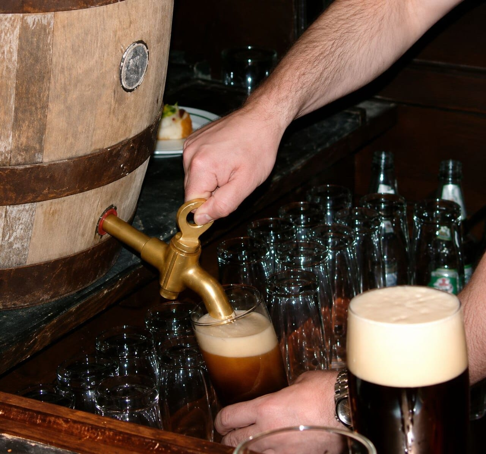
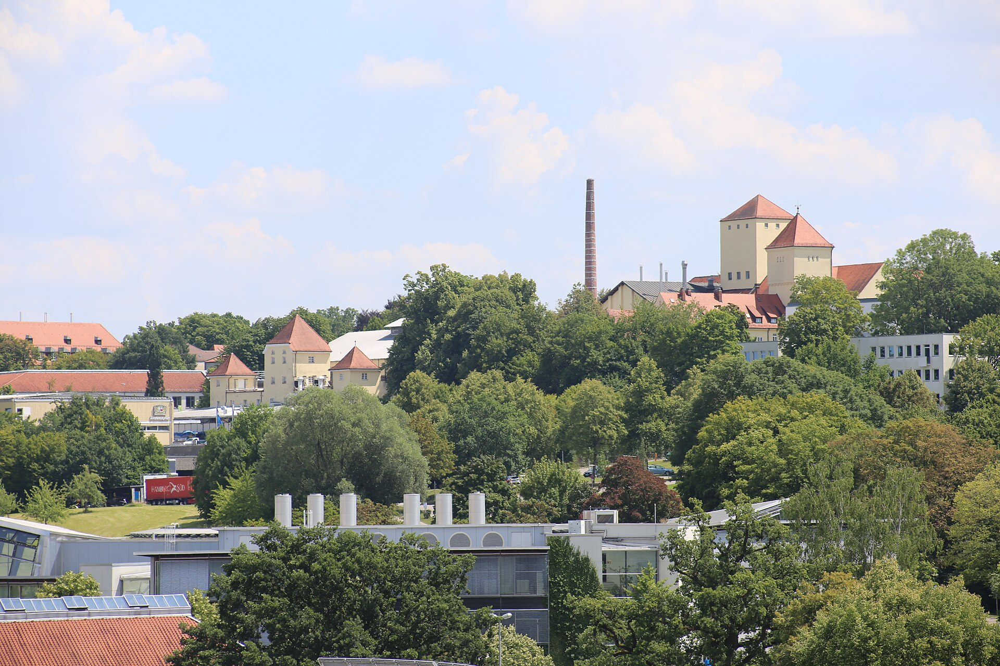

# Rauchbier

Rauchbier is a beer whose main flavour comes from smoked malt, most famously in Bamberg, Bavaria. The smoke comes from beechwood fires used to dry the malt, not from smoke flavouring added to the beer; that distinction defines the boundary between it and a dark beer that merely tastes smoky. Traditional examples are dark [lagers](ref:lager), but smoke intensity, colour and strength vary from brewery to brewery.

Figure: Rauchbier. Image: The original uploader was SilkTork at English Wikipedia ., CC BY-SA 2.5, via Wikimedia Commons ([source page](https://commons.wikimedia.org/wiki/File:GravityTap.jpg)).

## Smoke from the malt, not the beer

The critical step is [malting](ref:malting): germinated [barley](ref:barley) is dried in a kiln over an open beechwood fire. Phenolic compounds from the combustion settle on the malt and then pass through mashing and [fermentation](ref:fermentation) into the finished beer. Beech, rather than pine or peat, is used because it burns steadily and gives a clean, spicy, woody smoke without resin or medicinal notes.

This also explains a common misunderstanding: Rauchbier is not beer with liquid smoke stirred in. Real smoke flavour is integrated with the toasted character of the malt, giving more layers, while liquid smoke tends to be one-dimensional and lacks malt depth. Another boundary is smoked strong beer: those use smoked malt but are dominated by roasted coffee bitterness, with smoke as a supporting note.

## Bamberg's beechwood fire

Bamberg lies in Franconia and traditionally has a dense cluster of small breweries. The smoked-malt process survived here, linked to local beech woods, kiln design and workshop-scale production. In the second half of the 20th century smoked beer became scarce elsewhere, while Bamberg treated it as part of local identity, often serving it alongside ordinary lager in its pubs.

Franconian breweries often run smoked and unsmoked lagers on the same line, sharing mash and fermentation equipment and separating only at the malt stage. This explains why the malt backbone of local Rauchbier resembles ordinary lager, with the difference concentrated in phenolic aroma. For the brewer, smoke is not a novelty flavour but the default left by a malting tradition.

[Bavaria](ref:bavaria)'s beer culture emphasises locality, and Bamberg especially so. Smoked beer here is an everyday drink rather than a curiosity; that ordinariness has in turn protected the craft by keeping steady demand for smoked malt. Autumn and winter beer festivals and pub menus also let visitors work up through the intensity range.

## The Blue Lion house of 1405

Bamberg's most cited example is Schlenkerla. The building, the Haus zum blauen Löwen, first appears in documents in 1405 and is now run by the Trum family in its sixth generation. It still serves beer from oak casks tapped directly, and its flagship is a smoked Märzen, alongside a smoked doppelbock and a smoked wheat beer.

The other traditional brewery is Brauerei Spezial, whose smoke is usually lighter and better for a first taste. The two styles show that Bamberg smoke is not a fixed parameter but a spectrum from gentle to intense. When visiting, note whether the brewery malts its own grain: bought-in smoked malt can make a sound beer, but the flavour layers are often simpler. If time allows, compare the two breweries side by side in the same year to see how malting and fermentation choices differ.

## A gradient of smoke

A typical Bamberg Rauchbier is copper to dark brown, clear, with fine foam; the aroma is smoke, bread crust, nuts and light caramel, with very little hop. Malt sweetness arrives first, smoke opens in the middle, and the finish is dry with medium-low bitterness. Alcohol is commonly about 4.8%–6% and [bitterness](ref:ibu) about 20–30 IBU; these figures vary by source and brewery and are not a legal standard.

Smoke intensity can be described as bacon-like, campfire-like or smoked-cheese-like, but words are less reliable than a side-by-side tasting. Beginners should start with a lighter example and move up to the heavily smoked versions. Too cold makes the smoke sharp, too warm pushes alcohol forward; 8–10°C is a good range. If one brewery makes both light and heavy versions, comparing them best shows the effect of the malt ratio.

## The boundary with porter and stout

[Porter](ref:porter) and [stout](ref:stout) take their colour from roasted malt, with coffee, chocolate and char at the centre; Rauchbier may take colour from smoked malt itself, with woody smoke at the centre and roast bitterness only in the background. A beer with both obvious coffee bitterness and heavy smoke is closer to a smoked porter than to the traditional Bamberg smoked lager.

Compared with Scottish peated beer, beech smoke is drier and spicier, while peat brings medicinal and seaweed notes. Compared with an ordinary German dark lager, Rauchbier adds a layer of phenolic aroma but keeps a similar malt sweetness and body. These boundaries are drawn by where the smoke comes from and how much of the profile it occupies, not by colour.

## Pairing: smoke as a seasoning

Rauchbier suits smoked pork, grilled sausage, roast chicken, onion tart and hard cheese; the smoke echoes charred notes in the food while malt sweetness buffers salt. It also works with grilled meat and mushrooms, but not with delicate seafood or desserts, where smoke overwhelms the ingredients. As a beer for the table, serve it in small glasses, cool and slowly, treating it as liquid seasoning rather than a thirst quencher. In Bamberg pubs it is often poured into straight glasses or traditional stoneware mugs, vessels that avoid concentrating the smoke too much.

Check the production date and storage when buying. Smoke phenols are relatively stable, but hop aroma and fresh malt notes still fade; after long storage the smoke may dominate and balance suffer. Once opened, finish the bottle to avoid the cardboard note of oxidation.

For Rauchbier, begin with the production rule, then the strength, and finish with the usual serving; that order keeps the account grounded.

The comparison with [Lager](ref:lager) and [Stout](ref:stout) runs through legal definition and materials and process. Each answers a different question.

**Short definition:** A German beer built on beechwood-smoked malt, best preserved in Bamberg, with smoke intensity running from delicate to intense across a spectrum rather than a fixed recipe.

**Key facts.**

| Item | Detail |
| --- | --- |
| In one line | A German beer built on beechwood-smoked malt, best preserved in Bamberg, with smoke intensity running from delicate to intense across a spectrum rather than a fixed recipe. |
| Parent style | Lager |
| Aroma family | Smoke and malt |

**Sources and limits.** The key claims about Rauchbier are checked against the following sources: Beer Judge Certification Program (the strength, bitterness, colour and smoked-malt description of Rauchbier; no original text is reproduced), Brauerei Heller-Trum / Schlenkerla, Bamberg Tourismus & Kongress Service (public information on Bamberg beer culture and pub tradition; no original text is reproduced) and 4 sources in total. Prices, batches and status change; the body is project-written and does not reproduce source text.

## Related images

Image: Category image for Bavaria. Credit: Christian Schranner, CC BY-SA 4.0, via Wikimedia Commons ([source page](https://commons.wikimedia.org/wiki/File:%C3%9Cberblick_der_Bayerischen_Staatsbrauerei_Weihenstephan.jpg)). Related image for Rauchbier.
