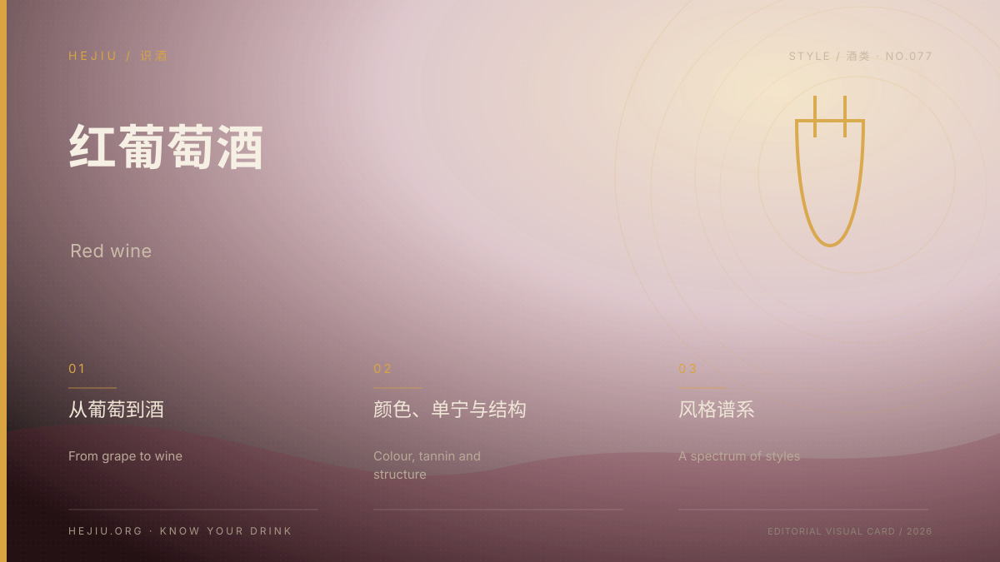
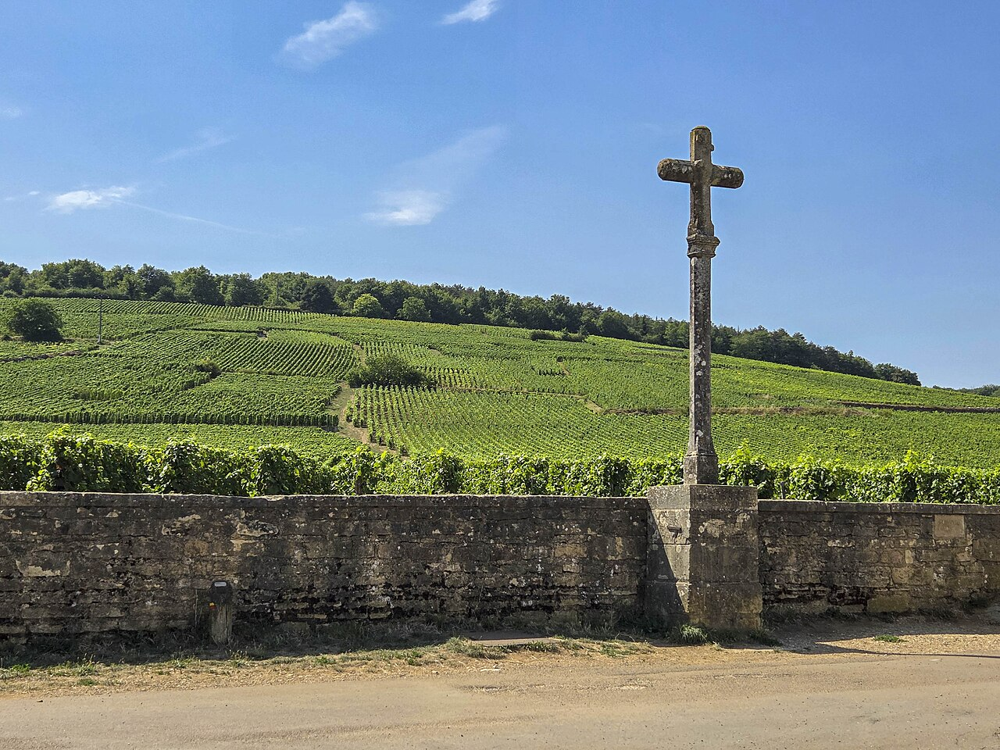

# Red wine

Red wine is made from dark-skinned grape varieties. Its colour comes from anthocyanins in the skins, and its tannin from skins, seeds and stems. The biggest difference from white wine is not the colour of the raw material but whether the liquid stays in contact with the skins during fermentation: red wine is usually fermented with skins, extracting colour, tannin and aroma during maceration.

Figure: thematic illustration for Red wine. Image: AI-assisted illustration generated with Doubao Seedream 5.0 (project-owned); not a photograph of the subject.

## From grape to wine

The basic red-wine flow includes destemming and crushing, fermentation with skins, pressing, malolactic conversion (optional), ageing and bottling. After crushing, juice, skins and seeds enter the fermentation vessel, and yeast converts sugar into ethanol and carbon dioxide. During fermentation, producers use punch-downs or pump-overs to keep the liquid in contact with the floating cap, controlling extraction. Maceration can last from a few days to several weeks, and temperature, oxygen and pressing pressure also change the final style.

After fermentation, free-run wine and press wine are kept separate. Free-run wine is usually softer, while press wine is darker and more tannic; whether and how much to blend is a stylistic choice. Malolactic conversion can turn sharp malic acid into softer lactic acid and add buttery, creamy notes, but whether to allow it depends on the target style.

## Colour, tannin and structure

Young red wines range from purple-red to ruby, shifting towards garnet and brick with age. Colour depth is affected by variety, maceration time, temperature and pH, and cannot be used alone to judge quality. Tannin provides the “backbone”: enough tannin gives structure, food compatibility and ageing potential; too much, or unripe small tannins, makes the wine feel hard and dry.

Acidity matters too. High-acid reds feel fresher and pair well with food, and may need longer to soften; low-acid reds feel rounder but usually have less ageing potential. Alcohol, acidity, tannin and aroma together make up “body”; judging one factor alone easily leads to error.

## A spectrum of styles

Red-wine styles run from light to heavy along a continuum. Light-bodied reds are usually paler, lower in tannin and direct in fruit, and suit slightly cooler serving temperatures. Medium-bodied reds balance fruit, acidity and tannin. Full-bodied reds are darker, more tannic and often higher in alcohol, typically from warmer climates and longer maceration.

Variety and climate shape style. Pinot Noir is usually paler, high in acidity and fine in tannin; Cabernet Sauvignon is dark and structurally tannic; Merlot is rounder and softer in fruit; Syrah often shows pepper and black fruit. The same variety can show very different ripeness and acidity in a cool region and a warm one. For specific wines, look at a Bordeaux blend such as [Château Lafite Rothschild](ref:lafite) or a Burgundy Pinot Noir grand cru such as [Romanée-Conti](ref:romanee-conti).

## Regions and labels

Names such as Bordeaux, Burgundy and Tuscany first indicate geographical origin and applicable rules, not a quality ranking. The EU PDO/PGI system, France's AOC and Italy's DOCG all write varieties, yields, winemaking methods and label terms into regulation. Within one region there is still much variation: village, plot, vintage and producer all matter.

Vintage is the grape harvest year, not the bottling year. Weather affects ripeness, yield and disease pressure, but skilled producers can keep a relatively stable style across vintages. Treating a “great vintage” as an absolute conclusion easily overlooks the specific wine and producer.

## How to drink

Red wines are usually served a little warmer than whites; light reds can be slightly cool, full reds close to room temperature. Too warm and the alcohol stands out; too cool and the aroma closes down. Decanting mainly suits young, tannic wines or older wines that need sediment separated; not every red needs it.

For food, high-tannin reds suit dishes rich in protein and fat, because tannins bind with food proteins and the astringency softens. Spicy, very acidic or sweet food can amplify the dry sensation. Rather than applying “red wine with red meat” mechanically, look at the wine's structure and the dish's seasoning.

## Maceration and extraction: the real lever of style

The same grapes can be taken in completely different directions by maceration. A short maceration gives paler colour, less tannin and more direct fruit; a long maceration gives deeper colour and more tannin but also more readily extracts coarse components. Higher temperatures favour colour and tannin entering the liquid, while lower temperatures preserve fresher fruit. Punch-downs, pump-overs and rotating tanks determine how efficiently the liquid meets the skins.

Press wine matters too. Press wine is darker and more tannic; a measured addition can build structure, while too much makes the wine feel hard and dry. Producers reassess every year according to fruit ripeness, tannin texture and target style rather than applying a fixed recipe.

## Common misconceptions

First, deep colour does not mean high quality. Colour is affected by variety, maceration and pH, and a dark wine can still have coarse tannin and insufficient fruit.

Second, more tannin does not mean better ageing. Ageing potential depends on acidity, tannin texture, body and storage conditions; judging by tannin quantity alone easily misleads.

Third, red wine does not always need decanting. Young, tannic wines may benefit, while over-decanting an old or light red can cost aroma.

## Boundary

This style describes the category and basic methods, not specific estates, vintages or prices. Check the label, producer information and professional reviews for grape proportions, residual sugar, strength, ageing potential and drinking window.

**At a glance:** Wine made by fermenting dark-skinned grapes with their skins to extract colour and tannin; colour, tannin, acidity and alcohol together shape the style, not a vintage or regional label alone.

Begin with the production rule, move on to the strength, and finish with the usual serving. That order keeps the reading of Red wine practical.

Start with [Wine](ref:wine) for legal definition, then read [Romanée-Conti](ref:romanee-conti) for materials and process. Seeing both keeps Red wine from being confused with a neighbouring idea.

**Key facts.**

| Item | Detail |
| --- | --- |
| In one line | Wine made by fermenting dark-skinned grapes with their skins to extract colour and tannin; colour, tannin, acidity and alcohol together shape the style, not a vintage or regional label alone. |
| Parent style | Wine |

**Sources and limits.** The key claims about Red wine are checked against the following sources: International Organisation of Vine and Wine (OIV) (Used to check wine and special-wine definitions, minimum strength and categories), European Union (Used to check EU wine categories, geographical indications and labelling rules), Oxford University Press (Used for entries on red-wine vinification, tannin and regions) and 4 sources in total. Prices, batches and status change; the body is project-written and does not reproduce source text.

## Further reading

- [Wine](ref:wine): an overview of still, sparkling, fortified and sweet wines.
- [Château Lafite Rothschild](ref:lafite): a Cabernet-based Bordeaux blend.
- [Romanée-Conti](ref:romanee-conti): a Burgundy Pinot Noir grand cru.

## Related images

Image: Romanée-Conti. Credit: Wikipedro, CC BY-SA 4.0, via Wikimedia Commons ([source page](https://commons.wikimedia.org/wiki/File:Vosne-Roman%C3%A9e,_le_Domaine_de_la_Roman%C3%A9e-Conti.jpg)). Related image for Red wine.
