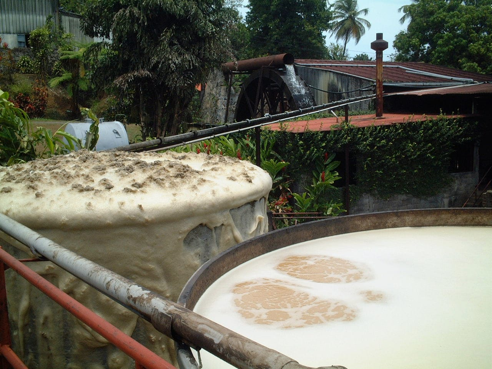

# Rhum Agricole

Rhum agricole is [rum](ref:rum) made from fresh sugarcane juice that is fermented and distilled directly. It shares the cane starting point with common molasses rum, then parts company at the first step: in sugar mills, cane is crystallised for sugar and the leftover molasses is fermented and distilled, the industrial rum route; rhum agricole sends the freshly pressed juice straight to the fermenter to preserve the field character of the cane.

Figure: Rhum Agricole. Image: Stefan Ivanovich, CC BY-SA 3.0, via Wikimedia Commons ([source page](https://commons.wikimedia.org/wiki/File:Guadeloupe_rhum_fermentation_tanks.jpg)).

## Cane juice, not molasses

Once [sugarcane](ref:sugarcane) is pressed, the cloudy juice holds sugar, minerals and plenty of plant tissue. If it is not handled at once, it oxidises, ferments or spoils, so the press and the distillery must sit close together. Cane variety, soil, rainfall and harvest date all enter the spirit, which is why it can talk about terroir.

[Molasses](ref:molasses) follows another route: it is a by-product of sugar making, easy to ship and store, and can be fermented at a large scale, giving a more concentrated, sweeter, heavier flavour. Cane juice ferments lighter and more herbal, with a drier body and clearer grass and olive notes.

## The French Antilles and the sugar crisis

The history of rhum agricole is tied to the sugar economy of the French Caribbean. In the seventeenth and eighteenth centuries, Martinique and Guadeloupe lived mainly from cane growing and sugar exports; the sugar crisis of the nineteenth century, competition from beet sugar and the abolition of slavery reshaped the local economy, and some estates turned surplus cane towards distillation, gradually creating a cane-juice rum tradition.

Martinique's rhum agricole received appellation control (AOC) in 1996, the key moment that separates it from ordinary rum. The AOC writes the area, cane varieties, pressing deadline, fermentation, distillation and at least 3 years of oak ageing into the rules, turning "agricultural rum" from a local habit into a verifiable legal identity. Guadeloupe, Réunion and French Guiana also make agricultural rum, but Martinique's AOC is the strictest and most recognisable.

## From field to still

Cane is usually cut by hand or machine when ripe and taken to the press as quickly as possible. The juice is lightly filtered and goes into the fermenter; fermentation is usually short, to keep the cane fresh and avoid an excess of esters and acidity. The wash then goes to [distillation](ref:distillation), often in a continuous column still that yields a spirit of 65% to 75% ABV; some distilleries use a pot still for a heavier version.

[Fermentation](ref:fermentation) here is not a case of "slower is better". Rhum agricole wants clean cane aroma, not the dense ester load of molasses rum; too much heat, unwanted microbes or a long ferment can turn grass into vegetable. The cut matters as well: heads are sharp, tails carry earth and acid, and the heart must be clean but full.

## The rules of AOC Martinique

The Martinique AOC covers the whole chain from cane to bottle: cane must come from the defined area and belong to permitted varieties; pressing must be followed quickly by fermentation; distillation must happen locally; white rum strength and the barrel time for aged rum have minimums. A bottle marked "rhum vieux" must age at least 3 years in oak, while "rhum ambré" may have had only a shorter contact with wood.

The AOC tells the drinker that a bottle marked Martinique is not just island cane spirit; it has passed continuous checks on origin, raw material and process. When buying, the AOC, the strength and the words "vieux" or "ambré" deserve attention before the brand story.

## Grass, olive and banana

White rhum agricole is easy to recognise: fresh cane, grass, olive, green banana, citrus peel and white flowers, a dry entry, clear alcohol and a finish with a touch of salt and bitterness. It is not sweet and heavy like molasses rum, nor neutral like vodka; its aim is to preserve the cane field as fully as possible.

Aged rhum agricole turns to honey, vanilla, coconut, dried fruit and spice, with less grass and a rounder body. Barrel choice matters: new wood brings obvious vanilla and tannin, while old wood lets cane and flowers last longer. Heavy wood can bury the herbal line that makes agricultural rum valuable, so many producers choose large or used casks rather than chasing "oak flavour".

## The grammar of Ti' Punch

In Martinique the most common serve is Ti' Punch: cane syrup, lime and white rhum agricole, adjusted to taste and usually built around the rum. Its grammar is simple — sweetness rounds the alcohol, acidity lifts the aroma, lime oil adds perfume — but order and proportion change the result noticeably. Locals often say you mix your own, because tolerance for sweet, sour and alcohol differs.

Rhum agricole also suits a Daiquiri variation, a Rum Sour and highballs; aged bottlings can be taken neat or over ice. Compared with [cachaça](ref:cachaca), agricultural rum shows more herb and olive, while cachaça leans towards the sweet, green side of cane. Both start from cane, but their regions, laws and fermentation traditions differ, so they are not simple substitutes.

## Where molasses rum and cachaça end

[rum](ref:rum) made from molasses uses a sugar by-product, while rhum agricole uses fresh cane juice; the first more easily gives heavy caramel, vanilla and ester notes, the second is lighter, more herbal and drier. The classic rums of Barbados, Jamaica and Cuba mostly follow the molasses route, while Martinique and Guadeloupe are known for agricultural rum.

Cachaça is Brazil's cane spirit, usually fermented from cane juice and distilled, but its law, regions and flavour goals differ from rhum agricole; cachaça stresses sweet cane and green grass, while rhum agricole has a clearer AOC system and an olive, savoury personality. Understanding these differences in raw material and law is more useful than remembering that all three come from cane.

**Short definition:** A rum distilled from fresh sugarcane juice in Martinique, Guadeloupe and other French Caribbean territories, protected by the Martinique AOC since 1996; it skips molasses, tastes of grass, olive, banana and citrus, and its vieux expression ages at least 3 years in oak.

**Key facts.**

| Item | Detail |
| --- | --- |
| In one line | A rum distilled from fresh sugarcane juice in Martinique, Guadeloupe and other French Caribbean territories, protected by the Martinique AOC since 1996; it skips molasses, tastes of grass, olive, banana and citrus, and i… |
| Parent style | Rum |
| Aroma family | herbal/fruit/floral |

**Sources and limits.** The key claims about Rhum Agricole are checked against the following sources: Rhums AOC Martinique (the Martinique AOC rules, raw material, distillation and ageing requirements), Martinique Tourism Authority (the agricultural rum tradition and the 1996 AOC date), European Union (the rum category, the cane-juice requirement for agricultural rum and the GI framework) and 4 sources in total. Prices, batches and status change; the body is project-written and does not reproduce source text.
