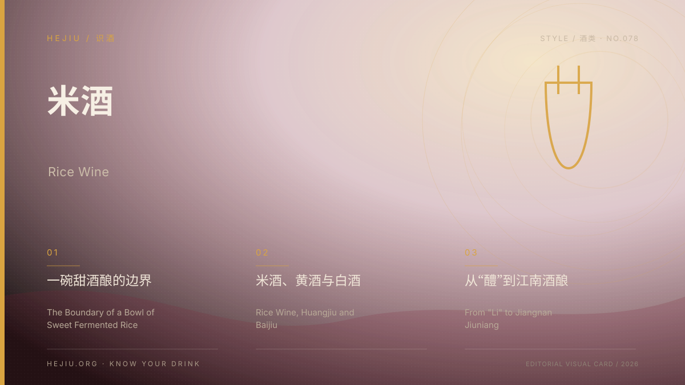

# Rice Wine

Rice wine is the low-alcohol drink of [China](ref:china) made from [glutinous rice](ref:rice) with a sweet-rice starter, usually seen as jiuniang or laozao: a white or pale yellow cloudy liquid with half-floating grains, sweet and slightly sour, lightly sparkling, and usually only 1% to 15% ABV. It is neither distilled nor aged like huangjiu. Its value lies in freshness, sweetness and rice aroma rather than in vintage.

Figure: thematic illustration for Rice Wine. Image: AI-assisted illustration generated with Doubao Seedream 5.0 (project-owned); not a photograph of the subject.

## The Boundary of a Bowl of Sweet Fermented Rice

Rice wine can be defined from both raw material and process. The base is mainly glutinous rice, though japonica or ordinary rice may be used; the grain is steamed, cooled and mixed with a starter so that moulds break starch into sugar and yeasts turn some sugar into alcohol. Saccharification and fermentation run together, and after a few days the result is a sweet, mildly alcoholic ferment. The filtered liquid may be called rice wine; the unfiltered version with grains is jiuniang or laozao.

"Rice wine" is not the same as any drink made from rice. Sake, shochu, huangjiu and baijiu may all start with rice, but their methods and results differ greatly. The key markers of rice wine are low strength, sweetness, cloudiness, no distillation, and usually intact grains and live microbes.

## Rice Wine, Huangjiu and Baijiu

Rice wine and huangjiu are the easiest to confuse. Huangjiu uses glutinous and japonica rice with wheat starter or rice starter, ferments longer and reaches a higher strength, usually 14% to 20%, then is pressed, clarified and aged to colours from pale yellow to amber. Rice wine ferments briefly, stays low in alcohol, tastes sweeter and paler, and is often neither filtered nor aged.

The difference from baijiu is distillation. Baijiu distils the fermented mash into a strong spirit; rice-aroma baijiu is already a distilled drink even though it starts with rice. Rice wine is not distilled, so its alcohol comes from fermentation itself, which explains its low strength and short life. Sake differs in starter and style: it uses rice koji and yeast, tastes drier and focuses on aroma, while rice wine uses a sweet-rice starter and is sweeter and more lactic.

## From "Li" to Jiangnan Jiuniang

Ancient China called a sweet fermented grain drink "li". The Book of Songs contains the phrase "for wine, for li", showing that such low-alcohol sweet drinks entered ritual and daily life early. Huangjiu and baijiu later became dominant, but the sweet fermented style never disappeared; it survived in Jiangnan, central China and the southwest under the names jiuniang and laozao.

Xiaogan in Hubei is one of the most famous homes of rice wine. Local producers use glutinous rice, starter and groundwater to make a sweet, aromatic drink that serves as breakfast, late-night food and traditional postpartum nourishment. Jiangnan's jiuniang yuanzi, Sichuan's laozao fenzi and Hunan's sweet wine with egg are all variations on the same fermented rice drink.

## Glutinous Rice, Starter and Temperature

The first step is choosing rice. Glutinous rice is high in amylopectin, sticky when cooked and slow to retrograde, so it gives a fuller sweetness after saccharification; japonica rice makes a lighter, looser ferment. The rice is soaked and steamed until cooked but not mushy, then cooled to 25 to 30 degrees Celsius so that the microbes in the starter are not killed.

The starter is the soul of the drink. Southern starters usually contain Rhizopus, Mucor and yeast: the moulds cut starch into sugar, the yeast turns sugar into alcohol, and local recipes may add lactic-acid bacteria. The inoculated rice goes into a clay jar or glass container, with a well pressed in the centre to show the emerging liquid and allow some air. At 25 to 30 degrees Celsius, the well usually fills with sweet liquid in 2 to 4 days.

## Saccharification and Fermentation Together

Rice wine ferments by simultaneous saccharification and [fermentation](ref:fermentation). Mould enzymes break starch into glucose, yeast converts glucose into alcohol and carbon dioxide, and lactic-acid bacteria produce lactic acid, giving the ferment a faint yoghurt note. The three compete in one vessel, and temperature, moisture and starter decide the final balance of sweet and sour.

Early on, saccharification dominates: the ferment is very sweet and low in alcohol. With time, yeast turns sugar into alcohol, sweetness falls and the alcoholic note rises. If fermentation continues, lactic and acetic bacteria push it towards sourness. Home makers therefore refrigerate the ferment at its sweetest, while commercial producers pasteurise or filter to stabilise it.

## Sweet, Sour, Rice Aroma and a Light Sparkle

A good jiuniang is milky white or pale yellow, with plump grains suspended in a cloudy liquid and perhaps tiny bubbles on the surface. The nose is cooked glutinous rice, sweet ferment, lactic acid and light floral notes; the entry is sweet but not cloying, acidity follows, alcohol is faint and the texture is like thin porridge. Different starters push it towards honey and flowers or towards yoghurt and rice bran.

Freshness matters. Just-made jiuniang is sweetest and most aromatic; with time, sweetness thins and acidity grows. Judge it by whether the grains are intact, whether sweet and sour balance, and whether the liquid looks cleanly cloudy. Excessive sweetness may mean over-saccharification; excessive sourness points to uncontrolled fermentation or poor storage.

## Xiaogan, Jiangnan and Local Ways of Eating

Xiaogan is best known for "hutang mijiu": rice wine cooked with glutinous rice balls, osmanthus and sugar into a thick sweet soup, served hot in winter and chilled in summer. Jiangnan's jiuniang yuanzi combines the ferment with small glutinous-rice balls and osmanthus; Sichuan's laozao fenzi adds brown sugar and rice flour, while Hunan's sweet wine with egg cooks the ferment with egg and brown sugar.

Yunnan, Guizhou and Jiangxi have their own traditions, some using red yeast or local herbs, with flavours from sweet to sour. Commercial bottlers make Xiaogan rice wine portable, but pasteurisation weakens the live yeast and fresh rice aroma; for the real thing, look for refrigerated products with a short shelf life.

## Jiuniang Yuanzi and Egg Wine

Rice wine is more often cooked than drunk neat. Jiuniang yuanzi simmers the ferment with small rice balls, rock sugar and osmanthus for a warm sweet soup; egg wine cooks it with beaten egg and brown sugar for a thicker texture. In summer it can be served over ice with lemon or soda; in winter, ginger, red dates and goji berries turn it into a hot drink.

It also works in cooking: steamed fish, braised pork and sweet soups use its sweetness and lactic acidity to soften meat and lift aroma. Drunk neat, serve it in a small bowl or cup, chilled for freshness; but its low strength means it keeps fermenting after opening and cannot be stored like spirits.

## Why It Does Not Keep

Rice wine is usually only 1% to 15% ABV, not enough to suppress all microbes, and live yeast and enzymes may remain, continuing to ferment in the bottle and producing gas, sourness or even a burst container. Home-made jiuniang can be slowed but not stopped by refrigeration and is best eaten within a week.

Commercial rice wine is pasteurised, filtered or preserved to extend shelf life, but heat costs some fresh rice aroma. Its [residual sugar](ref:residual-sugar) is high, and after opening it becomes a home for microbes; discard it if it smells wrong, grows mould, bulges or turns red. Rice wine is not better with age; it is best close to its fresh state.

## Buying and Storage

Read the ingredients first: only glutinous rice, water and starter is closer to tradition; a long list may include sugar, acidity regulators or preservatives. Then check storage and shelf life: refrigerated products with short dates usually taste fresher, while ambient long-life products are convenient but flatter. Strength and sweetness vary widely, from 1% to 15%, and suit different uses.

For home-made rice wine, sterilise containers and tools, keep the temperature below 30 degrees Celsius, and discard the whole batch if coloured mould appears. Refrigerate after opening and reheat before eating. Its pleasure comes from a brief microbial balance, not from long storage.

Further reading: [Abbey beer](ref:c-extra-1).

## Related images

Image: Abbey beer. Credit: BLloydT, CC BY-SA 4.0, via Wikimedia Commons ([source page](https://commons.wikimedia.org/wiki/File:A_wall_of_Belgian_beer_bottles_at_the_Bruges_beer_experience.jpg)). Related image for Rice Wine.
