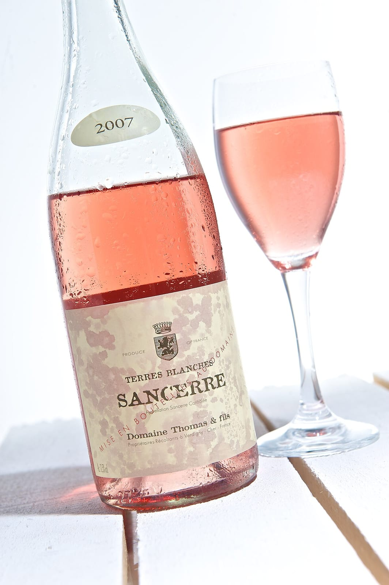

# Rosé Wine

Rosé is a type of [wine](ref:wine) made from red grapes, but the juice spends only a short time in contact with the skins, so it takes on a little colour and [tannin](ref:tannin). It is neither simply “red wine mixed with white wine” nor a sweetness grade; colour depth, aroma and texture depend on the variety, the [maceration](ref:maceration) method, the fermentation temperature and whether [residual sugar](ref:residual-sugar) is retained.

Figure: Rosé Wine. Image: THOR, CC BY 2.0, via Wikimedia Commons ([source page](https://commons.wikimedia.org/wiki/File:Sancerre_rose_Wine.jpg)).

## The boundary: what counts as rosé

The core of rosé is “red grapes, brief colour extraction”. Grape juice is mostly colourless; colour comes from anthocyanins in the skins. When juice is separated after a short contact with the skins, the wine is pink, onion-skin or pale ruby. It differs from [red wine](ref:red-wine) in maceration time and from [white wine](ref:white-wine) in raw material and the small amount of tannin.

What does not count: a still wine made by blending red and white wine (EU rules tightly restrict this for still wine), a coloured or flavoured drink, and a light-bodied red that looks pale but completed a long skin fermentation. Pale does not mean rosé, and deep does not mean red.

## Where the colour comes from

Colour comes mainly from anthocyanins in the skins. Extraction depends on temperature, alcohol, sulphur dioxide, pH and contact time: warmer, stronger and longer contact gives more colour; low pH pushes the hue towards red, high pH towards purple. Rosé can therefore run from the palest onion skin to bright strawberry pink.

Colour is not a quality measure. Provence pursues very pale colour and freshness, while Tavel pursues deeper colour and structure; both can be excellent. Treating “paler is better” as a rule mistakes one regional aesthetic for a universal standard.

## Three ways to take colour

Direct pressing lightly presses red grapes and separates the juice at once, giving pale colour and little tannin, suited to fresh styles. The saignée method draws off part of the juice while making red wine and ferments that portion separately as rosé; it can give deeper colour and more structure, but it also concentrates the remaining red wine.

Blending red and white wine is tightly restricted for still wine under EU rules and allowed only for particular products and traditions; rosé [sparkling wine](ref:sparkling) often takes colour from a small addition of red wine. In every method, the choice shapes colour, tannin and aroma, not just appearance.

## Fermentation and texture

Rosé is usually fermented at a lower temperature to preserve fresh fruit. Whether [malolactic fermentation](ref:mlf) takes place, whether oak is used and whether the wine spends time on the lees all change the texture. Most rosé is meant to be drunk young, with an emphasis on fruit and acidity rather than long ageing; a few structured examples can age for several years.

Low tannin is typical but not absolute. A longer maceration or a saignée wine shows more tannin and structure and suits grilled meat; a direct-pressed, early-separated wine is lighter and suits seafood and salads.

## Regulation and sweetness

EU wine law sets a framework for rosé categories, production restrictions and labelling, and individual appellations add their own AOC rules. China's GB/T 17204-2021 supplies the terminology basis within its drinks classification. Words such as “dry”, “sec” and “demi-sec” describe sweetness, not colour.

OIV gives verifiable thresholds for still wine: dry up to 4 g/L sugar, or up to 9 g/L when total acidity is no more than 2 g/L below the sugar level; medium-dry up to 12 g/L, or up to 18 g/L under specific acidity conditions; medium-sweet up to 45 g/L; sweet above 45 g/L. Rosé can be dry, medium-dry, medium-sweet or sweet, and colour does not predict sweetness.

## A stylistic map

Provence rosé is usually very pale, with citrus, white peach, redcurrant and herbal notes, a light body and high acidity; the main varieties include Grenache, Cinsault, Syrah and Mourvèdre. Tavel in France is deeper in colour and closer in structure to a light red, often with strawberry, spice and mineral notes.

Spanish rosado often shows strawberry and spice, with Rioja and Navarra as representative regions; Italian chiaretto and cerasuolo range from pale to deep with crisp acidity; American-style white Zinfandel may keep noticeable residual sugar and taste sweet. Rosé Champagne takes colour from brief maceration or a small addition of red wine, combining bubbles with red-fruit aroma.

## Key parameters

Rosé usually runs from 11% to 14% alcohol, depending on climate and ripeness. Maceration can last from a few hours to a day or two; fermentation is usually cooler than for red wine; most products avoid new oak. Serving temperature is lower than red and higher than white, around 8 to 12 degrees Celsius.

These are style variables, not legal figures. A rosé from one region and variety can run from light and crisp to full and spicy depending on maceration and fermentation. Read the variety, region, strength and sweetness word on the label rather than colour alone.

## Difference from neighbouring styles

A light red, such as some Pinot Noir or Gamay, differs from rosé in fermentation: the former completes skin fermentation, the latter separates the juice after extraction. Blush in the US market often means a medium-sweet or sweet rosé, but it is not a legal category. Vin gris is a very pale direct-pressed rosé that can look almost white.

Rosé is also not a synonym for pink sparkling wine: still rosé and rosé sparkling wine differ in process, pressure and occasion. Mixing the names makes it hard to judge sweetness, bubbles and body.

## Common misconceptions and disputes

First, that rosé must be sweet. Second, that it is a simple red-and-white blend. Third, that paler means better. Fourth, that rosé is only for summer. Fifth, that white Zinfandel represents all rosé. Sixth, that rosé cannot be paired with food.

Disputes centre on the EU restriction of blending for still rosé, regional preferences for colour, and whether “rosé” should be treated as an independent style rather than a colour description. These are regulatory and market questions; they do not change the core process of short maceration.

## How to drink it

Serve rosé a little warmer than white wine and a little cooler than red; too cold closes the aroma, too warm emphasises the alcohol. Dry rosé suits salads, seafood, Mediterranean vegetables and light poultry; sweeter rosé can accompany fruit desserts or spicy food. It is also a common summer aperitif, though there is no need to limit it to summer.

Once opened, keep it cold and finish it promptly, especially low-alcohol, low-tannin styles, because the aroma fades quickly on contact with air.

[Wine](ref:wine) explains legal definition; [White wine](ref:white-wine) adds materials and process. Put Rosé Wine between them before deciding what it is.

## Related images

Image: Malolactic fermentation. Credit: Agne27, CC BY-SA 3.0, via Wikimedia Commons ([source page](https://commons.wikimedia.org/wiki/File:Malolactic_spotting.JPG)). Related image for Rosé Wine.
