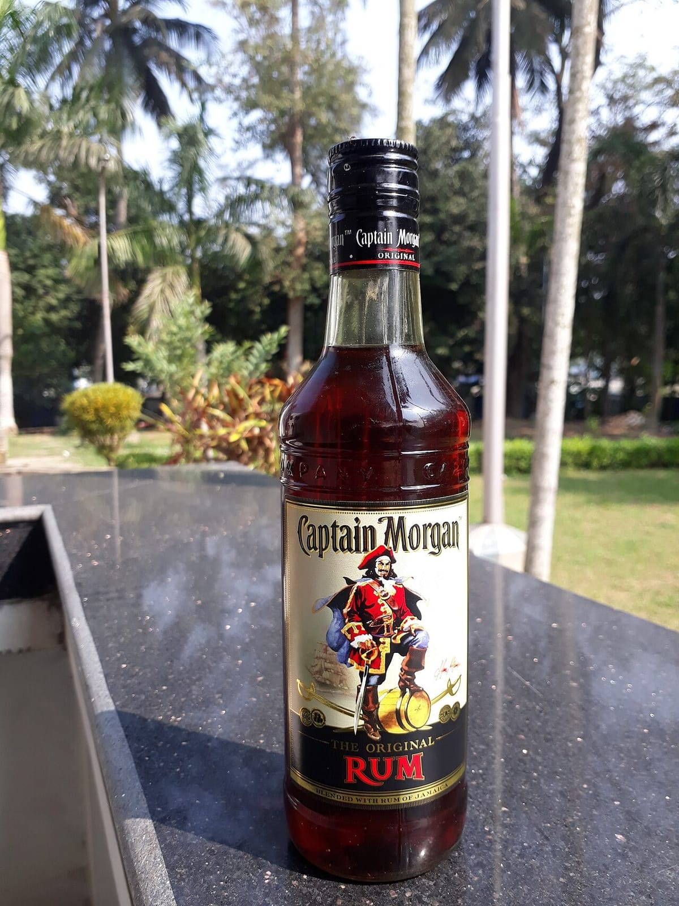

# Rum

Rum is a spirit made by fermenting and [distilling](ref:distillation) sugarcane juice, molasses or sugarcane syrup. Its flavour range is wide: the same word covers a nearly neutral white mixing base and a dark aged spirit with caramel, vanilla and wood. Understanding raw material, still and ageing matters more than memorising a brand for judging style.

Figure: A bottle of Captain Morgan Original Rum, with dark liquid and the brand label. Image: Pinakpani, CC BY-SA 4.0, via [source page](https://commons.wikimedia.org/wiki/File:Bottle_of_Captain_Morgan_Rum_01.jpg).

## Definition and regulation

EU regulation requires rum to be made from sugarcane products, sets a minimum strength of 37.5% ABV, and allows the term "rhum agricole" for products fermented and distilled directly from sugarcane juice. The regulation also separates rum from other sugarcane-spirit categories, so the category word on the label carries real weight. Individual countries add their own standards and geographical indications; Martinique agricole rum, for example, has French protected designation of origin status.

Rum also needs to be distinguished from Brazilian cachaça. Both start from sugarcane and the processes are similar, but cachaça is a separate legal and category, not a simple synonym. Likewise, "spiced rum" is usually rum with added spice and sugar, a flavoured product whose raw materials and additives should be read from the label.

## Raw materials and regions

There are two main raw materials: molasses, a by-product of sugar refining with high volume, low cost and a heavier flavour; and sugarcane juice fermented directly, which keeps more vegetal and herbal notes and is common in agricole rum. Some regions also use sugarcane syrup. The freshness of the material, fermentation time and yeast culture directly shape the aromatic base.

Rum is produced mainly in the Caribbean but also in Latin America, the Indian Ocean and Asia. Jamaica, Barbados, Martinique, Cuba and Trinidad have formed different stylistic traditions: some emphasise ester aroma and a heavy body, some pursue lightness and cleanliness, and some are marked by the freshly cut cane of agricole rum. A region name is not a quality guarantee, but it hints at a production tradition.

## History

Rum's origins are tightly tied to the sugarcane-plantation economy of the Caribbean. In the 17th century, molasses fermentation and distillation spread across the islands, and rum became a common drink of sailors, plantations and colonial trade. In the 18th century, the rum trade and naval allowances pushed it into wider markets, and also brought taxation, smuggling and the heavy history of slavery.

In the 19th century, continuous stills and more stable fermentation control raised output and consistency, and light white rum gradually became a mixing base. In the 20th century rum expanded through tropical-style cocktails and tourism, and in the 21st century the craft wave brought agricole rum, single-region products and long-aged releases back into focus, along with transparency about added sugar and age claims.

## Distillation and ageing

Stills are mainly pot or column. Pot distillation usually keeps more esters and a heavier aroma, suited to dark, complex styles; column distillation can reach higher purity and a lighter body, suited to white rum. Some products blend distillates from different batches to balance aroma and palate.

Ageing usually happens in oak barrels, as described under [oak ageing](ref:oak-ageing). Tropical ageing is warm and evaporates quickly, so a few years bring noticeable colour and flavour; temperate ageing is slower and the style is more restrained. The colour of aged rum may also come from caramel colouring, so depth of colour does not equal length of ageing. Check the age claim and any declared additives on the label.

## Main categories

- **White rum**: usually filtered, pale and light, suited to Mojitos, Daiquiris and other cocktails.
- **Gold rum**: may be briefly aged or coloured with caramel, rounder than white rum, common in mixing and over ice.
- **Dark rum**: aged longer or given molasses and caramel, with vanilla, caramel and wood notes, suited to sipping or dark cocktails.
- **Agricole rum**: fermented and distilled directly from sugarcane juice, common in Martinique and elsewhere, with a more herbal, vivid style.
- **Spiced rum**: rum with added spice, fruit or sugar, a flavoured product whose sweetness and additives need reading from the label.
- **Overproof rum**: noticeably stronger than standard products, often used in mixing or specific drinking traditions, and requiring care over safety and dilution.

## Flavour and tasting

Typical white rum aromas are cane sweetness, light ester and clean alcohol; gold rum adds a layer of vanilla and caramel; dark rum often shows caramel, chocolate, coffee, tobacco and wood. Agricole rum brings fresh cane, grass, floral notes and pepper. High-ester Jamaican styles show pronounced banana, ripe fruit and solvent notes, which are a feature of the style rather than a defect.

Taste a small amount neat first, add a few drops of water if needed to open the aroma, then judge sweetness, body and finish. If the label does not declare added sugar, sweetness may come from the raw material, the barrel or additives, and sweetness alone cannot be used to infer age. Comparing an aged rum such as [Havana Club 7](ref:havana) with a light base such as [Bacardi white rum](ref:bacardi) makes the effect of ageing and filtration on style clearer.

## Drinking and pairing

White rum suits mixing, gold rum and agricole can be served over ice, and dark rum suits sipping or tropical cocktails. The Mojito and Daiquiri look simple, but the balance of lime, sugar and ice changes the drink markedly; the stronger the rum, the more the sweet-sour ratio needs readjusting.

With food, white rum suits seafood, salads and light snacks; aged rum suits dark chocolate, nuts, cigars and after-dinner desserts. High-ester rum can stand up to strongly flavoured grilled meat, while sweeter spiced rum suits desserts rather than a main course.

## Common misconceptions

First, equating rum with "a sweet drink". White rum can be very dry, and sweetness appears more in aged or flavoured products.
Second, assuming darker colour means longer ageing. Caramel colouring darkens the liquid, and the label claim is the evidence.
Third, treating cachaça as a type of rum. Their legal categories differ.
Fourth, assuming all rum suits cola. Light white rum and heavy dark rum behave very differently in a mix.
Fifth, ignoring what "agricole" means in law and origin. It is not only a marketing word and usually corresponds to specific raw-material and regional rules.

## Advanced judgment

Figure: The barrel warehouse at Foursquare Rum Distillery, where tropical ageing and cask type shape rum style. Image: Unknown author Unknown author, CC BY 2.5, via Wikimedia Commons ([source page](https://commons.wikimedia.org/wiki/File:Foursquare_Rum_Distillery_Barrel_Warehouse.jpg)).

| Variable | Route | Flavour and buying clue |
| --- | --- | --- |
| Raw material | Molasses / cane juice | Molasses is heavier, cane juice brighter |
| Distillation | Pot / column | Pot is heavier, column is lighter |
| Ageing | Tropical / European | Tropical is faster, European slower |
| Additions | Sugar / spice | Smoother texture, but read the label |

**What is the difference between agricole and industrial rum?** Agricole ferments fresh cane juice, giving greener, floral notes; industrial rum usually uses molasses for a heavier, sweeter profile. Both can be excellent; the difference is raw material and regional tradition.

**Is spiced rum fake rum?** No. Spiced rum is a legal category, but added sugar and spice change flavour and label transparency. Check ingredients, origin and strength, not just the word “spiced”.

**Are rum age statements reliable?** Read whether the label states a minimum age, a single cask or a blend. Tropical and European ageing proceed at different rates, so age numbers are not directly comparable across regions.

Further reading: [distillation](ref:distillation) and [oak ageing](ref:oak-ageing).

## Further reading

- [Distillation](ref:distillation): pot and column stills set the foundation of rum's body.
- [Oak ageing](ref:oak-ageing): an important source of colour and flavour in aged rum.
- [Havana Club 7](ref:havana): a product page for a representative Cuban aged rum.
- [Bacardi white rum](ref:bacardi): an example of light white rum as a mixing base.
