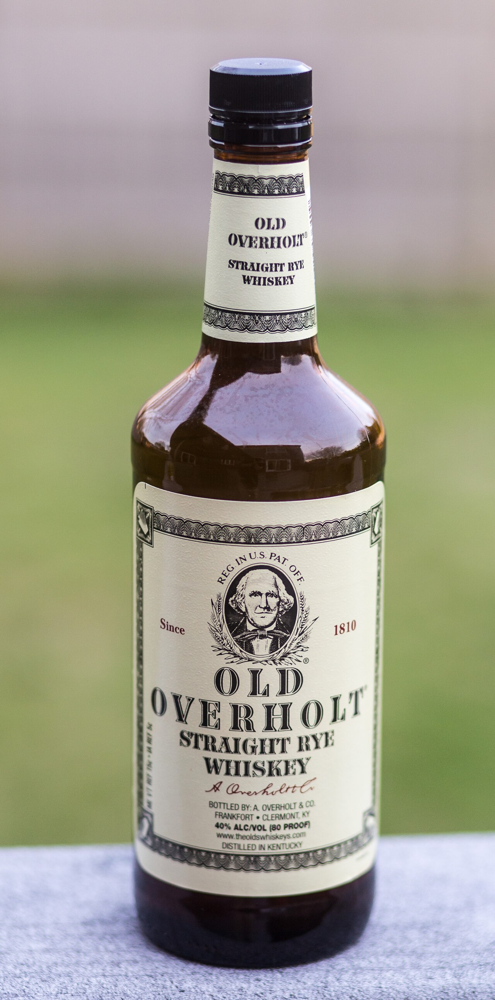
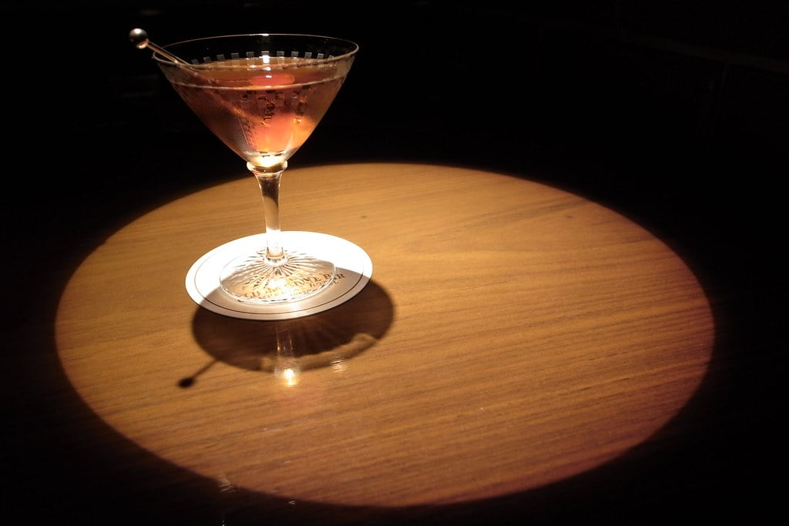

# Rye Whiskey

Rye whiskey is whiskey built on rye as its main grain. In the United States it comes with a checkable federal threshold: at least 51% rye in the fermented mash, distillation no higher than 160 proof (80% ABV), barrel entry no higher than 125 proof (62.5% ABV), new charred oak, and bottling at no less than 80 proof (40% ABV). In Canada, "rye" tells a different story: it is often simply a synonym for Canadian Whisky and promises nothing about how much rye is in the bottle.

Figure: Rye Whiskey. Image: User:kzirkel, CC0, via Wikimedia Commons ([source page](https://commons.wikimedia.org/wiki/File:A_bottle_of_Old_Overholt_Straight_Rye_Whiskey.jpg)).

## 51% is the legal floor

The current US [whisky](ref:whisky) standard lists rye whisky among the types named for their grain: once rye reaches 51% of the fermented mash, the label may use the name. The distillation ceiling, entry ceiling, cask type and bottling floor match [bourbon](ref:bourbon); only the main grain differs. Rye whiskey is therefore not "bourbon with rye added" but a parallel category in which maize gives way to rye.

51% is a floor, not a typical recipe. Many products push rye past 60% or close to an all-rye mash, while so-called "barely legal rye" sits just above 51% with maize and malted barley making up the rest. A higher share usually brings more spice and dryness, but yeast, distillation and cask can rewrite that rule of thumb.

## New charred oak and the two years of straight

Every American rye whisky must use new, charred oak. The charred layer converts lignin and wood sugars into vanillin, caramel and guaiacol compounds, giving the spirit a base of vanilla, coconut and sweet spice. Compared with Scotland's refill tradition, new oak extracts harder and faster, and long maturation can let wood override the grain.

A product labelled straight rye must also mature in new charred oak for at least two years and may not contain colouring, flavouring or other spirits. If the whisky in the bottle is under four years old, the label usually has to state the age. Straight is an additional layer of rules, not a synonym for rye whiskey; a bottle can be rye whiskey without carrying the straight designation.

## From field to mash

[Rye](ref:rye) starch behaves differently from barley starch. The mash turns viscous and gluey during saccharification, so distilleries often rely on enzymes from malted barley or added enzymes to complete conversion. The outer layers of the grain also carry strong cereal aroma and precursors for spice, and fermentation generates compounds associated with pepper, mint and dill.

[Fermentation](ref:fermentation) time and yeast strain decide where those precursors go. A short fermentation keeps the cereal impression direct, while a long one builds esters and fruit, and may add acidity. Rye mash foams easily, and temperature control is more sensitive than with a maize recipe; these process details often explain two distilleries' styles better than the rye percentage does.

## Distillation and the cut

American rye whiskey is usually produced on a continuous column still, though small distilleries may use pot stills or hybrid setups. Whatever the equipment, distillation must stay below 160 proof and the spirit must be reduced below 125 proof before barrel entry. Distilling too high strips away the spice and oil of the rye, leaving clean sweetness.

The cut between [heads, hearts and tails](ref:heads-hearts-tails) matters just as much. Heads carry solvent notes and tails bring cloudiness and bitterness, so only the heart goes to the barrel. An early cut gives a lighter, cleaner new make; a late cut keeps more oil and cereal weight. Rye's pepper note is stronger with a late cut, but rough edges are also more likely.

## Pepper, mint and a dry finish

Typical rye whiskey opens with rye bread, pepper, mint and dill, moves through caramel, vanilla and citrus peel, and finishes drier than bourbon with more visible tannin. A high-rye mash is spicier and more herbal; a high-maize mash is sweeter and rounder; wheat in the recipe adds softness.

These are tendencies, not guarantees by region or brand. Char level, warehouse temperature and humidity, ageing time and bottling strength all change the result. The gap between one distillery's rye and its bourbon can be smaller than the gap between two brands, and treating "rye is always fiery" as a law misses the softer, oilier expressions.

## The Canadian branch: rye need not be 51%

Canadian rules treat Canadian Whisky, Canadian Rye Whisky and Rye Whisky as one standard: distilled from a cereal mash, matured in small wood for at least three years, mashed, distilled and aged in Canada, bottled at no less than 40% ABV, with flavouring permitted. There is no requirement that rye reach 51%, and new charred oak is not required.

"Rye" on a Canadian label is therefore more a matter of history and flavour tradition than a statement of recipe. It may describe a rye-heavy spirit or a maize-led blend with only a little rye. Treating American rye and Canadian rye as the same product is the most common mistake in cross-market comparison.

## In the Manhattan and the Sazerac

The [Manhattan](ref:manhattan) traditionally uses rye whiskey as its base, because rye spice cuts the sweetness of vermouth and keeps the finish dry; bourbon makes a rounder, sweeter drink. The [Sazerac](ref:sazerac) also leans on rye structure, with an absinthe rinse and lemon peel providing aromatic contrast while the pepper note holds the centre.

There is no need to reach for the most expensive cask-strength bottling when mixing. A high-rye core expression often suits stirred cocktails better than a high-maize recipe, and a cask-strength version needs a smaller pour or more dilution. Neat, a few drops of water open the mint and rye-bread aroma.

## Six misreadings of rye

First, that rye whiskey must be 100% rye. US law asks for only 51%. Second, that Canadian rye and American rye follow the same standard. Third, that rye is always stronger or rougher than bourbon. Fourth, that straight means older is better; it only guarantees at least two years. Fifth, that rye whiskey is only for cocktails, when many aged expressions reward neat drinking. Sixth, that "rye" always means spicy, ignoring cask and yeast.

When buying, check the country and the category name first, then the rye share if the distillery discloses it, the age and the strength. Rye also follows the basic mechanics of [oak maturation](ref:oak-ageing): cask type and new-oak intensity set the direction of extraction, and time is only one variable. Drink in moderation, adults only.

**At a glance:** A whiskey built on rye as its main grain and matured in new charred oak; US rules require at least 51% rye and straight rye needs two years, while Canada treats Canadian Rye Whisky as the same standard as Canadian Whisky, with no minimum rye share.

## Related images

Image: A Manhattan in a coupe, with deep amber liquid and a cherry on a pick laid across the rim.. Credit: naotakem, CC BY 2.0, via Wikimedia Commons ([source page](https://www.flickr.com/photo.gne?id=6992048786)). Related image for Rye Whiskey.
