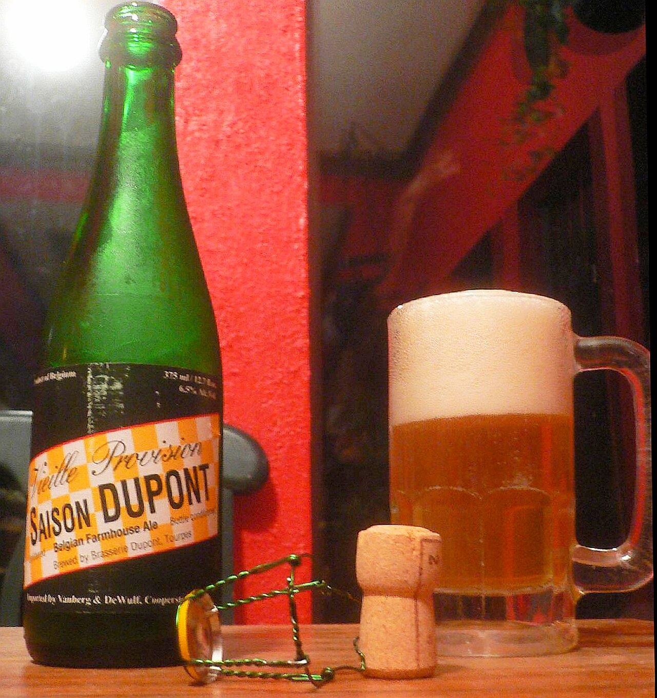

# Saison

Saison is a [beer](ref:beer) brewed by Walloon farmhouses in [Belgium](ref:belgium) during the cool season and kept for the summer farm work. It is defined not by colour but by fermentation and palate: high attenuation gives a dry finish, yeast produces pepper, citrus and hay-like aroma, and carbonation is usually lively. Historically it was a low-alcohol drink for farm labour; today it ranges from everyday versions to strong saisons above 8%.

Figure: Saison. Image: Jmcstrav, Public domain, via Wikimedia Commons ([source page](https://commons.wikimedia.org/wiki/File:Saison_Dupont.jpg)).

## A Walloon farmhouse larder for summer

In the 19th century Walloon farms brewed in winter and early spring, using the lower temperature to control fermentation, and brought the beer out for hired workers during the summer harvest. Such beers were usually modest in alcohol, based on local barley, wheat and sugar, and made by people who were not necessarily trained brewers, so recipes varied from farm to farm. Towns in Hainaut are regarded as the heartland of saison. Farms often grew grain, kept cattle and brewed at the same time; beer was part of wages and a source of fluid and energy during summer work, and this link between farm, season and labour forms the everyday background of the name.

In the 20th century bottled industrial beer and war reshaped the rural economy and many farms stopped brewing. From the 1980s, Belgian and American craft brewers turned their attention back to the tradition and made saison an international style. Today some family breweries still keep old recipes, while modern versions may add American hops, fruit or barrel ageing.

## High attenuation and a yeast-led character

[Yeast](ref:yeast) is the core of saison. Fermentation is usually warm, commonly at 20–25°C, and the yeast produces abundant esters and phenols in that environment, bringing pepper, clove, citrus and ripe fruit. The grist usually combines pale base malt with a little wheat and fermentable sugar, aiming for a light body and a clean finish rather than thickness built on residual sugar. Hard or soft water changes the outline of bitterness, and a cooler mash favours more fermentable sugar and a drier result.

[Fermentation](ref:fermentation) often rises in stages so that the yeast keeps consuming sugar late on and reaches very high attenuation. A little sugar and yeast may be added at bottling for a second fermentation and fine bubbles. Saison commonly runs 5%–8% alcohol and 20–35 IBU, but these figures vary with source and brewery and are not a legal standard; some farmhouse versions are only 3%–5%, while some modern versions exceed 8%.

## Pepper, citrus and a dry finish

Young saison is dominated by lemon peel, orange peel, green apple, pepper and hay, and some versions carry a little Brettanomyces barnyard note. The body is light to medium, carbonation lively, acidity modest but refreshing, the finish dry and bitterness usually moderate and clean. It is not a sour beer; acidity is only part of the structure. High attenuation makes the body seem light, but alcohol and spice lengthen the aftertaste; this balance of light without thinness is the key to judging quality.

Cellared saison develops honey, nut and more obvious spice, but the aroma also fades. A clear vinegar note, cardboard or excessive oxidation usually points to poor storage. Let the beer warm in the glass for a few minutes before tasting; the aroma opens up compared with a bottle taken straight from the fridge.

## Hainaut and the East Flanders horizon

The traditional home of saison is Hainaut in Wallonia, especially the towns near the French border. Some breweries south of Brussels and in East Flanders also make farmhouse-style beer, but their yeast and recipes differ widely. Representative producers include Brasserie Dupont, whose Saison Dupont is a benchmark, Fantôme, known for wild yeast and experimental flavours, and small farmhouse breweries such as Blaugies.

American craft brewing developed its own saison tradition after the 1980s, often with more obvious hop aroma, higher alcohol or barrel ageing. These versions can be excellent, but the distance from the Belgian farmhouse prototype has to be judged from recipe and yeast rather than the word "saison" alone. Belgian farmhouse versions often show more barnyard and pepper, while American versions may be cleaner and more citrus-hopped; both are legitimate, but the reference points differ.

## Saison, wheat beer and Belgian golden ale

Compared with [wheat beer](ref:wheat-beer), saison usually uses less wheat and focuses on yeast spice and a dry finish rather than banana, clove and a cloudy body. Compared with Belgian golden ale, saison is lighter, more attenuated and drier in bitterness, with yeast aroma leaning toward pepper and hay. Compared with sour beer, its acidity is usually gentle and not driven by lactic or acetic acid.

[Bitterness](ref:ibu) in saison is mainly a balancing act rather than the star. Too much bitterness buries yeast aroma; too little leaves the finish soft. The best test of a typical saison is whether it finishes dry, whether the yeast spice is clear, and whether carbonation holds up the light body.

## Vintage variation, serving and pairing

Saison is best served at about 6–10°C. Too cold suppresses pepper and citrus aroma; too warm makes alcohol stand out. A tulip or a white-wine glass gathers aroma; leave a reasonable head without demanding a thick one. Bottle-conditioned versions may throw sediment.

With food, saison suits salads, roast chicken, seafood, herbed pork and goat cheese, and it can also work with lightly spiced Asian dishes. Its dryness and bubbles cleanse the palate, but it is a poor match for very sweet desserts. Check the bottling date and alcohol content when buying; vintage variation in farmhouse versions is often more obvious than in industrial beer.

**In brief:** A farmhouse ale brewed in the cool season in Wallonia and kept for summer farm work; it is defined by high attenuation, a dry finish and peppery, citrusy yeast aroma, and modern versions range from low-alcohol everyday beers to strong saisons above 8%. 

Saison is best approached through the production rule, then the strength, and then the usual serving. One check alone will not settle it.

[Beer](ref:beer) and [Belgium](ref:belgium) are the nearest useful comparisons: one clarifies legal definition, the other tests materials and process.

**Key facts.**

| Item | Detail |
| --- | --- |
| In one line | A farmhouse ale brewed in the cool season in Wallonia and kept for summer farm work; it is defined by high attenuation, a dry finish and peppery, citrusy yeast aroma, and modern versions range from low-alcohol everyday b… |
| Parent style | Beer |
| Aroma family | Yeast esters and spice |

**Sources and limits.** The key claims about Saison are checked against the following sources: Beer Judge Certification Program, Brewers Association (Used to check public US craft industry categories for saison and farmhouse ale; no original text is reproduced), Oxford University Press and 4 sources in total. Prices, batches and status change; the body is project-written and does not reproduce source text.
