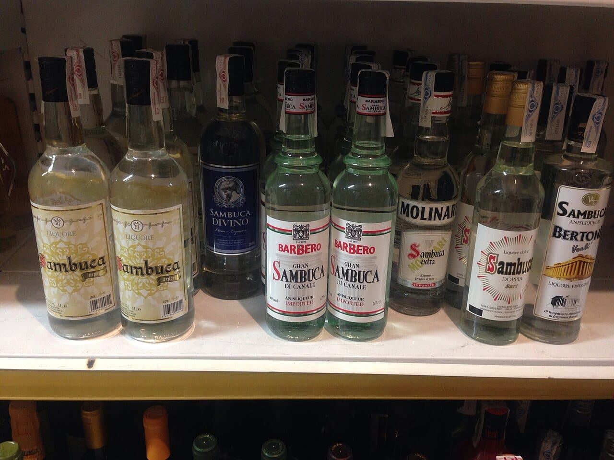
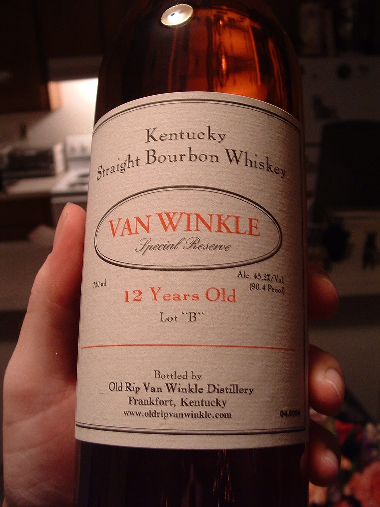

# Sambuca

Sambuca is an Italian anise-flavoured sweet liqueur, led by star anise and built on sugar and neutral spirit. Its legal minimum strength is 38% ABV; the classic bottling is clear, traditionally served with coffee beans or diluted to cloud, mostly as a digestif after meals.

Figure: Sambuca: Bottles of sambuca (Wikimedia Commons). Image: No Swan So Fine, CC BY-SA 4.0, via Wikimedia Commons ([source page](https://commons.wikimedia.org/wiki/File:Bottles_of_sambuca.jpg)).

## Definition and boundaries

Under EU spirit-drinks rules, sambuca (ref:liqueur) falls in the liqueur category as a colourless aniseed-flavoured liqueur. Its material includes distillates of anise (Pimpinella anisum L.), star anise (Illicium verum L.) or other aromatic herbs. The regulation sets explicit floors: sweetening products of at least 350 grams per litre expressed as invert sugar, a natural anethole content of between 1 and 2 grams per litre, and a minimum alcoholic strength of 38%; under the legal definition sambuca itself must not be coloured.

Alongside the classic clear white sambuca, the market also offers a deep-blue near-black nera version and a red version. These are commercial coloured variants, not the colourless sambuca of the strict legal definition. Elderflower, liquorice and other botanicals may be added but are not required by law. On a label, whether anise leads the aroma, and whether sugar level and strength meet the legal floor, matters more than colour for placing the product. It is an Italian (ref:italy) drink, with brands and recipes rooted in the liqueur tradition of the country's central and northern regions.

## History and naming

The name is commonly traced to the Latin sambucus, meaning elderberry; another theory links it to the Arabic zammut, a term for an anise drink. Both are etymological hypotheses. Around 1850, Luigi Manzi created an elderberry-based liqueur in Civitavecchia and named it sambuca; that early product is not the same as today's anise-led sambuca.

The modern commercial starting point is 1945, when perfumer and blending expert Angelo Molinari began experiments in Civitavecchia to produce Sambuca Extra, a star-anise-based liqueur whose recipe remains secret. In the 1950s, Rome cafés began serving the liqueur with three roasted coffee beans, the serve that became its most recognizable signature. In 1974 the company built a second factory, Molinari Sud, in Colfelice (Frosinone); the automated line reached a capacity of 60,000 bottles per day. After Angelo Molinari's death in 1975, his sons carried the business forward.

## Materials and process

The base is usually a neutral grain- or grape-based spirit. Anise and aromatic botanicals yield their essential oils through maceration (ref:maceration) or distillation (ref:distillation), which are then blended with neutral alcohol, concentrated sugar syrup and other flavourings. Star anise supplies the dominant sweet-anise aroma; green anise (Pimpinella anisum) is used less often, while elderflower and liquorice act as supporting layers. The syrup gives a thick, sweet palate, and the alcohol keeps the aromatic compounds in solution.

In production, the aromatic material is first processed: oils and flavour are extracted by distillation or infusion, then mixed with alcohol and syrup, filtered and stabilized before bottling. Sambuca receives no oak ageing; products reach the shelf as freshly blended spirits, and blend ratios set anethole concentration, sweetness and alcohol balance. Anethole dissolves in high-alcohol liquid; when water dilutes the drink below roughly 30% ABV, it forms a milky cloud, the louche effect shared by anise spirits generally.

## Style and palate

The classic sambuca opens sweet and syrupy, with anise, liquorice and floral notes woven together, finishing on a cool herbal note; the alcohol is wrapped by the high sugar but not made weak. The aroma leads with sweet star-anise, supported by herbs and a light floral character, and the liquid is clear and bright. Brands differ in sugar level, anise intensity and supporting botanicals: some are sweeter and thicker, others push the anise harder.

The legal minimum strength is 38%, and common bottlings sit between 38–42%: Luxardo Sambuca dei Cesari is 38%, Ramazzotti is 38%, and Molinari Sambuca Extra is around 42%. ABV (ref:proof) and sweetness together shape the palate: sugar brings out the sweet perception, while alcohol provides the warm backbone. Ageing is not part of this liqueur's cycle, and a freshly blended bottle's aroma directly reflects its raw materials and recipe.

## Representative regions and brands

The best-known brand in international markets is Molinari Sambuca Extra, founded in Civitavecchia in 1945 and famous for its star-anise recipe and the three-coffee-bean serve. The company remains family-owned, with the second and third generations expanding beyond Italy. Luxardo's Sambuca dei Cesari uses star anise, herbs and spices with volcanic spring water from its own sources, following the family recipe at 38% ABV.

Other familiar brands include Ramazzotti Sambuca (38%, owned by Pernod Ricard) and Romana Sambuca, distributed in the US market. These names are market references, not an official classification; the anise type, sugar level and ABV on the ingredient list explain a bottle's style better than brand ranking. Sambuca production is centered on Italian liqueur houses, though other countries make imitation anise sweet liqueurs; use of the name is constrained by regulation and trademark arrangements.

## How to drink and pair

The classic serve is con la mosca, "with the fly": three roasted coffee beans in the glass, with the sambuca neat. The beans add a light roast aroma and textural contrast while drinking. Other common serves are on ice or with a little water to cloud the drink and open the anise aroma; igniting the surface alcohol is a social-table preparation in some settings. The traditional occasion is the post-meal digestif, and it can also be stirred into coffee.

At the table, a sweet anise liqueur generally does not accompany a main course; it pairs with desserts, dried fruit and nuts, or stands alone as an after-dinner digestif. Coffee, chocolate, almond biscuits and anise sweets echo its sweet aroma. It is not commonly matched with mild cheese or salty charcuterie, where sweetness and alcohol would overpower the food. In bars it can anise a cocktail, though high sugar and high aroma call for a restrained measure.

## Buying, storage and misreadings

On the label, first check the lead aroma and parameters: anise distillate, sugar level, anethole content and ABV are the items the regulation cares about. A product labelled only "anise liqueur" without origin or recipe offers less to compare. Distinguish the Italian traditional sambuca from anise liqueurs made elsewhere, which may not meet the EU definition of sambuca.

For storage, a high-sugar, high-alcohol liqueur is stable: keep it away from light and heat for long-term keeping. Once opened, sugar and alcohol still inhibit microbes, but the aroma fades slowly with oxidation; finish the bottle within a year or two. Three common misreadings: treating a dark or red bottling as the standard sambuca colour, since the legal classic is colourless; assuming sambuca needs oak ageing, when it reaches market freshly blended; and treating the three coffee beans as a required ingredient rather than a traditional serving garnish.

## Further reading and see also

To get to know sambuca, start with a classic clear 38% bottling neat, then compare the water-cloud and coffee-bean serves, and finish with a brand differing in sugar or anise intensity. Across those comparisons, the differences in recipe, sweetness and serving practice become clear.

- Related: [liqueur](ref:liqueur), [italy](ref:italy), [distillation](ref:distillation), [proof-and-abv](ref:proof), [maceration](ref:maceration).

Start with the production rule. From there, consider the strength, then the usual serving. That is how a practical judgment about Sambuca is built.

[Liqueur](ref:liqueur) and [Distillation](ref:distillation) are the nearest useful comparisons: one clarifies legal definition, the other tests materials and process.

## Related images

Image: An Old Rip Van Winkle bourbon bottle and label; a real example of how strength and proof are declared, not a hydrometer or measuring instrument. Credit: Joe Hall from Oakland, USA, CC BY 2.0, via Wikimedia Commons ([source page](https://commons.wikimedia.org/wiki/File:Old_Rip_Van_Winkle_Whiskey_301243232.jpg)). Related image for Sambuca.
