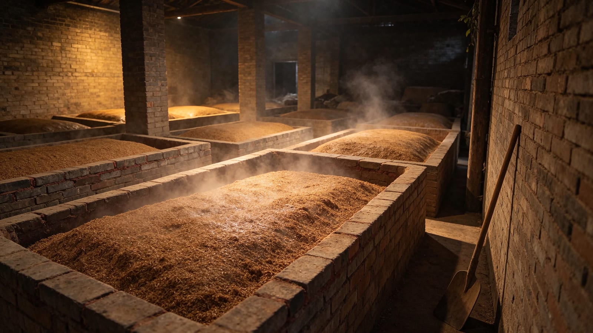

# Sauce-aroma baijiu

Sauce-aroma baijiu is one style within [baijiu](ref:baijiu), marked by high-temperature qu, high-temperature stacking, stone pits with mud bottoms, multi-round fermentation and long storage. Its aroma is usually described as prominent sauce aroma, elegant and delicate, full-bodied and long-finishing, but the style name itself is not a quality grade.

Figure: Sauce-aroma baijiu. Image: Xiaomage de, CC BY-SA 4.0, via Wikimedia Commons ([source page](https://commons.wikimedia.org/wiki/File:Vertreter_der_vier_Baijiu_Kategorien.jpg)).

## Definition and standard

Sauce aroma is a style category defined by aroma and process characteristics. The current product standard is GB/T 10781.4-2024, Quality requirements for baijiu — Part 4: Jiang-flavour baijiu, published on 2024-05-28, implemented on 2025-06-01 and fully replacing GB/T 26760-2011, Jiang-flavour Chinese spirits.

GB/T 26760-2011 was published in 2011 and implemented on 2011-12-01, and for a long time served as the inspection basis for sauce-aroma products. For products made after 2025-06-01, the new edition should be cited first; the old edition fits only when discussing old labels and historical products, and its time context should be stated.

At the terminology level, GB/T 15109-2021, Terminology of baijiu industry, defines concepts such as first grain addition, rounds and stacking, while GB/T 17204-2021, Terminology and classification of alcoholic beverages, provides the classification framework for alcoholic beverages. Product standards carry quality requirements and terminology standards define boundaries; neither replaces the other.

## Process characteristics

Sauce-aroma production is often summarised as high-temperature qu, high-temperature stacking, multi-round fermentation, long storage and blending to form the final product. High-temperature qu brings heat-tolerant microbes and a rich enzyme system; high-temperature stacking completes microbial multiplication and warming before pit loading; stone pits with mud bottoms provide a sealed in-pit environment; multi-round distillation gives the spirit layers from different rounds; long storage and blending provide stability and consistency.

The process depends heavily on season and rhythm. The industry saying that qu is made at the Dragon Boat Festival and the first grain addition happens at the Double Ninth Festival describes a rhythm built around temperature and raw-material supply. Companies and regions adjust it to local conditions, and the rhythm is not a legal requirement.

## Two grain additions and rounds

Traditional sauce-aroma production adds grain in two steps. The first is called xiaosha, the first grain addition, and the second is called caosha, the second grain addition. Multiple rounds of cooking, fermentation and distillation follow.

The industry often summarises the traditional process as 12987: one production cycle per year, two grain additions, nine cooking steps, eight fermentations and seven distillations. This is a popular summary of the traditional flow, not a legal grade and not a uniform parameter for every product. GB/T 10781.4-2024 describes one production cycle with no fewer than six rounds of stacked fermentation, a traditional eight rounds of in-pit fermentation, and in-pit fermentation lasting no fewer than 30 days.

Rounds differ noticeably. The early rounds tend to show more acidity and rawness, the middle rounds are fuller, and the later rounds can carry heavier toasted and bitter notes. Producers balance these differences through separate storage by round and [blending](ref:blending).

## Qu making and stacking

Sauce-aroma baijiu uses high-temperature qu. GB/T 10781.4-2024 describes qu making with a peak temperature above 60 °C. The high temperature lets heat-tolerant bacteria take part and provides a base for sauce and toasted notes. [Qu making](ref:qu-making) is the first gate of this route, and unstable qu is hard to compensate for later.

[Stacked fermentation](ref:stacked-fermentation) is the most recognisable open step in sauce-aroma production. Qu-inoculated mash is piled before pit loading, and the peak temperature can reach 50 °C or above. Stacking handles microbial multiplication, warming and conversion, and only afterwards does the mash enter the pit.

## Pit and in-pit fermentation

The sauce-aroma pit is preferably a stone pit with a mud bottom. Stone walls give strength and easier cleaning, while the mud layer at the bottom carries microbes and takes part in flavour formation. After loading, the pit is sealed to create an anaerobic environment where yeast completes alcoholic fermentation and esterification continues.

The condition and maintenance of the [fermentation pit](ref:fermentation-pit) directly affect the result. Unlike strong-aroma baijiu, which stresses mud pits and pit mud, sauce-aroma production places more weight on stone structure, the bottom mud layer, round rhythm and stacking control. Saying that sauce aroma also values old pits is not wrong, but the strong-aroma pit logic should not be applied directly.

## Flavour structure

Sensory descriptions of sauce-aroma baijiu usually include prominent sauce aroma, elegance and delicacy, a full body, a long finish and a lingering empty glass. The main aroma compounds are complex, and neither academia nor industry has settled on a single compound as the only source of sauce aroma. This is one way it differs from strong-aroma baijiu, where ethyl caproate dominates the explanation.

On strength, 53% vol is one of the most common specifications for sauce aroma, and lower-strength products also exist at 43% vol and 38% vol. Strength affects aroma concentration and palate heat but is not a quality grade. Comparing products means reading the standard, raw materials, round structure, storage time and price band together.

## Regions and representative products

The most concentrated sauce-aroma region is the Chishui River basin, including Maotai town, Xishui and Jinsha in Guizhou (see [Guizhou](ref:guizhou)), as well as Gulin in Sichuan. [Moutai](ref:moutai) and [Langjiu](ref:langjiu) are product pages representing this style.

Regional stories often stress river-valley climate, water and microbial environment, but these factors have to be checked against specific companies, raw materials and processes. Sauce aroma is not made only in Guizhou; Shandong, Hunan and other places also produce sauce-aroma or mixed-aroma products. Equating a region name with quality is a common simplification.

## Labelling and common misconceptions

First, treating the style as a quality grade. Sauce aroma is only a category; quality also depends on the standard, grade marking and sensory performance.
Second, treating kunnsha, suisha, fansha and cuanxiang as legal grades. These are industry nicknames for raw-material handling and process routes, and standard texts do not use them to classify product grades.
Third, recognising only 53% vol. It is common but not the only specification, and lower-strength products carry process requirements too.
Fourth, treating vintage wording as a standard grade. Vintage statements mean different things across companies and products, so the label and producer notes should be read.
Fifth, equating sauce aroma with the Guizhou region. Region is an important clue but not the only explanation.

**In brief:** A baijiu style known for high-temperature qu, high-temperature stacking, stone pits with mud bottoms and multi-round fermentation. Style is not a quality grade. 

## Further reading

- [Baijiu](ref:baijiu): the definition and classification framework at the drink level.
- [Strong-aroma baijiu](ref:strong-aroma): another style to read in comparison.
- [Qu making](ref:qu-making): the microbial and enzyme basis of high-temperature qu.
- [Stacked fermentation](ref:stacked-fermentation): the most recognisable open step in sauce-aroma production.
- [Fermentation pit](ref:fermentation-pit): the vessel behind stone pits with mud bottoms.
- [Distillation](ref:distillation): the technical background for multi-round distillation.
- [Blending](ref:blending): the key step that combines rounds and unifies flavour.
- [Sorghum](ref:sorghum): the main raw material for sauce-aroma baijiu.
- [Guizhou](ref:guizhou): the core region of the Chishui River basin.
- [Moutai](ref:moutai): a representative product page for sauce aroma.
- [Langjiu](ref:langjiu): a sauce-aroma product page from the Sichuan side of the Chishui River.
- [GB/T 26760-2011 Jiang-flavour Chinese spirits](ref:gbt-26760-2011): the older standard fully replaced by GB/T 10781.4-2024.

## Related images

Image: Editorial illustration of stacked fermentation: grain mounds and steam in a brick fermentation room; AI-assisted illustration, not a photograph.. Credit: Hejiu editorial team, AI-assisted with Doubao Seedream 5.5; project-generated editorial figure, not a photograph ([about](https://hejiu.org/about/)). Related image for Sauce-aroma baijiu.
