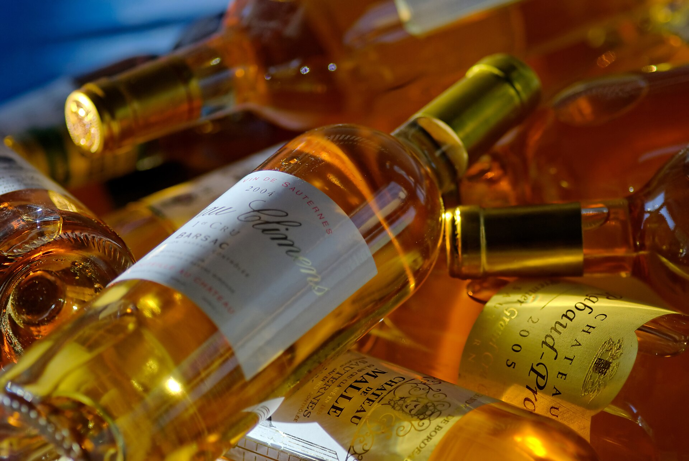

# Sauternes

Sauternes is the botrytised sweet white of southern [Bordeaux](ref:bordeaux), in the Gironde, and one of the easiest sweet wines in the world to name. Its identity is not a single estate but the result of a small river, a fungus and a classification working together. Autumn fog from the Ciron river lets noble rot develop in the vineyards, [Sémillon](ref:semillon) gives body and honeyed texture, [Sauvignon Blanc](ref:sauvignon-blanc) gives acidity and citrus, and oak and bottle age decide whether the final wine is fresh or rich.

Figure: Related photograph of Sauternes. Image: Pascal MOULIN, CC BY-SA 4.0, via Wikimedia Commons ([source page](https://commons.wikimedia.org/wiki/File:Sauternes_2.jpg)).

## Fog is the first ingredient

Sauternes lies on the left bank of the Garonne, where the Ciron flows north into the larger river. In autumn, the cold Ciron meets the warmer Garonne and morning fog forms; afternoon sun burns it off, so the vineyards alternate between damp and dry. That rhythm is ideal for [noble rot](ref:noble-rot): fog lets the fungus enter the skins, the dry afternoon suppresses harmful moulds, and the fruit slowly loses water while sugar, acidity and aroma concentrate.

Without fog, Sauternes would make ordinary sweet white; with too much fog or rain, noble rot turns to grey rot and whole bunches are lost. This is why vintages in Sauternes vary so widely.

## Three varieties, two roles

Sémillon is the main variety, usually more than half the blend. Its thin skins are easily penetrated by botrytis, and it gives a full-bodied wine with honey, apricot and a waxy texture. Sauvignon Blanc supplies acidity, citrus and grassy notes, keeping the wine from becoming heavy; Muscadelle is used in small amounts for floral and grapey perfume. Proportions change with estate and vintage: some properties use almost only Sémillon, while others raise Sauvignon to keep the wine fresh.

The division of labour is simple: Sémillon is the body, Sauvignon the frame, Muscadelle the aromatic accent. That explains why Sauternes can be either a rich confection or a lighter wine of citrus and stone.

## 1855: the long life of a list

During the Paris Universal Exhibition of 1855, the Bordeaux chamber of commerce ranked the estates by price and reputation. In Sauternes and Barsac, 26 properties were classified into a top tier, first growths and second growths. It was never comprehensively reordered as prices, ownership and quality changed, so today's hierarchy is a historical coordinate rather than an absolute quality ranking.

Begin with the production rule, move on to the strength, and finish with the usual serving. That order keeps the reading of Sauternes practical.

## Why d'Yquem is the exception

In the 1855 Sauternes ranking, [Château d'Yquem](ref:dyquem) was placed alone as Premier Cru Supérieur, above every other estate in Sauternes and Barsac. This was not a matter of volume; on the contrary, selection is severe, grapes are picked berry by berry, and in weaker years the estate may not release a grand vin at all. Its history reaches back centuries, and successive owners and winemaking philosophies made it the symbol of Sauternes.

D'Yquem is usually richer and longer-lived than its neighbours, with honey, apricot, vanilla and toasted nuts in youth, moving to caramel, orange peel and spice with age. Its price and scarcity make it a collector's wine, but it also encourages the mistaken idea that Sauternes has only one expression. In fact the region is far more diverse than a single estate.

## Picking as a repeated operation

Sauternes is not harvested in one pass. Workers inspect the rows and pick only the berries that have been infected by botrytis and reached the right state, leaving the rest for the next round. A vineyard may be picked three to six times, sometimes more. Each pass has a different sugar level and aroma, so the lots are pressed and fermented separately before blending.

This is expensive in labour, time and yield. The Sauternes AOC already sets a low maximum yield, and in poor weather the crop falls further.

## Young and old: two wines

Young Sauternes is pale gold, with citrus, white flowers, honey and apricot, sweet but not cloying, with clear acidity. With age, the colour turns amber and copper, the aromas move to toasted nuts, caramel, orange marmalade, ginger and spice, and the texture thickens while acidity holds the structure.

Not every Sauternes is built for long ageing. Entry-level wines are usually best within five to ten years, while top estates in great vintages can last decades. Judge ageing potential by balance of acidity, residual sugar and body, not by the name alone.

## Serving, pairing and price

Serve Sauternes at 8–10°C, or up to 12°C for older bottles. A small tulip or white-wine glass is enough, and over-chilling will shut down the aroma. Foie gras is the classic match; blue cheese, roast chicken, lobster and apricot desserts also work. It can handle mildly spicy Asian dishes, where sweetness softens the heat.

## What to check when buying

First, the appellation. Only [Sauternes](ref:sauternes) or Barsac belongs to this system; a sweet white labelled Bordeaux Supérieur does not. Second, the vintage, since autumn humidity can let botrytis run too far. Third, the estate and classification: the 1855 list is a reference, not the only standard. Fourth, the format: Sauternes is often sold in half bottles because sweet wine is served in small quantities. Fifth, storage: heat and light damage sweet wine, so confirm provenance and conditions.

**At a glance:** The botrytised sweet white of southern Bordeaux, based on Sémillon with Sauvignon Blanc and Muscadelle; autumn fog from the Ciron river feeds noble rot, while the 1855 classification and the unique status of d'Yquem shaped its reputation. 

Sauternes is a botrytised sweet wine from southern Bordeaux, based on Sémillon with Sauvignon Blanc and Muscadelle; the Ciron fog and gravel terraces drive noble rot, and the 1855 classification shaped its prices.

The best vintages are those with enough botrytis and enough acidity to keep the wine from tasting heavy.

**Key facts.**

| Item | Detail |
| --- | --- |
| In one line | The botrytised sweet white of southern Bordeaux, based on Sémillon with Sauvignon Blanc and Muscadelle; autumn fog from the Ciron river feeds noble rot, while the 1855 classification and the unique status of d'Yquem shap… |
| Parent style | Dessert Wine |
| Aroma family | Honey / apricot / citrus peel |

**Sources and limits.** The key claims about Sauternes are checked against the following sources: Conseil Interprofessionnel du Vin de Bordeaux (the Bordeaux regional, variety and sweet-wine framework; no original text is reproduced), INAO (the French appellation system and the administration of the Sauternes AOC; no original text is reproduced), Conseil des Grands Crus Classés en 1855 (the terroir, appellation data and 1855 classification of Sauternes and Barsac; no original text is reproduced) and 4 sources in total. Prices, batches and status change; the body is project-written and does not reproduce source text.

## Related images

Image: Sémillon - Joseph Daurel. Credit: Imprimerie A. Bellier & Cie - Bordeaux, CC0, via Wikimedia Commons.. Credit: Imprimerie A. Bellier & Cie - Bordeaux, CC0, via Wikimedia Commons ([source page](https://commons.wikimedia.org/w/index.php?curid=94839238)). Related image for Sauternes.
