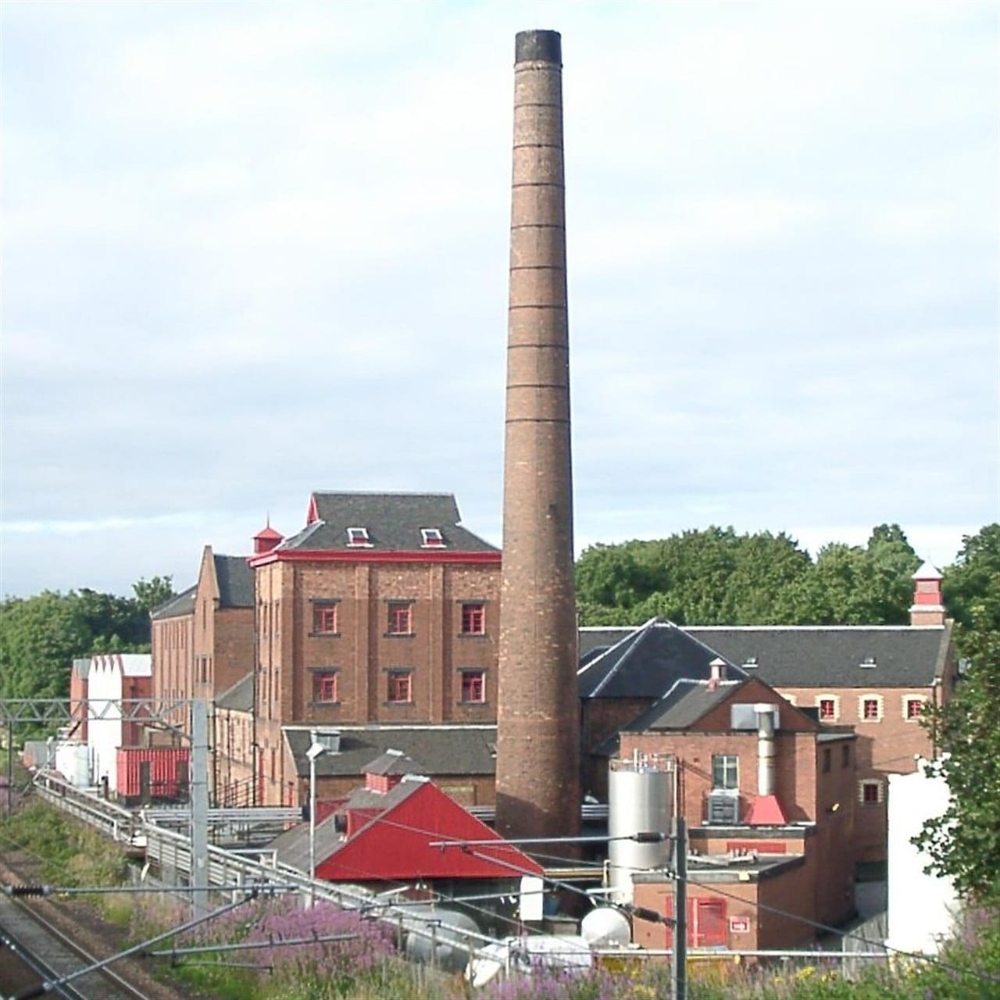

# Scottish Ale

Scottish ale is the umbrella for Scotland's traditional top-fermented beers, malt-led with low hop bitterness and caramel, toast, toffee and dried-fruit notes. Strength runs the gradient from the light 60/- to the heavy Wee Heavy, and the family sits within the British Isles ale tradition alongside English ale (ref:english-ale).

Figure: Scottish Ale: Caledonian Brewery (Wikimedia Commons). Image: Wikimedia Commons contributor, CC BY-SA 3.0, via Wikimedia Commons ([source page](https://commons.wikimedia.org/wiki/File:Caledonian_Brewery.jpg)).

## Definition and boundaries

Scottish ale gathers a group of malt-led Scottish beers (ref:beer), traditionally split into strengths: the 60/- Scottish Light, close to a dark mild; the 70/- Scottish Heavy, comparable to an ordinary bitter; the 80/- Scottish Export, comparable to a best or strong bitter; and the strongest tier, Wee Heavy (Strong Scotch Ale). These are not legal appellations and share no single brewing code. The number after "/-" now only denotes the beer's weight within one brewery; a larger number usually means fuller body and higher ABV.

Compared with English bitter, Scottish ale finishes lower in attenuation, sweeter on the finish and less hopped, generally darker in colour. Scottish (ref:scotland) breweries adjust recipes to local water, malt habit and traditional hops, so the same tier can still differ in depth between breweries. Soft local water and barley (ref:barley) malt supply the main flavour; hops are not native to Scotland and were historically expensive to import, so traditional recipes keep them to a level that only balances sweetness. One distinction worth making: Scottish ale is a top-fermented ale, not the bottom-fermented lager that later spread across the beer world.

## History and naming

The shilling (/-) label originally referred to the price of beer sold by the hogshead cask. The price moved over time, and although shillings are no longer Scottish currency, the term stuck as a shorthand for a beer strength. Beers under these names existed before World War I as mild (unaged) beer, but the modern Light, Heavy and Export forms only took shape after World War II.

In brewing lineage, Wee Heavy descends from Edinburgh Ale, a strong malty beer similar to Burton Ale but hopped at roughly half the rate. Historically hops were expensive and scarce in Scotland, so brewers relied on caramelized malt, roasting sugars and high malt concentration for flavour, and fermented at slightly cooler temperatures than English counterparts. The 60/-, 70/- and 80/- tiers were often produced by parti-gyling: one wort split by gravity into runs, the higher-gravity portions giving fuller body and concentration.

## Materials and process

Traditional ingredients center on dextrinous pale ale malt, with corn, dark brewing sugars and brewers' caramel for colour. Modern post-WWII recipes often add small amounts of dark malt, a lower proportion of crystal malt, plus amber malt and wheat. Mashing traditionally uses a single infusion with an underlet mash and multiple sparges; the yeast is a clean ale strain, and the water is soft. Hops are mostly English varieties, used sparingly, with bitterness only enough to keep the beer from cloying.

Fermentation runs a little cooler than English ale, with incomplete attenuation that leaves residual sugar and dextrin; this is the source of the rounded body and sweet entry. Traditional recipes do not use peat (ref:peat)-smoked malt: brewing literature states that peat malt is not only inauthentic but produces a dirty phenolic character inappropriate for the style. Any perceived smoke or earthiness comes from yeast performance, local water and roasted malt rather than peat smoking. A few modern smoked examples belong in the separate smoked-beer category, not in traditional Scottish ale.

## Style and palate

The aroma opens on a medium malt sweetness, with caramel, toffee, toasted breadcrumbs, ladyfingers and butterscotch, plus light pome fruit and a restrained English hop note of earth, floral or orange-citrus spice. The palate is toasted-bready malt with a slight roast dryness on the finish balancing residual sweetness; esters and hop flavour are light and the fermentation profile clean. Body runs medium-light to medium, carbonation low to medium, and the mouthfeel can be slightly creamy.

The tier parameters run roughly as follows: 60/- Light at 2.5–3.3% ABV, IBU 10–20, SRM 17–25; 70/- Heavy at 3.3–3.9% ABV, IBU 10–20, SRM 12–20; 80/- Export at 3.9–6% ABV, IBU 15–30, SRM 12–20; Wee Heavy at 6.5–10% ABV, IBU 17–35, SRM 14–25, OG 1.070–1.130. Strong versions are malt-concentrated sippers for cold nights, with low carbonation to emphasize body weight; light tiers read more like everyday cask draught.

## Representative regions and brands

Scottish breweries provide the main reference points. Light tier examples include Belhaven Best and McEwan's 60; Heavy includes McEwan's 70 and Orkney Raven Ale; Export includes Belhaven Scottish Ale, Broughton Wee Jock 80 Shilling, Caledonian Edinburgh Castle, McEwan's 80/-, Orkney Dark Island and Traquair Bear Ale. These names are market and competition references, not an official classification.

Wee Heavy representatives include Belhaven Wee Heavy, Broughton Old Jock, Gordon Highland Scotch Ale, Inveralmond Blackfriar, McEwan's Scotch Ale, Orkney Skull Splitter and Traquair House Ale. North America also brews in the Scottish ale style, and some American versions run stronger than traditional Scottish examples. Compare tier and ABV before brand style; do not take an American strong ale as the traditional Scottish baseline.

## How to drink and pair

Serving temperature follows strength: light and Heavy tiers sit near English bitter, chilled but not ice-cold at roughly 10–12°C, to bring out malt sweetness and freshness; Export and Wee Heavy are served a little cooler, letting caramel and dried-fruit aromas open. A plain pint glass or medium-bowl ale glass works; cask-conditioned versions are best drunk on the brewery or pub premises, and young bottled examples do not need long airing.

Pairing circles around malt sweetness and the roasted backbone: roast lamb, stews, sausages and smoked meats, with oatcakes, carry the caramel and bread-malt notes; hard cheeses such as Cheddar and smoked cheese pair well with Wee Heavy. Delicate seafood or high-acid salads do not match, where malt sweetness would overpower the food; spicy dishes amplify hop and alcohol bite, so a softer-hopped light tier is the safer pick.

## Buying, storage and misreadings

On the label, first confirm tier and strength: 60/-, 70/-, 80/- and Wee Heavy differ greatly in ABV and body, and tiers from the same brewery are not interchangeable for comparison. Then read the ingredient list: traditional versions are malt, sugar and a little hops, while extra smoke, fruit or spice marks a modern variant. Whether the origin is Scotland or a North American imitation also affects recipe strength and hop balance.

Beer does not age indefinitely. Scottish ale is drunk young and fresh; bottled versions with residual sugar and carbonation should be kept away from light and heat and finished soon after opening. Strong Wee Heavy can keep longer under suitable conditions, but it does not improve forever. Three common misreadings: assuming Scottish ale must carry peat smoke, since traditional recipes use no peat malt; calling every dark sweet beer a Scotch Ale, when strength and process tiers must be separated; and judging traditional light tiers by the rich sweetness of an American strong ale.

## Further reading and see also

To approach Scottish ale, start with a standard-strength 70/- or 80/- to learn the malt skeleton, then compare the Light and Wee Heavy ends. Across those three tiers, the differences contributed by gravity, residual sugar and hopping rate become clear.

- Related: [english-ale](ref:english-ale), [beer](ref:beer), [barley](ref:barley), [peat](ref:peat), [scotland](ref:scotland).

For Scottish Ale, begin with the production rule. Then look at the strength, and finally ask the usual serving. The answers point to different choices, not to a single score.

## Related images

Image: Peat. Credit: David Stanley from Nanaimo, Canada, CC BY 2.0, via Wikimedia Commons ([source page](https://commons.wikimedia.org/wiki/File:Peat_(49302157252).jpg)). Related image for Scottish Ale.
