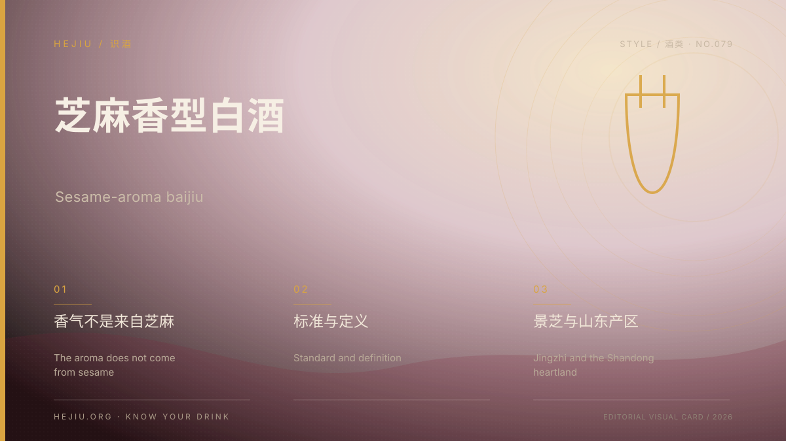

# Sesame-aroma baijiu

The name of sesame-aroma baijiu misleads easily: it contains no sesame and is not flavoured with sesame essence. "Sesame aroma" is a metaphor for a roasted, nutty, lightly scorched composite impression. The real source is the microbiology and chemistry of koji making, stacking, the fermentation pit and long storage, above all sulphur compounds, pyrazines and roasted aroma substances.

Figure: thematic illustration for Sesame-aroma baijiu. Image: AI-assisted illustration generated with Doubao Seedream 5.0 (project-owned); not a photograph of the subject.

> **Quick verdict**
> **In one line:** This style places Sesame-aroma baijiu on the flavour map, and helps you choose and serve it.
>
> - **Best for:** Anyone comparing Sesame-aroma baijiu with other styles before buying or ordering.
> - **Not for:** If you want want a single “best” ranking and reject stylistic difference.
> - **Check first:**
>   - Fermentation is followed by solid-state distillation, see distillation.
>   - There is no sesame in the ingredient list.

## The aroma does not come from sesame

There is no sesame in the ingredient list. Its aroma is closer to a blend of toasted sesame, roasted nuts, light scorch and aged wood, with a full, soft, long finish. Treating sesame aroma as the result of added flavouring misunderstands the process and underrates the difficulty of making this kind of baijiu.

Nor is it one compound. Research usually attributes the roasted impression to sulphur compounds, pyrazines, aldehydes, ketones and phenols acting together; high-temperature stacking and high-temperature koji supply precursors, and long storage lets them recombine. Different breweries, with different heat, koji and pit conditions, range from a restrained roast to a dense, smoky aroma.

## Standard and definition

The current national standard is GB/T 10781.9-2021, Quality requirements for baijiu — Part 9: Zhimaxiangxing baijiu, implemented on 1 March 2022 and wholly replacing GB/T 20824-2007. It defines the type as baijiu made mainly from grain, optionally with wheat bran, using daqu, fuqu or similar saccharifying and fermenting agents, through stacking, solid-state fermentation, solid-state distillation, ageing and blending, without direct or indirect addition of edible alcohol or colour, aroma and flavour substances not produced by its own fermentation, and having the sesame-aroma style.

Four words carry the definition: grain, bran, daqu and fuqu, and stacking. They point to materials, koji and process route. Remove any one and the product may still be pleasant, but it is no longer sesame-aroma baijiu in the standard sense. The standard also divides products by strength into high-strength and low-strength spirit, with high-strength spirit at 40%–68% ABV, noting that 40% ABV itself is excluded.

## Jingzhi and the Shandong heartland

The representative region is Shandong, centred on Jingzhi town in Anqiu, Weifang. Jingzhi Distillery has long promoted sesame aroma, taken part in standard drafting and spread the process, so that the name Jingzhi has almost become a synonym for the type. Distilleries outside Shandong also make sesame-aroma products with fuqu, high-temperature stacking and brick pits, but the scale and historical depth remain concentrated in central Shandong.

A region is not a quality guarantee. The climate, water and microbial environment of Jingzhi provide conditions, but breweries in the same area differ widely in koji ratio, stacking temperature, pit material and storage time. Treating "made in Shandong" as "authentic" mistakes a regional tradition for a legal grade; the standard sets process and physical-chemical boundaries, not a single town.

## Koji: high-temperature daqu and fuqu

Sesame aroma usually combines high-temperature daqu with fuqu. High-temperature daqu is cultured warm, enriching heat-tolerant bacteria and moulds and bringing scorched, sauce-like notes and a complex enzyme system. Fuqu uses wheat bran as a carrier, inoculated with pure or mixed cultures; it has strong saccharifying power and high fermentation efficiency, making up for daqu's limits in starch use. Used together, they keep daqu's aromatic complexity while raising yield and consistency.

This dual koji route is a key difference from sauce aroma and strong aroma. Sauce aroma centres on high-temperature daqu and multiple fermentation rounds; strong aroma centres on medium-high-temperature daqu and old mud pits; light aroma centres on low-temperature daqu and earthen jars. Sesame aroma brought fuqu into a famous-spirit process, once seen as a technical breakthrough and still argued over as "is fuqu lower-end?"

## Stacking and brick pits with mud floors

Before entering the pit, the steamed grain mash is stacked warm, see [koji making](ref:qu-making) and [fermentation](ref:fermentation). Stacking lets microbes multiply in the open air, temperature rises, starch and protein begin to break down, and aroma precursors form in quantity. Stacking temperature, time and turning decide whether the finished spirit has a roasted note and whether the scorch is excessive.

The fermentation vessel is usually a brick pit with a mud floor: brick walls and a mud base. Brick helps control moisture and temperature, while the mud floor gives acetic-acid bacteria and other microbes a habitat, balancing the cleanliness of sesame aroma with strong-aroma pit character. Compared with a full mud pit, the mud area is small and the pit aroma more restrained; compared with the stone-walled, mud-floored pits of sauce aroma, the brick pit has different air permeability and microbiology. Fermentation length and rounds vary by brewery; there is no national "sesame cycle".

## Distillation, storage and blending

Fermentation is followed by solid-state distillation, see [distillation](ref:distillation). The steamer and the cut preserve more high-boiling aroma compounds; heads, heart and tails are kept separately, with the heart as the main body and the rest used for adjustment or redistillation. Too fierce a fire brings scorched bitterness and off-notes; too soft a fire leaves aroma thin.

New spirit usually rests for a long period so that sulphides escape, alcohol and water associate, and aroma turns from sharp to round. Clay jars or stainless steel tanks are common; clay's slight porosity aids oxidation and mellowing, while stainless steel preserves aroma. Blending combines spirits of different rounds, years and koji ratios, with a little old spirit for lift when needed. Blending is a skill, not "adding water"; the standard allows water to reduce strength but not edible alcohol or external flavouring.

## Key parameters

- Current standard: GB/T 10781.9-2021, implemented on 1 March 2022.
- Materials: grain as the base, optionally wheat bran.
- Koji: daqu, fuqu and similar.
- Process: stacking, solid-state fermentation, solid-state distillation, ageing, blending.
- High-strength spirit: 40%–68% ABV, with 40% ABV excluded by the standard.
- Aroma words: toasted sesame, nuts, scorch, aged aroma.

These parameters come from the national standard and describe category boundaries. Strength, storage time and koji ratio cannot each stand for quality; a good bottle still depends on clean aroma, harmonious body and a comfortable finish.

## Boundaries with sauce, strong and light aroma

The difference from sauce aroma lies in koji and pit. Sauce aroma centres on high-temperature daqu, stone-walled pits with mud floors, multiple rounds, and an aroma of sauce, scorch and age; sesame aroma brings in fuqu, brick pits with mud floors, and stresses the roast from stacking. Both use heat and show scorch, but sauce aroma's "sauce" comes from repeated high-temperature fermentation, while sesame aroma's "sesame" comes from the composite aroma of stacking and koji.

The difference from strong aroma lies in pit and ester. Strong aroma centres on old mud pits and medium-high-temperature daqu, with ethyl hexanoate prominent and a dense pit aroma; sesame aroma's brick pit has less mud surface, ethyl hexanoate is not the lead, and roasted and sulphur notes stand out. The difference from light aroma lies in koji and vessel. Light aroma uses low-temperature daqu, earthen jars and clean steaming, with ethyl acetate dominant and a crisp profile; sesame aroma uses high-temperature daqu and fuqu, brick pits and stacking, giving a more composite, heavier aroma.

## Common misconceptions

First, that sesame aroma means added sesame. There is no sesame in the materials; the aroma comes from fermentation and storage. Second, that it is a branch of sauce aroma. The two differ in koji, pit and rounds. Third, that fuqu means low-end. Fuqu is one kind of saccharifying and fermenting agent; the key is culture, process and control. Fourth, that heavier scorch is better. Excess scorch hides fruit and aged notes; balance is the goal. Fifth, that "made in Shandong" is a legal guarantee. The standard sets process and physical-chemical boundaries, not a single place. Sixth, that sesame aroma is a flavouring note. Real sesame aroma is a composite roast, not a linear additive.

For Sesame-aroma baijiu, begin with the production rule. Then look at the strength, and finally ask the usual serving. The answers point to different choices, not to a single score.

## Further reading

- [Baijiu](ref:baijiu): the overall classification and process framework.
- [Sorghum](ref:sorghum) and [wheat](ref:wheat): the main materials and koji material.
- [Koji making](ref:qu-making): how daqu and fuqu differ.
- [Fermentation](ref:fermentation): the role of stacking and pit fermentation.
- [Distillation](ref:distillation): solid-state distillation and the cut.

## Related images

Image: Wheat. Credit: kallerna, CC BY-SA 4.0, via Wikimedia Commons ([source page](https://commons.wikimedia.org/wiki/File:Vehn%C3%A4pelto_6.jpg)). Related image for Sesame-aroma baijiu.
