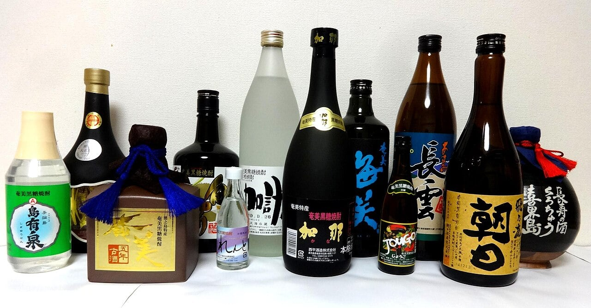

# Japanese shochu

Japanese shochu is not one drink but a branch of distilled spirits under Japan's liquor tax law. It divides by distillation into two routes: continuously distilled class A shochu, neutral in character and made at scale; and single-distilled class B shochu, which keeps the identity of its material and, when it meets the material rules, may carry the label honkaku shochu. That fork matters more than any single brand or place name.

Figure: Bottled examples of Amami kokuto shochu, a regional type of Japanese shochu. Image: Hhaithait, CC BY-SA 4.0, via [source page](https://commons.wikimedia.org/wiki/File:Bottled_amami_kokuto_shochu.jpg).

## The legal boundary

The liquor tax law defines shochu as a distillate of an alcohol-containing material that is either continuously distilled at below 36% ABV, or distilled in equipment other than a continuous still at no more than 45% ABV, and that does not fall into categories such as whisky, brandy, vodka, rum or gin. The first is continuously distilled shochu; the second is single-distilled shochu, commonly called class A and class B.

Two conclusions follow. First, the boundary of shochu is drawn by distillation equipment and strength together, not by raw material alone. Second, class A and class B are parallel legal categories, not a genuine product and a cheap imitation. Class A is a base spirit; class B is a flavour spirit. They do different jobs.

Honkaku shochu is not a separate tax category. It is a labelling term for single-distilled shochu that meets material conditions: fermented from grains or tubers and their koji plus water; rice shochu may use only rice koji and water; brown sugar shochu uses sugar, rice koji and water and is limited to the Amami islands of Kagoshima. The label is governed by fair competition rules and cannot be used freely.

## Materials, koji and two-stage mashing

The main material may be rice, barley, sweet potato, buckwheat, brown sugar or sake lees. Koji is usually made from rice, though barley koji and black koji also exist. Its job is to break starch into fermentable sugar and to supply aroma precursors. Awamori in Okinawa is distinctive for using only rice koji made with black koji mould.

Honkaku shochu generally uses two-stage mashing. The first stage puts koji, [water](ref:water) and yeast into a tank to build an active starter. The second adds steamed main material and more water, so saccharification and [fermentation](ref:fermentation) continue in the same vessel. Compared with a single charge, this lets the yeast establish itself first, lowers the risk of contamination and carries more of the main material's aroma into the mash.

Material handling sets the starting point of style. Sweet potatoes are steamed and crushed, barley is steamed until it opens, and rice is steamed firm outside and soft inside. Under-steaming leaves starch locked up; over-steaming makes the mash sticky and makes both fermentation and distillation harder to control.

## Distillation: atmospheric and vacuum

Single distillation uses a pot still and is usually run once. A distillery may work at atmospheric pressure or under vacuum. Vacuum lowers the boiling point and keeps a lighter, cleaner aroma; atmospheric distillation carries more high-boiling compounds into the spirit, giving a fuller body and a stronger material note. The same mash can produce two quite different drinks.

The cut during [distillation](ref:distillation) matters just as much. Heads are sharp, tails carry off-notes, and the heart is the bottling base. Distilleries separate by aroma and strength, then store and blend different cuts and batches. Class A uses a continuous still, which is efficient and neutral; its lack of material character is the point, because it is designed as a base.

## Regional families

The home of honkaku shochu is Kyushu. Kagoshima and southern Miyazaki are known for sweet potato shochu, with sweet aroma and an earthy note; Kumamoto's Kuma region is known for rice shochu; Nagasaki's Iki and Oita are known for barley shochu; Miyazaki's Takachiho and Nagano make buckwheat shochu; the Amami islands of Kagoshima make brown sugar shochu. Okinawan awamori, made from rice and black koji, is another tradition.

These associations are regional traditions, not legal grades. Within one prefecture, distilleries may choose different materials, koji, distillation pressure and storage, and the differences between their products can be larger than the differences between regions. Treating Kagoshima as a fixed flavour ignores the distillery's technical choices.

## Storage, blending and kusu

Most honkaku shochu stresses freshness and is stored only briefly before bottling so that the sharpness of new spirit softens. Tanks are usually stainless steel or clay jars. Stainless steel keeps aroma; clay is slightly porous and brings mild oxidation and softening. Some barley shochu is stored in oak, which adds vanilla and wood, but that is a distillery choice, not a general requirement.

Awamori has a tradition of long storage. Under current labelling practice, awamori stored for three years or more may be called kusu, and its flavour moves from sharp to round, with dried fruit, spice and old wood. The value comes from time and warehouse conditions; not every awamori improves indefinitely.

## Key parameters

- Class A shochu: continuously distilled, below 36% ABV, common as a base for mixed drinks.
- Class B shochu: single-distilled, no more than 45% ABV, the home of flavour-led shochu.
- Commercial honkaku shochu: commonly 25% ABV, diluted with water before bottling; undiluted spirit can be stronger.
- Awamori kusu: three years or more in storage before the term is used.
- Honkaku shochu brewing runs mainly from September to December, and 1 November is marked as Honkaku Shochu and Awamori Day.

These figures come from the liquor tax law and published tax agency explanations. They define categories and labels, not quality. Strength shows dilution, not merit.

## Shochu, soju and awamori

Korean soju differs in regulation, materials and process. The common diluted soju is made by adding food-grade alcohol to water and flavourings, aiming for a clean, cheap, high-turnover product; Japanese honkaku shochu starts with koji and fermentation and keeps material aroma through pot distillation. The two may share a written name, but they are not products of the same system.

Awamori is closer to Japanese shochu: it is also single-distilled, but uses only rice and black koji, is made in Okinawa and has a kusu tradition. Treating awamori as an Okinawan sweet potato shochu misreads both its material and its history.

## Serving and tasting

Neat serving suits judging material aroma and distillate cleanliness. Ice suppresses aroma and lengthens the entry; mizuwari (water) lowers the alcohol burn and opens sweet potato, barley or rice sweetness; sodawari adds freshness and works with food; oyu-wari (hot water) is common in cold weather. At 25% ABV the spirit is already diluted, so add water in small amounts to avoid washing out the aroma.

Smell the still aroma first, then take a small sip and hold it, noting sweetness, bitterness, acidity and the finish. Too cold suppresses aroma and too warm amplifies alcohol. Excessive drinking is harmful to health, and minors should not drink.

## Common misconceptions and disputes

First, treating Japanese shochu and Korean soju as the same drink. Their materials, processes and regulations differ. Second, assuming honkaku shochu improves with long ageing. Most honkaku shochu is valued for freshness, and long ageing is not the general practice. Third, treating class A as inferior. It is a lawful category positioned as a neutral base. Fourth, assuming sweet potato shochu is sweetened. The sweetness comes from material and fermentation, not added sugar. Fifth, treating awamori as ordinary shochu. It uses black koji and has its own place and storage tradition. Sixth, treating honkaku as a quality grade. It describes distillation and material conditions.

## Further reading

- [Soju](ref:soju): another East Asian distilled spirit for comparison.
- [Distillation](ref:distillation): continuous versus pot distillation.
- [Rice](ref:rice) and [water](ref:water): the base materials of shochu.
- [Fermentation](ref:fermentation): koji, saccharification and two-stage mashing.
- [Alcohol by volume](ref:abv): the basic concept behind label declarations.
