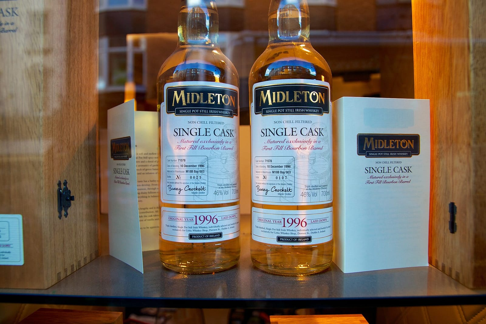

# Single Pot Still Whiskey

Single pot still whiskey is the one Irish whiskey category built on mashing malted and unmalted barley together. The two qualifiers in the name are precise: single means one distillery, and pot still means a [pot still](ref:pot-still). It says nothing about a single cask and nothing about single malt. That distinction is the starting point for separating it from Scotch single malt and Irish single malt.

Figure: Related photograph of Single Pot Still Whiskey. Image: Der Robert, CC BY 2.0, via Wikimedia Commons ([source page](https://commons.wikimedia.org/wiki/File:Midleton_Single_Cask_Irish_Whiskey.jpg)).

## The boundary: four conditions that must all hold

Under Irish whiskey category rules, single pot still whiskey must meet four conditions at once. First, distillation takes place at one distillery. Second, the mash contains at least 30% malted barley and at least 30% unmalted barley. Third, other cereals make up no more than 5%. Fourth, it is distilled in pot stills and matured in oak for at least 3 years.

In addition, the distillate must be below 94.8% ABV. That ceiling keeps enough grain and fermentation character in the spirit instead of refining it towards neutrality. Together with the four conditions, it forms the category boundary; fail any one and the name is not available.

## Why unmalted barley matters

Unmalted barley is the key difference from single malt. Malting produces the amylase enzymes that convert starch into fermentable sugar; unmalted barley lacks that enzyme system but keeps more grain protein, beta-glucan and a waxy surface layer. After mashing and distillation these give a fuller body, a stronger grain sweetness and a distinctive spice.

That spice is often described as a mix of green apple, pear, clove, nutmeg and toast. It is not the floral fruit of malt, nor the pepper of rye. The so-called “pot still character” is not mystique; it is the direct result of the raw-material structure showing up in the distillation curve.

## Mashing and pot distillation

Producers mill malted and unmalted barley together and mash them, relying on the malted fraction's enzymes to complete conversion. Because the unmalted share is high, the mash is more viscous and filtering and conversion are harder to control, which is one reason single pot still whiskey is produced in limited volume and at a relatively high cost.

The fermented wash then enters pot stills. Pot distillation is a batch process, and reflux, still shape and cut points decide whether the body is light or heavy. Triple distillation is more common in the Irish tradition, but the rules do not require every product to be distilled three times. Two distillations keep more grain and oily texture; three give a lighter, cleaner spirit. Equating all Irish whiskey with triple distillation is another simplification.

## Maturation and cask types

A minimum of 3 years in oak is a category requirement, not the whole style. Casks previously used for bourbon, sherry or other drinks are traditional, and cask type and age bring vanilla, nuts, dried fruit and spice. Some products use new or flavoured casks to add sweetness and layers.

Ageing runs from 3 years to more than 20. Long maturation turns grain spice towards leather, dried fruit and wood, but older is not automatically better; if the base spirit lacks structure, extra time only lets wood and bitterness take over. For the general mechanics of [oak ageing](ref:oak-ageing), see the process entry.

## Style range and representative products

The style range comes from three variables: the unmalted share, the number of distillations and the cask type. A high unmalted share with two distillations gives a heavier, spicier result; triple distillation with mostly bourbon casks gives a lighter profile leaning towards green apple and cream.

Representative products include the Redbreast range, Green Spot, Yellow Spot and Powers John's Lane. All sit in the single pot still category but differ in age, cask and strength. Some cask-strength versions push alcohol above 55%, concentrating the flavour and making a little water useful. This style does not rank brands or batches.

## Difference from single malt and blended whiskey

Single malt usually requires 100% malted barley, one distillery and pot distillation. Single pot still deliberately keeps unmalted barley, so it reads as grain and spice rather than pure floral malt. Both may carry an age statement and belong to the wider [whisky](ref:whisky) family, but they are not interchangeable.

Blended whiskey, by contrast, combines pot still whiskey with grain whiskey in chosen proportions to achieve consistency and softness. Single pot still whiskey contains no grain whiskey, so it keeps the pot still signature intact. Reading it as “the Irish version of single malt” or “the Irish version of a blend” misses both the raw material and the blending difference.

## Comparison with bourbon and Scotch

Against corn-led [bourbon](ref:bourbon), single pot still whiskey has a more complex grain structure, a fuller and spicier body, and a sweetness that comes from grain rather than corn. Against Scotch single malt, it is usually less peated, more grain-and-spice driven and rounder in texture.

Such comparisons only mean something once raw material, number of distilleries and distillation method are confirmed. Putting all three into one “whiskey style table” tends to confuse origin, raw material and process, which are separate axes.

## Common misconceptions and disputes

First, treating single pot still as “single cask”. Second, assuming every single pot still whiskey is triple distilled. Third, equating it with single malt. Fourth, thinking unmalted barley is only a cost-saving device when it is the core of the style. Fifth, treating “pure pot still” as the current legal category; it is largely a historical term.

Disputes centre on how flexible the unmalted proportion should be, the revival of traditional triple distillation, and the scarcity of very old stocks. These affect price and supply, not the definition.

## How to drink it

Neat shows the creamy, grainy and spicy texture. A little water opens the aroma, but too much dilutes the body. It can be mixed, though its strength and spice easily overwhelm light ingredients. Room temperature or slightly cool is enough; there is no need to chill it hard. For the effect of [distillation](ref:distillation) on body, see the process entry.

To read Single Pot Still Whiskey, start with the production rule, then the strength, then the usual serving; no single check settles it.

Read [Whisky](ref:whisky) for the legal definition side of Single Pot Still Whiskey, and [Distillation](ref:distillation) for the materials and process side. Together they locate it.

**Key facts.**

| Item | Detail |
| --- | --- |
| In one line | An Irish whiskey category distilled in pot stills from a mash of malted and unmalted barley; one distillery, a 30% to 30% raw-material split, a 3-year minimum and a 94.8% distillation ceiling define it. |
| Parent style | Whisky |

**Sources and limits.** The key claims about Single Pot Still Whiskey are checked against the following sources: Drinks Ireland — Irish Whiskey Association, European Union (Used to check the general legal framework for Irish whiskey as a geographical indication and spirit category), Bord Bia (Irish Food Board) (Used to check Irish whiskey categories and industry background) and 5 sources in total. Prices, batches and status change; the body is project-written and does not reproduce source text.

## Related images

Image: Editorial illustration of oak ageing: the toasted barrel staves, wine and a sampling tube; AI-assisted illustration, not a photograph.. Credit: Hejiu editorial team, AI-assisted with Doubao Seedream 5.5; project-generated editorial figure, not a photograph ([about](https://hejiu.org/about/)). Related image for Single Pot Still Whiskey.
