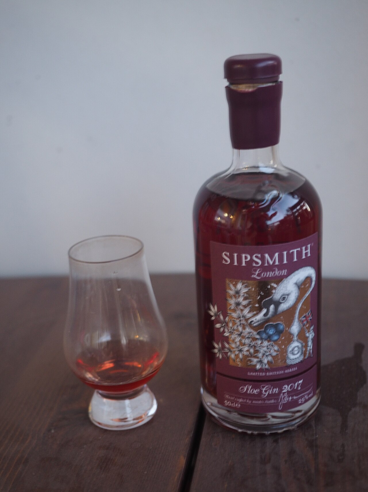

# Sloe Gin

A traditional British gin liqueur made by steeping sloe berries in gin and sweetening it; deep red, sweet-sour and almond-spiced, usually lower in alcohol than gin.

Figure: Sloe Gin: Sipsmith Sloe Gin (Wikimedia Commons). Image: JIP, CC BY-SA 4.0, via Wikimedia Commons ([source page](https://commons.wikimedia.org/wiki/File:Sipsmith_Sloe_Gin.jpg)).

## Definition and boundaries

Sloe gin is a British gin liqueur: sloe berries, the fruit of Prunus spinosa, are steeped in gin, sugar is added, and the liquid is filtered to a deep red or purple. It is not a type of gin and not a London dry gin with a colour; alcohol usually falls between 15% and 30% ABV.

EU and UK rules classify it as a liqueur, with minimum alcohol and sugar requirements. The name is regulated at the label level, but brands differ widely in base gin, sugar level and steeping time. The boundary with ordinary gin is the sugar and fruit; the boundary with fruit liqueurs is the sour, tannic, almond-like character of sloe.

“Sloe gin” is not “black gin” and does not describe a juniper-forward spirit. Its identity comes from the fruit and the sweetening, not from the colour alone. A clear or pale sloe liqueur can exist, though most are deep red.

## History and naming

Sloe is common in European hedgerows and ripens in autumn. British rural households were steeping sloes in gin and adding sugar by the seventeenth century, often as a winter drink and a homemade remedy. The fruit was picked after frost, when its astringency softened.

The traditional method packed sloes, sugar and gin into a wide jar and left it for months, shaking occasionally before filtering. Modern brands use a more consistent base gin and sugar level and sell the product year-round. The old recipe often pricked the fruit to speed colour and flavour; freezing now mimics the frost.

In the nineteenth century sloe gin was associated with hunting, Christmas and winter gatherings. That social image survives in packaging, but the technical category is broader: a liqueur that can be sweet or lean, depending on fruit and sugar.

## Materials and process

Sloes need frost or freezing to break the skin and release colour and flavour. Whole fruit is steeped in gin for two to three months; alcohol extracts fruit, acid and almond notes. Sugar is added later in the steep so that high sugar does not inhibit extraction.

The base can be London dry, Plymouth gin or a neutral gin. Juniper and citrus provide a frame, while sloe brings sourness, tannin, almond and deep red colour. Sugar ranges from about 100 to 300 g/L; the lower the alcohol and the higher the sugar, the more syrup-like the texture.

After filtering, the liqueur rests for several weeks so the flavours integrate. Some brands add a little almond essence or spice, but the traditional recipe relies on fruit and sugar. Colour darkens with light and time, so bottles should be stored away from sun.

Sloe tannin comes from the skin; frost reduces it and raises sugar. Steeping too long can bring bitterness and excessive almond character, and two to three months is usually enough. Sugar added early can suppress extraction, so the order of operations matters.

## Style and palate

The liqueur is deep red to purple. Aroma brings sloe, almond, cherry, cinnamon and juniper; the entry is sweet-sour, with tannin and astringency from the skin, and the finish has almond and spice. Alcohol is low and texture ranges from light to syrupy.

Compared with gin, sloe gin is sweeter, more fruity and lower in alcohol. Compared with cherry liqueur, it has more acidity and a clearer almond note. Typicality comes from the proportion of sloe, the sugar level and the base gin, then from whether the colour looks natural.

Bottles at 15–30% ABV can be drunk neat; those below 20% are often more syrup than spirit and work better in cocktails. Acidity comes from the fruit, sugar from 100 to 300 g/L, and the deep colour from the skins. Long exposure to light turns the red brown.

## Representative regions and brands

Plymouth Sloe Gin is a classic, built on Plymouth gin and balanced in sugar and fruit. Hayman’s is sweeter and more fruit-forward; Sipsmith uses a London dry base and shows clearer acidity and juniper. These are reference points, not a ranking.

Small British distilleries make seasonal versions with local sloes. Look at the base gin, sugar level and fruit source rather than colour intensity. A deeper red does not prove a higher fruit proportion; some colour can come from additives or from the length of steeping.

A useful comparison is a classic Plymouth-style sloe gin, a sweeter commercial version and a leaner London-dry-based bottling. The three show how base gin and sugar change the same fruit.

## How to drink and pair

Serve at 10–12°C in a small liqueur glass, with a 30–40 ml pour. It can also be served over ice or topped with soda as a Sloe Gin Fizz. Game, roast meat, blue cheese, dark chocolate and almond desserts work well; high sugar makes it a poor match for delicate seafood.

After opening, refrigerate and finish within three to six months. Sugar and low alcohol preserve it, but fruit aroma fades. Do not freeze; low temperature thickens the syrup and closes the aroma.

A strip of orange peel in a neat glass brightens the fruit. The liqueur is often treated as “sweet gin”, but the real difference is maceration and sugar, not the juniper base. It can be acidic and relatively dry; the fruit-to-sugar ratio is the key.

## Buying, storage and misreadings

Read alcohol and sugar first, then base gin and fruit source. A high-sugar version is better for cocktails than for neat drinking. A high price may reflect hand-steeping or brand positioning, not a higher fruit proportion.

Common misreadings include treating sloe gin as a gin category, assuming darker is better, and assuming it must be very sweet. It can be sour, lean and even dry; the balance of sloe and sugar decides. UK rules require the category and alcohol on the label; EU liqueur rules apply to imports, and a US bottling may be classified as a liqueur rather than a gin.

Colour fades with age because the natural pigment is unstable; this is not spoilage. Keep the bottle out of direct sunlight. A bottle that tastes of vinegar or has a bulging cap may have fermented further and should not be served.

## Further reading and see also

Compare a classic, a sweet and a lean sloe gin at similar alcohol. Record base gin, sugar, fruit ratio and maceration time; those variables explain the texture more than colour.

- [Gin](ref:gin): the juniper-flavoured spirit base.
- [Liqueur](ref:liqueur): sweetened spirit categories.
- [Maceration](ref:maceration): fruit steeping and extraction.
- [Plum](ref:plum): the botanical family of sloe.
- [Distillation](ref:distillation): production of the base spirit.
