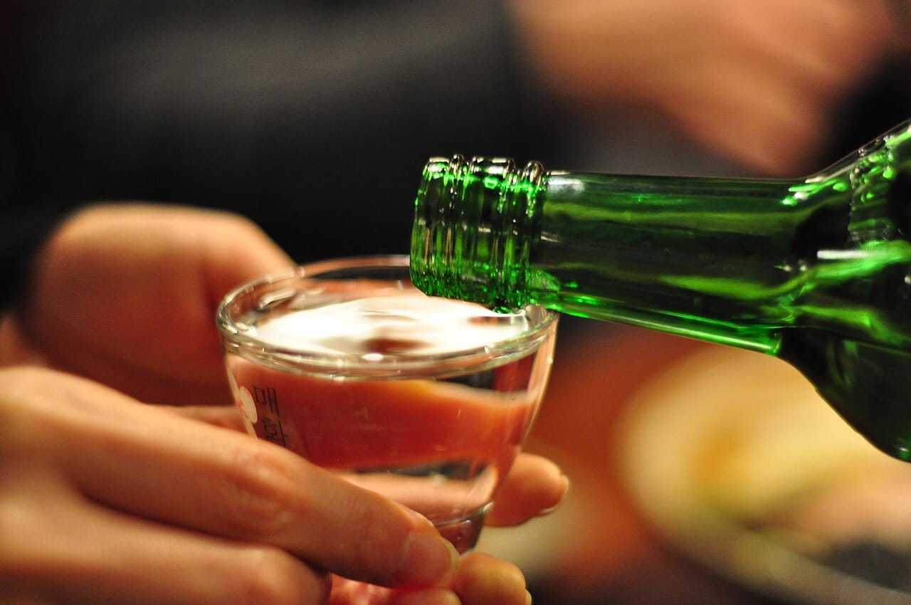

# Soju

Soju is a traditional Korean drink that today covers both local soju made by inherited distillation methods and the diluted soju that dominates the mass market. The two share a name but differ greatly in raw material, process, flavour and price. Understanding soju starts with separating those two products, then moving on to brands and serving.

Figure: Soju. Image: Graham Hills, CC BY 2.0, via Wikimedia Commons ([source page](https://commons.wikimedia.org/wiki/File:Soju.jpg)).

## Definition and classification

Under Korean liquor law, soju belongs to the distilled-liquor category and can be divided by process and raw material into distilled soju, diluted soju and other compounded products. Traditional soju is made from rice or other grains by fermentation and distillation and is relatively strong; most modern mass-market soju is "diluted soju", made from edible alcohol with water, sweetener and flavouring.

Diluted soju usually has a strength between 16% and 25%, with common products around 17%. Distilled soju is stronger and more concentrated in flavour. Both are called soju, but reading the strength, ingredients and process statement tells a buyer more about which product they are holding than the brand name does.

## History

The soju tradition on the Korean peninsula goes back to grain-liquor production after distillation technology arrived. Early soju was mostly made in small local distilleries, and places such as Andong and Jeonju have kept a fairly complete tradition. In the 20th century, industrialisation and urban consumption changed the product mix, and diluted soju gradually became the mainstream.

In 1965, Korea restricted the use of rice for making soju because of grain shortages, and diluted soju expanded as a result; after the restriction was lifted in 1999, traditional distilled soju and local soju regained room to grow. This history explains why "soju" in today's Korean market by default means the light, cheap, low-strength diluted product, while traditional soju has become a specialty category.

## Distilled soju

Distilled soju keeps the basic structure of grain fermentation and distillation, and its flavour is closer to the raw material itself. Rice soju is usually clean with rice aroma and slight sweetness; recipes that add wheat or other grains bring different aromatic layers. Local soju is often made in small pot stills, has limited output and a higher price, and suits neat drinking or food pairing.

Distilled soju is relatively strong and hits the palate clearly, so small glasses and slow drinking suit it better. Compared with [baijiu](ref:baijiu), its aroma intensity and complexity are usually lower and it emphasises cleanliness and smoothness; compared with Japanese [sake](ref:sake), it is a distilled spirit rather than a fermented drink, with different storage and serving needs.

## Diluted soju

The core of diluted soju is edible alcohol diluted with water and then adjusted with sweeteners, acidulants and flavourings. Its advantages are low cost, large output and consistent taste, which suit restaurants and everyday home drinking; its limitation is a narrow flavour range that relies more on sweetness and freshness.

The technical focus of diluted soju is "clean" and "easy to drink": water quality, dilution ratio, filtration and blending decide whether the entry is smooth. Differences between brands tend to appear in sweetness, alcohol heat and aftertaste rather than in the origin of the raw material. Treating it as a drink for food rather than an object of tasting fits how the product is designed.

## Raw material and process

Distilled soju uses rice, wheat, barley or a grain blend, and the process includes washing, steaming, qu making, fermentation, distillation and resting. The type of qu and the fermentation temperature affect aroma; the cut point during distillation decides the cleanliness and weight of the body. Traditional methods often emphasise multiple fermentation rounds and slow, low-temperature fermentation.

Diluted soju instead centres on alcohol dilution, supported by syrup, citric acid and amino-acid flavourings. Both processes require stable water quality and hygiene control. The ingredient list, strength and product category on the label are the most direct clues for telling the two apart.

## Flavour and tasting

Distilled soju aromas are mainly rice, grain sweetness and light ester, with a fuller entry and a clean finish; some local soju shows distinct qu or nutty notes. Diluted soju is lighter in aroma, sweet on entry, direct in alcohol and short in finish, and smoother when chilled.

To taste distilled soju, use a small glass at room temperature, smell first and then take a small sip; water or ice changes the aromatic structure. Diluted soju is better chilled and drunk directly, with the focus on freshness and food compatibility rather than complex aroma. The strength of any soju can be read through the labelling convention explained under [alcohol by volume](ref:abv).

## Drinking and pairing

Soju is usually chilled and poured into small glasses, often with grilled meat, seafood and spicy food. The Korean "bomb shot" mixes soju with beer; it is a serving style, not a separate category, and the mixing ratio strongly changes the alcohol heat and the bubbles. Because diluted soju is light, juice or soda is also common.

With food, light diluted soju suits spicy dishes, grilled meat and seafood, while distilled soju better suits richer dishes or neat drinking. Watch the amount and the pace: a warm, social setting makes it easy to underestimate alcohol intake.

## Common misconceptions

First, conflating soju with Japanese shochu. Their raw materials, distillation systems and flavour traditions differ, and the shared Chinese character for "burn" does not make them interchangeable.
Second, assuming all soju is low-strength. Distilled soju can be strong.
Third, treating the "bomb shot" as a liquor category. It is a mixed serving style, not a separate product.
Fourth, assuming diluted soju involves no craft. Dilution, filtration and blending all affect taste and stability.
Fifth, choosing by brand without reading the category. Strength and ingredient labelling are the key to the product type.

**Short definition:** A Korean spirit ranging from traditional distilled soju to modern diluted soju, distinct from Japanese shochu. 

Soju is best read by starting with the production rule, moving to the strength, and ending with the usual serving.

**Read alongside.** Put Soju next to Baijiu, Sake, Alcohol by volume (ABV): the first fixes identity and boundary, the others provide a region, process or peer comparison. Read this style first, then return to those entries; the links become coordinates, not decoration.

**Sources and limits.** The key claims about Soju are checked against the following sources: Oxford University Press (Consulted for entries on Korean soju history and the difference between distilled and diluted soju), National Tax Service of Korea (the statutory classification and labelling framework for Korean liquor), Korea Legislation Research Institute (provisions and definitions in the Liquor Tax Act) and 4 sources in total. Prices, batches and status change; the body is project-written and does not reproduce source text.

## Further reading

- [Baijiu](ref:baijiu): a Chinese grain distillate that can be compared with distilled soju.
- [Sake](ref:sake): a Japanese fermented rice drink, a different liquor category from soju.
- [Alcohol by volume](ref:abv): the basic concept behind the ABV figure on a soju label.
