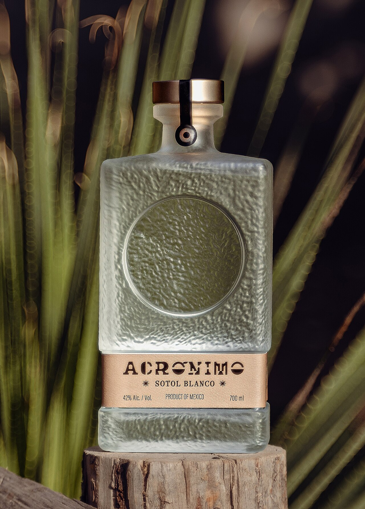

# Sotol

Sotol is a distilled spirit from northern Mexico made from desert spoon (Dasylirion). It is often placed next to [mezcal](ref:mezcal), but the two do not use the same plant: mezcal uses agave, while sotol uses Dasylirion, a genus in the asparagus family. That botanical difference shapes its legal identity, flavour and regions. Sotol has a denomination of origin covering Chihuahua, Coahuila and Durango; it is not a "northern agave spirit" that anyone may make anywhere.

Figure: Sotol. Image: Alessandra Camino, CC BY-SA 4.0, via Wikimedia Commons ([source page](https://commons.wikimedia.org/wiki/File:Sotol_Blanco_y_planta_Daysilirion_(cropped).jpg)).

## Desert spoon: a different plant

Desert spoon has long, narrow leaves growing in a rosette, with toothed edges, so the plant looks like a spoon stuck in the sand. Its heart is rich in fermentable sugar, but the fibre structure differs from agave, and harvesting, roasting and grinding change with it. Wild plants grow slowly and need years to mature; over-harvesting is one of the most concrete ecological pressures in the producing areas.

Folding sotol into "agave spirits" hides what makes it distinct. [Agave](ref:agave) belongs to the Agave genus, desert spoon to the Dasylirion genus; they are related but not interchangeable. The law defines sotol by plant genus, region and process, not by how much it resembles mezcal.

## 2002 and three states

Sotol received official protection as a denomination of origin in 2002, covering Chihuahua, Coahuila and Durango. Chihuahua is the best-known and largest producing state, while Durango and Coahuila also produce. The denomination does not mean that anything made in the three states qualifies: the raw material must come from the defined area, and distillation and bottling must meet the official standard.

Mexican standard NOM-159-SCFI-2004 sets the raw material, process, strength, categories and labelling rules for sotol. Producers may choose wild or cultivated plants, traditional or modern equipment within that standard, but they may not label another plant's distillate as sotol. When buying, separate the state of production, the raw material, the strength and the proportion of raw material, because sotol is not agave in the first place.

## Pit roast, fermentation, double distillation

Traditional sotol follows a path similar to mezcal: the hearts are put into an earthen pit, heated with stone and wood for several days so starch converts, sugar is released and smoke and caramel notes develop; the roasted hearts are crushed, water is added and fermentation begins; after fermentation, a [pot still](ref:pot-still) is used for two [distillation](ref:distillation) runs, with heads, heart and tails cut to give a clear spirit.

The pit roast is central to flavour but not the only variable. Fermentation vessel, wild yeast, water ratio and distillation cuts all change the result. Modern producers also use stainless fermenters and tighter temperature control for cleaner grass and citrus, while traditionalists keep earthen pits, wooden vats and open fermentation for more smoke and microbial complexity. Both routes are legal; the difference is the style being pursued.

## Grass, resin and mineral

Sotol usually smells greener than mezcal: grass, aloe, pine needle, anise, citrus peel and white flowers, with smoke as a background rather than the lead. The entry is dry, the body medium, with clear mineral and herbal bitterness, and a finish of pepper and resin. Aged versions show vanilla, cream and dried fruit, but many producers prefer to keep the herbal line of the young spirit.

Compared with tequila, sotol has less of the sweet, cooked agave heart and more of the desert plant's green bitterness and resin; compared with mezcal, its smoke is usually more restrained and its plant range narrower. Taste by looking for grass, resin, smoke and mineral in turn, rather than scoring only smoke intensity.

Sotol is usually lighter in body and less oily than mezcal, so it suits a pinch of salt and citrus when sipped neat, and works as a substitute in tequila-based cocktails.

## Regions and producers

Chihuahua's sotol producers cluster where desert meets valley, and brands range from family workshops to export-oriented distilleries. Production in Durango and Coahuila is more scattered, and local brands often use wild plants and traditional pit roasting as their signature. What the regions share is drought, wide day-night temperature swings and slow-growing desert spoon, conditions that concentrate sugar and aroma in the raw material.

The market for sotol is far smaller than that of [tequila](ref:tequila), which is both a weakness and a protection. Small scale means more handwork and clearer site differences, but also a harder job building a consistent quality standard. Because output is small, sotol usually costs more than a tequila of the same age, and batch variation is obvious; that is a common feature of small-region spirits. Buyers should look first for the denomination, the state, the raw-material proportion and the distillation method, not just words such as "handmade" or "desert".

## Where sotol differs from mezcal and tequila

[Mezcal](ref:mezcal) uses agave, has a larger protected area and more varieties, and builds its story around smoke and plant difference; [tequila](ref:tequila) is mainly blue agave, concentrated in Jalisco and other areas, and far more industrial. Sotol uses desert spoon, is limited to three northern states, and leans towards grass, resin and mineral.

All three belong to Mexico's distilling tradition, but their raw materials, regions and laws stand apart. Calling sotol "mezcal's cousin" can be an entry point, but it cannot replace an understanding of plant genus and denomination of origin. It is not a substitute for tequila or an imitation of mezcal, but an independent desert distilling path.

For Sotol, begin with the production rule. Then look at the strength, and finally ask the usual serving. The answers point to different choices, not to a single score.

[Mezcal](ref:mezcal)'s legal definition and [Agave](ref:agave)'s materials and process form a useful pair: the contrast shows where one ends and the other begins.

**At a glance:** A distilled spirit from northern Mexico made from desert spoon (Dasylirion), with a denomination of origin covering Chihuahua, Coahuila and Durango; protected in 2002, made under NOM-159-SCFI-2004 by pit roasting, fermentation and pot distillation, usually at 38% to 45% ABV.

**Sources and limits.** The key claims about Sotol are checked against the following sources: Instituto Mexicano de la Propiedad Industrial / WIPO Lex (the application, covered states and legal basis of the sotol denomination of origin), Gobierno del Estado de Chihuahua (the Chihuahua certification body and industry management), Organización de los Estados Americanos — SICE (sotol's place on Mexico's official list of protected denominations of origin) and 4 sources in total. Prices, batches and status change; the body is project-written and does not reproduce source text.

**Read alongside.** Put Sotol next to Mezcal, Tequila, Agave: the first fixes identity and boundary, the others provide a region, process or peer comparison. Read this style first, then return to those entries; the links become coordinates, not decoration.

For Sotol, this style was last checked in 2026; prices, batches and availability change, so confirm them against the sources below.
