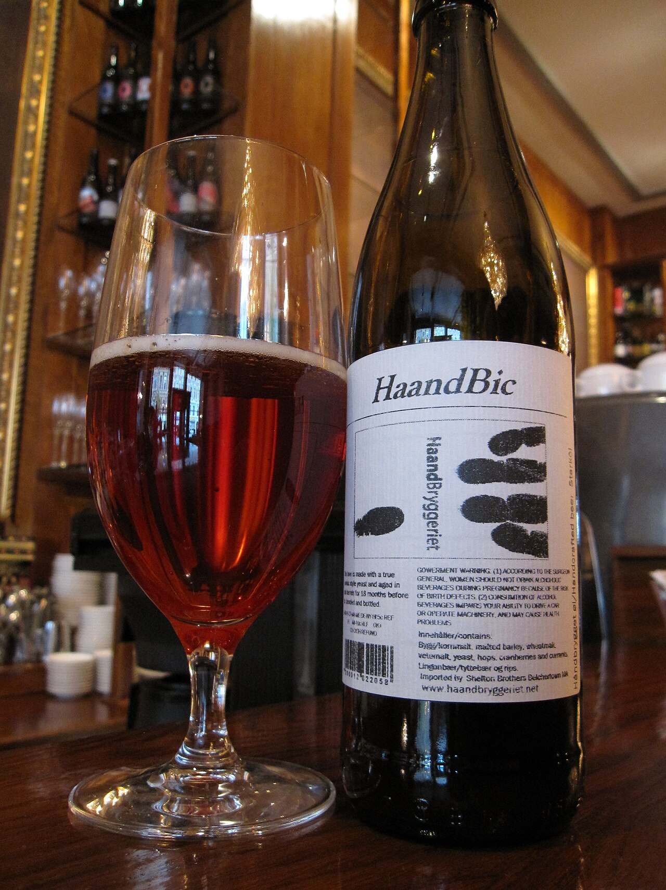

# Sour beer

Sour beer is a category of beers in which microbial metabolism produces marked acidity and acidity itself is central to the style. The acid comes mainly from lactic fermentation, and sometimes from acetic fermentation; the organisms involved are not only brewer's yeast but also lactic acid bacteria, acetic acid bacteria and Brettanomyces. Belgian lambic and red-brown ales, German Berliner Weisse and Gose, and modern kettle souring all belong to this lineage. Acidity is a style axis, not a defect and not a quality grade.

Figure: Sour beer. Image: Bernt Rostad, CC BY 2.0, via Wikimedia Commons ([source page](https://commons.wikimedia.org/wiki/File:Norwegian_sour_beer.jpg)).

## Definition and standards

Sour beer has no single parameter table. The pH commonly sits at 3.2–3.8, and total acidity expressed as lactic acid is roughly 0.3–1.0%, though different styles are measured differently, so the figures are only a guide. Alcohol content varies widely: Berliner Weisse commonly 2.8–3.8%, Gose 4.2–4.8%, lambic 5.0–6.5%, and Flanders red ale mostly 5.0–6.5%. Bitterness is usually low, mostly 5–15 IBU, because acidity and bitterness compete in perception.

Style guidelines list European sour ale, American sour beer and wild-fermented beer separately, which shows that “sour” is a shared style axis rather than a single style. Perceived sourness, pH and total acidity should be distinguished: they are related but not equal. Clear sourness does not mean the beer has spoiled; judge by the type of acid, its cleanliness and the overall balance.

## Origin and history

Before pure-culture yeast and pasteurisation became widespread, sourness was not rare in beer. Wooden barrels, air and reused vessels brought in many organisms, and brewers only began to control them systematically in the 19th century. The work of Pasteur and Hansen promoted pure yeast and hygiene, so sourness turned from a normal condition into a feature that had to be deliberately preserved.

[Belgium](ref:belgium) kept two traditions: [lambic](ref:lambic) in the Pajottenland and Senne valley relies on spontaneous fermentation and long oak ageing; Flanders red ale and oud bruin let acetic bacteria work slowly in oak barrels, giving acidity, fruitiness and a dry finish. In Germany, Berliner Weisse ferments with lactic acid bacteria and yeast together and was traditionally softened with syrup; Gose from the Harz region of [Germany](ref:germany) adds salt and coriander, with a gentler acidity.

In the late 20th century these styles shrank to very small volumes, and from the 1980s they returned to the market with the revival of [craft beer](ref:craft-beer). Contemporary breweries also developed kettle souring: the wort is first boiled to sanitise it, cooled and inoculated with lactic acid bacteria, then boiled again with hops once acidified. The method is fast and controllable, but usually gives less layered flavour than mixed fermentation and barrel ageing.

## Ingredients and process

[Wheat](ref:wheat) makes up a high share of Berliner Weisse and lambic, feeding body and microbes; [barley](ref:barley) malt remains the base of most recipes. The choice of microbe determines the character of the acid: Lactobacillus produces soft lactic acid, Pediococcus appears often in lambic, Brettanomyces brings dryness and complex aroma, and Acetobacter needs oxygen and produces acetic acid.

There are roughly four process routes: kettle souring, mixed fermentation, spontaneous fermentation and barrel ageing. Kettle souring happens after mashing, and the acidified wort is boiled a second time, so the finished beer usually contains no live lactic acid bacteria and the risk of contaminating equipment is lower. Mixed fermentation pitches yeast and bacteria together for more complex flavour. [Oak ageing](ref:oak-ageing) lets trace oxygen in, encouraging acetic bacteria and aroma evolution. Hops are antibacterial, and too much suppresses lactic acid bacteria, so the souring stage usually receives no hops or only a little.

## Flavour profile

Lactic acid tastes soft, often described as yoghurt, lemon or green apple; acetic acid is sharper and approaches vinegar when excessive. Brettanomyces can bring barnyard, hay, leather and fruit, and makes the finish drier. Carbonation, residual sugar and body thickness all change how the acidity is perceived.

To judge quality, first check whether the acidity is clean and bright, then whether the aroma is complex and the palate balanced. Pungent solvent, cardboard, hydrogen sulphide and abnormal haze usually point to hygiene, oxidation or fermentation management rather than to sour beer as it should be. Acidity itself is not a score: a gentle Berliner Weisse and a forceful Flanders red ale can both be excellent.

## Tasting and serving

Sour beer is best at around 8–12°C; a tulip or narrowing glass helps gather sour and fruity aromas. Pour slowly to avoid disturbing the sediment. With food, acidity cuts richness and suits fried food, salads, seafood and soft cheese; Flanders red ale suits stews and game, while Berliner Weisse suits lighter dishes.

An opened sour beer does not keep long, since oxygen keeps changing its acidity and aroma. Low-alcohol, low-pH versions are best drunk fresh, and only stronger, well-structured versions have cellaring potential.

## Common misconceptions

First, assuming sour means spoiled. Deliberately acidified beer and contaminated beer are different things.
Second, assuming more sour is better. Balance, cleanliness and complexity matter more than an acidity figure.
Third, assuming sour beer always contains fruit. Fruit is only one version of the style.
Fourth, equating kettle souring with traditional methods. The methods differ and so does flavour depth, but this is not a hierarchy.
Fifth, assuming every sour beer rewards cellaring. Most low-alcohol sour beers are best drunk fresh.

**Short definition:** A category of beers given marked acidity by lactic or acetic fermentation; Belgian lambic and red-brown ales, German Berliner Weisse and Gose each form a tradition, and modern kettle souring makes production more controllable, with acidity a style axis rather than a defect or a grade.

For Sour beer, begin with the production rule, then the strength, and finish with the usual serving; that order keeps the account grounded.

Start with [Beer](ref:beer) for legal definition, then read [Acidity](ref:acidity) for materials and process. Seeing both keeps Sour beer from being confused with a neighbouring idea.

**Key facts.**

| Item | Detail |
| --- | --- |
| In one line | A category of beers given marked acidity by lactic or acetic fermentation; Belgian lambic and red-brown ales, German Berliner Weisse and Gose each form a tradition, and modern kettle souring makes production more control… |
| Parent style | Beer |
| Aroma family | Sour and fermentation |

**Sources and limits.** The key claims about Sour beer are checked against the following sources: Beer Judge Certification Program, Brewers Association, Deutscher Brauer-Bund (public information on Berliner Weisse, Gose and other German sour beers; no original text is reproduced) and 4 sources in total. Prices, batches and status change; the body is project-written and does not reproduce source text.

## Further reading

- [Beer](ref:beer): where sour beer sits in the beer style system.
- [Lambic](ref:lambic): the Belgian tradition of spontaneous fermentation and barrel ageing.
- [Acidity](ref:acidity): understanding the difference between sourness, pH and total acidity.
- [Fermentation](ref:fermentation): the roles of different microbes in mixed fermentation.
- [Oak ageing](ref:oak-ageing): trace oxygen and its link to acetic bacteria.
- [Wheat](ref:wheat): the grain base of Berliner Weisse and lambic.
- [Barley](ref:barley): the base malt of most sour recipes.
- [Belgium](ref:belgium): the home of lambic and Flanders sour ales.
- [Germany](ref:germany): the tradition of Berliner Weisse and Gose.
- [Craft beer](ref:craft-beer): the background of the sour revival and kettle souring.

## Related images

Image: Acidity. Credit: Chemicalinterest, Public domain, via Wikimedia Commons ([source page](https://commons.wikimedia.org/wiki/File:Zn_reaction_with_HCl.JPG)). Related image for Sour beer.
