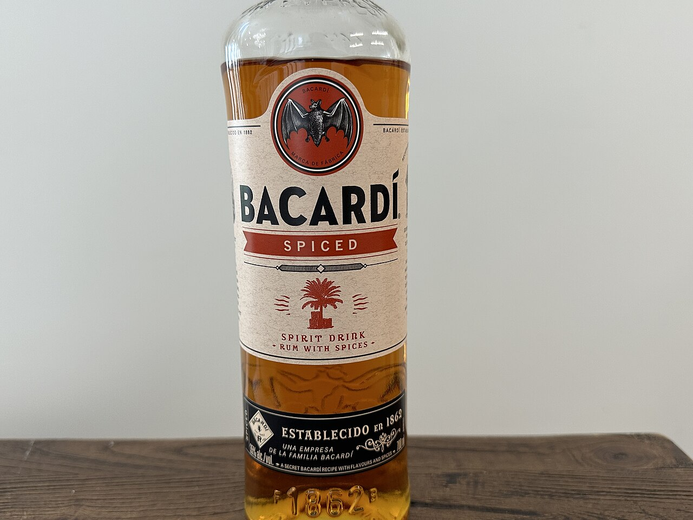

# Spiced Rum

Spiced rum is a flavoured spirit built on a rum base, seasoned with vanilla, cinnamon, clove, nutmeg and other spices, then rounded with sugar or caramel for sweetness and colour. Styles run from light and spicy to sweet and vanilla-heavy; alcohol is commonly 35–40%, and it is a common product in Caribbean drinking and modern cocktails.

Figure: Spiced Rum: Bacardi Spiced Rum 02 (Wikimedia Commons). Image: Indrajit Das, CC BY-SA 4.0, via Wikimedia Commons ([source page](https://commons.wikimedia.org/wiki/File:Bacardi_Spiced_Rum_02.jpg)).

## Definition and boundaries

Under EU spirits law (Regulation 2019/787), "rum" is a defined spirit category: produced by fermenting and distilling molasses, syrup or sugar-cane juice from sugar manufacture, distilled below 96% vol, with a minimum strength of 37.5% ABV, not flavoured, coloured only with caramel, and sweetened by no more than 20 grams per litre expressed as invert sugar. Once spices or other flavourings are added to rum, it leaves the "rum" category under EU law and becomes a spirit drink based on rum.

The United States uses a different classification: spiced rum falls under the "flavored spirit" class, whose legal strength floor sits below that for plain rum, under 27 CFR 5.22. A bottle labelled "rum" in large lettering may therefore carry a different legal status in different markets. To judge a product, look at the base spirit, spice source, sugar level and alcohol strength rather than the name alone. It should not be confused with rhum agricole, which emphasises fresh sugar-cane juice and a regional production tradition.

## History and naming

The Caribbean has a long folk tradition of adding spices to rum: sailors and settlers used cinnamon, clove, allspice and ginger to mask the roughness of rough rum, and spices and drink also served everyday health uses. This tradition mostly stayed at the level of home and local serving methods and never formed a single historical product category.

The commercial spiced rum on today's market took shape mainly from the late twentieth to the twenty-first century, driven by brand marketing. The Captain Morgan brand lineage traces to rum production begun by Seagram in 1944; its Original Spiced Rum entered the United States in 1984, and the brand passed to Diageo in 2001. Kraken was launched by Proximo Spirits in 2010, based on Trinidad molasses rum aged 1–2 years and blended with eleven spices. Sailor Jerry takes its name from Norman "Sailor Jerry" Collins, the legendary American tattoo artist, an example of a brand drawing on Caribbean sailor imagery.

## Materials and process

The base is usually a young column-still molasses rum, sometimes lightly aged, clean enough in flavour to leave room for the spices. Common spices include vanilla, cinnamon, clove, nutmeg, allspice, ginger, orange peel, star anise, pepper and cardamom; the exact recipe is each brand's commercial secret. Spices enter the liquid in two ways: whole spices are macerated in rum for days or weeks to draw out aroma slowly, or spice extracts and concentrates are added after distillation for batch consistency. Most commercial products use both, and the ratio is rarely published.

The finishing step adds sugar and caramel: commercial spiced rum typically carries 15–40 grams of sugar per litre, with caramel mainly responsible for the dark appearance. The rum's origin sets the underlying skeleton — Jamaican rum carries esters and fruit, Barbados is rounder, Trinidad clean and light, Dominican sweeter and fuller — though after spices are layered on, these differences are often covered by vanilla and cinnamon and need close attention to distinguish.

## Style and palate

A typical spiced rum leads with vanilla, cinnamon, clove and sweet caramel, entering smooth with alcohol wrapped by sugar and spice. Light versions are clearly spicy and light-bodied for mixing; sweet, full versions carry heavy vanilla and dried-fruit notes, close to a sweet liqueur in texture. Bitterness is usually very low; hop-style bitterness is not an element of this style. Common aromas are toast, warm spice, raisin and orange peel.

In judging quality, the spices should support the rum base rather than cover everything with flavour syrup. Obvious artificial flavouring, cloying sweetness, solvent notes or uneven colour usually point to ingredient grade or blending problems. Temperature changes the impression: chilling or ice narrows sweetness and alcohol bite, while neat at room temperature opens spice and caramel. It is not a dry spirit; balance depends on whether sweet, spice, alcohol and base fruit hold together.

## Representative regions and brands

Captain Morgan is one of the best-selling spiced rums worldwide; its Original Spiced Gold sits at 35% ABV in European markets, identified by its golden caramel appearance and vanilla-cinnamon flavour. Kraken Black Spiced, launched by Proximo Spirits in 2010, is recognised by its black bottle and sea-monster label; the black version is 47% ABV and the gold version 35% ABV, based on Trinidad molasses rum aged 1–2 years and blended with eleven spices. Sailor Jerry uses a Jamaican-style rum base with a cinnamon-clove spice route; Chairman's Reserve comes from Saint Lucia, and Bacardi Spiced is a large-brewery mixing-oriented product.

Between brands, differences lie in base-rum origin, ageing length, spice route and sugar level: some lean dry and spicy, others sweet and vanilla-heavy. Reading the back label for alcohol strength, ingredients and origin tells you more than a vague idea of a typical spiced rum.

## How to drink and pair

The most common serve is neat over ice, or mixed with cola, ginger beer or soda as a long drink. In cocktails it goes into rum punches, hot grog, tropical mixes and various rum blends. Light versions suit mixing, while higher-strength or longer-aged expressions can be sipped still and slowly. It does not demand a specialist glass like whisky or brandy; an Old Fashioned or highball glass follows the setting.

On the table, spiced rum matches Caribbean cooking most closely: jerk chicken, barbecue, spare ribs, grilled corn and dishes with sweet-spicy sauces, where its sweet spice complements smoke and heat. Tropical fruit desserts, gingerbread, nuts and raisin cake also carry its vanilla and dried-fruit notes. Light seafood, plain salads and acidic dishes do not suit a sweet, full spiced rum, which would push the sweetness forward. Slow after-dinner sipping or a party long-drink base are its most common settings.

## Buying, storage and misreadings

Common misreadings: treating dark colour as barrel age — darkness often comes from caramel colouring; assuming spiced rum is legally a rum in every market — in the EU it becomes a spirit drink once flavoured; taking high sweetness for high quality; and equating brand history with product craft. Colour, sweetness and alcohol strength all follow the back label, and legal categories vary by market.

When buying, read the back label first: base-rum origin, spice and sugar source, whether alcohol and sugar are stated clearly, and who produced it. Large front lettering is usually brand marketing. An unopened bottle keeps away from light and heat, standing upright. Once opened, alcohol and spice aroma fade slowly, so finish it within months to a year. High-sugar products may throw sediment after standing; a light shake is enough. A high price usually reflects brand and distribution rather than a more typical style.

## Further reading and see also

Categories close to spiced rum share the rum base and flavouring craft: [rum](ref:rum) is the broad distilled-spirit family it belongs to, [distillation](ref:distillation) prepares the base rum, [liqueur](ref:liqueur) provides the reference framework for sweetened flavoured spirits, [proof-and-abv](ref:proof) is the easiest label parameter to compare, and [maceration](ref:maceration) is the main way spice aroma enters the liquid.

To learn a flavoured spirit, start with the standard benchmark, then a variant that changes spice or sweetness, then a high-strength extreme; after those three steps the boundary is clearer than from definitions alone.

- Related: [rum](ref:rum), [distillation](ref:distillation), [liqueur](ref:liqueur), [proof-and-abv](ref:proof), [maceration](ref:maceration).
