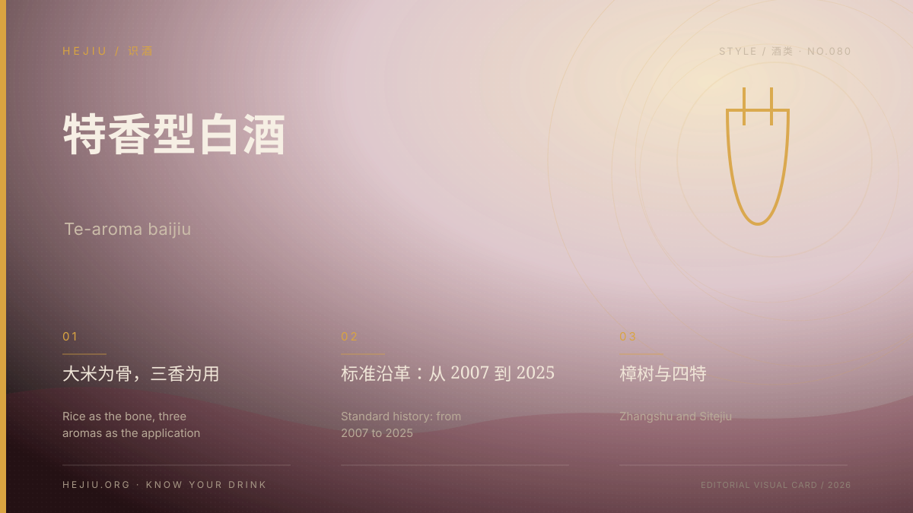

# Te-aroma baijiu

Te-aroma is often summed up as "three aromas, yet belonging to none": it has the pit aroma of strong aroma, the cleanliness of light aroma and the scorch of sauce aroma, without settling into any of them. The phrase sounds abstract, but the process is concrete: rice as the bone, daqu cultured from wheat flour, wheat bran and distillers' grains as the soul, and red conglomerate stone pits as the bed. Those three elements give te-aroma its frame.

Figure: thematic illustration for Te-aroma baijiu. Image: AI-assisted illustration generated with Doubao Seedream 5.0 (project-owned); not a photograph of the subject.

> **Quick verdict**
> **In one line:** This style places Te-aroma baijiu on the flavour map, and helps you choose and serve it.
>
> - **Best for:** Anyone comparing Te-aroma baijiu with other styles before buying or ordering.
> - **Not for:** If you want want a single “best” ranking and reject stylistic difference.
> - **Check first:**
>   - The national standard has gone through three editions.
>   - The main material is rice, not sorghum.

## Rice as the bone, three aromas as the application

The main material is rice, not sorghum. Rice starch is fine, with less protein and fat, so the spirit is clean and soft; the aroma does not rely on the tannin structure of sorghum but on the combined action of koji and pit. This sets it apart from the sorghum-based strong, sauce and light aroma types and gives it a material base in the rice-growing south.

The "three aromas" are not three aroma-type spirits added together but a composite produced by one process. The entry has the pit aroma and thickness of strong aroma, the middle has the cleanliness of light aroma, and the finish carries the scorch and age of sauce aroma. The proportion varies by distillery, round and year, but "belonging to none" is the baseline: it must not become as strong as strong aroma or as sauce-like as sauce aroma, or it loses its independence.

## Standard history: from 2007 to 2025

The national standard has gone through three editions. GB/T 20823-2007 first listed te-aroma separately; GB/T 20823-2017 revised it; the current standard is GB/T 10781.7-2025, Quality requirements for baijiu — Part 7: Texiangxing baijiu, published on 30 May 2025, implemented on 1 December 2025 and wholly replacing GB/T 20823-2017.

The new standard defines te-aroma baijiu as baijiu made mainly from rice, with daqu cultured from wheat flour, wheat bran and distillers' grains as the saccharifying and fermenting agent, through solid-state fermentation in red conglomerate stone pits, solid-state distillation, ageing and blending, without direct or indirect addition of edible alcohol or colour, aroma and flavour substances not produced by its own fermentation. The definition fixes three things: rice, flour-bran koji and red conglomerate stone pits.

## Zhangshu and Sitejiu

The representative region is Zhangshu in Jiangxi, with Sitejiu as the core producer. Sitejiu is based in Zhangshu, has long used te-aroma as its flag, and led the drafting of GB/T 10781.7-2025 together with the China National Research Institute of Food and Fermentation Industries and other units. Zhangshu sits on the middle reaches of the Gan River, with a warm, humid climate suited to the culture of rice and koji materials.

Region and brand should be kept apart. Sitejiu is the representative brand of te-aroma, but te-aroma is an aroma category, and other distilleries may produce it under the standard. Equating te-aroma with Sitejiu confuses brand and category; conversely, not every Sitejiu product is necessarily te-aroma, since a company's range may cover different types and grades.

## Whole rice grains

Te-aroma uses whole rice grains, with little or no grinding. Whole grains stay intact after steaming, release starch more slowly, ferment more steadily and give a cleaner body; too fine a grind can clump, heat too fast and produce off-notes. Whole rice demands more from steaming: cooked through without a raw core, neither mushy nor hard, so that koji mould and yeast can work evenly.

Compared with rice aroma, te-aroma also uses rice, but rice aroma uses xiaoqu and semi-solid fermentation, while te-aroma uses daqu and solid-state fermentation. Compared with strong aroma, te-aroma does not use sorghum as the main material, and its pit aroma comes from stone pits and pit mud rather than the deep mud of old strong-aroma pits. Change the material and the koji, and the style takes a different road.

## Flour-bran koji

The koji is unusual: daqu cultured from wheat flour, wheat bran and distillers' grains. Flour supplies starch and protein, bran adds air permeability and surface area, and distillers' grains bring acids and aroma precursors from a previous fermentation; together they culture a composite community of bacteria, moulds and yeasts. It is neither pure wheat daqu nor pure fuqu but a "flour-bran daqu" in between.

Its value lies in aroma. The acidity from distillers' grains suppresses contaminants, the open bran structure supports microbial growth, and flour provides sustained nutrition. The finished koji has both the esterifying capacity of daqu and the saccharifying efficiency of fuqu. Koji temperature, humidity, turning time and room microbiology all change enzyme activity and aroma, and with them the balance of the three phases.

## Red conglomerate stone pits

The fermentation vessel is a pit built from red conglomerate stone. The stone is cut from the red sandstone of Danxia landforms, hard with moderate porosity; a pit built from it holds water while allowing trace air and microbes to enter. The seams and the mud floor give acetic-acid bacteria and other microbes a habitat, supplying pit aroma.

This differs from the full mud pits of strong aroma, the stone-walled mud-floored pits of sauce aroma and the earthen jars of light aroma. Full mud pits have a large mud area and dense pit aroma; stone-walled pits balance air and water; earthen jars isolate the spirit from soil and pursue cleanliness. Red conglomerate stone sits between stone and mud: pit aroma is present but does not overwhelm rice aroma, exactly what the "three aromas, belonging to none" target needs.

## Solid-state fermentation, distillation, ageing and blending

Fermentation is solid-state, see [fermentation](ref:fermentation). Once the grain mash enters the pit, koji and pit-mud microbes work together so that saccharification, fermentation and aroma formation proceed at the same time; temperature, moisture and pit care decide whether fermentation is steady. Fermentation length and rounds vary by distillery, with no single national number of days.

Distillation is solid-state, see [distillation](ref:distillation). The steamer and the cut separate heads, heart and tails; the heart is the main body, while heads and tails are used for adjustment or redistillation. New spirit is aged in clay jars or stainless steel tanks so sulphides escape and the body softens. Blending combines spirits of different rounds, years and pits, with the aim of tuning the strong-light-sauce sequence rather than pushing one aroma to the limit.

## Key parameters

- Current standard: GB/T 10781.7-2025, implemented on 1 December 2025.
- Material: rice as the main raw material.
- Koji: daqu cultured from wheat flour, wheat bran and distillers' grains.
- Fermentation vessel: red conglomerate stone pit.
- Process: solid-state fermentation, solid-state distillation, ageing, blending.
- Strength: 25.0%–68.0% ABV.

These parameters come from the national standard and describe category boundaries. Strength, pit age and koji ratio cannot each stand for quality; the real test is whether the aroma is harmonious, the body soft and sweet, and the finish clean.

## Boundaries with rice, strong, light and sauce aroma

The difference from rice aroma lies in koji and fermentation. Rice aroma uses xiaoqu, semi-solid fermentation and pot distillation, with ethyl lactate and beta-phenylethanol dominant and a clear honeyed aroma; te-aroma uses flour-bran daqu, solid-state fermentation and red conglomerate stone pits, giving a more composite aroma with pit and scorch. The difference from strong aroma lies in material and pit. Strong aroma uses sorghum, old mud pits and prominent ethyl hexanoate; te-aroma uses rice and stone pits, with pit aroma present but not dominant.

The difference from light aroma lies in koji and vessel. Light aroma uses low-temperature daqu, earthen jars and clean steaming and distillation, with ethyl acetate dominant and a crisp profile; te-aroma uses flour-bran daqu and stone pits, giving a thicker, more layered aroma. The difference from sauce aroma lies in koji and rounds. Sauce aroma uses high-temperature daqu, stone-walled pits with mud floors and multiple rounds, with sauce and scorch throughout; te-aroma's sauce note appears only at the finish, and its main body remains a balance of rice and pit aroma.

## Common misconceptions

First, that te-aroma is a blend of strong, light and sauce spirits. It is a composite produced by one process, not three spirits mixed. Second, that te-aroma is rice aroma. Both use rice, but koji, fermentation and vessel differ completely. Third, that Sitejiu equals all te-aroma. Brand and aroma category are not the same. Fourth, that rice can only make low-strength spirit. The te-aroma standard covers 25.0%–68.0% ABV, and high-strength spirit is common. Fifth, that a red conglomerate stone pit is an ordinary stone pit. The stone is red sandstone from Danxia landforms, with different porosity and microbiology. Sixth, that flour-bran koji is low-end. It is part of the te-aroma definition, and its value lies in composite aroma.

## Further reading

- [Baijiu](ref:baijiu): the overall classification and process framework.
- [Rice](ref:rice) and [wheat](ref:wheat): the main material and koji material.
- [Koji making](ref:qu-making): the composition and role of flour-bran koji.
- [Fermentation](ref:fermentation): solid-state fermentation in red conglomerate stone pits.
- [Distillation](ref:distillation): solid-state distillation and the cut.
