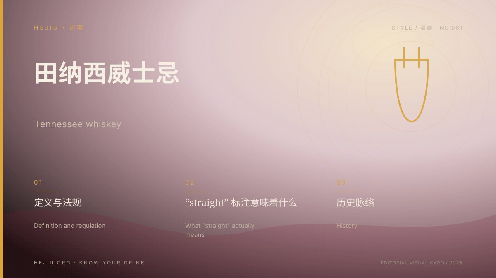
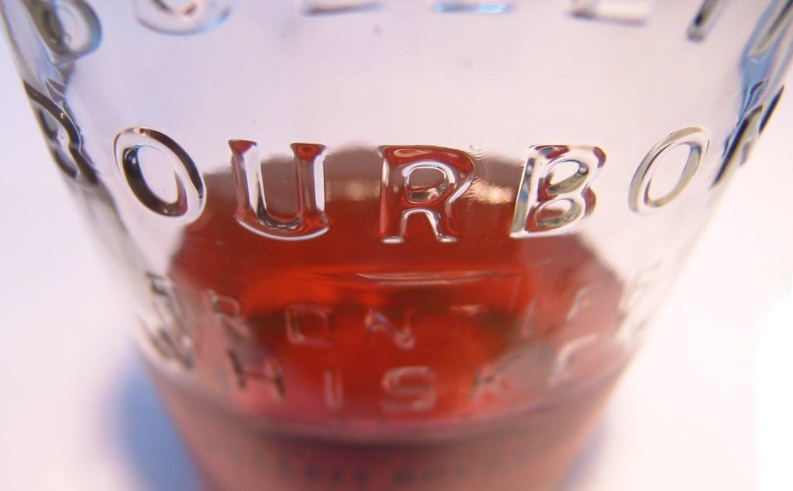

# Tennessee whiskey

Tennessee whiskey is often dismissed as bourbon with a different label, which is the laziest way to read it. The grain recipe and the new charred barrels are indeed close to bourbon, but US federal standards give this name its own origin rule and require the new spirit to pass through sugar maple charcoal before it enters the barrel. Origin, filtration and maturation together make the category.

Figure: thematic illustration for Tennessee whiskey. Image: AI-assisted illustration generated with Doubao Seedream 5.0 (project-owned); not a photograph of the subject.

> **Quick verdict**
> **In one line:** This style places Tennessee whiskey on the flavour map, and helps you choose and serve it.
>
> - **Best for:** Anyone comparing Tennessee whiskey with other styles before buying or ordering.
> - **Not for:** If you want want a single “best” ranking and reject stylistic difference.
> - **Check first:**
>   - Whiskey production in middle Tennessee grew in the 19th century alongside corn farming, river transport and limestone water.
>   - Serve neat in a tulip-shaped glass.

## Definition and regulation

In the US standards of identity for distilled spirits, Tennessee whiskey is a separate name. It must be produced in the state of Tennessee, from a fermented mash containing at least 51% corn, distilled at no more than 160 proof (80% ABV), and stored in new charred oak barrels. The clause that really sets it apart is the requirement that the spirit be filtered through sugar maple charcoal before barrelling, the step usually called the Lincoln County process.

The overlap with [bourbon](ref:bourbon-whiskey) is large: both are corn-led, both use new charred oak and both cap distillation at 80% ABV. The differences come down to two points — production must take place in Tennessee, and the charcoal filtration must be carried out. Legally, then, Tennessee whiskey stands beside bourbon rather than beneath it, and it is not a marketing alias for the same thing.

## What "straight" actually means

The word straight on a label is not a synonym for Tennessee whiskey. It is a stricter set of ageing and composition rules. A straight whiskey must mature for at least two years in new charred oak, may not contain added colouring, flavouring or other spirits, and may not be blended with other whiskey. If the liquid is younger than four years, the label must state its age.

A bottle can be both straight and Tennessee whiskey, in which case both sets of rules apply; it can also be Tennessee whiskey without a straight claim. Read the category name and the age claim separately. Seeing straight does not prove the whiskey came from Tennessee, and seeing Tennessee whiskey does not by itself prove that every straight requirement has been met.

## History

Whiskey production in middle Tennessee grew in the 19th century alongside corn farming, river transport and limestone water. Jack Daniel's commonly dates its brand history to an 1866 registration, and its early story is closely tied to Nearest Green, an African American distiller whose role in the charcoal-filtering tradition is now widely acknowledged. George Dickel established production at Cascade Hollow later in the century.

In the early 20th century Tennessee went dry ahead of federal Prohibition, closing many distilleries and shrinking the industry. After repeal, production remained concentrated in a handful of brands for decades, and only in recent years has a new generation of distilleries appeared. That history explains both the high brand concentration of Tennessee whiskey and why the Lincoln County process became a shared technical term rather than one company's trademark.

## Raw materials and process

The mash is built around [maize](ref:maize), commonly around seventy per cent, with rye and malted barley alongside it. Corn supplies sweetness and a full body, rye adds spice and structure, and malted barley provides the enzymes needed for conversion. After mashing and fermentation the wash goes to [distillation](ref:distillation), usually in a column still, where the heart of the run is cut at a relatively low strength.

The decisive step comes after distillation and before the barrel. The new spirit is trickled slowly through a thick bed of hand-made sugar maple charcoal, produced by burning stacked maple wood down to char. As it passes, some oils, sulphur compounds and coarse aromas are adsorbed, so the spirit enters the barrel cleaner and softer. Only then does [oak ageing](ref:oak-ageing) begin in new charred casks.

## Grades and labelling

Tennessee whiskey has no Scottish-style ladder of legal grades. The market shows roughly three layers. The first is the standard bottling, built around a consistent house profile. The second carries a straight claim, with tighter rules on ageing and composition. The third covers single-barrel, barrel-proof or special-cask releases that stress batch variation and strength.

These layers are not an official ranking. A standard bottling may rely on a larger vatting, while a single-barrel release may come from one cask or one small batch; the difference is mainly selection and dilution strategy, not hierarchy. Age statements follow the youngest-liquid rule: a bottle marked eight years may contain older whiskey, but none younger than eight.

## Sensory profile

A typical Tennessee whiskey opens with vanilla, caramel, roasted corn and banana-like esters, followed by coconut, cream and a little rye spice. The finish leans sweet, with restrained tannin and wood. Charcoal filtration removes some of the sharp sulphur and oily notes, which is why even young bottlings can feel round and is the usual reason the style is called smooth.

Against bourbon, the gap between the two styles is often smaller than the gap between two brands. High-corn recipes, new barrels and a warm climate all push toward sweetness and oak; filtration changes only part of the picture. Imagining Tennessee whiskey as bourbon with no spice at all ignores the rye and the barrel that remain.

## Region

The legal region is the whole state of Tennessee, though production clusters in the middle of the state south of Nashville. Lynchburg, in Moore County, is home to Jack Daniel's; Cascade Hollow, in Coffee County, is home to George Dickel; and recent years have brought new distilleries around Nashville and its outskirts. The area shares limestone groundwater and a climate with four distinct seasons.

The Lincoln County process takes its name from Lincoln County, but that does not mean a distillery must stand there. The phrase describes a filtration method, not a protected geographical name. Treating the process name as a place of origin is one of the commonest confusions around this category.

## Representative bottles

Jack Daniel's Old No. 7 is the best-known standard bottling, leaning toward vanilla, banana and caramel. Gentleman Jack passes through charcoal both before and after maturation, giving a cleaner entry. George Dickel No. 12 uses a high corn proportion and shows a fuller, grain-driven sweetness. Uncle Nearest 1856 and Nelson's Green Brier draw attention to the African American distilling tradition and to small-scale production in the state.

These bottles represent different recipes and cask selections rather than a quality ladder. Within one brand, the gap between a barrel-proof, a single-barrel and a standard release is often wider than the gap between two brands' entry-level products.

## Tasting and serving

Serve neat in a tulip-shaped glass. Look first for vanilla, caramel and banana, then for rye spice and the coconut note from the barrel. A few drops of water open the aroma and soften the alcohol; too much dilutes the body. In mixed drinks, a Highball highlights the sweetness and the bubbles, while an Old Fashioned sets the oak against bitters.

Ice suppresses aroma release, so it suits stronger or heavier versions better than delicate ones. Whether drunk neat or mixed, keep consumption moderate; excessive drinking is harmful to health and minors should not drink.

## Common misconceptions

First, that Tennessee whiskey is simply bourbon. It is a separate federal name with an origin rule and a charcoal-filtration rule. Second, that filtration happens before bottling. The rule requires it before barrelling, and the filtered spirit still matures in new oak. Third, that the Lincoln County process must be carried out in Lincoln County. The method is named for the county, but production can sit elsewhere in Tennessee. Fourth, that straight means Tennessee whiskey. They are two rules that can overlap or stand apart. Fifth, that charcoal filtration sweetens the spirit. No sugar is added; the sweetness comes from corn and oak. Sixth, that Jack Daniel's is a bourbon. It is sold, and regulated, as Tennessee whiskey.

**Short definition:** A Tennessee-produced American whiskey with a corn-led mash, new charred oak maturation and maple-charcoal filtration before ageing, often labelled straight.

## Further reading

- [Bourbon whiskey](ref:bourbon-whiskey): shares most grain and barrel rules but differs on origin and filtration.
- [Distillation](ref:distillation): how column stills and the cut shape the new spirit.
- [Oak ageing](ref:oak-ageing): the vanilla, caramel and wood that new charred casks contribute.
- [Maize](ref:maize): the backbone of the Tennessee mash bill.
- [United States](ref:usa): the geographical and regulatory setting for American whiskey.

## Related images

Image: A glass of bourbon, its wall embossed BOURBON FRONTIER WHISKEY and filled with amber liquid.. Credit: Markyboy81, CC BY 2.0, via Wikimedia Commons ([source page](https://www.flickr.com/photo.gne?id=1001040958)). Related image for Tennessee whiskey.
