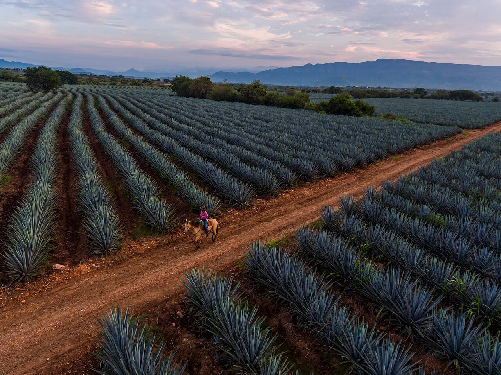

# Tequila

Tequila is a distilled spirit made from blue Weber agave (Agave tequilana Weber var. azul) in designated regions of Mexico. Its flavour comes from the sweetness and vegetal character of cooked agave hearts, and its process relies on four steps: cooking, crushing, fermentation and [distillation](ref:distillation). Mezcal, made from other agave species, is a separate category.

Figure: Tequila. Image: T2O media México, CC BY-SA 4.0, via Wikimedia Commons ([source page](https://commons.wikimedia.org/wiki/File:Paisaje_agavero_de_Jose_Cuervo_en_Tequila,_Jalisco.jpg)).

## Definition and legal framework

Mexican official standard NOM-006-SCFI-2012 sets the raw material, regions, categories, ageing and labelling rules for tequila, and the Consejo Regulador del Tequila (CRT) handles certification and supervision. The designated region is centred on Jalisco and includes specified areas of Guanajuato, Michoacán, Nayarit and Tamaulipas. The product must use blue Weber agave grown in the designated region and complete key steps within the defined area.

"Tequila" is used as a protected geographical indication in some countries, so not every agave distillate may carry the name. Mezcal and sotol are separate categories with different raw materials and processes. Buyers should look for CRT certification information and an explicit category statement.

## The agave plant and raw material

Blue Weber agave is a plant in the Amaryllidaceae family whose leaves hold fibre and liquid while the sugars concentrate in the stem heart, the piña. The plant usually needs several years of growth before harvest, with the exact number depending on climate and cultivation. Harvesting is done by a jimador, who removes the leaves to leave the agave heart.

The sugars in the heart are mainly complex fructans, which must be converted into fermentable sugars by cooking. The cooking method affects flavour: a traditional brick pit (horno) brings smoke and earth, while a modern autoclave is more even and cleaner. After cooking, the material is crushed or milled for its juice and then fermented.

## History

The modern form of tequila is tied to 19th-century Mexican distillation, railways and glass-bottle manufacturing. Before that, the central highlands already had a long tradition of fermented agave drinks. In the 20th century tequila expanded in Mexico and in export markets, white tequila became a mixing base, and age grades were gradually standardised.

In the later 20th century the distinction between "100% agave" and mixto, regional protection and certification were refined. In the 21st century premium tequila and high-end aged products grew, and drinkers began to ask about raw-material origin, cooking method and added sugar or flavourings. At the same time, the ecological pressure of agave farming and the rights of harvest workers became part of the industry debate.

## Production

The process can be summarised as: harvest and leaf removal, cooking, crushing or milling, fermentation, distillation, optional ageing, strength adjustment and bottling. Fermentation uses native or commercial yeast and lasts from tens of hours to several days. Distillation is usually double: the first pass produces a low-strength liquid and the second raises strength and makes the cut.

Ageing uses oak barrels, as described under [oak ageing](ref:oak-ageing). Barrel type, barrel age and time decide the strength of vanilla, caramel and wood notes. Some products use barrels that previously held other drinks to add complexity. Added sugar, caramel colour and flavourings are restricted by the standard, and the label and certification information are the basis for judgment.

## Categories and age grades

- **Blanco / plata**: unaged or briefly aged, the most direct style, with agave, citrus and pepper notes.
- **Joven**: literally "young", usually unaged or a blend of batches, and not a sign of low quality.
- **Reposado**: aged in oak for at least 2 months, rounder in texture and still showing plenty of agave character.
- **Añejo**: aged at least 1 year, often with vanilla, caramel and wood notes.
- **Extra añejo**: aged at least 3 years, closer to an aged spirit in style and usually more expensive.

Age grades are legal ranges, not exact years. Products within one grade can differ widely in actual ageing time, and any "years" claim on the label should be checked against the regulation and certification. Strength usually falls between 35% and 55%, with the label as the authority and the concept of [alcohol by volume](ref:abv) as background.

## Flavour and tasting

Typical white tequila aromas are the sweetness of cooked agave, green pepper, citrus peel, pepper and a mineral note; the palate is direct and the alcohol clear. Reposado adds vanilla, cinnamon and creaminess; añejo and extra añejo move towards caramel, dried fruit, leather and wood, while the vegetal agave note recedes.

Taste a small amount neat in a small glass, smell first, then take a small sip and let the liquid reach both sides of the mouth. Water or ice changes the aromatic structure and is useful for comparing batches. Compared with the traditional salt-and-lime serve, neat tasting says more about raw material and process; salt and lime belong more to mixing and social ritual and are not a necessary step in judging quality.

## Drinking and pairing

Blanco suits sipping or cocktails such as the margarita; reposado suits sipping, ice or recipes that need a rounder body; añejo and extra añejo are better sipped. As a cocktail base, tequila's vegetal note works well with citrus, but high strength amplifies any imbalance between sweet and sour.

With food, white tequila suits seafood, sour salads and Mexican snacks; aged tequila suits grilled meat, dark chocolate and after-dinner desserts. Compared with [rum](ref:rum), tequila emphasises vegetal and mineral notes, while rum shows more cane sweetness and barrel age.

## Common misconceptions

First, assuming every tequila is "100% agave". Mixto is legal, and the difference lies in ingredient transparency.
Second, conflating tequila and mezcal. Their raw materials, processes and legal categories all differ.
Third, assuming older is always better. Ageing changes style but may not preserve the vivid agave character.
Fourth, treating salt and lime as a tasting standard. That is a specific serve, not a quality test.
Fifth, ignoring region and certification. Geographical indication and CRT certification decide whether a product may use the name "tequila".

[Distillation](ref:distillation) and [Rum](ref:rum) are the two useful reference points for Tequila. [Distillation](ref:distillation) sets out legal definition; [Rum](ref:rum) brings in materials and process. Read them together.

**In brief:** A Mexican spirit distilled from blue Weber agave, with 100% agave and mixto expressions and several age tiers.

**Sources and limits.** The key claims about Tequila are checked against the following sources: Consejo Regulador del Tequila (tequila's designated regions, raw material, categories and age grades), Secretaría de Economía, Mexico (the issuing body and regulatory framework of NOM-006-SCFI-2012), Oxford University Press (Consulted for entries on agave distillation, mezcal and tequila history) and 4 sources in total. Prices, batches and status change; the body is project-written and does not reproduce source text.

## Further reading

- [Distillation](ref:distillation): double distillation and the cut decide tequila's aromatic direction.
- [Oak ageing](ref:oak-ageing): the main source of the difference between reposado and añejo styles.
- [Rum](ref:rum): another tropical-crop distillate, useful for comparing sweetness and ageing.
- [Alcohol by volume](ref:abv): the basic concept behind the ABV figure on a label.

## Related images

Image: The barrel warehouse at Foursquare Rum Distillery, where tropical ageing and cask type shape rum style. Credit: Unknown author Unknown author, CC BY 2.5, via Wikimedia Commons ([source page](https://commons.wikimedia.org/wiki/File:Foursquare_Rum_Distillery_Barrel_Warehouse.jpg)). Related image for Tequila.
