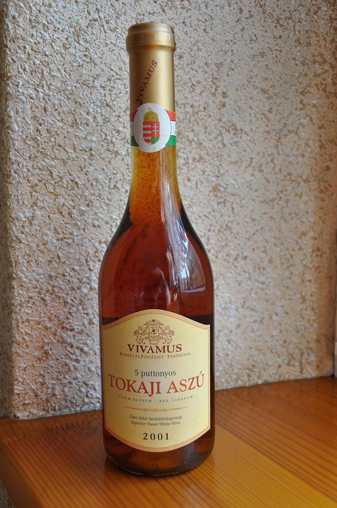
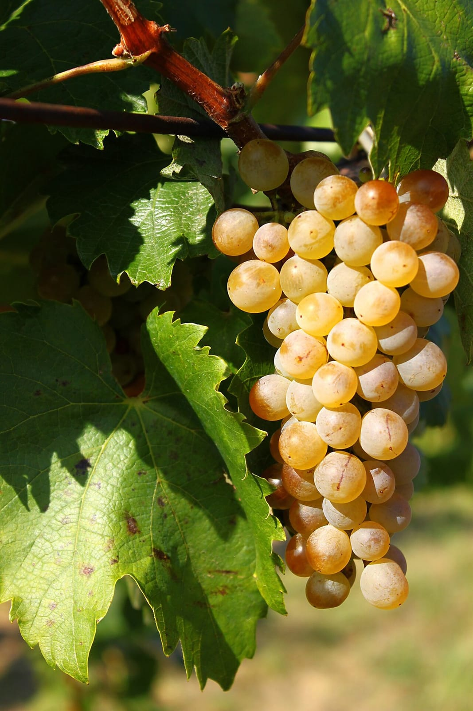

# Tokaji

Tokaji is the sweet wine of the [Tokaj region](ref:tokaj) in north-eastern Hungary, and one of the earliest sweet wine systems to be written into law. Its core is Aszú: botrytised grapes are picked by hand, macerated in base wine or fermenting must from the same vintage, then pressed, fermented and aged in oak for at least eighteen months. The result is a [wine](ref:wine) of honey, apricot and citrus peel, whose sweetness is carried by high acidity rather than by sugar alone.

Figure: A bottle of Vivamus 5 puttonyos Tokaji Aszú, labelled 2001 and 5 puttonyos. Image: Beemwej, CC BY-SA 3.0, via [source page](https://commons.wikimedia.org/wiki/File:Tokaji_Aszu.JPG).

## A hierarchy built on sweetness

For Tokaji, begin with the production rule. Then look at the strength, and finally ask the usual serving. The answers point to different choices, not to a single score.

## How Aszú is made

Aszú is made in two stages. First, healthy grapes are picked, pressed and fermented into a base wine. Second, once the botrytised grapes reach the desired state, workers select them berry by berry and add them to the base wine or to must that is still fermenting. Maceration lasts from a day to several days, during which alcohol and sugar pass from the skins into the liquid; the wine is then pressed, fermented and aged.

[Noble rot](ref:noble-rot) is essential here. It thins the skins, evaporates water, concentrates sugar and acidity, and creates glycerol and distinctive aroma compounds. Without it, Aszú would lose its honey and apricot and taste like an ordinary late harvest. The base wine may be dry or may retain a little sugar; its acidity and alcohol shape the weight of the final wine.

## Puttonyos retires, after 2013

From the 2013 vintage, Hungary changed the rules. The minimum natural [residual sugar](ref:residual-sugar) for all Aszú became 120 g/L, the three- and four-puttonyos categories were abolished, and Aszúeszencia ceased to be a separate category. Five and six puttonyos may still appear as voluntary labels, but they must meet thresholds of 120 g/L and 150 g/L respectively and satisfy the corresponding ageing requirements.

## Furmint and Hárslevelű

[Furmint](ref:furmint) is the main variety of Tokaj: late-ripening, thick-skinned and high in acidity, prone to noble rot and capable of structured dry whites as well. It supplies citrus, green apple, smoke and mineral notes, and forms the backbone of Aszú. Hárslevelű adds flowers, honey and a softer texture, while Sárgamuskotály (Muscat Blanc à Petits Grains) contributes grape and floral aroma. The three are often blended, in proportions chosen by the estate and the year.

Beyond variety, the share of botrytised fruit and the length of maceration change the finished wine. Tokaji is not a fixed flavour but a formula that can be adjusted.

## From Eszencia to Szamorodni

The sweetness spectrum is wide. Eszencia is the highest tier: juice that drips from botrytised grapes under their own weight, without pressing, with at least 450 g/L of residual sugar and very little alcohol, usually served in small pours. Aszú is the core product, starting at 120 g/L. Szamorodni is made from botrytised and healthy grapes harvested and vinified together; the sweet version has at least 45 g/L of residual sugar, while the dry version ferments to dryness. Fordítás and Máslás are rarer methods: the first soaks pressed botrytis pomace in base wine, the second tops the lees of Aszú or Szamorodni with base wine.

The family shows that Tokaji is not one noun but a whole group built around botrytised grapes. It belongs to the wider category of [dessert wine](ref:dessert-wine), yet its process differs from Sauternes and from ice wine, and the texture comes as much from maceration and ageing as from sugar.

## Fog, rivers and volcanic soil

Tokaj sits near the northern limit of viticulture, with a relatively cool climate and an annual average temperature of about 9–10°C. The Bodrog and Tisza rivers bring morning fog in autumn, allowing noble rot to develop evenly, while afternoon sun dries the skins and suppresses harmful moulds. This is the microclimate that makes botrytised wine reliable here.

The soils are mainly volcanic: andesite, rhyolite and tuff weather into a range of substrates, mixed with loess and river deposits. Volcanic soils drain well and give a mineral edge, while the humidity from the rivers completes the aromatic profile. The region is divided into villages and named parcels, and the old puttonyos hierarchy was often linked to the position of a site.

## Ageing, temperature and food

Aszú requires at least eighteen months in oak, and many estates age it longer. Once bottled, Tokaji can age for decades, its acidity and sugar making it more durable than most sweet wines.

Serve at 10–12°C, or up to 14°C for older bottles, in a small tulip glass. Foie gras, blue cheese, apricot desserts and nut tarts are classic matches; it also works with lightly sweet Asian dishes such as honey-glazed meat or a mild curry. Excessive drinking is harmful, and minors should not drink.

## Reading the label

First check whether it is Aszú, then the residual sugar, then the vintage and the estate. A bottle labelled Tokaji but not Aszú may be a dry white or a late harvest. A bottle labelled 5 puttonyos that does not reach 120 g/L does not meet current rules. A bottle labelled Eszencia should exceed 450 g/L. Knowing these thresholds prevents more mistakes than memorising brands; vintages from the same estate often differ more than brands do.

**At a glance:** The botrytised sweet wine system of Hungary's Tokaj region, built around Aszú; since 2013 it is labelled by grams per litre of residual sugar, Furmint and Hárslevelű supply the high-acid frame, and the range runs from Eszencia to Szamorodni. 

[Furmint](ref:furmint) and [Noble rot](ref:noble-rot) are the nearest useful comparisons: one clarifies legal definition, the other tests materials and process.

Tokaji is the sweet wine of Hungary's Tokaj region, labelled by grams of residual sugar since 2013; Furmint and Hárslevelű give the high-acid frame, and Eszencia is the richest grade.

**Key facts.**

| Item | Detail |
| --- | --- |
| In one line | The botrytised sweet wine system of Hungary's Tokaj region, built around Aszú; since 2013 it is labelled by grams per litre of residual sugar, Furmint and Hárslevelű supply the high-acid frame, and the range runs from Es… |
| Parent style | Dessert Wine |
| Aroma family | Honey / apricot / botrytis |

**Sources and limits.** The key claims about Tokaji are checked against the following sources: Wines of Tokaj, Wines of Hungary (the history, terroir, varieties and extent of the Tokaj region; no original text is reproduced), European Union (protected designations of origin and wine labelling; no original text is reproduced) and 4 sources in total. Prices, batches and status change; the body is project-written and does not reproduce source text.

## Related images

Image: Furmint. Credit: Andrs.kovacs, CC BY-SA 3.0, via Wikimedia Commons ([source page](https://commons.wikimedia.org/wiki/File:Furmint_grape_cluster.jpg)). Related image for Tokaji.
