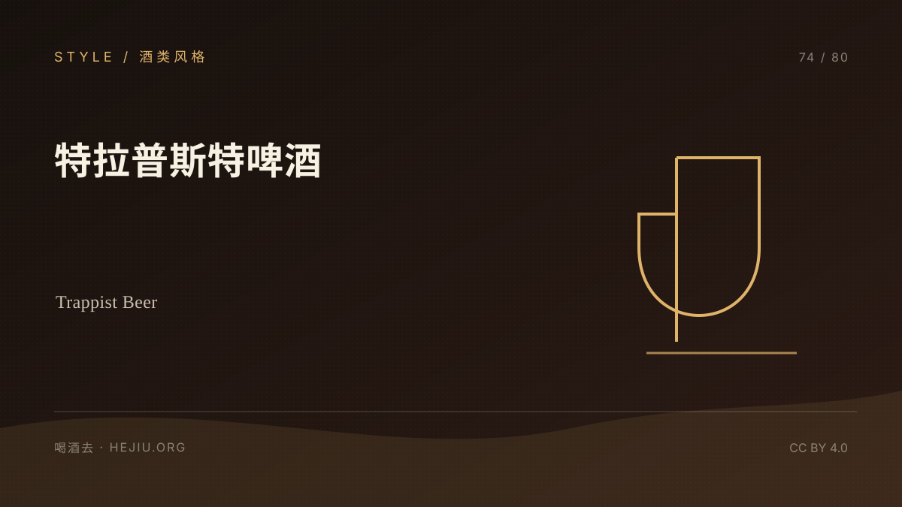

# Trappist Beer

Trappist beer is not a style defined by colour or strength but a group of [beers](ref:beer) bound by rules of place and supervision: it must be brewed inside a Trappist monastery, made by monks or under their oversight, with proceeds used for the monastery and for social work. Only six breweries may currently use the Authentic Trappist Product (ATP) mark, and they are located in [Belgium](ref:belgium) and the Netherlands.

Figure: thematic illustration for Trappist Beer. Image: AI-assisted illustration generated with Doubao Seedream 5.0 (project-owned); not a photograph of the subject.

## A brewery inside the walls

The Trappist order grew out of the Cistercian reform of the Middle Ages. Brewing began as one means of supporting the monastery and gradually became a stable source of income. The French Revolution at the end of the 18th century and the two world wars of the 20th century interrupted or forced the rebuilding of many monastic breweries. In the 19th century monastic beer often sat within a local economic circle of farming, baking and innkeeping; monks brewed, while lay brothers helped with bottling and transport. Today the six houses differ greatly in scale, some still brewing in small batches by hand and others using modern equipment, but brewing inside the walls and the use of proceeds remain central to their identity.

In 1997 the International Trappist Association established the ATP mark, turning three requirements, namely brewing inside the monastery, supervision by monks and use of proceeds, into verifiable certification conditions. The mark is not a style name; it governs the producer and the use of income, not the recipe. The association checks periodically whether a brewery still produces inside the monastery and whether proceeds support the monastery and social projects, and products that no longer qualify are removed from the list.

## Six breweries and the ATP mark

The six are Westvleteren (St. Sixtus), Westmalle, Rochefort, Orval and Chimay in Belgium, and La Trappe (Koningshoeven) in the Netherlands. Each has its own yeast, water and recipe tradition: Westmalle is known for tripel, Rochefort for rich dark beers, Orval for a distinctive combination of dry hopping and Brettanomyces, Chimay for a range from golden to dark, and La Trappe as the Dutch representative.

The ATP mark is granted only to qualifying products, so not every beer from a Trappist brewery carries it. Seeing the mark means that the producer and the use of proceeds have been checked by the association; it says nothing about strength or flavour. For the beer itself, read alcohol content, colour and recipe description.

## Yeast, mashing and bottle refermentation

[Yeast](ref:yeast) is the character at the centre of these beers. Monastic breweries usually keep their own top-fermenting yeast and ferment at relatively warm temperatures, producing pear, apple, banana and pepper-like esters. Mashing typically uses pale base malt with darker speciality malt, and candi sugar or syrup raises the share of fermentable sugar so that a stronger beer can still finish dry.

After [fermentation](ref:fermentation), most products undergo a second fermentation in bottle: a little sugar and yeast are added at bottling so that carbon dioxide forms inside the bottle, bringing a rounder texture and longer shelf life. Original gravity ([original gravity](ref:original-gravity)) sets the ceiling for alcohol and body, but attenuation varies widely between breweries, so gravity alone does not reveal sweetness. Water also shapes style: harder water suits dark malt, softer water suits a golden tripel. The yeast and sugar added at bottling determine carbonation, and the beer usually needs weeks to months to become stable.

## The strength ladder of dubbel, tripel and quadrupel

Dubbel is usually deep amber to brown, with caramel, raisin and bread notes and moderate alcohol; tripel is mostly golden, with citrus, pear and spice aromas and a drier finish; quadrupel is a darker, richer, sweeter and more alcoholic version. The three are strength labels used by breweries and the market rather than legal style categories.

One brewery may make dubbel, tripel and quadrupel at the same time, and may also make golden ales or seasonal products outside the three. On a label, alcohol content and perceived residual sweetness explain the experience better than the name. Colour runs from gold through amber to deep brown, bitterness is usually moderate, and the balance of yeast esters, malt sweetness and alcohol warmth matters more than hops. Alcohol, bitterness and colour vary considerably between breweries, and the figures depend on source and brewery rather than a legal standard.

## Where Trappist beer ends and abbey beer begins

[Abbey beer](ref:abbey-beer) is the broader category: it may be made by a commercial brewery that has licensed a monastic name, and it need not be brewed inside a monastery or supervised by monks. Trappist beer must meet the three ATP conditions, so the two terms cannot be used interchangeably.

The distinction matters in practice: a commercial beer with a monastic name may be excellent, but it carries no Trappist production or proceeds obligation; conversely, not every beer from a Trappist brewery carries the ATP mark.

## Serving, pairing and keeping

Trappist beer is best served at about 8–14°C. Dubbel and quadrupel can be a little warmer, while tripel and golden versions suit a lower temperature. A wide chalice or a tulip gathers esters and foam; leave the yeast in the bottle unless the brewery advises otherwise.

With food, dubbel suits stews, mushrooms and medium-aged cheese, tripel suits poultry, seafood and spiced vegetables, and quadrupel suits game, blue cheese and dark chocolate. Bottle-conditioned products should be stored away from light in a cool place; strong versions can be cellared moderately, but not every beer improves with long keeping.

Trappist Beer is best approached through the production rule, then the strength, and then the usual serving. One check alone will not settle it.

Read [Abbey beer](ref:abbey-beer) for the legal definition side of Trappist Beer, and [Belgium](ref:belgium) for the materials and process side. Together they locate it.

**At a glance:** Beer that must be brewed inside a Trappist monastery by monks or under their supervision, with proceeds going to the monastery and social work; only six breweries may currently use the Authentic Trappist Product mark, and their styles range from dubbel and tripel to quadrupel and dark strong ale.

**Key facts.**

| Item | Detail |
| --- | --- |
| In one line | Beer that must be brewed inside a Trappist monastery by monks or under their supervision, with proceeds going to the monastery and social work; only six breweries may currently use the Authentic Trappist Product mark, an… |
| Parent style | Abbey beer |
| Aroma family | Malt and yeast esters |

**Sources and limits.** The key claims about Trappist Beer are checked against the following sources: International Trappist Association, Beer Judge Certification Program, Brewers Association and 4 sources in total. Prices, batches and status change; the body is project-written and does not reproduce source text.
