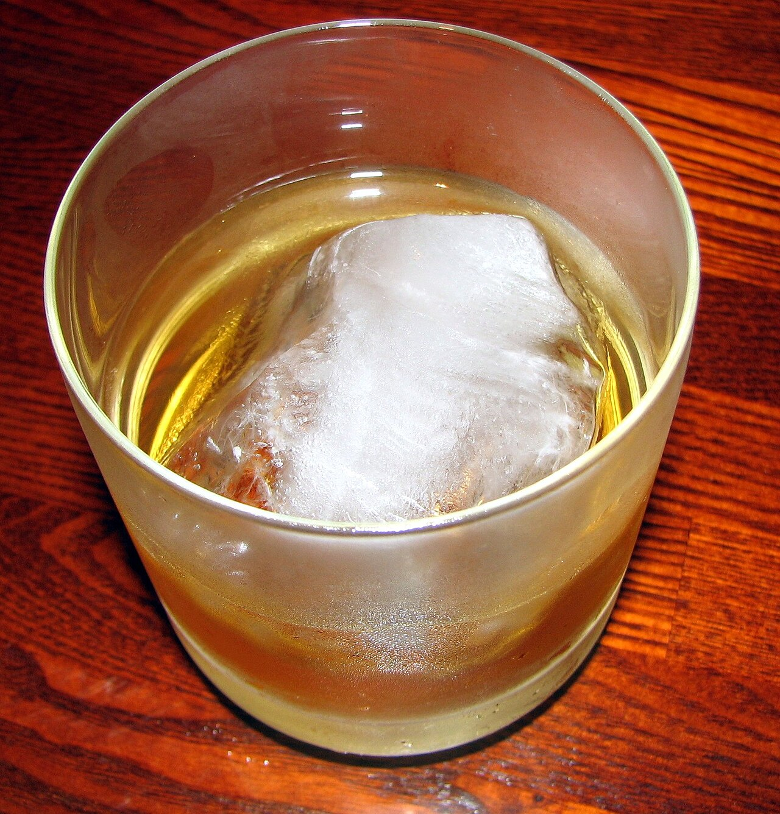
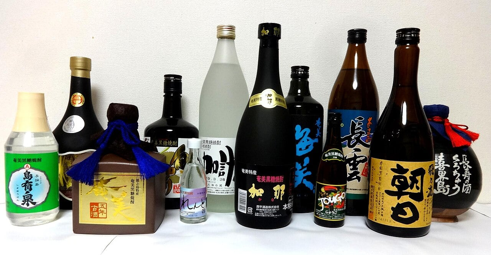

# Umeshu

Umeshu is a [Japanese](ref:japan) sweet liqueur made by steeping green ume plums, sugar and alcohol together in a jar. It is not fermented: the alcohol comes from the base spirit, the plums supply acidity, aroma and colour, and the sugar rounds the sourness. The result is usually pale gold to amber, 10% to 15% ABV, sweet-sour on the palate and marked by almond and honey notes. It is not a plum wine in the fermented sense, nor simply plums left in alcohol.

Figure: Umeshu. Image: Wikimedia Commons contributor, CC BY-SA 3.0, via Wikimedia Commons ([source page](https://commons.wikimedia.org/wiki/File:Umeshu_on_the_rocks.jpg)).

## Three Things: Ume, Sugar and Alcohol

The three core ingredients are ume, sugar and alcohol. Ume is a Prunus species related to apricot and plum; the fruit used for umeshu is picked unripe and green. Sugar is usually rock sugar or white sugar, providing sweetness and osmotic pressure; the alcohol may be shochu, brandy, vodka or neutral spirit, extracting aroma and acidity. Their proportions decide whether the finished drink is rich, light or strongly alcoholic.

Because there is no fermentation, the aroma is closer to "fresh fruit plus sugar" than to yeast-derived complexity. It belongs to the broad family of [liqueur](ref:liqueur) and is classified as liqueur under Japanese liquor tax law, which explains why it is sweet and moderate in strength yet does not need the cold chain of sake.

## The Liquor Tax Act and "Honkaku Umeshu"

Japanese liquor tax law defines liqueur as an alcoholic beverage made from alcohol and sugar or other materials, with an extract content of at least 2 degrees. Umeshu falls into this category, but the name "umeshu" itself does not require that the only ingredients be ume, sugar and alcohol. Some commercial products may add acidulants, flavourings, colourings or other fruit juices.

"Honkaku umeshu" is a stricter self-regulatory label. The Japan Spirits & Liqueurs Makers Association standard allows the term only for umeshu made from ume, sugar and alcohol alone, without acidulants, colourings or flavourings. The standard took effect in 2015 and is an industry code, not the tax law itself. A "honkaku umeshu" label therefore points to a more traditional ingredient list; a plain "umeshu" label may include additives.

## From the Honcho Shokkan to the Home Jar

One of the earliest Japanese records of making umeshu appears in the Honcho Shokkan of 1697. Sugar was expensive in the Edo period, so umeshu was closer to a festival or medicinal drink than an everyday beverage. In modern times, steeping plums in a glass jar became a summer habit: green ume arrives in the shops, households buy rock sugar and shochu, and the jar sits in a cool place until autumn or winter.

Commercial production took shape in the twentieth century. CHOYA began as a grape grower in 1914, started making umeshu in 1959, and turned a home-made drink into a national product. Umeshu then moved into bars, restaurants and export markets, with variants based on brandy, sake or honey.

## Green Ume, Rock Sugar and Base Spirit

Traditional recipes buy green ume around the rainy season, choosing firm fruit with unbroken skin. The stems are removed, the fruit is washed and dried, then layered with rock sugar in a glass jar; sugar and fruit alternate, and the base spirit is poured over to cover the plums completely. A common ratio is roughly equal parts ume, sugar and alcohol, though sugar can be reduced to taste.

The base spirit shapes the style. A spirit around 35% extracts strongly and keeps well; a 20% shochu is softer, gives a lower final strength and is best drunk sooner. Some producers use brandy for vanilla and oak notes, or sake for a lighter version. Steeping takes from three months to a year, and the longer it goes, the darker the colour and the rounder the acidity.

## Infusion, Not Fermentation

Making umeshu is infusion, not fermentation. Sugar creates high osmotic pressure at the fruit surface and draws juice, organic acids and aroma into the liquid; alcohol dissolves aromatic compounds from the skin. No yeast converts sugar into alcohol, so strength does not rise and sweetness does not fall.

The characteristic aroma comes from compounds such as benzaldehyde, which smells of almond, cherry stone or marzipan. Acidity comes mainly from citric and malic acids, while sugar balances it and adds viscosity. After steeping, producers filter out the fruit and may clarify or cold-settle; some keep a little solids for a hazier, more handmade look. The level of [residual sugar](ref:residual-sugar) is one of the clearest indicators of style.

## Sweet, Sour and Almond

Umeshu is usually pale gold to deep amber, clear or slightly hazy. The nose is green plum, almond, honey, white blossom and a hint of cherry stone; the entry is sweet, acidity follows to cut it, and the finish carries a little bitterness and alcoholic warmth. A good example keeps a clear line between sweet, sour and alcohol.

Temperature changes the drink. Chilled, sweetness retreats and acidity feels crisper; at room temperature the nose opens but sweetness grows heavier; hot water lifts almond and honey. Judge it on three points: whether the plum aroma tastes like real fruit, whether acidity gives support, and whether sugar covers the alcohol.

## Wakayama, Osaka and the Brands

Wakayama is Japan's most important ume region, and Nanko ume, large, thin-skinned and aromatic, is often used for premium umeshu. Osaka is CHOYA's base and the centre of commercial production and export; Nagano, Gunma and Yamanashi have smaller producers emphasising local fruit and hand-steeping.

CHOYA is the best-known name, while Suntory, Takara, Ozeki and Nakano offer different prices and sweetness levels. Look for the "honkaku umeshu" wording, the ingredient list and the origin of the plums; labels stressing fully ripe ume, Nanko ume or long ageing usually signal richer fruit and a higher price.

## On the Rocks, with Soda, with Hot Water

The everyday serve is over ice, or one part umeshu to two parts soda for a lighter highball. In winter it can be mixed with hot water; in summer, ice, mint and lemon work well. It also makes a cocktail base with gin, vodka or sparkling wine, or a simple sauce for vanilla ice cream.

With food, its acidity suits fried dishes, grilled meat, cheese and Japanese sweets. It can accompany sushi, tempura and fried chicken, but a very sweet version overwhelms sashimi. Serve in a small glass or highball, and keep the emphasis on balance rather than volume.

## The Difference from Plum Wine and Flavoured Drinks

In Chinese, "plum wine" may mean a plum-flavoured drink based on grape or other fruit wine, or a fermented plum drink; Japanese umeshu is an infused liqueur. The two differ in strength, sweetness and method. Another confusion is "umeshu-flavoured beverage", which may be very low in alcohol or alcohol-free, built on flavourings and sugar, and cannot be compared with honkaku umeshu.

The relationship with [shochu](ref:shochu) also needs care: shochu is a distilled spirit, and umeshu may use it as a base, but umeshu itself is a sweetened infusion. Treating it as "plum shochu" underrates its sugar and misreads the way it is served.

## Buying and Storage

Look first for "honkaku umeshu" and the ingredient list: only ume, sugar and alcohol is closer to tradition, while acidulants, flavourings and colourings indicate an ordinary umeshu. Then check strength and sugar; 10% to 15% is common, and sweetness ranges from light to thick. Plum origin and variety hint at aroma, with Nanko ume usually fuller and more almond-like.

Refrigerate after opening, especially low-strength or fruit-rich products; high-alcohol, high-sugar versions can stay cool and dark, but flavour still flattens. For home-made umeshu, use food-grade containers, keep the fruit submerged and avoid sunlight; do not drink it if it smells wrong, looks unusually cloudy or the lid bulges.

Further reading: [Abbey beer](ref:c-extra-1).

## Related images

Image: Bottled examples of Amami kokuto shochu, a regional type of Japanese shochu.. Credit: Hhaithait, CC BY-SA 4.0, via Wikimedia Commons ([source page](https://commons.wikimedia.org/wiki/File:Bottled_amami_kokuto_shochu.jpg)). Related image for Umeshu.
