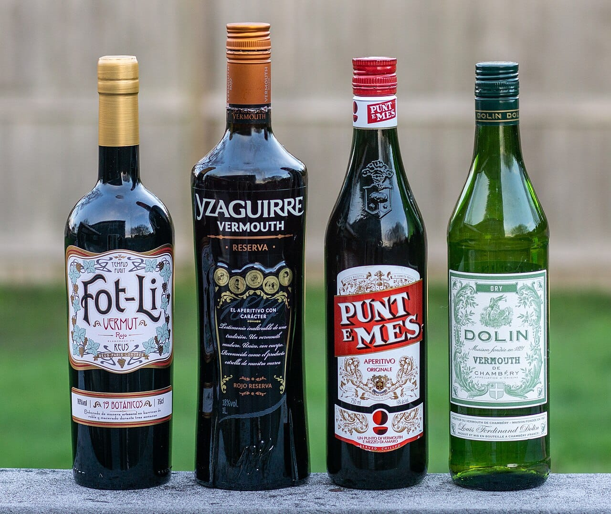
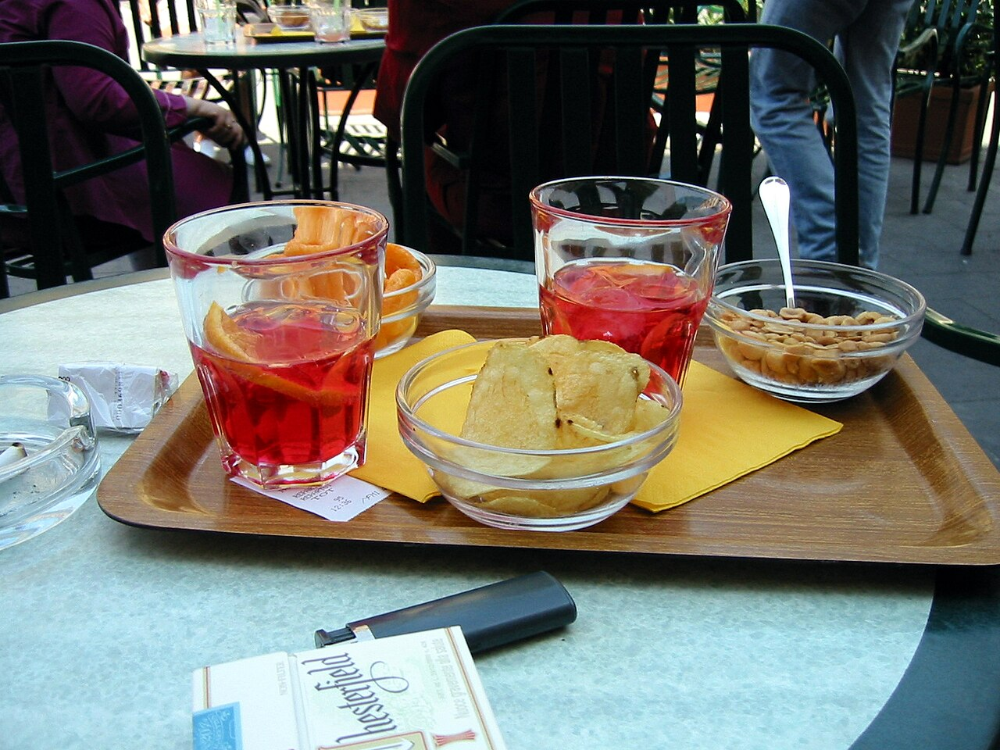

# Vermouth

Vermouth is an aromatised wine: a wine base plus wormwood, clove, cinnamon, citrus peel and other botanicals, fortified according to product type and adjusted for sugar. It has the acidity and fruit of wine and the bitterness and aroma of a spirit, so it can be drunk alone or used in cocktails. Its classic role is as an [aperitif](ref:aperitif), though modern bars also use it as a modifier. Unlike an ordinary [fortified wine](ref:fortified-wine), its core is not a rise in alcohol but a rebuild of the aroma with plants.

Figure: Vermouth. Image: Kenneth C. Zirkel, CC BY-SA 4.0, via Wikimedia Commons ([source page](https://commons.wikimedia.org/wiki/File:Four_bottles_of_vermouth.jpg)).

## The boundary: what counts as vermouth

The EU places vermouth among aromatised wine products. The rules require a wine base and the use of wormwood (Artemisia) and other plants to create the characteristic flavour; actual alcohol must be at least 14.5% and below 22%, and total alcohol at least 17.5%. It is not the vague home-made idea of “wine with herbs steeped in it”, but a processed drink with a category, an alcohol range and labelling rules.

What does not count: a liqueur built on neutral spirit with added spice and sugar; an ordinary aromatised wine that does not use wormwood for its character; and aniseed-flavoured absinthe. They may look alike and Chinese translations may overlap, but the categories are entirely different.

## Base wine and fortification

The base is usually a neutral white wine: enough acidity, restrained aroma and a medium body so the botanical recipe can lead. It is clarified and stabilised, then blended with alcohol, syrup and botanical extracts. Fortification raises strength and stability, making an opened bottle more resistant to oxidation than ordinary wine, but it does not make the bottle indestructible.

The method and level vary by product. Dry styles tend to carry less sugar; red styles are sweeter and fuller to carry heavier bitterness and spice. Fortification is not the defining step of vermouth; aromatisation with wormwood is. That distinction matters when comparing products across countries.

## How the botanical recipe works

Bitterness comes from wormwood, gentian, cinchona and similar plants, not from artificial bitters. Aroma comes from citrus peel, coriander seed, clove, nutmeg, vanilla and saffron. Production generally follows two routes: steeping the plants directly in wine or alcohol, or distilling them first and blending the distillate with the base; many products use both.

Recipe differences often outweigh origin differences. One producer in a region may make a red vermouth that is bitter, sweet or vanilla-led; another may push citrus and flowers. Recipes are trade secrets, and labels normally give only the style and strength, not the full botanical list.

## Dry, white and red

Dry or extra-dry vermouth is pale and low in sugar, with bitterness, citrus, herbs and a faint saline note; it suits a well-chilled solo serve or a dry Martini. White vermouth (bianco) is golden, rounder in aroma and medium-sweet, often served with ice and soda. Red vermouth (rosso) is dark, with caramel, vanilla, spice and bitterness, and is a common base for Italian aperitifs and cocktails.

There are also amber, rosé and bitter aromatised wine styles. Discussing vermouth as a single category hides the huge difference between dry and red in recipe, sugar and use: dry is closer to “wine with a bitter edge”, red closer to “a low-alcohol spiced liqueur”.

## Regions and traditions

Turin in Italy and Chambéry in France are the two most cited centres. Turin is known for red vermouth and bitter styles; Chambéry for dry, crisp white vermouth. Products from both are protected by geographical indications or traditional names, with the precise rules set by EU and national registers.

Southern France, Milan in Italy and Catalonia in Spain also have long traditions. A place name describes history and craft tradition, not an automatic quality grade; within one region products can run from bone dry to sweet and from delicate to heavy.

## Representative products and style coordinates

Representative brands include Martini, Cinzano, Carpano, Dolin and Noilly Prat. They span the range from commercial dry to artisanal red: some stress citrus and bitterness, some vanilla and caramel, some the freshness of the herbs. Vermouth di Torino and Vermouth de Chambéry write their regional tradition into the name.

Start with the use. A dry Martini needs a dry, crisp product with restrained bitterness; a Negroni needs a red with structure and a sweet-bitter balance; a solo serve can take a more complex, slightly stronger artisanal bottling. For how [residual sugar](ref:residual-sugar) shapes texture, see the term entry.

## The role in cocktails

Dry vermouth is the key ingredient of the [dry Martini](ref:dry-martini); the amount ranges from a rinse to a third of the glass and directly changes bitterness and aroma. Red vermouth is central to the [Negroni](ref:negroni) and the [Manhattan](ref:manhattan), carrying sweetness, bitterness and spice. White vermouth appears in long drinks such as the Americano.

Vermouth is not an optional seasoning in a cocktail. Its strength, sugar and bitterness change the balance of the whole drink, and the amount, brand and opening date all leave a mark. Replacing it with ordinary wine or dry sherry usually produces a structurally different drink.

## Storage and service

Opened vermouth oxidises, and its aroma moves from fresh herbs towards nuts, caramel and vinegar. Keep an opened bottle cold and use it within a few weeks to three months; do not leave it in a room-temperature cabinet as if a fortified wine could not spoil. When mixing, the opening date affects the glass more than the brand does.

Begin with the production rule, move on to the strength, and finish with the usual serving. That order keeps the reading of Vermouth practical.

## Common misconceptions and disputes

First, reading the Chinese “苦艾酒” always as vermouth. Second, thinking vermouth is a spirit when it is an aromatised wine. Third, assuming dry means no sugar at all, when dry styles still carry a little residual sugar. Fourth, assuming red vermouth must be made from red grapes, when colour can also come from the recipe and caramel. Fifth, assuming a fortified wine cannot spoil after opening.

Two arguments recur: how much aromatisation and sweetening still counts as vermouth, and whether a geographical name may be used as a generic style word. The first is settled by regulation and trade practice; the second returns in international trade negotiations. For the classification of the [wine](ref:wine) base and the [fortification](ref:fortification) process, see the linked entries.

[Fortified wine](ref:fortified-wine) and [Negroni](ref:negroni) answer different questions about Vermouth: legal definition and materials and process. Read them as a pair, not as alternatives.

**Key facts.**

| Item | Detail |
| --- | --- |
| In one line | An aromatised wine based on wine, flavoured with wormwood and other botanicals and fortified by category; EU rules set an actual-alcohol range from 14.5% up to but below 22% and a total-alcohol floor of 17.5%, and dry, w… |
| Parent style | Fortified wine |

## Related images

Image: Aperitif. Credit: Wikimedia Commons contributor, Public domain, via Wikimedia Commons ([source page](https://commons.wikimedia.org/wiki/File:Aperitif_Campari_Soda.jpg)). Related image for Vermouth.
