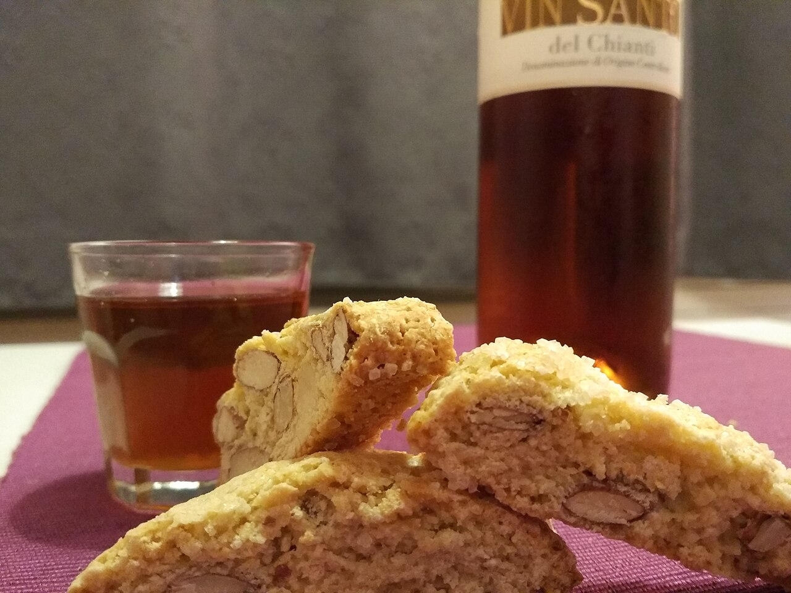

# Vin Santo

Vin Santo is a dried-grape wine of central Italy, above all Tuscany: grapes are dried in a ventilated space to concentrate sugar, fermented slowly, then aged for years in small wooden casks. The wine is gold-amber, with dried apricot, raisin, fig, honey, nut and caramel notes, and it is traditionally served with cantucci almond biscuits.

Figure: Vin Santo: Vin santo (Wikimedia Commons). Image: Popo le Chien, CC BY-SA 3.0, via Wikimedia Commons ([source page](https://commons.wikimedia.org/wiki/File:Vin_santo.jpg)).

## Definition and boundaries

Vin Santo is a special wine made from raisined (passito) grapes: dehydration concentrates sugar, followed by slow fermentation and long cask ageing. Tuscan Vin Santo del Chianti has held a DOC designation since 1996; neighbouring central-Italian regions produce similar wines under their own rules. It belongs to the [dessert-wine](ref:dessert-wine) family and differs from fortified wines such as Port or Sherry, where fermentation is stopped by adding spirit.

Whether a wine is Vin Santo depends on varieties, drying method, ageing length and residual-sugar style, not just the name. White Vin Santo and the Sangiovese-based Occhio di Pernice are the two common branches; the latter is deeper in colour, with firmer tannin and acidity. Its oxidative character comes from natural attic ageing and slow oxygen through small casks; it does not undergo the artificial heating (estufagem) of Madeira, and the two routes are distinct.

## History and naming

The origin of the name carries several legends. One ties it to wine used in church Mass; another tells of a Dominican monk in the 1348 plague year who used an ancestor of this wine to soothe the sick. The best-known story points to the 1439 Council of Florence: the Medici hosted a banquet for the church delegations, served a passito wine, and Cardinal Bessarion of Nicaea exclaimed "Hoc Xanthos est" — "this is the blond wine" — and those present linked xanthos with the Latin sanctus, holy, giving the name.

These narratives are legend and etymology, not verifiable history. What is documented is the Tuscan farm practice of hanging grapes in the attic (vinsantaia) and fermenting them in small casks across seasons, interwoven with family festivals and church tradition; that practice is the real historical basis. In modern times, Chianti Classico, San Gimignano, Montepulciano and other areas formed their own Vin Santo names and rules.

## Materials and process

Under the Vin Santo del Chianti rules, Trebbiano Toscano and Malvasia Bianca Lunga are the main varieties, together at least 70% of the blend, with up to 30% other local white or red grapes; where Sangiovese reaches at least 50%, the wine may be labelled Vin Santo Occhio di Pernice DOC. Grapes are selected on the vine, hand-picked into small crates and carried to the ventilated vinsantaia attic or dedicated room, laid on mats (cannicci, graticci) or hung to dry.

Drying runs from September for 3–6 months, with mouldy or damaged bunches removed through the period. The pressed must amounts to only a third to a quarter of the grape weight, thick and high in sugar. It then goes into small casks called caratelli, usually 50–200 litres, in chestnut, cherry, acacia or mulberry wood, with a little oak; the cask leaves a small air gap and is often sealed with cement. The high-sugar must ferments slowly through yeasts resident in the casks and environment, restarting and stopping across seasons, while oxidation enters slowly through the staves; this is the source of the nutty, oxidative aroma.

Ageing length is set by the rules: Vin Santo del Chianti spends at least 3 years in small wood, and Riserva versions at least 4 years. In practice many products age longer: Felsina's Chianti Classico Vin Santo rests about 7 years in the loft, and Avignonesi's Occhio di Pernice spends more than 10 years in cask. Whether the yeast finishes the sugar decides whether the finished wine is dry, off-dry or sweet; results can differ between small casks, and the winemaker blends them before bottling.

## Style and palate

A typical white Vin Santo is gold to amber, full and warm, with concentrated aroma: dried apricot, raisin, fig, date, honey, almond and walnut husk, with citrus peel, candied fruit and a faint volatile note. The entry is sweet but held up by acidity, rather than plain syrup. Occhio di Pernice is a deeper orange-red, with Sangiovese tannin, sour cherry and leather, a firmer structure, usually dry or off-dry. Style varies markedly by producer and vintage.

Under the DOC rules, white Vin Santo has a minimum 16% ABV and Occhio di Pernice a minimum 17% ABV; common commercial bottles sit around 13.5–15% ABV, so check the label. A good Vin Santo balances sweet, sour, bitter and alcohol, with clear oxidative nut notes without corruption; vinegary, mouldy or solvent notes are faults. The wine can keep evolving for years in bottle.

## Representative regions and brands

Chianti Classico is one of the most watched Vin Santo areas. Felsina, based in Castelnuovo Berardenga, blends Trebbiano, Malvasia and Sangiovese for its Vin Santo del Chianti Classico, rested about 7 years in the loft and balanced between residual sweetness and oxidative complexity. Avignonesi's Occhio di Pernice is Sangiovese-led, aged more than 10 years in cask, one of the references for dry red Vin Santo; Isole e Olena and Capezzana of Carmignano are other respected Tuscan producers.

Beyond the Chianti zone, San Gimignano, Montepulciano and several Tuscan sub-zones all produce their own Vin Santo. Between cellars, variety proportions, drying length, cask wood and ageing differ widely. Reading the DOC designation, varieties and ageing notes on the label tells you more than a vague idea of "holy wine".

## How to drink and pair

Vin Santo is traditionally an after-dinner sweet wine, served around 12–15°C, lightly cool rather than very chilled, in a white-wine or small tulip glass that leaves room for the aroma to open. The classic pairing is cantucci almond hard biscuits, dipped in the wine to soften; the almond fat and bitterness complement the sweet dried-fruit richness.

The pairing range also includes aged pecorino, gorgonzola blue cheese, panforte dried-fruit cake, dried figs, walnuts, crème caramel and nut tarts. A drier Occhio di Pernice can be treated like an Oloroso Sherry, with cured meats or nuts. Light seafood, green salads and acidic dishes do not suit a sweet Vin Santo, which would push the sweetness forward.

## Buying, storage and misreadings

Common misreadings: equating Vin Santo with a Madeira-style heated wine — both have oxidative nut notes, but Vin Santo relies on natural attic drying and small-cask oxygenation, with no artificial heating; assuming every Vin Santo is sweet — dry, off-dry and sweet versions exist; treating dark colour as long ageing — colour also comes from variety and oxidation; and taking high sugar for a quality grade.

Start with the production rule. From there, consider the strength, then the usual serving. That is how a practical judgment about Vin Santo is built.

## Further reading and see also

Categories close to Vin Santo share the drying process and sweet-wine framework: [dessert-wine](ref:dessert-wine) is the broad family it belongs to, [late-harvest](ref:late-harvest) covers grape dehydration and concentration, [oak-ageing](ref:oak) and small-cask cross-season ageing decide oxidative and wood layers, [tuscany](ref:tuscany) is its core region background, and [wine](ref:wine) gives the basic category reference.

To learn a special wine, start with the standard benchmark, then a variant that changes variety or sweetness, then a long-aged extreme; after those three steps the boundary is clearer than from definitions alone.

- Related: [dessert-wine](ref:dessert-wine), [late-harvest](ref:late-harvest), [oak-ageing](ref:oak), [tuscany](ref:tuscany), [wine](ref:wine).

**At a glance:** A sweet Tuscan “holy wine” made from dried grapes and aged in wood for years; dried apricot, honey, nuts and caramel, traditionally served with cantucci almond biscuits. 
