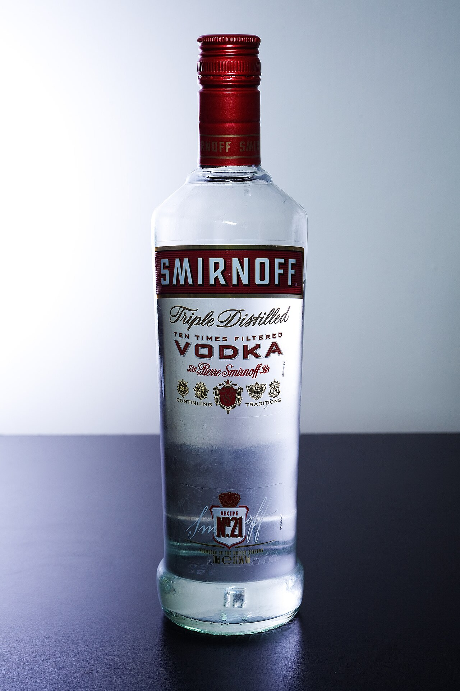

# Vodka

Vodka is a neutral spirit made from agricultural materials such as grain, potato or molasses, then fermented, [distilled](ref:distillation) and filtered or treated. It is not necessarily "completely tasteless": raw material, distillation method, filtration strength and trace residues all affect the mouthfeel, though the differences are usually subtler than in whisky or gin.

Figure: Vodka. Image: Ashley Pomeroy, CC BY 4.0, via Wikimedia Commons ([source page](https://commons.wikimedia.org/wiki/File:Smirnoff_Red_Label_8213.jpg)).

## Definition and regulation

EU regulation lists vodka as a spirit-drink category: it must be based on ethyl alcohol of agricultural origin, show the expected sensory characteristics, and be bottled at a minimum of 37.5% ABV. US rules put more emphasis on "neutrality": vodka should be without distinctive character, aroma, taste or colour after distillation or treatment, and must be bottled at a minimum of 40% ABV. The difference between the two standards shows that the definition of vodka has both a technical and a market component.

Regulation sets a floor, not a style. As long as raw material, purity and strength requirements are met, producers can still shape the product through raw material choice, the number of distillations, filtration and trace additions. Read vodka first as a target of neutrality, then see how that target is interpreted in different markets.

## Raw materials and styles

- Grain vodka: wheat, rye, corn and barley are common. Wheat tends to give soft sweetness, rye can be more peppery, and corn is fuller.
- Potato vodka: often described as rounder and fuller, with flavour depending on variety, ripeness and cooking.
- Molasses vodka: made from sugar-cane molasses at lower cost, usually more neutral and suited to large-scale production.
- Other materials: grape and whey can also be used, and regulation usually permits "other agricultural raw materials", with the label stating the source.

Raw material is not a quality grade. Both grain and potato can make high-quality vodka; the difference is style and cost structure. "Single material" is not automatically better either, and blends can be produced consistently. What consumers mainly notice is body weight, sweetness and heat.

## Production

The public process is: convert starch to fermentable sugar (mashing), ferment, distil to purify, filter, adjust strength with water and bottle. Grain needs mashing, potato needs cooking, and molasses can be diluted and fermented directly. Fermentation produces ethanol plus small amounts of esters and higher alcohols, and distillation separates these by boiling point.

Distillation is either batch pot still or continuous column. Continuous distillation is efficient and pure, and suits stable large-scale production; pot distillation retains more flavour detail but varies more between batches. Filtration usually uses activated carbon, which adsorbs some fusel alcohols and off-notes, and over-filtration can leave the body thin. Producers usually balance "clean" against "keeping a little raw-material character".

## Main categories

Vodka divides by whether flavour is added. Plain vodka emphasises neutrality and cleanliness; flavoured vodka adds fruit, herbs, honey or spices to the base and is a flavoured spirit with clearly higher sugar and flavour. The two are used differently in mixing, and the sweetness of a flavoured version should not be read as a property of vodka itself.

By region, Poland and Russia have long vodka traditions, and Sweden, Finland, the United States and France also have strong brands. Regional style is not a legal concept but an impression built by history, raw materials and markets. Compared with [gin](ref:gin), vodka is not led by botanical aroma: gin's juniper and botanical blend are the design core, while vodka pursues neutrality.

## Flavour and tasting

Vodka's aroma is usually light, with possible cereal sweetness, a slight creamy note, citrus or alcohol. The difference is clearer on entry: some are soft, some hot, some slightly sweet or bitter at the finish. Temperature changes perception markedly: low temperature suppresses heat and aroma, while room temperature makes alcohol and raw-material character more prominent.

For Vodka, taste in a small glass with a small amount: nose first, then sip and let the liquid reach the sides of the mouth and the back of the tongue, watching sweetness, heat and finish. Compare plain and flavoured versions of the same brand, or grain against potato products. Do not evaluate vodka in large swallows, because high strength quickly numbs the palate.

## Drinking and pairing

Neat vodka is usually served well chilled with salty snacks, pickles, caviar, smoked fish or richer, fattier dishes. For mixing, the Moscow Mule (vodka, ginger beer, lime), the Bloody Mary (vodka, tomato juice, spices), the vodka martini and the Cosmopolitan are all common. Because the flavour is neutral it acts as structure in the recipe, but its strength markedly changes the balance of the finished drink.

As a base, vodka suits recipes that need a clean background; if a recipe relies on the base for complex aroma, it can seem too neutral. With high-sugar mixers, control total sugar and dilution so the drink does not become cloying or too strong. With food it suits salty, sour and fatty dishes rather than delicate desserts.

## Common misconceptions

First, that vodka is completely tasteless. Raw material and process leave subtle differences, simply expressed more restrainedly.
Second, treating the number of distillations as a quality ranking. The number affects purity and style, not whether it tastes better.
Third, treating flavoured vodka as plain vodka. Flavoured products carry extra sugar and flavour, and the label says so.
Fourth, that vodka can only be drunk ice-cold and neat. It is also an important cocktail base, and the serve depends on the recipe.
Fifth, ignoring strength and volume. Both 37.5% ABV and 40% ABV are common, and the label is authoritative.

For Vodka, begin with the production rule. Then look at the strength, and finally ask the usual serving. The answers point to different choices, not to a single score.

[Distillation](ref:distillation) and [Water](ref:c-extra-1) are the nearest useful comparisons: one clarifies legal definition, the other tests materials and process.

**At a glance:** A neutral spirit distilled from grain, potato, molasses or other agricultural materials, with more flavour variation than the "colourless and tasteless" stereotype suggests.

**Read alongside.** Put Vodka next to Distillation, Gin, Water: the first fixes identity and boundary, the others provide a region, process or peer comparison. Read this style first, then return to those entries; the links become coordinates, not decoration.

**Sources and limits.** The key claims about Vodka are checked against the following sources: European Union (the vodka definition, permitted raw materials and minimum strength), U.S. Alcohol and Tobacco Tax and Trade Bureau (the US category and labelling requirements for vodka), Oxford University Press (Consulted for entries on vodka raw materials, distillation and regional styles) and 4 sources in total. Prices, batches and status change; the body is project-written and does not reproduce source text.

For Vodka, this style was last checked in 2026; prices, batches and availability change, so confirm them against the sources below.

## Further reading

- [Distillation](ref:distillation): the core step in vodka purification and flavour retention.
- [Gin](ref:gin): a spirit that also starts from neutral alcohol but aims at juniper and botanical aroma.

Further reading: [Water](ref:c-extra-1).
